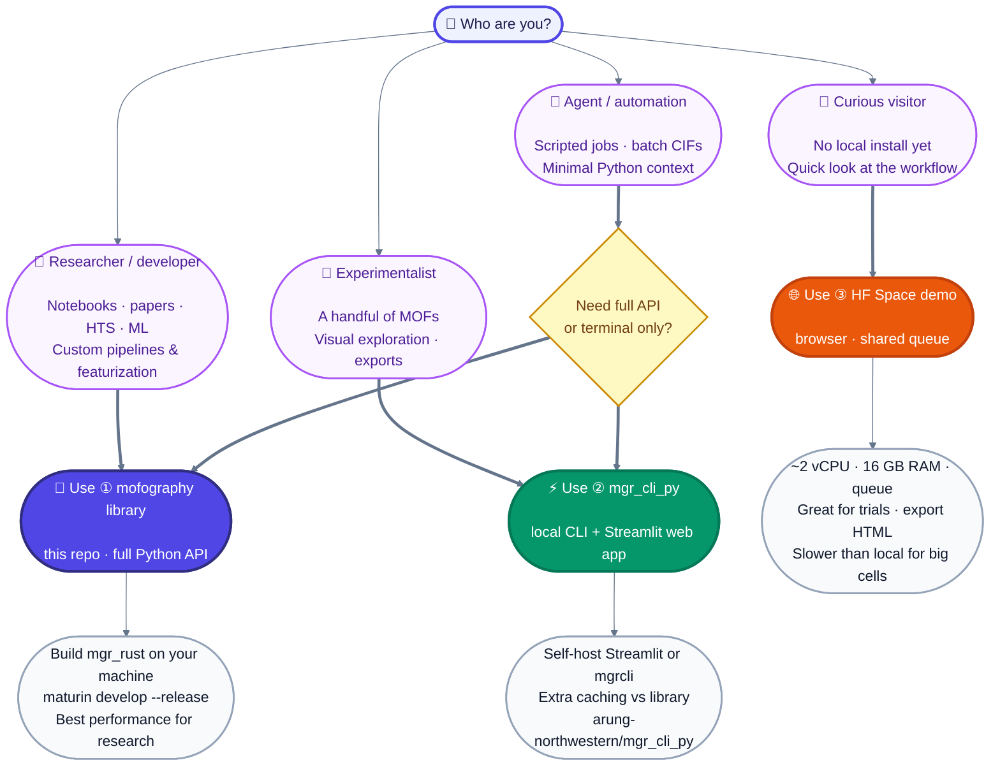

mofography
==========

[](LICENSE)
[](https://github.com/mofography/mofography/releases)
[](docs/releases-and-citing.md)
[](https://arung-northwestern-mofography-web-demo.hf.space/)
[](https://mofography.github.io/mofography/)


**mofography** segments void space into pockets, builds **pore graphs**, and supports visualization and featurization for crystalline nanoporous materials (MOFs, zeolites, polymers, and related frameworks). Core numerics use a **Rust** backend (`mgr_rust`) with a **Python** API.

<p align="center">
  
</p>

**Canonical code:** [github.com/mofography/mofography](https://github.com/mofography/mofography) · **Latest release:** [2026.10.09.1](https://github.com/mofography/mofography/releases/tag/2026.10.09.1) · branch `master`

---

## Who should use what?

Pick your path by **role**, then use the matching tool. The **library** (this repo), **[`mgr_cli_py`](https://github.com/arung-northwestern/mgr_cli_py)** (CLI + self-hosted Streamlit), and the **[Hugging Face demo](https://arung-northwestern-mofography-web-demo.hf.space/)** share the same core science.



| | **① Library (this repo)** | **② CLI + web app (`mgr_cli_py`)** | **③ Public web demo (HF)** |
|---|---------------------------|-------------------------------------|----------------------------|
| **Best for** | Papers, notebooks, HTS, custom analysis | A few structures, interactive UI, automation without full env | Try before you install |
| **Install** | Clone + build `mgr_rust` ([below](#install-the-library)) | Separate repo; `pip install -e .` + Rust ([mgr_cli_py README](https://github.com/arung-northwestern/mgr_cli_py)) | None — [open demo](https://arung-northwestern-mofography-web-demo.hf.space/) |
| **Performance** | **Fastest** on your hardware (`maturin develop --release` tuned to your CPU) | Fast locally; extra caching vs library | Shared **queue**, **~2 vCPUs** — often slower than local; **16 GB RAM** helps large cells |
| **Maintainer** | [mofography](https://github.com/mofography/mofography) org | Personal repo — [**arung-northwestern/mgr_cli_py**](https://github.com/arung-northwestern/mgr_cli_py) (will go public; PRs via maintainer) | Hosted demo only |
| **AI / agents** | Import `mofography` in code | **`mgrcli`** subprocess — no notebook context | Not for batch/agent pipelines |

> **Tip:** For serious work on medium/large cells, prefer **①** or **②** on your machine. Use **③** to explore the UI and export HTML; expect waiting in queue at busy times.

**Self-hosted web app:** clone [`mgr_cli_py`](https://github.com/arung-northwestern/mgr_cli_py), install, then run Streamlit interactive mode (see that repo’s README). It is **not** the same package as `pip install mofography` from this tree.

---

## Cite this code

- **Software:** release tag **`2026.10.09.1`** + commit hash — [docs/releases-and-citing.md](docs/releases-and-citing.md), [CITATION.cff](CITATION.cff).
- **Paper:** *Advanced High-Throughput Characterization of Nanoporous Materials using Pore Graphs* — Arun Gopalan, Chao Zheng, Behnam Azdapour, Kaihang Shi, Lev Sarkisov.  
  **arXiv:** *link when posted* (`PLACEHOLDER_ARXIV_ID` — [docs/PAPER_METADATA_TODO.md](docs/PAPER_METADATA_TODO.md)).

```python
import mofography as m
print(m.__version__, m.__git_revision__)
```

---

## Install the library

This repository is the **full Python package**. There is no PyPI wheel yet: you install dependencies, compile **`mgr_rust`** with [maturin](https://www.maturin.rs/) in **release** mode (important for speed on your CPU), then `pip install -e .`.

**Python:** 3.10–3.12 (3.11 recommended) · **Rust:** [rustup](https://rustup.rs/) · **OS:** Linux, macOS, Windows (see PowerShell script)

**Pin a paper/release checkout (optional):**

```bash
git clone https://github.com/mofography/mofography.git && cd mofography
git checkout 2026.10.09.1
```

### One command (Linux / macOS)

**A. Fresh sandbox with [uv](https://github.com/astral-sh/uv)** (creates `.venv` in the clone):

```bash
curl -fsSL https://raw.githubusercontent.com/mofography/mofography/master/scripts/install_mofography.sh | bash -s -- --mode uv-sandbox
```

**B. Active conda / venv** (installs into the Python you already activated):

```bash
curl -fsSL https://raw.githubusercontent.com/mofography/mofography/master/scripts/install_mofography.sh | bash -s -- --mode pip-existing
```

Pin a release in the one-liner:

```bash
curl -fsSL https://raw.githubusercontent.com/mofography/mofography/master/scripts/install_mofography.sh | bash -s -- --mode uv-sandbox --ref 2026.10.09.1
```

From an existing clone: `./scripts/install_mofography.sh --mode uv-sandbox` or `--mode pip-existing --repo-dir .`

### Windows (PowerShell)

```powershell
git clone https://github.com/mofography/mofography.git
cd mofography
git checkout 2026.10.09.1   # optional
.\scripts\install_mofography.ps1
```

### Manual steps (any OS)

```bash
conda create -n mgr_env python=3.11 -y && conda activate mgr_env   # or your venv
conda install -c conda-forge pymatgen ase dask networkx scikit-image scikit-learn plotly freud rdkit -y

git clone https://github.com/mofography/mofography.git && cd mofography
python -m pip install maturin
cd mgr_rust && maturin develop --release && cd ..
python -m pip install -e .
```

**Verify:** `python -c "import mgr_rust, mofography as m; print(m.__version__)"`

After `git pull`, rebuild Rust: `cd mgr_rust && maturin develop --release`

More detail: [docs/rust_backend_documentation.md](docs/rust_backend_documentation.md), [docs/install.qmd](docs/install.qmd).

We do **not** ship prebuilt `mgr_rust` wheels per OS — local `--release` builds match your machine best.

---

## Quick test

```python
import mofography as mgr
from ase.io import read

atoms = read("examples/TestCIFs/P1-IRMOF-1.cif")
figures = mgr.quick_cluster(atoms)
```

Interactive **Three.js HTML** is not stored in this repo; export from the **web demo** or [`mgr_cli_py`](https://github.com/arung-northwestern/mgr_cli_py), or regenerate with `examples/gen_*_threejs.py`.

---

## Tutorials & documentation

Tutorials are first-class: Jupyter notebooks and Quarto pages live under [`docs/`](docs/). The site is built with **Quarto** (+ **quartodoc** API reference) into `docs/_site/`:

```bash
cd docs && quarto render
open _site/index.html    # macOS; or use a local static server
```

**Planned public URL (GitHub Pages when `mofography/mofography` is public):** [https://mofography.github.io/mofography/](https://mofography.github.io/mofography/) — the Docs badge above will point there after deploy. Until then, render locally or browse notebook sources on GitHub under `docs/`.

### Basic tutorials (recommended order)

1. [Quick cluster](docs/quick_cluster.ipynb) — end-to-end workflow
2. [Basic structure analysis](docs/basic_structure_io.ipynb)
3. [Basic structure visualization](docs/quick_structure_visualization.ipynb)
4. [Distance grid](docs/distance_grid.ipynb)
5. [Region segmentation](docs/region_segmentation.ipynb)
6. [Applying periodic boundary conditions](docs/applying_pbc.ipynb)
7. [Region adjacency graph (RAG)](docs/region_adjacency_graph.ipynb)
8. [Connections and windows](docs/connections_and_windows.ipynb)
9. [Pocket type detection](docs/pockets_detection.ipynb)

### Advanced tutorials

- [Advanced structure visualization](docs/framework_visualization_example.ipynb)
- [Framework subset visualization](docs/plot_subset_as_mesh_tutorial.ipynb)
- [PLD and percolation history](docs/pld_and_percolation.ipynb)
- [Compute pore diameters](docs/compute_pore_diameters.ipynb)
- [MOFDB example](docs/mofdb_example.ipynb)
- [High-throughput characterization](docs/hts_using_mofography.ipynb)
- [Periodic segmentation Rust vs Python (HTS)](docs/hts_periodic_seg_benchmark.ipynb)
- [Functional group detection](docs/detect_functional_groups_in_dataset.ipynb)
- [Graph convolutional network (GCN) on RAGs](docs/graph_convolution_on_rags_ccr.ipynb)

Quarto guides (not only `.ipynb`): [install](docs/install.qmd), [CLI quick start](docs/cli_quickstart.qmd), [learn hub](docs/learn.qmd), [API reference](docs/reference/index.qmd).

---

## Releases & metadata

Calendar-version tags and collaborator citations: [docs/releases-and-citing.md](docs/releases-and-citing.md). Maintainer TODOs (arXiv, Zenodo, `mgr_cli_py` links): [docs/PAPER_METADATA_TODO.md](docs/PAPER_METADATA_TODO.md).

---

## Copyright

Copyright © 2022–2026, Arun Gopalan and contributors. [BSD-3-Clause](LICENSE).

Scaffolding from the [MolSSI Python Cookiecutter](https://github.com/molssi/cookiecutter-cms).
