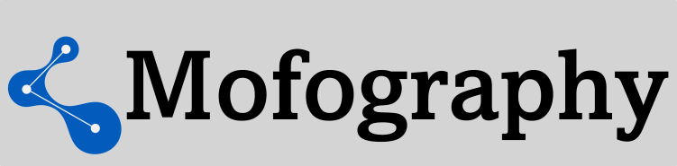

mofography 🧪🔬
==============================
[//]: # (Badges)
[](https://github.com/REPLACE_WITH_OWNER_ACCOUNT/mofography/actions?query=workflow%3ACI)
[](https://codecov.io/gh/REPLACE_WITH_OWNER_ACCOUNT/mofography/branch/master)

<!-- Add logo -->

<!--  -->
<!--  -->


A powerful Python package for the analysis, visualization, featurization, and machine learning on molecular pores in nanoporous materials. 🔍🧠

## Trying out mofography 🚀

*Note: In all the steps below, feel free to replace `conda` with `mamba`, as it is much faster at resolving dependencies and installing packages. To install mamba use `conda install -c conda-forge -n base mamba`*

You can simply try out mofography after installing just the dependencies. In fact, we recommend this approach, since mofography is still in active development.

### 1. Set up the environment 🛠️

Create a new conda environment with Python 3.9:

```bash
conda create -n mgr_env python=3.9
conda activate mgr_env
```

### 2. Install dependencies 📦

Using conda:

```bash
conda install -c conda-forge pymatgen ase dask dask-jobqueue networkx scikit-image tqdm aiohttp icecream sparse scikit-learn rich trimesh pyvista plotly furl requests freud nbformat cupy
```

=======
Using pip:

```bash
pip install pymatgen ase dask dask-jobqueue networkx scikit-image tqdm aiohttp icecream sparse scikit-learn rich trimesh pyvista plotly furl requests freud-analysis cupy
```

*Note*: If you don't have a GPU, exclude `cupy` from the list of dependencies.

### 3. Clone the repo 📥

Download the zip file or use git:

```bash
git clone https://github.com/arung-northwestern/mofography.git
```

If you already have a cloned repo, update it:

```bash
cd mofography
git pull
```

### 4. Add mofography to your Python path 🐍

In your scripts and notebooks, add:

```python
import sys
import os
sys.path.append(os.path.abspath('path_to_mofography'))
```

Replace `path_to_mofography` with the relative path to the mofography directory on your local machine.

### 5. Test the package 🧪

Try a full clustering workflow with default parameters on the IRMOF-1 structure:

```python
import mofography as mgr
from ase.io import read
mat_atoms = read('path_to_mofography/examples/TestCIFs/P1-IRMOF-1.cif')
figures = mgr.quick_cluster(mat_atoms)
```

## Tutorials 📚

Find tutorials in the [Docs](https://arung-northwestern.github.io/mofography/docs) section. Here's a recommended order:

### Basic tutorials 🌱

1. [Quick cluster](docs/quick_cluster.ipynb): Get a feel for the whole thing
2. [Basic structure analysis](docs/basic_structure_io.ipynb): Learn fundamental structure analysis techniques
3. [Basic structure visualization](docs/quick_structure_visualization.ipynb): Explore simple visualization methods
4. [Distance grid](docs/distance_grid.ipynb): Calculate and visualize distance grids
5. [Region segmentation](docs/region_segmentation.ipynb): Understand how to segment regions in materials
6. [Applying Periodic Boundary Conditions](docs/applying_pbc.ipynb): Master PBC concepts
7. [Region Adjacency Graph (RAG)](docs/region_adjacency_graph.ipynb): Dive into pore graph analysis
8. [Connections and windows](docs/connections_and_windows.ipynb): Detect windows in materials
9. [Pocket type detection](docs/pockets_detection.ipynb): Identify different types of pockets

### Advanced tutorials 🚀

These can be completed in any order after finishing the basic tutorials:

- [Advanced structure visualization](docs/framework_visualization_example.ipynb): Explore complex visualization techniques
- [Framework subset visualization](docs/plot_subset_as_mesh_tutorial.ipynb): Learn to visualize specific parts of frameworks
- [PLD and percolation history](docs/pld_and_percolation.ipynb): Analyze pore limiting diameter and percolation
- [Compute pore diameters](docs/compute_pore_diameters.ipynb): Compare MOFography vs MOFDB (zeo++) in high-throughput computations
- [MOFDB example](docs/mofdb_example.ipynb): Grab a dataset from MOFDB and perform workflow on random materials
- [High-throughput characterization](docs/hts_using_mofography.ipynb): Construct pore graphs for IZA dataset using Mofography and Dask
- [Functional group detection](docs/detect_functional_groups_in_dataset.ipynb): Identify functional groups/moieties in datasets like CoREMOF
- [Graph Convolutional Neural Network (GCN)](docs/graph_convolution_on_rags_ccr.ipynb): Train a GCN on RAGs to predict hydrogen adsorption

## Copyright ©️

Copyright (c) 2022, Arun Gopalan

### Acknowledgements 🙏

Project based on the 
[Computational Molecular Science Python Cookiecutter](https://github.com/molssi/cookiecutter-cms) version 1.6.
