Figures from the mofography paper (abridged captions). Each panel is reproduced from the manuscript.

### Workflow and example materials

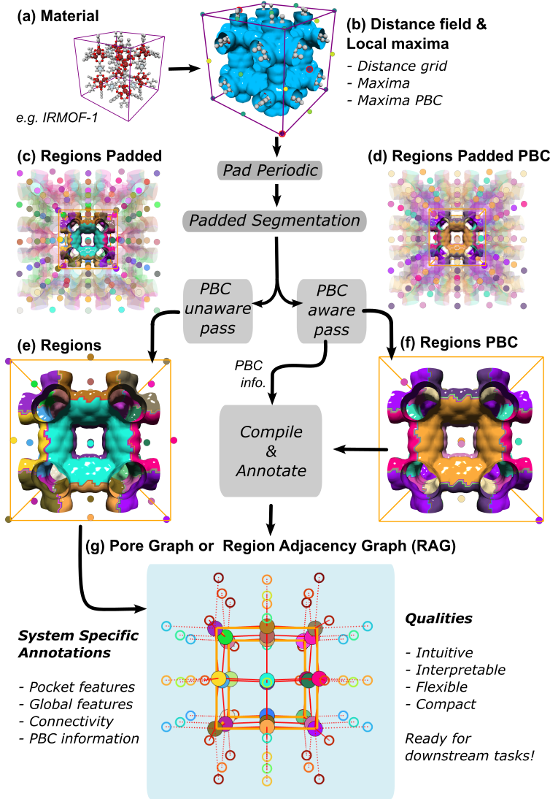

**Pipeline.** (a) input crystal and central cell, (b) signed distance field and local maxima, (c, d) PBC-unaware and PBC-aware watershed segmentation on the padded structure, (e, f) central-cell `regions` and `regions_pbc`, (g) the annotated pore graph (region adjacency graph). In (e) and (f) the isosurface is colored by pocket; partial pockets on cell boundaries that belong to the same pocket share a color.

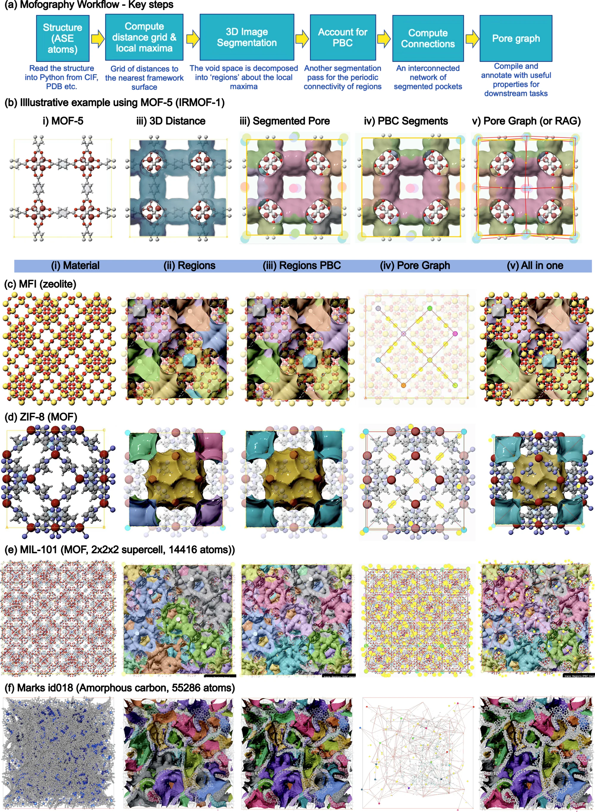

**Core workflow on representative materials.** Rows (a) and (b) give the workflow overview on IRMOF-1. Rows (c) to (f) apply it to MFI zeolite, ZIF-8, MIL-101, and MarksId-018. Columns show the framework, segmented regions without PBC, segmented regions with PBC, and the pore graph with windows.

### Global textural properties

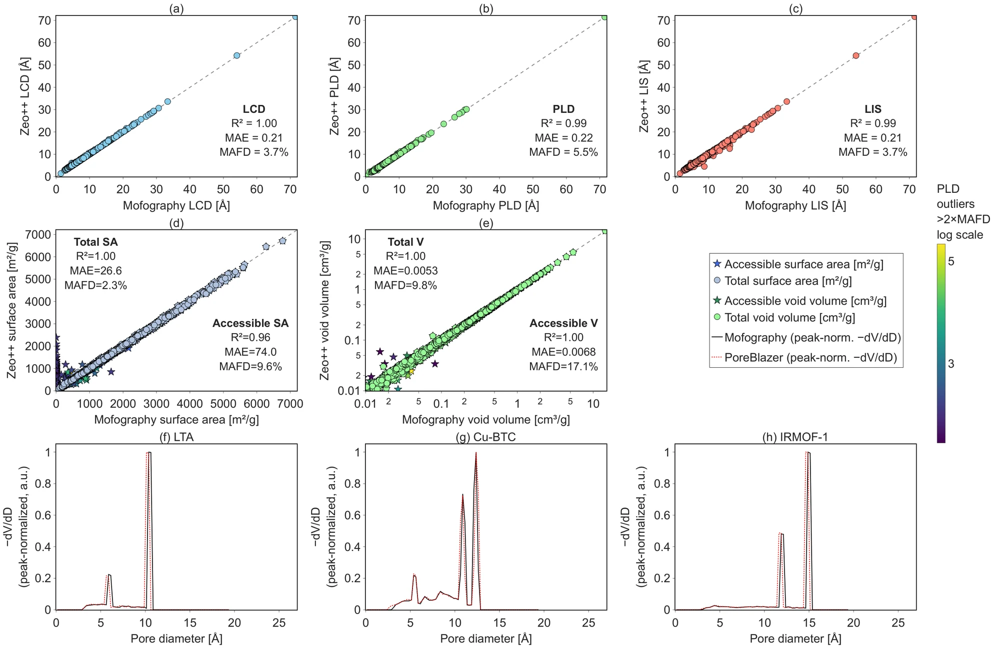

**Benchmark against Zeo++ and PoreBlazer** on 1,999 CoRE (2019) MOFs: (a) LCD, (b) PLD, (c) LIS along percolating pathways, (d) surface area, (e) void volume, and (f) to (h) global pore size distributions for LTA, Cu-BTC, and IRMOF-1.

### Pocket-wise properties

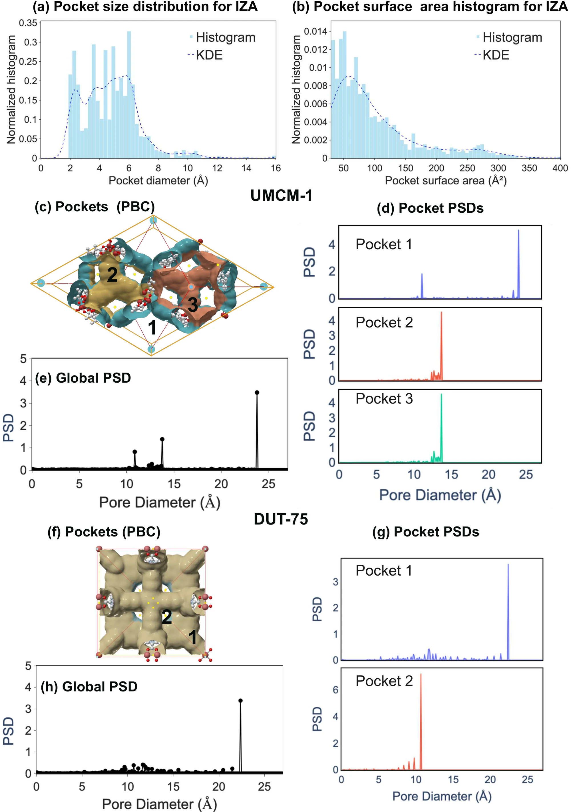

**Pocket-wise textural properties.** (a) Pocket-diameter distribution for the IZA all-silica zeolite database. (b) Pore-level surface areas from the Monte Carlo shell estimator at a 1.2 Å probe radius. (c) to (h) Global and pocket-wise PSDs for UMCM-1 and DUT-75, where the global PSD hides distinct pocket families.

### Pocket types

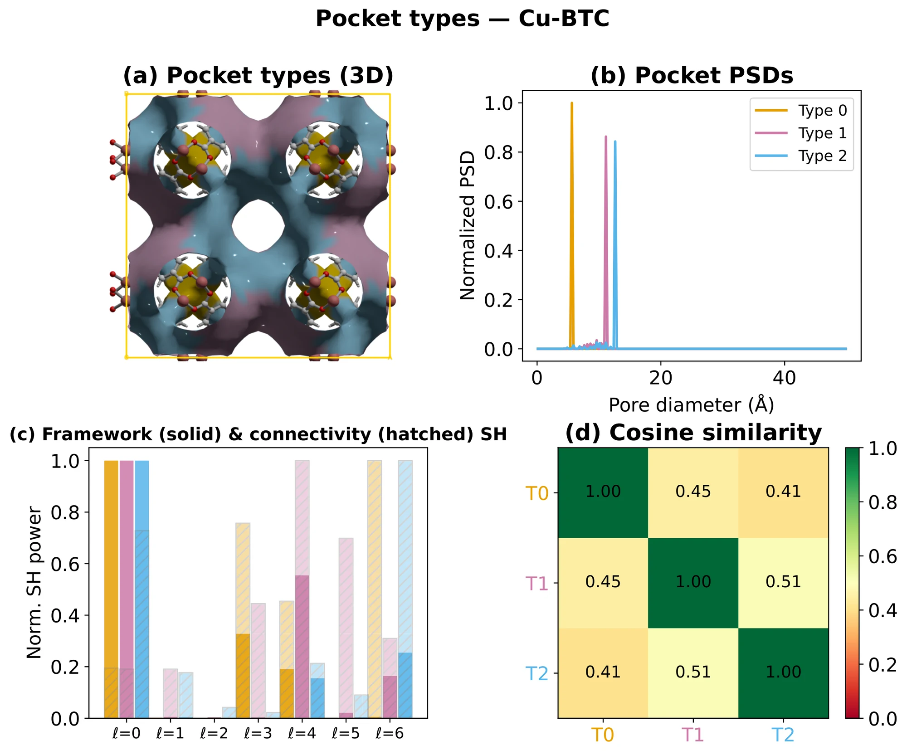

**Pore type detection for Cu-BTC.** (a) Segmentation colored by pocket type. (b) Pocket PSDs for the three detected types. (c) Framework and connectivity spherical-harmonic power. (d) Pairwise fingerprint cosine matrix. Cu-BTC is a straightforward case where size alone separates the three types.

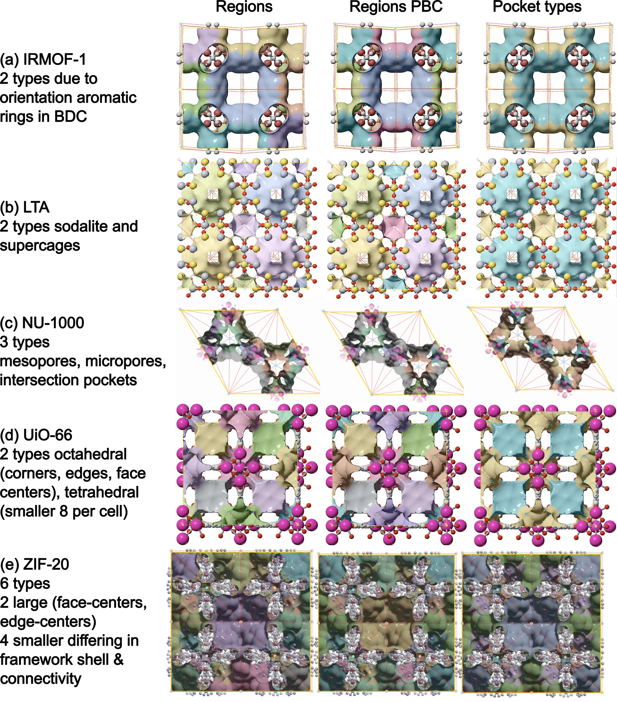

**Regions, PBC-aware regions, and pocket types** for (a) IRMOF-1, (b) LTA, (c) NU-1000, (d) UiO-66, and (e) ZIF-20, with framework atoms and pore graphs overlaid. Connections with window diameter below 1 Å are not shown.

### Windows

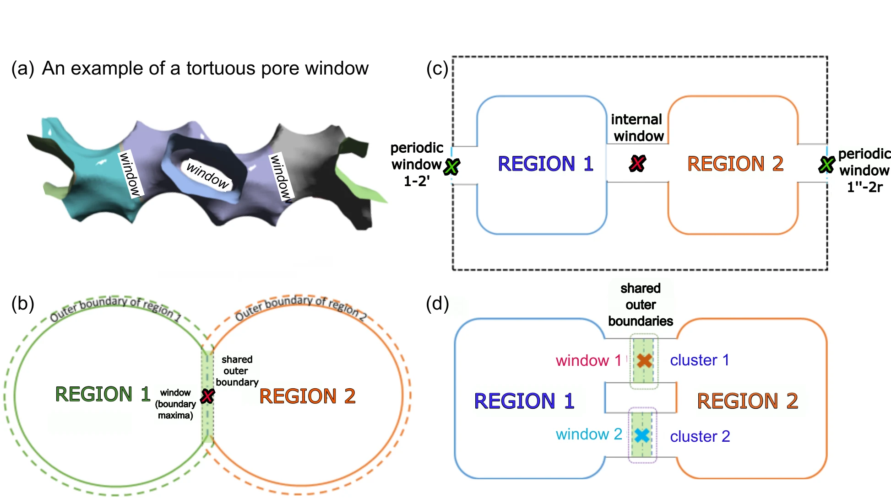

**Window detection.** (a) A tortuous pore structure where centroid-ray methods may fail. (b) to (d) The mofography algorithm and representative window cases.

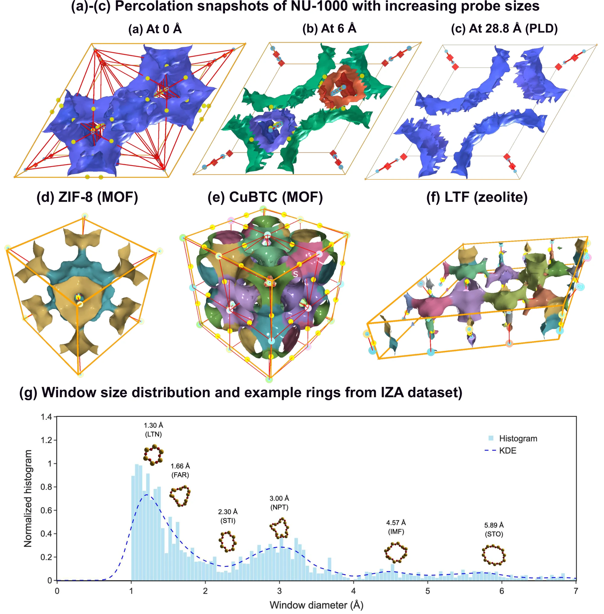

**Percolation and windows.** Top row: NU-1000 percolation snapshots at probe diameters of 0, 6, and 28.81 Å (the PLD). Middle row: pore graphs and windows for ZIF-8, HKUST-1, and LTF. Bottom: window-size distributions for the IZA zeolites.

### Pocket spacing

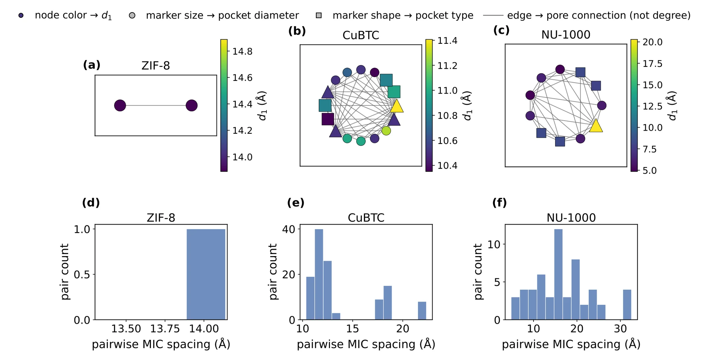

**Nearest-neighbor spacing \(d_1\) on the winding-percolation pore graph.** (a) to (c) Pore graphs for ZIF-8, Cu-BTC, and NU-1000, one node per unit-cell pocket. Node color is \(d_1\), marker area the pocket diameter, marker shape the pocket type, and grey edges join pockets that share a window. (d) to (f) Histograms of pairwise minimum-image pocket distances. ZIF-8 has a single spacing; Cu-BTC and NU-1000 show multiple pocket families.

### Pocket shape matching

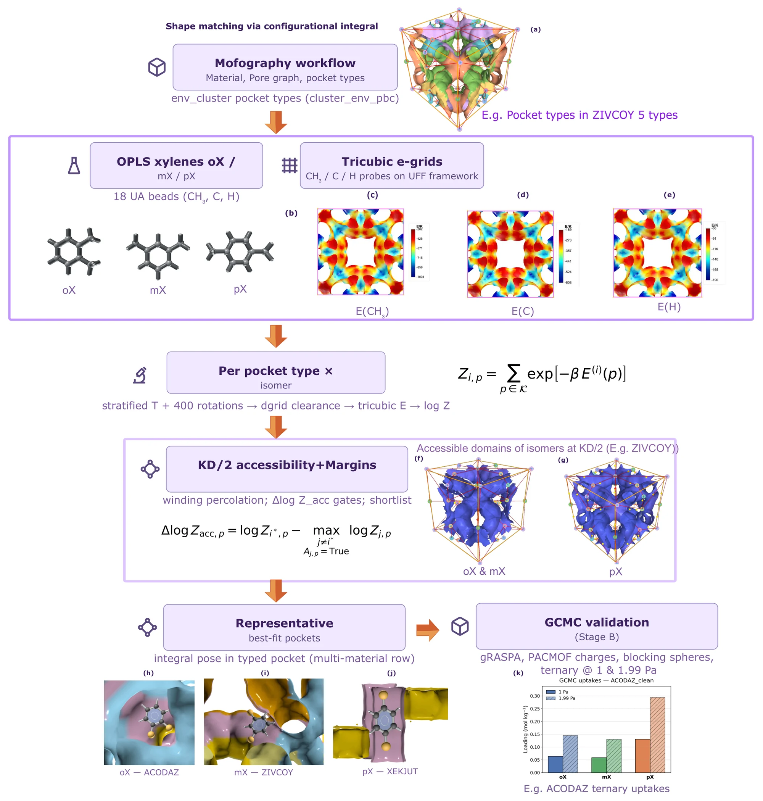

**Shape-matching workflow for xylene isomers on CoRE MOFs.** (a) Pocket segmentation and pore types. (b) Xylene models. (c) to (e) Tricubic van der Waals energy surfaces for CH\(_3\), C, and H probes. (f) and (g) Winding-percolation accessible domains at half the isomer's kinetic diameter. (h) to (j) Best-fit poses for oX, mX, and pX. (k) Confirmation against ternary-mixture GCMC.

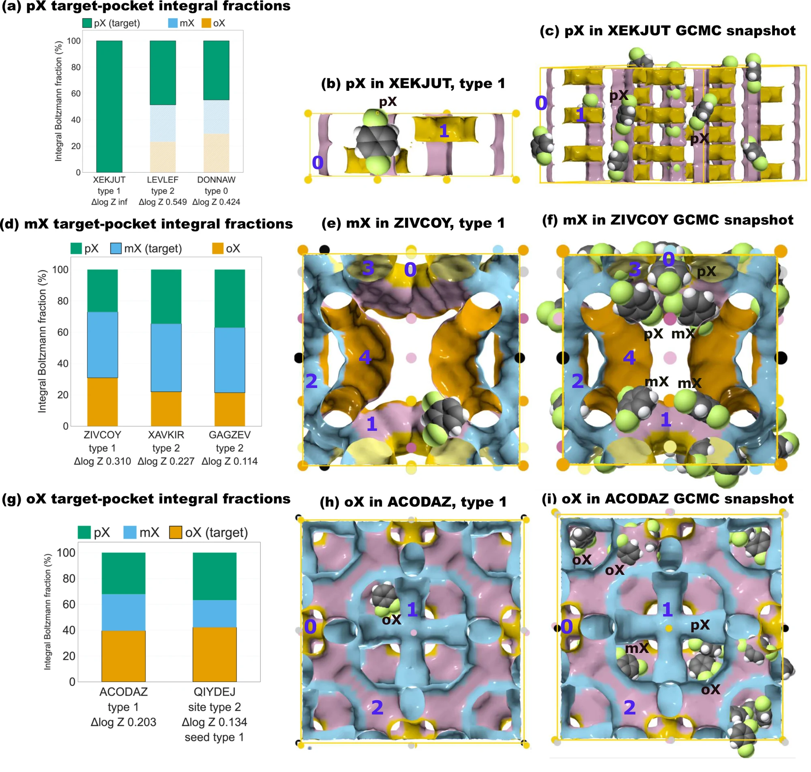

**Xylene shape-matching results.** Integral bar charts, best-pocket views, and all-isomer GCMC snapshots for pX, mX, and oX target pockets. Isomers that cannot percolate to a pocket at their KD/2 threshold are hatched and faded.
