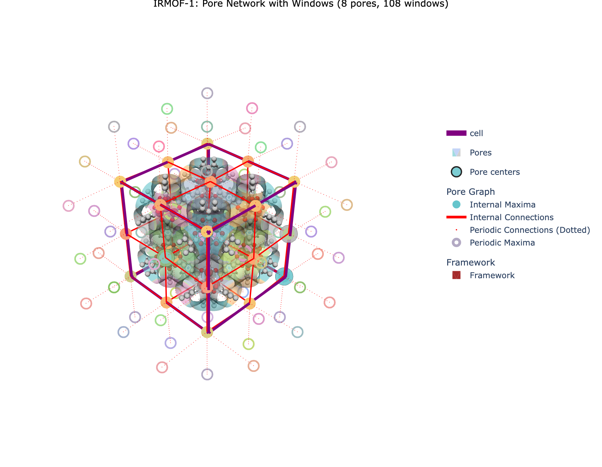
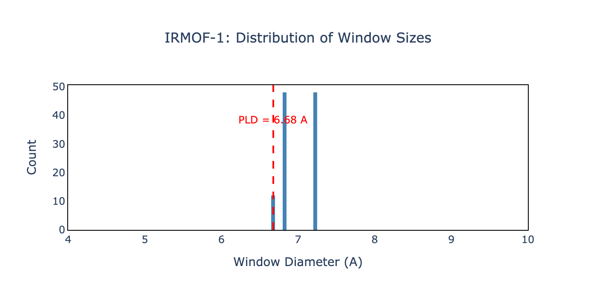

# Analyzing Pore Connections and Windows

> **A guide to understanding pore windows and their properties**

---

## Related Documentation

This is part of the MOFography tutorial series:
- [Periodic Segmentation Quick Start](periodic_segmentation_quick_start.md) - Complete workflow
- [Pore Graph](pore_graph.md) - Building and analyzing pore networks
- [Region Segmentation](region_segmentation.md) - Segmentation fundamentals

---

## What Are Pore Windows?

**Pore windows** (also called **connections** or **neck regions**) are the narrow passages that connect neighboring pores in a crystalline material.

### Why Windows Matter 🚪

1. **Transport Control** 🚗
   - Windows control molecular diffusion through the material
   - Size selectivity for gas separation applications

2. **Pore Limiting Diameter (PLD)** 📏
   - The smallest window diameter determines which molecules can pass
   - Critical for molecular sieving applications

3. **Energy Barriers** ⚡
   - Smaller windows create higher diffusion barriers
   - Affects kinetic selectivity in separations

### The Core Concept 🧠

A window is defined as the **centroid of points in the shared boundary** of two adjacent pore regions.

```
Pore Space                    Windows (Necks)
    ┌───┐                        ┌───┐
    │   │    ← Window →          │   ║
    │ ● │──────────────●         │ ●━╋━●
    │   │                        │   ║
    └───┘                        └───┘
  Two connected pores        Passage between them
```

---

## Key Concepts

### Internal vs. Periodic Windows

Windows can be located in two ways:

| Type | Description | In Pore Graph |
|------|-------------|---------------|
| **Internal** | Fully within the unit cell | Edge between nodes |
| **Periodic** | Crosses unit cell boundary | Edge with offset |

*(Schematic showing internal vs periodic windows coming soon)*

### Multiple Windows Between Regions

A single pair of pores may have **multiple windows** connecting them. MOFography:
- Detects spatially separated windows (≥1Å apart)
- Uses agglomerative clustering of boundary points
- Reports each window centroid separately

### Window Properties

For each window, MOFography computes:
- **Position** (x, y, z coordinates)
- **Radius** (window diameter / 2)
- **Connection type** (internal/periodic)

---

## ⚠️ Tutorial Scope

**This tutorial focuses on window analysis after segmentation.**

✅ **What this tutorial covers:**
- Understanding pore windows and their significance
- Extracting window information from segmentation results
- Visualizing windows in 3D
- Analyzing window size distributions

❌ **What this tutorial does NOT cover:**
- Basic segmentation workflow - see [Periodic Segmentation Quick Start](periodic_segmentation_quick_start.md)
- Graph analysis - see [Pore Graph](pore_graph.md)
- Percolation analysis - see [PLD & Percolation](pld_and_percolation.ipynb)
- Pocket detection - see [Pockets Detection](pockets_detection.ipynb)

---

## 🎓 What You'll Learn

1. ✅ Understand what pore windows represent
2. ✅ Extract window information from connections
3. ✅ Visualize windows in 3D with `plot_connections_as_it_is()`
4. ✅ Distinguish internal vs periodic windows
5. ✅ Analyze window size distributions

---

## 🔧 Prerequisites

- Python 3.8+
- MOFography installed (`uv pip install -e .`)
- [Periodic Segmentation Quick Start](periodic_segmentation_quick_start.md) completed
- [Pore Graph](pore_graph.md) completed
- NetworkX installed

---

## 📖 Step-by-Step Tutorial

### Step 1: Setup and Imports 📦

```python
import os
import sys
import numpy as np
from pathlib import Path

import mofography as mgr
from ase.io import read

repo_root = Path('/path/to/mofography')
path_to_cif = repo_root / 'examples' / 'TestCIFs' / 'P1-IRMOF-1.cif'
```

---

### Step 2: Run Periodic Segmentation 🎯

With the new workflow, **windows are computed automatically** as part of `do_periodic_segmentation_rust()`:

```python
mat_atoms = read(path_to_cif)
mat_updated = mgr.update_with_covalent_bonds(mat_atoms)

spacing = 0.5
dgrid = mgr.dgrid_from_atoms_cpu(mat_atoms, spacing=spacing, block_size=50000)
dgrid = mgr.zoom_grid(dgrid, zoom_factor=1).compute()
dgrid = mgr.periodic_gaussian_filter(dgrid, sigma=spacing*2).astype(np.float32)

results = mgr.do_periodic_segmentation_rust(
    dgrid, mat_atoms,
    spacing=spacing,
    mask_thickness=1.0,
    h=0.2,
    threshold_abs=1.5,
    minimum_window_separation=1.5,
    wall_thickness=0.08,
    extra_padding=10,
    compute_connections=True
)

print(f"✅ Found {len(results['connections'])} total connections")
```

---

### Step 3: Extract Window Information 📊

The `connections` list contains detailed information about each window:

```python
connections = results['connections']
all_maxima = results['all_maxima']
unique_regions = results['unique_regions']

# Trim to unit cell connections
connections_trimmed = np.array([
    c for c in connections
    if np.any(np.isin(c[0], unique_regions))
])

print(f"Total connections: {len(connections_trimmed)}")
```

**Connection format:** Each connection is an array with:
- `c[0]` - Region labels (two connected pores)
- `c[1]` - Confirmation flag (True/False)
- `c[2]` - Type ('internal' or 'periodic')
- `c[3]` - Window centroid coordinates
- `c[4]` - Window radius

---

### Step 4: Categorize Windows 🔄

```python
# Separate by type
internal_connections = [c for c in connections_trimmed if c[2] == 'internal']
periodic_connections = [c for c in connections_trimmed if c[2] == 'periodic']

print(f"Internal windows: {len(internal_connections)}")
print(f"Periodic windows: {len(periodic_connections)}")

# Extract window positions and radii
internal_positions = np.array([c[3].flatten() for c in internal_connections])
internal_radii = np.array([c[4][0] for c in internal_connections])

periodic_positions = np.array([c[3].flatten() for c in periodic_connections])
periodic_radii = np.array([c[4][0] for c in periodic_connections])

print(f"\nInternal window radii:")
print(f"  Min: {internal_radii.min():.3f} Å")
print(f"  Max: {internal_radii.max():.3f} Å")
print(f"  Mean: {internal_radii.mean():.3f} Å")
```

---

### Step 5: Analyze Window Statistics 📈

```python
all_radii = np.concatenate([internal_radii, periodic_radii])
all_diameters = 2 * all_radii

print("=" * 50)
print("WINDOW SIZE STATISTICS")
print("=" * 50)
print(f"Total windows: {len(all_diameters)}")
print(f"Pore Limiting Diameter (PLD): {all_diameters.min():.3f} Å")
print(f"Largest window diameter: {all_diameters.max():.3f} Å")
print(f"Mean window diameter: {all_diameters.mean():.3f} Å")
print(f"Median window diameter: {np.median(all_diameters):.3f} Å")
print("=" * 50)
```

---

### Step 6: Visualize Windows 🎨

Use `plot_connections_as_it_is()` to visualize windows:

```python
import plotly.graph_objects as go
import plotly.express as px

cscale = px.colors.qualitative.Pastel

cell_trace = mgr.plot_cell(mat_atoms)
frame_trace = mgr.plot_framework_as_mesh(mat_updated, stylize=True)

surface_trace = mgr.plot_surface_dgrid(
    dgrid, isovalue=1.5,
    region_labels=results['regions_pbc'],
    ase_atoms=mat_atoms, cscale=cscale,
    name='Pores', opacity=0.6
)

maxima_trace = mgr.plot_maxima(
    dgrid, results['maxima_pbc'], mat_atoms,
    name='Pore centers', show_spheres=False
)

windows_trace = mgr.plot_connections_as_it_is(
    connections_trimmed, all_maxima,
    dgrid.shape, mat_atoms,
    cscale=cscale,
    show_spheres=True
)

fig = go.Figure(data=[
    cell_trace, surface_trace, maxima_trace,
    *windows_trace, *frame_trace
], layout=mgr.dark_layout)

fig.update_layout(
    scene_aspectmode='data',
    title=dict(text="IRMOF-1: Pore Windows", x=0.5)
)
fig.show()

**Expected output shows:**
- Colored surfaces for pore regions
- Spheres at pore centers (maxima)
- Lines connecting pores through windows
- Windows marked at line midpoints



*The pore network of IRMOF-1 showing 8 unique pores connected by 108 windows. Blue lines show internal connections, spheres mark pore centers.*

---

### Step 7: Visualize Window Types Separately 🔍

Compare internal vs periodic windows (code example - schematic coming soon):

*(3D visualizations of internal vs periodic windows coming soon)*

---

### Step 8: Create Window Size Histogram 📊

```python
import plotly.express as px

all_diameters = 2 * np.array([c[4][0] for c in connections_trimmed])

fig3 = px.histogram(
    x=all_diameters,
    nbins=25,
    labels={'x': 'Window Diameter (A)'},
    title='IRMOF-1: Distribution of Window Sizes',
    color_discrete_sequence=['steelblue']
)

fig3.add_vline(x=all_diameters.min(), line_dash="dash", line_color="red",
               annotation_text=f"PLD = {all_diameters.min():.2f} A")
fig3.update_layout(showlegend=False)
fig3.show()
```



*The histogram shows the distribution of window diameters in IRMOF-1. The red dashed line marks the Pore Limiting Diameter (PLD), the smallest window that determines molecular access.*

**Window diameter statistics:**
- **PLD:** 6.68 A
- **Max:** 7.23 A  
- **Mean:** 7.00 A
- **Median:** 6.85 A

---

## 🛠️ Troubleshooting

| Issue | Solution |
|-------|----------|
| **No connections found** | Check `compute_connections=True` in segmentation |
| **Windows in wrong positions** | Verify `minimum_window_separation` parameter |
| **Too few windows** | Reduce `h` or `threshold_abs` in segmentation |
| **Multiple windows merged** | Increase `minimum_window_separation` |
| **Periodic windows missing** | Check `extra_padding` is large enough |

---

## 📝 Summary

| Step | What we did | Key Function |
|------|-------------|--------------|
| 1. Load structure | Read CIF file | `ase.io.read()` |
| 2. Segment | Run periodic segmentation | `do_periodic_segmentation_rust()` |
| 3. Extract | Get window information | Dictionary access |
| 4. Categorize | Separate internal/periodic | List comprehension |
| 5. Analyze | Statistics | NumPy functions |
| 6. Visualize | Plot windows | `plot_connections_as_it_is()` |

**Key Takeaway:** Use `do_periodary_segmentation_rust()` with `compute_connections=True` to get windows automatically!

---

## 🚀 Next Steps

### Learn More:
- [Pore Graph](pore_graph.md) - Build and analyze pore networks
- [Pockets Detection](pockets_detection.ipynb) - Classify pore types
- [PLD & Percolation](pld_and_percolation.ipynb) - Percolation analysis

### Advanced Analysis:
- [Percolated Paths Tutorial](percolated_paths_tutorial.ipynb) - Find transport paths
- [Winding Percolation](winding_percolation.md) - Percolation thresholds
- [Textural Properties](textural_props_methods.org) - Surface areas, void volumes

---

## 🎁 Bonus: Complete Window Analysis Script

```python
#!/usr/bin/env python3
"""
Complete window analysis workflow.
Analyzes pore windows and their properties.
"""

import numpy as np
import plotly.graph_objects as go
import plotly.express as px
from pathlib import Path

import mofography as mgr
from ase.io import read

# Setup
repo_root = Path('/path/to/mofography')
path_to_cif = repo_root / 'examples' / 'TestCIFs' / 'P1-IRMOF-1.cif'
mat_atoms = read(str(path_to_cif))
mat_updated = mgr.update_with_covalent_bonds(mat_atoms)

# Parameters
spacing = 0.5
params = {
    'mask_thickness': 1.0, 'h': 0.2, 'threshold_abs': 1.5,
    'minimum_window_separation': 1.5, 'wall_thickness': 0.08,
    'extra_padding': 10,
}

# Compute
dgrid = mgr.dgrid_from_atoms_cpu(mat_atoms, spacing=spacing, block_size=50000)
dgrid = mgr.zoom_grid(dgrid, zoom_factor=1).compute()
dgrid = mgr.periodic_gaussian_filter(dgrid, sigma=spacing*2).astype(np.float32)

results = mgr.do_periodic_segmentation_rust(dgrid, mat_atoms, spacing=spacing, **params)

# Analyze windows
connections = results['connections']
all_maxima = results['all_maxima']
unique_regions = results['unique_regions']

connections_trimmed = np.array([
    c for c in connections if np.any(np.isin(c[0], unique_regions))
])

internal = [c for c in connections_trimmed if c[2] == 'internal']
periodic = [c for c in connections_trimmed if c[2] == 'periodic']

radii = np.array([c[4][0] for c in connections_trimmed])
diameters = 2 * radii

print("=" * 50)
print("WINDOW ANALYSIS RESULTS")
print("=" * 50)
print(f"Total connections: {len(connections_trimmed)}")
print(f"  Internal: {len(internal)}")
print(f"  Periodic: {len(periodic)}")
print(f"\nWindow diameters:")
print(f"  PLD: {diameters.min():.3f} Å")
print(f"  Max: {diameters.max():.3f} Å")
print(f"  Mean: {diameters.mean():.3f} Å")
print("=" * 50)

# Visualization
cscale = px.colors.qualitative.Pastel
fig = go.Figure(data=[
    mgr.plot_cell(mat_atoms),
    mgr.plot_surface_dgrid(dgrid, isovalue=1.5, region_labels=results['regions_pbc'],
                          ase_atoms=mat_atoms, cscale=cscale, opacity=0.6),
    *mgr.plot_connections_as_it_is(connections_trimmed, all_maxima, dgrid.shape,
                                   mat_atoms, cscale=cscale, show_spheres=True),
    mgr.plot_maxima(dgrid, results['maxima_pbc'], mat_atoms, show_spheres=False),
    *mgr.plot_framework_as_mesh(mat_updated, stylize=True),
], layout=mgr.dark_layout)

fig.update_layout(scene_aspectmode='data',
                  title=dict(text="Pore Window Analysis", x=0.5))
fig.write_html('window_analysis_results.html')
print("Saved: window_analysis_results.html")

Happy window analyzing! 🎊
