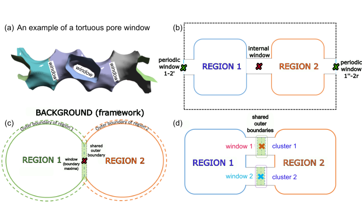
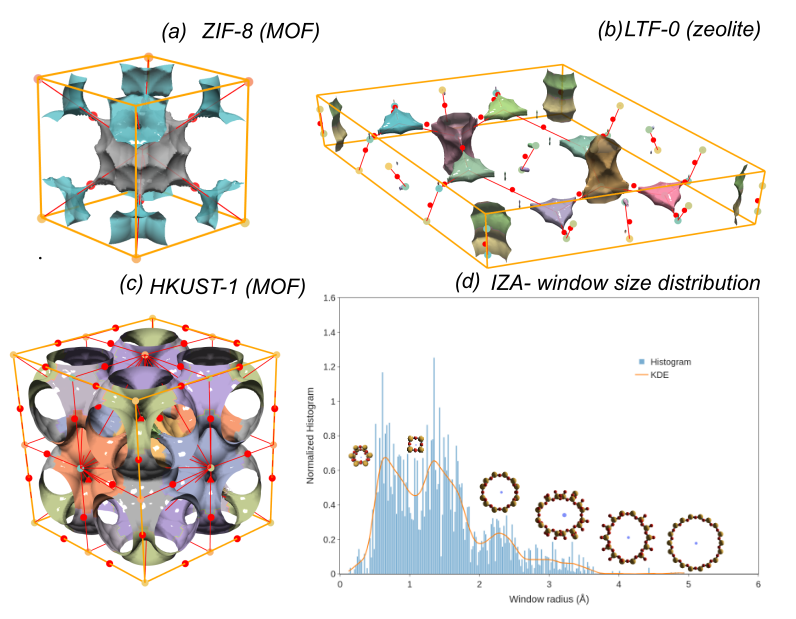

{width=100%}

{width=100%}

## Overview

**Pore windows** (also called **connections** or **neck regions**) are the narrow passages that connect neighboring pores in a crystalline material. In `mofography`, every connection in the segmentation result is a *5-tuple* describing two touching regions, the type of contact, the window centroid, and the window radius.

In this tutorial we will:

1. Run a **single-call** periodic segmentation with `compute_connections=True` so that windows are detected automatically.
2. Inspect `seg['connections']` — the list of 5-tuples describing every window.
3. Trim to **unit-cell** connections and split them into *internal* vs *periodic*.
4. Compute window-size statistics, including the **Pore Limiting Diameter (PLD)**.
5. Visualize everything interactively with `show_mof_plotly(seg, atoms, ...)`, which already includes window markers.

If you have not done so, please complete the [Quick Start: Full MOF Pore Analysis](quick_cluster.qmd) tutorial first — the rest of the page assumes you have run a segmentation and have a `seg` dict in hand.

## Why windows matter

- **Transport control** — windows gate molecular diffusion through the material. Their size distribution dictates selectivity in gas-separation MOFs.
- **Pore Limiting Diameter (PLD)** — the *smallest* window in a continuous path determines which molecules can pass.
- **Energy barriers** — narrow windows create higher diffusion barriers and influence kinetic selectivity.
- **Connectivity of the pore graph** — each window is an edge in the region-adjacency graph (RAG).

### How windows are defined

A window is the **centroid of points in the shared boundary** of two adjacent pore regions. The detection algorithm distinguishes two contact types:

| Type | Description | In pore graph |
|------|-------------|---------------|
| **Internal** | Both regions lie fully inside the unit cell | Edge between nodes |
| **Periodic** | One region sits across a unit-cell boundary | Edge with an offset |

When two regions touch at *multiple* distinct points, `mofography` reports each window separately. The minimum spatial gap between two distinct windows is controlled by the `minimum_window_separation` parameter (Å). Internally this is an agglomerative-clustering distance threshold on the boundary points.

## Imports and structure

```{python}
import mofography as mgr
from ase.io import read
import numpy as np
import plotly.graph_objects as go
import plotly.express as px
```

## Step 1: Compute the distance grid

`dgrid_from_atoms_rust` is the thread-parallel Rust backend — the correct choice for every cell type.

```{python}
atoms = read("IRMOF-1.cif")
spacing = 0.5  # Å — see Quick Start for trade-offs
dgrid = mgr.dgrid_from_atoms_rust(atoms, spacing=spacing)
print(f"Grid shape: {dgrid.shape} ({dgrid.size:,} voxels)")
print(f"Void max:   {dgrid.max():.1f} Å")
```

## Step 2: Periodic segmentation with windows

Set `compute_connections=True` (default) so that the same call returns both the segmentation grid **and** the window list. The relevant tuning knobs for window detection are:

- `minimum_window_separation` (Å) — distance threshold that splits boundary points into distinct windows. Default is `None`, which the function resolves internally; pass an explicit value to control window multiplicity.
- `wall_thickness` (Å) — minimum wall thickness in the void mask.
- `extra_padding` (Å) — extra padding around the unit cell so that periodic windows are not clipped.

```{python}
dgrid_f32 = dgrid.astype(np.float32)

seg = mgr.do_periodic_segmentation_rust(
    dgrid_f32, atoms,
    spacing=spacing,
    mask_thickness=0.05,        # void-space threshold (Å)
    h=0.2,                      # H-maxima persistence
    min_distance=1.5,           # min separation between distinct maxima (Å)
    threshold_abs=1.5,          # absolute threshold for maxima (Å)
    minimum_window_separation=1.5,  # Å — see "Tuning" section below
    wall_thickness=0.05,        # Å
    extra_padding=5,            # Å — PBC padding for window detection
    compute_connections=True,   # detect windows + build pore graph
    watershed_backend="rust_det",
    disable_tqdm=True,
)

print(f"Pockets (PBC-grouped): {len(seg['maxima_pbc'])}")
print(f"Unique regions:        {len(seg['unique_regions'])}")
print(f"Window connections:    {len(seg['connections'])}")
```

## Step 3: Inspect `seg['connections']`

The `connections` entry is a list of `numpy` arrays, one per window. Each array has five elements:

| Index | Meaning |
|-------|---------|
| `c[0]` | Two region labels that the window connects |
| `c[1]` | Confirmation flag (currently always `True` for a detected window) |
| `c[2]` | `'internal'` or `'periodic'` |
| `c[3]` | Window centroid coordinates (shape `(1, 3)`) |
| `c[4]` | Window radius in Å (shape `(1,)`) |

```{python}
connections = seg["connections"]
c = connections[0]
print("Type:    ", type(c).__name__)
print("Length:  ", len(c))
print("c[0] regions:", c[0])
print("c[1] flag:   ", c[1])
print("c[2] type:   ", c[2])
print("c[3] centre: ", c[3])
print("c[4] radius: ", c[4], "Å  →  diameter =", float(c[4][0]) * 2, "Å")
```

## Step 4: Trim to unit-cell connections

`do_periodic_segmentation_rust` reports every window it finds in the *padded* analysis domain, including windows between regions that only exist in the padding. To get a single, non-over-counted set of connections inside the unit cell, keep the windows that touch at least one region in `unique_regions`.

```{python}
unique_regions = seg["unique_regions"]
connections_trimmed = np.array([
    c for c in connections
    if np.any(np.isin(c[0], unique_regions))
])
print(f"All detected windows:  {len(connections)}")
print(f"Unit-cell windows:     {len(connections_trimmed)}")
```

## Step 5: Internal vs periodic windows

```{python}
internal = [c for c in connections_trimmed if c[2] == "internal"]
periodic = [c for c in connections_trimmed if c[2] == "periodic"]
print(f"Internal:  {len(internal)}")
print(f"Periodic:  {len(periodic)}")

# Window positions and radii
all_radii    = np.array([float(c[4][0]) for c in connections_trimmed])
all_centres  = np.array([c[3].flatten()  for c in connections_trimmed])
all_diameters = 2.0 * all_radii
```

## Step 6: Window-size statistics

```{python}
print("=" * 50)
print("WINDOW SIZE STATISTICS")
print("=" * 50)
print(f"Total windows:        {len(all_diameters)}")
print(f"Pore Limiting Diam.:  {all_diameters.min():.3f} Å")
print(f"Largest diameter:     {all_diameters.max():.3f} Å")
print(f"Mean diameter:        {all_diameters.mean():.3f} Å")
print(f"Median diameter:      {np.median(all_diameters):.3f} Å")
print("=" * 50)
```

The **PLD** (`min` diameter) is the smallest window in the unit cell — it is a hard upper bound on the diameter of a sphere that can diffuse through a single repeating cell of this MOF.

## Step 7: Visualize windows with `show_mof_plotly`

`show_mof_plotly` consumes the full `seg` dict, so window markers come along for the ride. There is no need to call `plot_connections_as_it_is` separately — pass `stylize=True` for a clean dark theme and `fig.show()` to render the interactive Plotly figure inline.

```{python}
fig = mgr.show_mof_plotly(
    seg, atoms,
    framework_atoms=atoms,
    stylize=True,
)
fig.update_layout(title=dict(text="IRMOF-1: Pore Windows", x=0.5))
fig.show()
```

You should see:

- coloured surfaces for the pore regions,
- spheres at pore centres (maxima),
- **markers at the windows** between regions, and
- a translucent framework mesh.

Because the figure is a Plotly `Figure`, you can rotate, zoom, and hover over each window to read its region labels, contact type, and diameter directly from the metadata baked into the trace.

## Step 8: Histogram of window diameters

A quick sanity check on the size distribution:

```{python}
fig3 = px.histogram(
    x=all_diameters,
    nbins=25,
    labels={"x": "Window diameter (Å)"},
    title="IRMOF-1: Distribution of window diameters",
    color_discrete_sequence=["steelblue"],
)
fig3.add_vline(
    x=all_diameters.min(),
    line_dash="dash",
    line_color="red",
    annotation_text=f"PLD = {all_diameters.min():.2f} Å",
)
fig3.update_layout(showlegend=False)
fig3.show()
```

For IRMOF-1 you should see a narrow, roughly symmetric peak centred near the mean diameter, with the red dashed line marking the PLD at the left tail.

## Tuning `minimum_window_separation`

This parameter is the **distance threshold** that the internal agglomerative clustering uses to split boundary points into distinct windows. Concretely:

- **Larger value** → boundary points further apart than `minimum_window_separation` Å are *not* merged → fewer, more distinct windows per region-pair.
- **Smaller value** → closer points are allowed to cluster together → fewer windows per region-pair, but each centroid is more stable.
- **Set to `None`** (default) → the function chooses a sensible internal default. Set it explicitly whenever you have a domain-specific expectation (e.g. you know two apertures must be resolved).

If the windows appear in the wrong positions, or two clearly distinct windows are being merged into one, start by adjusting `minimum_window_separation` before re-tuning `h` or `threshold_abs`.

## Troubleshooting

| Symptom | Likely cause | Fix |
|---------|--------------|-----|
| No connections found | `compute_connections=False`, or segmentation produced a single region | Re-run with `compute_connections=True`; relax `h` / `threshold_abs` |
| Windows appear in the wrong positions | Boundary points being merged across distinct apertures | Lower `minimum_window_separation` |
| Too few windows overall | Over-aggressive merging | Raise `minimum_window_separation` and/or relax `h` |
| Periodic windows clipped | Padding too small | Increase `extra_padding` |
| Window radii are noisy | Boundary points straddling multiple regions | Lower `wall_thickness` and rerun |

## Where to go next

- [Quick Start: Full MOF Pore Analysis](quick_cluster.qmd) — the canonical 3-function workflow this tutorial builds on.
- [Pore Graph (RAG)](pore_graph.md) — once you have windows, you can build the Region Adjacency Graph.
- [Pockets detection](pockets_detection.qmd) — classify each pore as a cage, channel, or dead-end pocket.

### Advanced window analysis

These notes document experimental refinements on top of the basic `connections` list:

- [Window fingerprinting](window_fingerprinting.org) — direction-invariant element-weighted fingerprints of the framework shell around each window. Used for **accessible** surface-area and void-volume curation, the `Mechanism A` / `Mechanism B` PLD distinction, optional DFSD signals, and prototype window-type detection.
- [Window refinement prototype](window_refinement.md) — distance-field-driven re-estimation of window centres and radii without relying solely on watershed boundaries.
