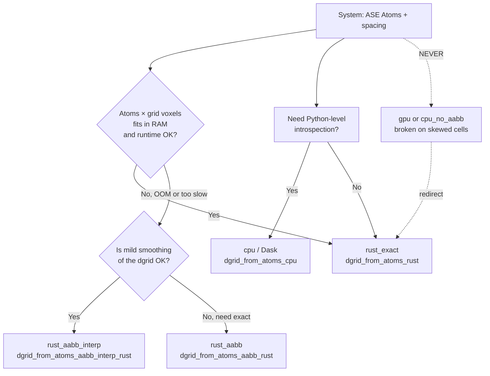

## Overview

The distance grid is the foundation of every `mofography` pore analysis — segmentation, RAG, PSD, PLD, and surface area all consume the same `dgrid` array. **Which function you call to build that array matters** because each backend trades off accuracy, memory, and runtime differently, and two of the legacy backends are *unsafe* on non-orthogonal cells.

This tutorial covers:

1. The four **active** distance grid backends and their exact signatures
2. A **decision tree** mapping system size to the right method
3. The **auto-AABB** policy the interactive app uses
4. ⚠️ The two **broken** methods to *never* use and why

If you have not done so, please complete the [Distance Grid tutorial](distance_grid.qmd) first — the rest of this page assumes you understand what a `dgrid` is and what `spacing` controls.

## The four distance grid backends

| # | Function | Strategy | Best for | Status |
|---|----------|----------|----------|--------|
| 1 | `dgrid_from_atoms_rust` | Brute-force Rust, exact MIC, thread-parallel | **All systems — default** | ✅ Active |
| 2 | `dgrid_from_atoms_aabb_rust` | R-tree (AABB) neighbor search in Rust | Large systems, memory-constrained | ✅ Active |
| 3 | `dgrid_from_atoms_aabb_interp_rust` | Coarse AABB + trilinear interpolation | Very large systems, mild smoothing OK | ✅ Active |
| 4 | `dgrid_from_atoms_cpu` | freud `AABBQuery` + Dask, Python | Legacy compatibility | ⚠️ Legacy |

::: {.callout-warning}
## ⚠️ Do NOT use these two methods
**`dgrid_from_atoms_gpu`** and **`dgrid_from_atoms_cpu_no_aabb`** are **BROKEN on non-orthogonal (skewed) cells**. They compute the minimum-image convention with per-axis `NINT`, which is *only* correct for orthogonal cells. Most MOFs (and all triclinic/monoclinic cells) violate this assumption, so these functions produce *systematically wrong* distance grids on real materials. They are kept in the codebase for legacy code paths but **must not be used in new work**. The Rust backend uses the same correct MIC path for every cell type. See the [Broken methods](#broken-methods) section for details.
:::

## Signatures

### 1. `dgrid_from_atoms_rust` — exact, brute-force

```python
dgrid_from_atoms_rust(ase_atoms, spacing, radii=None)
```

| Parameter | Type | Default | Meaning |
|-----------|------|---------|---------|
| `ase_atoms` | `ase.Atoms` | — | Framework structure |
| `spacing` | `float` | — | Grid spacing in Å |
| `radii` | `np.ndarray` or `None` | `None` | Per-atom VDW radii (Å). `None` → Bondi (1964) with Mendeleev fill |

**Returns:** `np.ndarray` of shape `(nx, ny, nz)`, signed distance to the nearest atom surface.

**Strategy:** Thread-parallel (Rayon) brute-force — every grid point is checked against every atom using an *exact* minimum-image convention. Orthogonal cells use a SIMD-optimized SoA path; skewed cells fall back to a 7-image Wassenaar construction. O(N_atoms × N_grid) work, O(N_grid) memory.

**Use when:** you want the most accurate distance grid and you have enough RAM for one float32 per voxel.

### 2. `dgrid_from_atoms_aabb_rust` — R-tree, memory-efficient

```python
dgrid_from_atoms_aabb_rust(ase_atoms, spacing, radii=None, n_neighbors=10)
```

| Parameter | Type | Default | Meaning |
|-----------|------|---------|---------|
| `ase_atoms` | `ase.Atoms` | — | Framework structure |
| `spacing` | `float` | — | Grid spacing in Å |
| `radii` | `np.ndarray` or `None` | `None` | Per-atom VDW radii (Å) |
| `n_neighbors` | `int` | `10` | Number of nearest atoms to query per grid point |

**Strategy:** Builds a Rust AABB (axis-aligned bounding box) tree on the atoms, then queries `n_neighbors` nearest atoms for every grid point under PBC. The minimum of `dist - radii[nbr]` becomes the surface distance. Memory is dominated by the R-tree, *not* by the grid → much smaller RAM footprint than brute force on large cells.

**Use when:** cells > 50 Å or atoms > 1000 and the brute-force Rust path runs out of memory. Accuracy depends on `n_neighbors`: 10 is safe for typical MOFs; reduce to 4–6 if the structure has very large open channels where the nearest atoms may be far apart, and consider whether you need 20+ for tiny-pore systems.

### 3. `dgrid_from_atoms_aabb_interp_rust` — coarse + trilinear

```python
dgrid_from_atoms_aabb_interp_rust(
    ase_atoms, spacing, coarse_factor=2, radii=None, n_neighbors=10,
)
```

| Parameter | Type | Default | Meaning |
|-----------|------|---------|---------|
| `ase_atoms` | `ase.Atoms` | — | Framework structure |
| `spacing` | `float` | — | **Fine** grid spacing in Å |
| `coarse_factor` | `int` | `2` | Coarsening factor for the AABB sampling grid (must be > 1) |
| `radii` | `np.ndarray` or `None` | `None` | Per-atom VDW radii (Å) |
| `n_neighbors` | `int` | `10` | AABB neighbor count |

**Returns:** `np.ndarray` (float32) of shape `(nx, ny, nz)` matching the *fine* `spacing`.

**Strategy:** Computes the AABB distance grid on a **coarse** grid (spacing × `coarse_factor`), then trilinearly interpolates back to the fine grid. Reduces compute by `coarse_factor³` (default 8×) and *also* acts as a mild low-pass filter. The grid shape is identical to the brute-force result, so downstream code is unchanged.

**Use when:** systems so large that even the AABB Rust path is too slow, *and* you can tolerate a slightly smoother distance field (mild trilinear averaging of nearby values). Good for HT screens where you want a ballpark PSD, less ideal for resolving sub-Å features like pore-limiting windows. Increase `coarse_factor` to 3 or 4 for very large cells; decrease toward 1 (in practice, use the plain AABB method) when you need sharper windows.

### 4. `dgrid_from_atoms_cpu` — freud + Dask, Python

```python
dgrid_from_atoms_cpu(
    ase_atoms, radii=None, spacing=0.25, block_size=50000,
    n_neighbors=10, probe_radius=0, precompute=True,
)
```

| Parameter | Type | Default | Meaning |
|-----------|------|---------|---------|
| `ase_atoms` | `ase.Atoms` | — | Framework structure |
| `radii` | `np.ndarray` or `None` | `None` | Per-atom VDW radii (Å). `None` → uses a hand-rolled Bondi table |
| `spacing` | `float` | `0.25` | Grid spacing in Å |
| `block_size` | `int` | `50000` | Dask chunk size (grid points per block) |
| `n_neighbors` | `int` | `10` | AABB neighbor count for freud query |
| `probe_radius` | `float` | `0` | Probe radius added on top of atom radii (Å) |
| `precompute` | `bool` | `True` | If `True`, call `.compute()` and return a NumPy array; if `False`, return a lazy Dask array |

**Strategy:** Builds a freud `AABBQuery` on the framework, lays out the grid as a Dask array of `block_size` chunks, and maps `gpd_aabb` (a NumPy reduction over the freud neighbor list) over every block. Uses `complete_cell().T` for the box, so the **MIC is correct on skewed cells** — this is *not* one of the broken methods.

**Use when:** you need Python-level introspection of intermediate values, are running on a machine without the Rust extension, or want lazy Dask composition with other grid ops. Performance is generally 5–20× slower than the Rust path on the same machine.

## Decision tree



### Rule of thumb

| System size (atoms × grid voxels) | Recommended method | Why |
|------------------------------------|--------------------|-----|
| < 5 × 10⁷ (small-to-medium) | `dgrid_from_atoms_rust` | Brute-force is fast enough and the most accurate |
| 5 × 10⁷ to 5 × 10⁸ (large) | `dgrid_from_atoms_aabb_rust` | AABB tree cuts memory; same accuracy as brute force |
| > 5 × 10⁸ (very large, HT screens) | `dgrid_from_atoms_aabb_interp_rust` with `coarse_factor=2` or `3` | 8–27× compute savings; smooths fine features |
| Need Python / Dask composition | `dgrid_from_atoms_cpu` | Slowest but flexible; uses correct freud MIC |

These are rough numbers — the actual crossover depends on cell shape, number of periodic images the AABB has to handle, and how much RAM you have. The auto-AABB policy in the interactive app uses a similar memory budget to switch.

## Auto-AABB policy (interactive app)

The Streamlit app (`mofography_dash` / hosted demo) does **not** expose the distance-grid method as a user knob by default. Instead it runs a two-step policy:

1. **Estimate** the float32 memory cost of the brute-force grid: `4 × nx × ny × nz` bytes.
2. **If** that estimate exceeds the configured RAM budget (default: ~512 MB), it auto-switches to `dgrid_from_atoms_aabb_rust` with `n_neighbors=10` (or to `dgrid_from_atoms_aabb_interp_rust` with `coarse_factor=2` for very large systems). A short status line in the UI tells you which backend was used.

This means the app "just works" for both IRMOF-1 and a 100-atom × 200-Å supercell, but it also means you should *check the UI output* before running a 1000-frame batch — silently hitting the AABB path on a system that needs brute-force precision can change window diameters by a few percent. The notebook and CLI surfaces do **not** auto-switch; you choose the backend explicitly.

## Setup

```{python}
import mofography as mgr
from ase.io import read
import numpy as np
import time

# Load a MOF structure
atoms = read("IRMOF-1.cif")  # 424 atoms, ~26 Å cubic cell
print(f"Loaded {len(atoms)} atoms, cell: {atoms.cell.cellpar()[:3].round(2)}")
```

## Method 1: `dgrid_from_atoms_rust` (default)

```{python}
t0 = time.perf_counter()
dgrid_exact = mgr.dgrid_from_atoms_rust(atoms, spacing=0.5)
t_exact = time.perf_counter() - t0
print(f"rust_exact:    shape={dgrid_exact.shape}, "
      f"min={dgrid_exact.min():.2f}, max={dgrid_exact.max():.2f}, "
      f"time={t_exact*1000:.0f} ms")
```

**Pros:** exact MIC for all cell types, thread-parallel, no accuracy trade-off.
**Cons:** O(N_atoms × N_grid) — memory scales with grid size.

## Method 2: `dgrid_from_atoms_aabb_rust` (memory-efficient)

```{python}
t0 = time.perf_counter()
dgrid_aabb = mgr.dgrid_from_atoms_aabb_rust(atoms, spacing=0.5, n_neighbors=10)
t_aabb = time.perf_counter() - t0
print(f"rust_aabb:     shape={dgrid_aabb.shape}, "
      f"min={dgrid_aabb.min():.2f}, max={dgrid_aabb.max():.2f}, "
      f"time={t_aabb*1000:.0f} ms")

# Agreement with exact method
print(f"max |dgrid_exact - dgrid_aabb| = {np.abs(dgrid_exact - dgrid_aabb).max():.3e}")
```

Uses a Rust AABB tree to find nearby atoms for each grid point. `n_neighbors` controls the search radius — higher = more accurate but slower. For typical MOFs, `n_neighbors=10` agrees with the exact method to ~1e-3 Å. If you see a few-voxel disagreement near a wall, raise `n_neighbors` to 16 or 20.

## Method 3: `dgrid_from_atoms_aabb_interp_rust` (very large systems)

```{python}
t0 = time.perf_counter()
dgrid_interp = mgr.dgrid_from_atoms_aabb_interp_rust(
    atoms, spacing=0.5, coarse_factor=2, n_neighbors=10,
)
t_interp = time.perf_counter() - t0
print(f"rust_aabb+int: shape={dgrid_interp.shape}, "
      f"min={dgrid_interp.min():.2f}, max={dgrid_interp.max():.2f}, "
      f"time={t_interp*1000:.0f} ms")

print(f"max |dgrid_exact - dgrid_interp| = {np.abs(dgrid_exact - dgrid_interp).max():.3e}")
```

The coarse grid is at 1.0 Å spacing (spacing × coarse_factor), and the result is trilinearly interpolated back to 0.5 Å. The interpolation step is what introduces the mild smoothing — you can see it as a slight rounding of the surface near tight windows. **Do not** crank `coarse_factor` above ~3 if you care about sub-Å window diameters; beyond that the interpolation swamps the true signal.

## Method 4: `dgrid_from_atoms_cpu` (legacy / Python)

```{python}
t0 = time.perf_counter()
dgrid_cpu = mgr.dgrid_from_atoms_cpu(atoms, spacing=0.5, block_size=50000)
t_cpu = time.perf_counter() - t0
print(f"cpu/dask:      shape={dgrid_cpu.shape}, "
      f"min={dgrid_cpu.min():.2f}, max={dgrid_cpu.max():.2f}, "
      f"time={t_cpu*1000:.0f} ms")

# Note: dgrid_from_atoms_cpu is correct on skewed cells (uses freud AABB)
print(f"max |dgrid_exact - dgrid_cpu| = {np.abs(dgrid_exact - dgrid_cpu).max():.3e}")
```

5–20× slower than the Rust path on a single thread, but the Dask graph is composable: pass `precompute=False` to get a lazy array and chain downstream reductions. This is the right entry point if you need to plug `dgrid` into an existing Dask pipeline.

## Side-by-side timing

```{python}
methods = {
    "rust_exact":     mgr.dgrid_from_atoms_rust(atoms, spacing=0.5),
    "rust_aabb":      mgr.dgrid_from_atoms_aabb_rust(atoms, spacing=0.5, n_neighbors=10),
    "rust_aabb+int":  mgr.dgrid_from_atoms_aabb_interp_rust(atoms, spacing=0.5, coarse_factor=2),
    "cpu/dask":       mgr.dgrid_from_atoms_cpu(atoms, spacing=0.5, block_size=50000),
}
ref = methods["rust_exact"]
print(f"{'method':<18}  {'shape':<14}  {'min':>7}  {'max':>7}  max|diff|")
for name, g in methods.items():
    diff = float(np.abs(g - ref).max()) if name != "rust_exact" else 0.0
    print(f"{name:<18}  {str(g.shape):<14}  {g.min():>7.2f}  {g.max():>7.2f}  {diff:.3e}")
```

## Broken methods

::: {.callout-danger}
## Two functions you must NOT use: `dgrid_from_atoms_gpu` and `dgrid_from_atoms_cpu_no_aabb`
Both compute the **minimum-image convention** with per-axis `NINT` rounding:

```python
# WRONG on a skewed cell
dx = dx - cell[0, 0] * NINT(dx / cell[0, 0])
dy = dy - cell[1, 1] * NINT(dy / cell[1, 1])
dz = dz - cell[2, 2] * NINT(dz / cell[2, 2])
```

This is **only correct for orthogonal cells** (cubic, tetragonal, orthorhombic). On a monoclinic or triclinic cell — which includes most real MOFs — the per-axis NINT picks the wrong image for some atom–grid pairs, and the distance grid develops systematic stripes near the cell walls. The bug is silent: the function returns without warning and the dgrid *looks* plausible until you compare it to the exact result.

**Use the Rust backend (`dgrid_from_atoms_rust`) instead.** Its MIC path uses a 7-image Wassenaar construction on skewed cells, which is correct for all cell types. The CPU/Dask method (`dgrid_from_atoms_cpu`, *without* the `_no_aabb` suffix) is also correct because it routes through freud's AABB query, which uses the proper box geometry.

If you see `dgrid_from_atoms_gpu` or `dgrid_from_atoms_cpu_no_aabb` in legacy code, replace the call with:

```python
# Replace dgrid_from_atoms_gpu(...)
dgrid = mgr.dgrid_from_atoms_rust(atoms, spacing=0.5)

# Replace dgrid_from_atoms_cpu_no_aabb(...)
dgrid = mgr.dgrid_from_atoms_cpu(atoms, spacing=0.5, block_size=50000)
```
:::

## Parameter guide

| Parameter | Applies to | Default | Typical range | What it controls |
|-----------|------------|---------|---------------|------------------|
| `spacing` | all | — | 0.2 – 1.0 Å | Voxel edge length. Halving → 8× voxels. |
| `radii` | all | `None` | — | Override per-atom VDW radii (Å). `None` → Bondi (1964) + Mendeleev fill. |
| `n_neighbors` | AABB, interp, CPU | `10` | 4 – 20 | Number of nearest atoms queried per voxel. |
| `coarse_factor` | interp | `2` | 2 – 4 | Coarsening of the sampling grid. |
| `block_size` | CPU | `50000` | 10k – 200k | Dask chunk size (grid points per block). |
| `precompute` | CPU | `True` | bool | `True` → return NumPy; `False` → return lazy Dask array. |
| `probe_radius` | CPU | `0` | 0 – 5 Å | Extra probe radius added on top of `radii`. |

**Tip:** Start with `dgrid_from_atoms_rust(atoms, spacing=0.5)` and only switch to AABB or interp when you hit a memory or runtime wall.

## Quick decision recap

- **Default → `dgrid_from_atoms_rust(atoms, spacing=0.5)`** — exact MIC, correct for all cell types.
- **OOM on big cell → `dgrid_from_atoms_aabb_rust(atoms, spacing=0.5, n_neighbors=10)`** — R-tree, same accuracy, less RAM.
- **HT screen / very large system → `dgrid_from_atoms_aabb_interp_rust(atoms, spacing=0.5, coarse_factor=2)`** — 8× faster, mild smoothing.
- **Python/Dask composition → `dgrid_from_atoms_cpu(atoms, spacing=0.5, block_size=50000)`** — slowest, but lazy-friendly.
- **NEVER → `dgrid_from_atoms_gpu`, `dgrid_from_atoms_cpu_no_aabb`** — broken on skewed cells.

## Next steps

- [Distance Grid tutorial](distance_grid.qmd) — basic usage, spacing tradeoffs, visualization.
- [Benchmark: Rust AABB dgrid](benchmark_rust_aabb_dgrid.md) — performance numbers across methods.
- [Region Segmentation](region_segmentation.qmd) — what happens after the distance grid.
- [Appyling Periodic Boundary Conditions](pbc_considerations.qmd) — PBC group structure on top of the segmentation.

## Related documentation

- `mofography.rust_fun.dgrid_from_atoms_rust`
- `mofography.rust_fun.dgrid_from_atoms_aabb_rust`
- `mofography.rust_fun.dgrid_from_atoms_aabb_interp_rust`
- `mofography.compute.dgrid_from_atoms_cpu` (active, correct)
- `mofography.compute.dgrid_from_atoms_gpu` (broken on skewed cells — do not use)
- `mofography.compute.dgrid_from_atoms_cpu_no_aabb` (broken on skewed cells — do not use)
