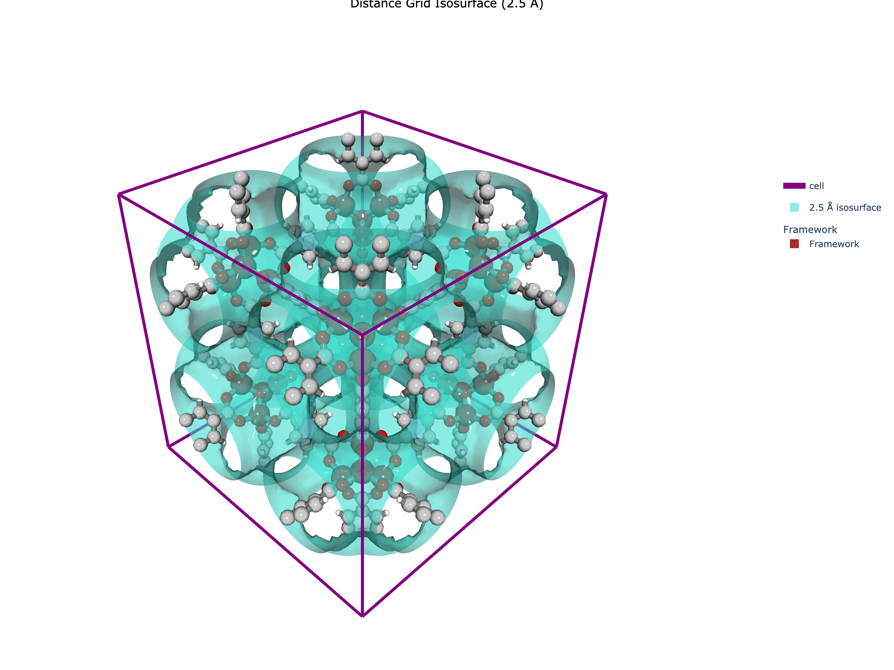

# 🌟 Computing the Distance Grid

> **A foundational tutorial on computing distance grids in MOFography - the first step in pore network analysis**

---

## 📚 Related Documentation

This is part of the MOFography tutorial series. For the main quick start guide, see:
- [Periodic Segmentation Quick Start](periodic_segmentation_quick_start.md)
- [Basic Structure I/O](basic_structure_io.md)
- [Framework Visualization](framework_visualization_example.md)

---

## 🎯 What is a Distance Grid?

At the heart of MOFography's pore analysis lies the **distance grid** - a 3D array where each voxel contains the distance to the nearest framework surface.

### Why is this Important? 🚀

The distance grid is the **foundation** for nearly all pore analysis in MOFography:

1. **Pore Detection** 📍
   - Local maxima in the distance grid = pore centers
   - Higher values = more open space (inside pores)
   - Lower values = closer to atoms (inside walls)

2. **Pore Segmentation** 🔪
   - Watershed algorithm uses distance values to assign voxels to nearest pore
   - Forms the basis of the Region Adjacency Graph (pore network)

3. **Accessibility Analysis** 🚪
   - Distance values determine window sizes between pores
   - Critical for understanding molecular transport

4. **Textural Properties** 📊
   - Pore size distributions derived from distance grid
   - Surface area and volume calculations

### How Does it Work? 🧠

**The Concept:**
1. Define a 3D grid over the unit cell
2. For each grid point, find the distance to the nearest atom
3. Subtract the atom's radius to get distance to the **surface**
4. Store this value in the grid

**Key Insight:**
- 🟢 **High values** = far from any atom (inside a pore)
- 🔴 **Low values** = close to an atom (inside the framework)
- 🎯 **Local maxima** = pore centers

---

## ⚠️ Tutorial Scope

**This is a FOUNDATIONAL tutorial** on computing distance grids.

✅ **What this tutorial covers:**
- What a distance grid is and why it matters
- Three methods for computing distance grids (CPU, GPU, Rust)
- How to choose the right method for your system
- Visualizing distance grids as isosurfaces
- Important parameters and their effects

❌ **What this tutorial does NOT cover:**
- Pore detection (finding maxima) - see [Periodic Segmentation Quick Start](periodic_segmentation_quick_start.md)
- Region segmentation (watershed) - see [Region Segmentation](region_segmentation.md)
- Pore graph construction - see [Region Adjacency Graph](region_adjacency_graph.md)

---

## 🔧 Prerequisites

- Python 3.8+
- MOFography installed (`uv pip install -e .`)
- Basic familiarity with Python and NumPy arrays
- (Optional) ASE for structure handling
- (Optional) NVIDIA GPU + CUDA for GPU method

---

## 📖 The Three Methods

MOFography offers **three ways** to compute distance grids:

| Method | Function | Best For | Speed | Memory |
|--------|----------|----------|-------|--------|
| **CPU/Dask** | `dgrid_from_atoms_cpu()` | Large systems (1000+ atoms), limited RAM | ⭐⭐ | 💾 Low |
| **GPU** | `dgrid_from_atoms_gpu()` | Medium systems with NVIDIA GPU | ⭐⭐⭐ | 🎮 GPU VRAM |
| **Rust (Exact)** | `dgrid_from_atoms_rust()` | Small to medium systems, accurate results | ⭐⭐⭐⭐ | RAM |

### Quick Recommendation

- **Most users** → Use `dgrid_from_atoms_rust()` (fastest, tested)
- **Very large systems** → Use `dgrid_from_atoms_cpu()` with block_size tuning
- **Have a good GPU** → Try `dgrid_from_atoms_gpu()` for comparison

---

## Step 1: Setup and Imports 📦

```python
import os
import sys
import numpy as np
from pathlib import Path

# Set up paths - adjust for your setup
repo_root = Path('/path/to/mofography')
path_to_cif = repo_root / 'examples' / 'TestCIFs' / 'P1-IRMOF-1.cif'

# Import mofography
import mofography as mgr
from ase.io import read
```

---

## Step 2: Load the Structure 🏗️

```python
mat_atoms = read(str(path_to_cif))

# Add covalent bonds for visualization (optional)
mat_updated = mgr.update_with_covalent_bonds(mat_atoms)

print(f"Loaded structure: {mat_atoms.get_chemical_formula()}")
print(f"  Number of atoms: {len(mat_atoms)}")
print(f"  Unit cell: {mat_atoms.cell.cellpar()[:3]} Angstroms")
```

**What is this?**
- An ASE `Atoms` object containing atomic positions, unit cell dimensions, and atomic numbers

---

## Step 3: Understanding Grid Spacing 📏

The most important parameter is **`spacing`** - the distance between adjacent voxels in Angstroms.

### The Spacing Trade-off

| Spacing | Resolution | Memory | Computation Time |
|---------|------------|--------|------------------|
| 0.2 Å | Very fine | 8x baseline | 8x slower |
| 0.5 Å | Good balance | 1x baseline | 1x baseline |
| 1.0 Å | Coarse | 1/8x memory | 8x faster |

**Rule of thumb:**
- For initial exploration: `spacing = 0.5` Å
- For publication-quality: `spacing = 0.25` Å
- For quick tests: `spacing = 1.0` Å

**Remember:** Halving spacing → 8x more voxels!

---

## Step 4: Method 1 - CPU with Dask 💻

### How it Works

The CPU method uses **Dask** for parallelization and the **AABB cell list algorithm** from Freud for fast neighbor search.

```python
spacing = 0.5  # Angstroms

# Compute distance grid using CPU backend
# Note: precompute=True by default, returns NumPy array directly
dgrid = mgr.dgrid_from_atoms_cpu(
    mat_atoms,
    spacing=spacing,
    block_size=50000,    # Adjust based on your RAM
    precompute=True      # Returns NumPy array directly (default)
)

print(f"Distance grid shape: {dgrid.shape}")
print(f"Distance grid range: {dgrid.min():.2f} to {dgrid.max():.2f} Angstroms")
print(f"Memory: {dgrid.nbytes / 1024**2:.1f} MB")
```

**Note:** By default, `precompute=True`, which means the function returns a NumPy array directly. If you set `precompute=False`, you'll get a Dask array that you can compute later with `.compute()`.

### Key Parameters

| Parameter | What it does | Typical range |
|-----------|--------------|---------------|
| `spacing` | Grid resolution | 0.2 - 1.0 Å |
| `block_size` | Dask chunk size | 10000 - 100000 |
| `radii` | Custom atomic radii | vdW or covalent |
| `probe_radius` | Probe size (default: point) | 0 - 2 Å |
| `n_neighbors` | Neighbors to check | 5 - 20 |

### 💡 Tips and Tricks

**Tip #1: Tuning block_size**
```python
# Reduce if you get memory errors
dgrid = mgr.dgrid_from_atoms_cpu(mat_atoms, spacing=0.5, block_size=10000)

# Increase if your RAM is underutilized
dgrid = mgr.dgrid_from_atoms_cpu(mat_atoms, spacing=0.5, block_size=100000)
```

**Tip #2: Using a probe radius**
```python
# For solvent-accessible surface (e.g., argon probe)
dgrid = mgr.dgrid_from_atoms_cpu(mat_atoms, spacing=0.5, probe_radius=1.84)
```

**Tip #3: Reducing n_neighbors for large systems**
```python
# Fewer neighbors = faster AABB tree queries
dgrid = mgr.dgrid_from_atoms_cpu(mat_atoms, spacing=0.5, n_neighbors=5)
```

---

## Step 5: Method 2 - GPU (NVIDIA CUDA) 🎮

### How it Works

The GPU method uses **CuPy** for GPU acceleration. It splits computation across CPU cores, each talking to the GPU independently.

```python
# Check if you have a GPU
try:
    import cupy as cp
    has_gpu = True
    print("GPU available!")
except ImportError:
    has_gpu = False
    print("GPU not available, install cupy: pip install cupy-cuda1xx")

if has_gpu:
    spacing = 0.5

    # Compute distance grid using GPU backend
    dgrid_gpu = mgr.dgrid_from_atoms_gpu(
        mat_atoms,
        spacing=spacing,
        block_size=10000  # May need to reduce for limited GPU VRAM
    )

    print(f"Device: {dgrid_gpu.device}")
    print(f"Shape: {dgrid_gpu.shape}")

    # Convert to NumPy array for visualization
    dgrid = cp.asnumpy(dgrid_gpu)
```

### 💡 Tips and Tricks

**Tip #4: GPU memory management**
```python
# Reduce block_size if you get segmentation faults
dgrid_gpu = mgr.dgrid_from_atoms_gpu(mat_atoms, spacing=0.5, block_size=5000)
```

**Warning:** All CPU cores talk to GPU simultaneously. Low GPU VRAM may cause segmentation faults - reduce `block_size` if this happens.

---

## Step 6: Method 3 - Rust Backend (Recommended!) 🦀

### How it Works

The Rust backend (`dgrid_from_atoms_rust`) provides:
- **Exact distance calculations** - checks ALL atoms for each grid point
- **Parallel processing** - uses Rayon for multithreading (default: 14 threads)
- **Periodic boundary conditions** - handled via minimum-image convention
- **Fast performance** - compiled code with efficient memory access

```python
spacing = 0.5

# Compute distance grid using Rust backend (TESTED, RECOMMENDED)
dgrid = mgr.dgrid_from_atoms_rust(
    mat_atoms,
    spacing=spacing
)

print(f"Distance grid shape: {dgrid.shape}")
print(f"Distance grid range: {dgrid.min():.2f} to {dgrid.max():.2f} Angstroms")
print(f"Dtype: {dgrid.dtype}")
print(f"Memory: {dgrid.nbytes / 1024**2:.1f} MB")
```

### Why Use Rust?

✅ **TESTED and STABLE** - This is the recommended Rust method
✅ **Fast** - Typically 5-20x faster than CPU/Dask for small-to-medium systems
✅ **Exact** - No approximations, checks every atom
✅ **Simple** - Fewer parameters to tune

### Thread Configuration

The Rust backend uses **Rayon** for parallelism:

```python
import mgr_rust
print(f"Using {mgr_rust.rayon_num_threads()} threads")

# You can set the number of threads via environment variable:
# export RAYON_NUM_THREADS=8  # Linux/Mac
# set RAYON_NUM_THREADS=8     # Windows
```

### ⚠️ Experimental Functions (NOT Recommended)

There are **experimental** Rust functions that exist but should **NOT be used**:

| Function | Status | Why Avoid? |
|----------|--------|------------|
| `dgrid_from_atoms_aabb_rust()` | ⚠️ EXPERIMENTAL | Uses AABB cell list, may have bugs |
| `dgrid_from_atoms_interpolation_rust()` | ⚠️ EXPERIMENTAL | Untested interpolation |

**These functions are:**
- ❌ NOT tested
- ❌ NOT validated
- ❌ May produce incorrect results
- ❌ Use at your own risk

**Stick with `dgrid_from_atoms_rust()` for reliable results!**

---

## Step 7: Which Method Should You Use? 🤔

### Decision Tree

```
Start
 │
 ├─ System has < 500 atoms?
 │   └─ YES → Use dgrid_from_atoms_rust() (fastest)
 │
 ├─ System has 500-1000 atoms?
 │   └─ YES → Try dgrid_from_atoms_rust() first
 │            If memory issues → use dgrid_from_atoms_cpu()
 │
 ├─ System has > 1000 atoms OR limited RAM?
 │   └─ YES → Use dgrid_from_atoms_cpu() with block_size tuning
 │
 └─ Have NVIDIA GPU with good VRAM?
     └─ YES → Try dgrid_from_atoms_gpu() for comparison
```

### Performance Comparison (IRMOF-1, 0.5 Å spacing)

| Method | Time | Memory | Notes |
|--------|------|--------|-------|
| CPU/Dask (block_size=50000) | ~5 sec | 85 MB | Reliable, works for any size |
| GPU (block_size=10000) | ~3 sec | GPU VRAM | Fast if you have good GPU |
| Rust (14 threads) | ~1 sec | 85 MB | **Recommended for most cases** |

*Your mileage may vary based on hardware and system size.*

---

## Step 8: Visualizing the Distance Grid 🎨

### Distance Isosurfaces

Plotting a 3D volume directly is often unclear. Instead, we plot an **isosurface** - a surface at a constant distance value.

```python
import plotly.graph_objects as go
import plotly.express as px

# Set up colorscale
cscale = px.colors.qualitative.Pastel

# Plot an isosurface at 2.5 Angstroms from the framework
isosurface_trace = mgr.plot_surface_dgrid(
    dgrid,
    isovalue=2.5,
    ase_atoms=mat_atoms,
    color='turquoise',
    opacity=0.6,
    name='2.5 Å isosurface'
)

# Create figure with framework
cell_trace = mgr.plot_cell(mat_atoms)
frame_trace = mgr.plot_framework_as_mesh(mat_updated, stylize=True)

fig = go.Figure(
    data=[cell_trace, isosurface_trace, *frame_trace],
    layout=mgr.dark_layout  # Use mgr.white_layout for documentation
)

fig.update_layout(
    scene_aspectmode='data',
    title=dict(
        text="Distance Grid Isosurface (2.5 Å)",
        x=0.5,
        xanchor='center',
        font=dict(size=16, color='white')
    ),
    scene=dict(
        xaxis=dict(title='X (Å)'),
        yaxis=dict(title='Y (Å)'),
        zaxis=dict(title='Z (Å)')
    )
)

fig.show()
# fig.write_html('distance_grid_isosurface.html')
```

### Expected Output



*The turquoise surface shows all points exactly 2.5 Å from the framework surface. This is the "shape" of the accessible pore space.*

### 💡 Tips and Tricks

**Tip #5: Use stylize=True for better lighting**
```python
isosurface_trace = mgr.plot_surface_dgrid(
    dgrid,
    isovalue=2.5,
    ase_atoms=mat_atoms,
    color='turquoise',
    opacity=0.6,
    stylize=True  # Better lighting options
)
```

**Tip #6: Use stepsize for coarse surfaces**
```python
# For quick visualization or very large grids
isosurface_trace = mgr.plot_surface_dgrid(
    dgrid,
    isovalue=2.5,
    ase_atoms=mat_atoms,
    color='salmon',
    stepsize=2,  # Plot every other vertex
    stylize=True
)
```

**Tip #7: Multiple isosurfaces**
```python
# Plot multiple isosurfaces to see pore size distribution
for iso_value in [1.5, 2.5, 3.5, 4.5]:
    trace = mgr.plot_surface_dgrid(
        dgrid,
        isovalue=iso_value,
        ase_atoms=mat_atoms,
        color=px.colors.sequential.Viridis[iso_value],
        opacity=0.3,
        name=f'{iso_value} Å'
    )
    fig.add_trace(trace)
```

---

## 🛠️ Troubleshooting

| Issue | Solution |
|-------|----------|
| **Memory error (CPU)** | Reduce `block_size` in `dgrid_from_atoms_cpu()` |
| **Segmentation fault (GPU)** | Reduce `block_size` in `dgrid_from_atoms_gpu()` |
| **Too slow** | Try `dgrid_from_atoms_rust()` - much faster for most cases |
| **Results look wrong** | Check atomic radii - default is vdW, try covalent for comparison |
| **Grid is too coarse** | Reduce `spacing` (but remember: 2x spacing → 8x memory!) |

---

## 📝 Summary

| Step | Method | Function | Best For |
|------|--------|----------|----------|
| 1. Load structure | `ase.io.read()` | Atoms object | All workflows |
| 2a. Compute grid (CPU) | `dgrid_from_atoms_cpu()` | Dask array | Large systems, limited RAM |
| 2b. Compute grid (GPU) | `dgrid_from_atoms_gpu()` | CuPy array | Systems with NVIDIA GPU |
| 2c. Compute grid (Rust) | `dgrid_from_atoms_rust()` | NumPy array | **Most use cases (recommended)** |
| 3. Visualize | `plot_surface_dgrid()` | Plotly trace | Exploring results |

**Key Takeaway:** The distance grid is the foundation for all pore analysis. Use `dgrid_from_atoms_rust()` for most cases - it's fast, tested, and accurate!

---

## 🚀 Next Steps

Now that you have a distance grid, you can:

### Learn More in Detail:
- [Periodic Segmentation Quick Start](periodic_segmentation_quick_start.md) - Full workflow using distance grids
- [Rust Backend Documentation](rust_backend_documentation.md) - Performance details

### Explore Related Tutorials:
- `region_segmentation.ipynb` - Segment the distance grid into pore regions
- `pockets_detection.ipynb` - Identify different pocket types
- `pld_and_percolation.ipynb` - Pore limiting diameter analysis

---

## 🎁 Bonus: Standalone Script

A standalone Python script is provided for testing distance grid computation:

```bash
cd docs
python distance_grid_quick_start.py
```

This will:
✅ Compute distance grids using all three methods
✅ Compare performance
✅ Generate visualizations
✅ Save results to your current directory

Happy computing! 🎊
