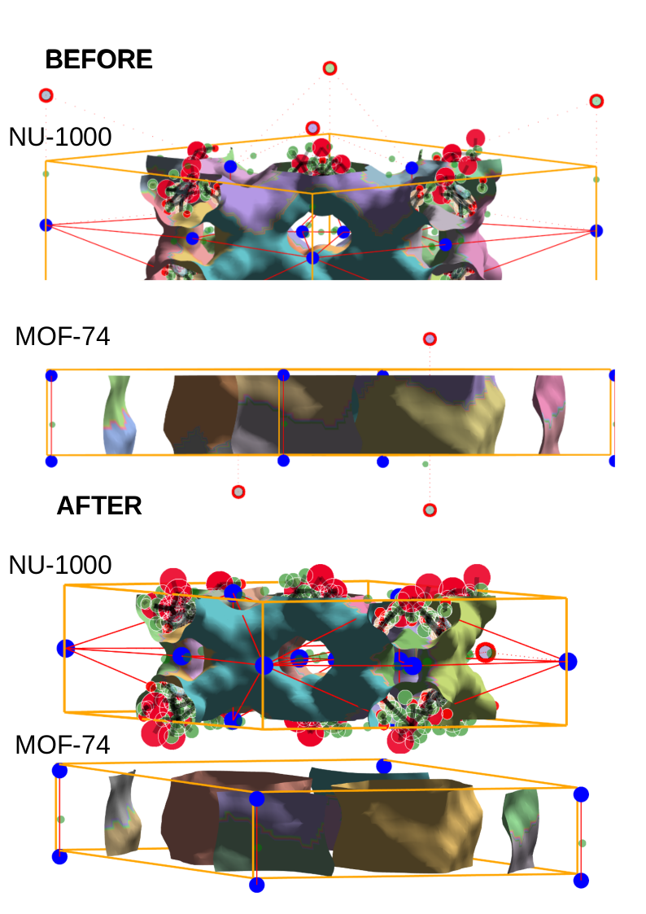

I'll add a motivation section that explains the core issue this code addresses. Here's the addition to the markdown document:

# Region Segmentation Post-Processing: End Channel Pair Merging

## Motivation

The need for this post-processing step arises from a fundamental challenge in periodic segmentation of MOF pore systems:

1. **Periodic Boundary Effects**:
   - When performing segmentation on periodic structures, maxima outside the unit cell walls can influence the segmentation inside
   - This is particularly problematic for long, continuous channels that cross unit cell boundaries
   - The periodic maxima can create artificial segmentation boundaries, splitting what should be a single channel into multiple regions

2. **End Channel Problem**:
   - At unit cell boundaries, channels often get split into "end channel" regions
   - These end channels are artificially small regions that are actually part of larger, continuous pore systems
   - Without correction, this leads to:
     - Incorrect pore size distributions
     - Fragmented pore networks
     - Misleading connectivity analysis
     - Artificial barriers in diffusion path analysis

3. **why it matters**:
   - for materials like nu-1000 with large, continuous channels, proper merging of end channels is crucial for:
     - accurate pore size analysis
     - correct identification of diffusion pathways
     - proper characterization of pore connectivity
    - the issue is compounded when it results in a non symmetric pore graph, which is problematic when you use the pore graph for downstream applications, like 
        - detecting it's connectivity /topology
        - some learning where edges matter.


## Overview
This code performs post-processing on segmented regions to merge end channels that are likely part of the same pore system but were incorrectly split due to periodic boundary conditions (PBC) handling.

## Detailed Implementation

### 1. Wall Region Identification
```python
# Create a mask for all wall regions (boundaries of the unit cell)
wall_mask = np.zeros_like(regions_nonpbc, dtype=bool)
wall_mask[0, :, :] = wall_mask[-1, :, :] = True
wall_mask[:, 0, :] = wall_mask[:, -1, :] = True
wall_mask[:, :, 0] = wall_mask[:, :, -1] = True

# Get unique labels of regions that touch the walls
wall_labels = np.unique(regions_nonpbc[wall_mask])
wall_labels = wall_labels[wall_labels != 0]  # Exclude background
```

### 2. Pair Finding Logic
For each wall region, the code:
1. Checks if it belongs to a single PBC region
2. Looks for adjacent regions on the same wall
3. Compares sizes to determine if they should be merged

```python
for label_id in wall_labels:
    # Get the PBC label for this wall region
    mask = (regions_nonpbc == label_id)
    pbc_label = np.unique(regions_pbc[mask])
    pbc_label = pbc_label[pbc_label != 0]
    
    # Skip if ambiguous (multiple PBC labels)
    if len(pbc_label) != 1:
        continue

    # Find other regions on the same wall with the same PBC label
    same_wall_mask = (regions_pbc == pbc_label[0]) & wall_mask
    other_labels = np.unique(regions_nonpbc[same_wall_mask])
    other_labels = [l for l in other_labels if l != label_id and l != 0]

    # For each adjacent region, check size ratio
    for neighbor_label in other_labels:
        if np.any(binary_dilation(mask) & neighbor_mask):
            size_current = np.sum(mask)
            size_neighbor = np.sum(regions_nonpbc == neighbor_label)
            if size_current < size_ratio * size_neighbor:
                pairs.append((label_id, neighbor_label))
```

## Key Parameters and Logic

1. **Wall Detection**:
   - Identifies regions touching the unit cell boundaries
   - Uses a boolean mask for all six faces of the unit cell

2. **PBC Consistency Check**:
   - Only considers regions that map to a single PBC label
   - Skips regions that are ambiguous (map to multiple PBC labels)

3. **Adjacency Check**:
   - Uses `binary_dilation` to check if regions are touching on the wall
   - Only considers the first touching neighbor for each region

4. **Size Ratio Criterion**:
   - Uses `size_ratio=0.3` as a threshold
   - Merges smaller region into larger one if size ratio < 0.3
   - This helps identify end channels vs. separate pores

## Expected Results


### Before and After Images
[This section would show visualization of regions before and after merging for NU-1000 and MOF-74]

For NU-1000:
- Before: Should show split channels at the boundaries, especially in the large hexagonal channels
- After: Should show continuous channels where end channels were merged, particularly at the unit cell boundaries

For MOF-74
- Before: May show split regions at the boundaries of the cage-like pores
- After: Should show proper merging of connected pore systems, maintaining the cage structure while fixing boundary artifacts

## Common Scenarios

1. **Good Merge Case**:
   - A small region at the boundary that's part of a larger channel
   - Same PBC label in both segmentations
   - Size ratio < 0.3
   - Results in a cleaner, more continuous pore representation

2. **Skipped Cases**:
   - Regions with ambiguous PBC labels, which often due to noise, this is OK, since it doesn't usually screw up the pore graph connectivity.
   - Regions that don't touch on the wall
   - Regions with similar sizes (size ratio > 0.3)
   - These are likely separate pores or require different handling

