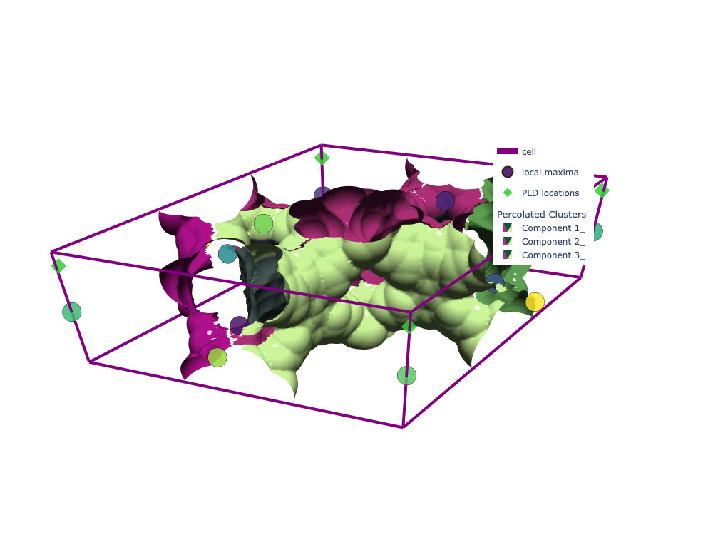
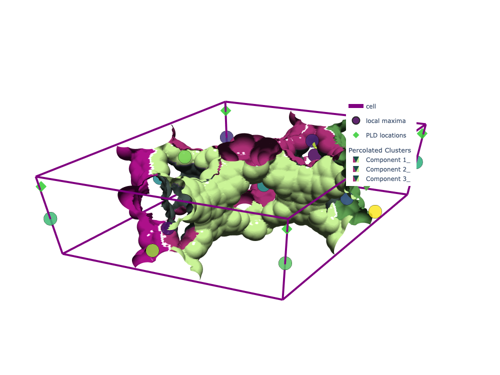

# Introduction

- **Goal:** Compare two algorithms for periodic percolation detection in porous materials:
  - Winding-number (graph-based): the mofography **standard**
  - Face-merging (voxel-based): the older method, closer to PoreBlazer's; **less accurate**, kept as a comparison point
- **Example:** NU-1000

---

# Motivation

- Percolation analysis is crucial for understanding connectivity in porous materials.
- Winding-number detection is the standard in mofography: it guarantees true periodic connectivity, even in contorted systems (`get_pore_dia_mgr_winding`).
- Traditional face-merging works for simple pores but is less accurate on complex, winding channels; it is shown here only for comparison.

---

# Face-Merging Algorithm

- Operates on the segmented distance field (voxel grid).
- Merges labels across periodic faces using `_merge_periodic_faces`.
- Checks percolation along each axis with `percolation_all_axes_periodic`.

---

## Face-Merging: Source Code

```{python}
# compute.py

class UnionFind:
    def __init__(self, n):
        self.parent = np.arange(n)

    def find(self, x):
        # Path compression
        root = x
        while self.parent[root] != root:
            root = self.parent[root]
        while self.parent[x] != x:
            x, self.parent[x] = self.parent[x], root
        return root

    def union(self, x, y):
        xr, yr = self.find(x), self.find(y)
        if xr != yr:
            self.parent[yr] = xr

    def union_pairs(self, a, b):
        """Union matching ids from arrays `a` and `b`."""
        for x, y in zip(a, b):
            self.union(int(x), int(y))


def _merge_periodic_faces(labeled, axis, uf):
    """Merge labels that touch across periodic faces of `axis`."""
    if labeled.shape[axis] < 2:
        return
    slicer_lo = [slice(None)] * 3
    slicer_hi = [slice(None)] * 3
    slicer_lo[axis] = 0
    slicer_hi[axis] = labeled.shape[axis] - 1
    face_lo = labeled[tuple(slicer_lo)]
    face_hi = labeled[tuple(slicer_hi)]
    mask = (face_lo != 0) & (face_hi != 0)
    if not np.any(mask):
        return
    idx_lo = face_lo[mask]
    idx_hi = face_hi[mask]
    if idx_lo.size == 0:
        return
    pairs = np.stack((idx_lo, idx_hi), axis=1)
    unique_pairs = np.unique(pairs, axis=0)
    uf.union_pairs(unique_pairs[:, 0], unique_pairs[:, 1])


def percolation_all_axes_periodic(binary):
    """
    Check percolation in x/y/z with periodic BCs in transverse directions.
    """
    struct = generate_binary_structure(3, 1)
    labeled, nlab = label(binary, structure=struct)
    if nlab == 0:
        return {"x": set(), "y": set(), "z": set()}, {}

    axes = {"x": 0, "y": 1, "z": 2}
    results = {}
    unioned_labels_dict = {}

    for name, axis in axes.items():
        uf = UnionFind(nlab + 1)

        # Merge only the transverse periodic boundaries
        for other_axis in range(3):
            if other_axis == axis:
                continue
            _merge_periodic_faces(labeled, other_axis, uf)

        # Remap labels using union-find parents
        remap = np.arange(nlab + 1)
        for lbl in range(1, nlab + 1):
            remap[lbl] = uf.find(lbl)
        unioned_labels = remap[labeled]
        unioned_labels_dict[name] = unioned_labels

        # Percolation check along this axis
        faceA = set(np.unique(np.take(unioned_labels, 0, axis=axis))) - {0}
        faceB = set(np.unique(np.take(unioned_labels, -1, axis=axis))) - {0}
        results[name] = faceA.intersection(faceB)

    return results, unioned_labels_dict
```

---

## Face-Merging: Line-by-Line Explanation


- `class UnionFind:`  
  Disjoint-set data structure for efficient label merging.
- `def __init__(self, n):`  
  Initialize parent array for `n` elements.
- `def find(self, x):`  
  Find the root of `x` with path compression for efficiency.
- `def union(self, x, y):`  
  Merge sets containing `x` and `y` by updating parent pointers.
- `def union_pairs(self, a, b):`  
  For each pair `(x, y)` in arrays `a` and `b`, merge their sets.
- `_merge_periodic_faces(labeled, axis, uf):`  
  Merge region labels that touch across periodic faces of the given axis using union-find.
- `percolation_all_axes_periodic(binary):`  
  Main function to check percolation along all axes, using union-find to merge periodic clusters.
- The union-find logic ensures that touching regions across periodic boundaries are treated as a single cluster, enabling correct percolation detection.

---

## Face-Merging: Detailed Line-by-Line Explanation (with UnionFind)

- `class UnionFind:`  
  Implements the disjoint-set (union-find) data structure for efficient merging of region labels.
- `def __init__(self, n):`  
  Initializes the parent array so each element is its own parent.
- `self.parent = np.arange(n)`  
  Each label starts as its own cluster.
- `def find(self, x):`  
  Finds the root of label `x` with path compression.
- `root = x`  
  Start with the input label.
- `while self.parent[root] != root:`  
  Traverse up the parent chain until the root is found.
- `root = self.parent[root]`  
  Move to the parent.
- `while self.parent[x] != x:`  
  Path compression: update parent pointers to point directly to the root.
- `x, self.parent[x] = self.parent[x], root`  
  Set parent of `x` to root and move up the chain.
- `return root`  
  Return the root label.
- `def union(self, x, y):`  
  Merges the sets containing `x` and `y`.
- `xr, yr = self.find(x), self.find(y)`  
  Find roots of both labels.
- `if xr != yr:`  
  If they are in different sets, merge them.
- `self.parent[yr] = xr`  
  Set the parent of `yr` to `xr`, merging the sets.
- `def union_pairs(self, a, b):`  
  Merges all pairs of labels from arrays `a` and `b`.
- `for x, y in zip(a, b):`  
  Iterate over pairs.
- `self.union(int(x), int(y))`  
  Merge each pair using `union`.

- `def _merge_periodic_faces(labeled, axis, uf):`  
  Merges region labels that touch across periodic faces of the specified axis.
- `if labeled.shape[axis] < 2:`  
  If the grid is too thin along this axis, nothing to merge; return early.
- `slicer_lo = [slice(None)] * 3`  
  Create a slicer for the lower face (all elements except along the axis).
- `slicer_hi = [slice(None)] * 3`  
  Create a slicer for the upper face.
- `slicer_lo[axis] = 0`  
  Set the lower face index for the axis.
- `slicer_hi[axis] = labeled.shape[axis] - 1`  
  Set the upper face index for the axis.
- `face_lo = labeled[tuple(slicer_lo)]`  
  Extract the lower face labels.
- `face_hi = labeled[tuple(slicer_hi)]`  
  Extract the upper face labels.
- `mask = (face_lo != 0) & (face_hi != 0)`  
  Find positions where both faces have nonzero (valid) labels.
- `if not np.any(mask):`  
  If no overlap, nothing to merge; return.
- `idx_lo = face_lo[mask]`  
  Get the lower face labels at overlap positions.
- `idx_hi = face_hi[mask]`  
  Get the upper face labels at overlap positions.
- `if idx_lo.size == 0:`  
  If no valid pairs, return.
- `pairs = np.stack((idx_lo, idx_hi), axis=1)`  
  Stack the pairs of touching labels.
- `unique_pairs = np.unique(pairs, axis=0)`  
  Remove duplicate pairs.
- `uf.union_pairs(unique_pairs[:, 0], unique_pairs[:, 1])`  
  Merge the touching labels using union-find.

- `def percolation_all_axes_periodic(binary):`  
  Main function to check percolation along all axes with periodic boundaries.
- `struct = generate_binary_structure(3, 1)`  
  Create a 3D connectivity structure for labeling.
- `labeled, nlab = label(binary, structure=struct)`  
  Label connected regions in the binary grid.
- `if nlab == 0:`  
  If no regions, return empty results.
- `axes = {"x": 0, "y": 1, "z": 2}`  
  Map axis names to indices.
- `results = {}` and `unioned_labels_dict = {}`  
  Prepare output containers.
- `for name, axis in axes.items():`  
  Loop over each axis.
- `uf = UnionFind(nlab + 1)`  
  Create a union-find structure for label merging.
- `for other_axis in range(3):`  
  Loop over transverse axes.
- `if other_axis == axis: continue`  
  Skip the axis being checked.
- `_merge_periodic_faces(labeled, other_axis, uf)`  
  Merge labels across periodic faces for transverse axes.
- `remap = np.arange(nlab + 1)`  
  Prepare a remapping array.
- `for lbl in range(1, nlab + 1): remap[lbl] = uf.find(lbl)`  
  Remap each label to its union-find parent.
- `unioned_labels = remap[labeled]`  
  Apply remapping to the labeled grid.
- `unioned_labels_dict[name] = unioned_labels`  
  Store the remapped labels for this axis.
- `faceA = set(np.unique(np.take(unioned_labels, 0, axis=axis))) - {0}`  
  Get unique labels on the lower face.
- `faceB = set(np.unique(np.take(unioned_labels, -1, axis=axis))) - {0}`  
  Get unique labels on the upper face.
- `results[name] = faceA.intersection(faceB)`  
  Percolating clusters are those present on both faces.
- `return results, unioned_labels_dict`  
  Return percolation results and remapped labels.

---

# Winding-Number Algorithm

## Winding-Number: Source Code

```{python}
# winding_percolation.py

def percolation_winding_multidigraph(G):
    """
    Evaluate percolation using winding numbers on a deduplicated MultiDiGraph.
    """
    percolates = {"x": False, "y": False, "z": False}
    loops = []
    acc_offsets = {}
    parent = {}
    visited = set()

    undirected = nx.Graph(G.to_undirected(as_view=True))

    for comp_nodes in nx.connected_components(undirected):
        comp_nodes = set(comp_nodes)
        root = next(iter(comp_nodes))
        if root in visited:
            continue
        visited.add(root)
        parent[root] = None
        acc_offsets[root] = (0, 0, 0)
        queue = deque([root])

        while queue:
            u = queue.popleft()
            u_acc = np.array(acc_offsets[u], dtype=int)

            for nbr, key, canonical_offset, delta, forward in _iter_neighbor_edges(G, u):
                ced = CanonicalEdgeID.from_nodes(u, nbr, key)

                # Ensure traversal stays within the current component
                if nbr not in comp_nodes:
                    continue

                implied = tuple((u_acc + np.array(delta, dtype=int)).tolist())

                if nbr not in visited:
                    visited.add(nbr)
                    parent[nbr] = u
                    acc_offsets[nbr] = implied
                    queue.append(nbr)
                    continue

                current = acc_offsets[nbr]
                if implied == current:
                    continue

                winding_array = np.array(implied, dtype=int) - np.array(current, dtype=int)
                winding = tuple(int(x) for x in winding_array)
                if winding == (0, 0, 0):
                    continue

                cycle_nodes = _tree_path(u, nbr, parent)
                loop_info = {
                    "winding": winding,
                    "nodes": cycle_nodes,
                    "edge": (ced.u, ced.v, ced.key),
                    "edge_offset": canonical_offset,
                    "delta": delta,
                }
                loops.append(loop_info)
                if winding[0] != 0:
                    percolates["x"] = True
                if winding[1] != 0:
                    percolates["y"] = True
                if winding[2] != 0:
                    percolates["z"] = True

    unique_loops = []
    seen = set()
    for loop in loops:
        key = (loop["winding"], tuple(loop["nodes"]), loop["edge"])
        if key in seen:
            continue
        seen.add(key)
        unique_loops.append(loop)

    return percolates, unique_loops, acc_offsets
```

---

## Winding-Number: Line-by-Line Explanation

- `def percolation_winding_multidigraph(G):`  
  Defines the function to detect percolation using winding numbers on a graph.
- `percolates = {"x": False, "y": False, "z": False}`  
  Initialize percolation flags for each axis.
- `loops = []`  
  List to store detected loops.
- `acc_offsets = {}`  
  Accumulated periodic offsets for each node.
- `parent = {}`  
  Parent pointers for BFS tree.
- `visited = set()`  
  Track visited nodes.
- `undirected = nx.Graph(G.to_undirected(as_view=True))`  
  Convert the directed graph to undirected for component analysis.
- `for comp_nodes in nx.connected_components(undirected):`  
  Loop over connected components.
- `root = next(iter(comp_nodes))`  
  Pick a root node for BFS.
- `if root in visited: continue`  
  Skip already visited components.
- `visited.add(root)`  
  Mark root as visited.
- `parent[root] = None`  
  Root has no parent.
- `acc_offsets[root] = (0, 0, 0)`  
  Start offset at zero.
- `queue = deque([root])`  
  Initialize BFS queue.
- `while queue:`  
  BFS loop.
- `u = queue.popleft()`  
  Pop node from queue.
- `u_acc = np.array(acc_offsets[u], dtype=int)`  
  Get current offset for node.
- `for nbr, key, canonical_offset, delta, forward in _iter_neighbor_edges(G, u):`  
  Iterate over neighbors and edge data.
- `ced = CanonicalEdgeID.from_nodes(u, nbr, key)`  
  Get canonical edge ID.
- `if nbr not in comp_nodes: continue`  
  Stay within current component.
- `implied = tuple((u_acc + np.array(delta, dtype=int)).tolist())`  
  Compute implied offset for neighbor.
- `if nbr not in visited:`  
  If neighbor not visited, add to BFS tree.
- `visited.add(nbr)`  
  Mark neighbor as visited.
- `parent[nbr] = u`  
  Set parent pointer.
- `acc_offsets[nbr] = implied`  
  Store offset.
- `queue.append(nbr)`  
  Add neighbor to queue.
- `continue`  
  Continue BFS.
- `current = acc_offsets[nbr]`  
  Get current offset for neighbor.
- `if implied == current: continue`  
  If offset unchanged, skip.
- `winding_array = np.array(implied, dtype=int) - np.array(current, dtype=int)`  
  Compute winding difference.
- `winding = tuple(int(x) for x in winding_array)`  
  Convert to tuple.
- `if winding == (0, 0, 0): continue`  
  Only nonzero windings matter.
- `cycle_nodes = _tree_path(u, nbr, parent)`  
  Get nodes forming the loop.
- `loop_info = {...}`  
  Store loop details.
- `loops.append(loop_info)`  
  Add to loop list.
- `if winding[0] != 0: percolates["x"] = True`  
  Mark percolation in x if winding detected.
- `if winding[1] != 0: percolates["y"] = True`  
  Mark percolation in y if winding detected.
- `if winding[2] != 0: percolates["z"] = True`  
  Mark percolation in z if winding detected.
- `unique_loops = []`  
  Prepare to filter unique loops.
- `seen = set()`  
  Track seen loops.
- `for loop in loops:`  
  Loop over detected loops.
- `key = (loop["winding"], tuple(loop["nodes"]), loop["edge"])`  
  Unique key for each loop.
- `if key in seen: continue`  
  Skip duplicates.
- `seen.add(key)`  
  Mark as seen.
- `unique_loops.append(loop)`  
  Add to unique list.
- `return percolates, unique_loops, acc_offsets`  
  Return percolation flags, loops, and offsets.

---

# Mapping Back to Regions

- **Face-merging:** Directly uses voxel labels.
- **Winding-number:** Uses graph nodes to region label sets via `build_base_region_labels_from_results`.

---

# NU-1000 Example: Setup

- Load CIF and run segmentation.
- Compute percolation using both algorithms.
- Generate and save Plotly figures for each method.

---


## NU-1000: Comprehensive Example (Face-Merging and Winding)

```{python}
#| eval: false
import numpy as np
import json
import os, sys
import plotly.graph_objects as go
import plotly.express as px
from ase.io import read
from pathlib import Path
import mofography as mgr
import logging
import time
logging.basicConfig(level=logging.INFO)
logger = logging.getLogger(__name__)

# Load CIF
path_to_cif = Path('~/repos/mofography/examples/TestCIFs/NU-1000_S1.cif').expanduser()
mat_atoms = read(path_to_cif)
print('Number of atoms: ', mat_atoms.get_global_number_of_atoms())
print('Unit cell is: ', mat_atoms.cell.cellpar())

# Grid and segmentation parameters
spacing = 0.25
h = 0.2
mask_thickness = 0.05
threshold_abs = 1.0
extra_padding = 2
min_distance = 1.5

# Compute distance grid
dgrid = mgr.dgrid_from_atoms(mat_atoms, spacing=spacing, block_size=50000).compute().astype(np.float32)

# Run periodic segmentation
results = mgr.do_periodic_segmentation_rust(
    dgrid,
    mat_atoms,
    mask_thickness=mask_thickness,
    h=h,
    spacing=spacing,
    return_dgrid=False,
    threshold_abs=threshold_abs,
    min_distance=min_distance,
    return_padded_regions=False,
    extra_padding=extra_padding,
)
pld = mgr.find_pore_limiting_radius(dgrid) * 2
# Extract regions and maxima
regions = results["regions"]
maxima_info = results["maxima_info"]
all_maxima = results["all_maxima"]
maxima = all_maxima[: regions.max()]

# Face-merging percolation
percolation_history, pld_locations, _, _, _ = mgr.compute_percolation_history2(dgrid, regions, maxima)
index = 65
print(f"Percolation history: {percolation_history[index]}")

# Plot face-merging clusters
percolated_cluster_meshes = mgr.plot_percolated_cluster_meshes(
    percolation_history, dgrid, regions, mat_atoms,
    isovalue=np.min([pld/2 - 0.25, 1.75]), stylize=True, probe_radius=percolation_history[65][0]
)
cell_trace = mgr.plot_cell(mat_atoms)
maxima_trace = mgr.plot_maxima(dgrid, maxima, mat_atoms, show_spheres=False, sphere_opacity=0.85)
pld_traces = mgr.plot_pld_locations(dgrid, pld_locations, mat_atoms, show_spheres=False, sphere_opacity=0.85, marker_size=10, marker_color='limegreen')
fig_face = go.Figure(data=[cell_trace, maxima_trace, pld_traces] + percolated_cluster_meshes, layout=mgr.white_layout)
fig_face.update_layout(legend = dict(x=0.7, groupclick='toggleitem'))
with open("face_merging_percolation.json", "w") as f:
    json.dump(fig_face.to_json(), f)
# fig_face.show()

# Winding-number percolation
plr = mgr.find_pore_limiting_radius_winding(results)
lcd, pld, dfsd, _ = mgr.get_pore_dia_mgr_winding(results=results)
print(f"LCD is {lcd}, \nPLD is {pld}, \nDFSD is {dfsd}")
percolation_history2, pld_locations, final_clusters = mgr.compute_percolation_history_winding(results)
index = 65
print(f"Percolation history: at threshold {percolation_history2[index][0]}, the percolating regions are {percolation_history2[index][1]}")
percolated_cluster_meshes_winding = mgr.plot_percolated_cluster_meshes(
    percolation_history2, dgrid, regions, mat_atoms,
    isovalue=0.75, stylize=True, probe_radius=percolation_history2[index][0]
)
fig_winding = go.Figure(data=[cell_trace, maxima_trace, pld_traces] + percolated_cluster_meshes_winding, layout=mgr.white_layout)
fig_winding.update_layout(legend = dict(x=0.7, groupclick='toggleitem'))
with open("winding_percolation.json", "w") as f:
    json.dump(fig_winding.to_json(), f)

# fig_winding.show()
```
---

## NU-1000: Face-merging vs winding clusters

The two figures were built in the previous chunk (saved as Plotly JSON because the run is slow). Static renders:

```{python}
import plotly.io as pio
import json
with open("../internal_docs/face_merging_percolation.json") as f:
    fig_face = pio.from_json(json.load(f))
fig_face.write_image("tutorial_images/face_merging_vs_winding_face.png", width=1000, height=750)

with open("../internal_docs/winding_percolation.json") as f:
    fig_winding = pio.from_json(json.load(f))
fig_winding.write_image("tutorial_images/face_merging_vs_winding_winding.png", width=1000, height=750)
```





::: {.callout-note collapse="true" title="Interactive version"}
```python
fig_face = pio.from_json(json.load(open("face_merging_percolation.json")))
fig_face.show()
fig_winding = pio.from_json(json.load(open("winding_percolation.json")))
fig_winding.show()
```
:::

[Open the interactive version](interactive/nu1000_percolation_history_threejs.html){target="_blank"}


---

# What makes the winding algorithm possible?
- Having a perfectly periodic pore graph
 - We enforce PBC through maxima merging by distance
 - All local maxima are images of representative maxima_pbc
 - Allows for a compact pore graph
 - Periodic pore graph can be directed or undirected
 - Directed without the i < j convention. Or undirected with the i < j convention for edges.
 - consistent with  popular topology formats
- Compact pore graph -> fast and easy winding -> fast percolation calculations

# Comparison & Discussion

- **Face-merging:**
  - Accurate for straight, crystalline pores
  - Can miss winding connectivity in amorphous systems
- **Winding-number:**
  - Detects true periodic loops
  - Faster and more robust for complex pore networks

---

# Summary

- Both algorithms are available in `mofography`.
- Winding-number percolation is recommended for general cases.
- See code and figures for hands-on comparison.

---

# References

- Source: `mofography/compute.py`, `mofography/winding_percolation.py`

---

# Questions?

This documentation is not comprehensive by any means.Feel free to ask for more details or additional examples!
