Interactive scenes you can rotate, slice, toggle layer by layer, and export. Each scene is a standalone HTML file made with mofography's Three.js backend (it loads Three.js from a CDN, so you need an internet connection). Click a picture to open the interactive version in a new tab.

Every image below is a canvas-only capture of the same scene with different viewer settings: projection, exploded view, visible layers, framework style, and background. Open "Show code" next to a figure for the exact settings. Each one has the **viewer steps** (click through them in the interactive scene) and the one-line command that produced the image with [`scripts/dev/gallery_screenshot.py`](add_to_gallery.qmd#screenshots) (`--zoom` is the camera distance multiplier; the sidebar is hidden in all images).

## Interactive scenes

### Cu-BTC (HKUST-1): everything in one scene

[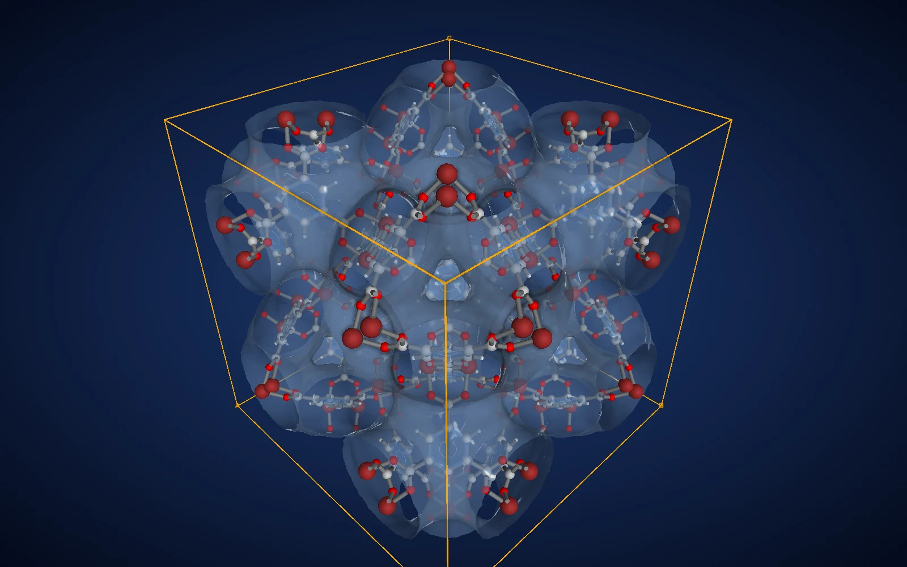](interactive/cubtc_all_in_one_threejs.html){target="_blank"}

[Open the interactive scene](interactive/cubtc_all_in_one_threejs.html){target="_blank"}. Toggle in the side panel: unit cell, framework atoms with bonds and aromatic rings, the **Pore surface (distance grid, isovalue 1.0 Å)** (the blue translucent layer: an isosurface of the distance grid, not a segmentation), **Regions (no PBC)** and **Regions (PBC-merged)** (the segmented, region-labelled surfaces), pocket types (`env_cluster`), local maxima, windows, the pore graph with internal and periodic nodes, and a percolated cluster. Companion Plotly charts: [surface area vs probe radius](interactive/cubtc_surface_area_plotly.html){target="_blank"} and [void volume vs probe radius](interactive/cubtc_void_volume_plotly.html){target="_blank"}.

::: {.gallery-grid}

::: {.gallery-item}
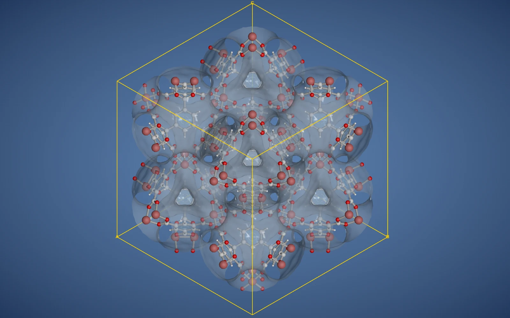

::: {.callout-note collapse="true" appearance="minimal"}
## Show code
Viewer: click **Ortho**, set view direction to `1 1 1` and press **Set**. Ortho switches the viewer's lighting and shows a lighter blue than the perspective background.

```bash
python scripts/dev/gallery_screenshot.py docs/interactive/cubtc_all_in_one_threejs.html \
  out.png --ortho --view 1 1 1 --zoom 1.15 --bg radial:#1d3b73:#040a1c
```
Perspective hero: same command without `--ortho`/`--bg`, `--view 1 1 1 --zoom 1.15`.
:::
:::

::: {.gallery-item}
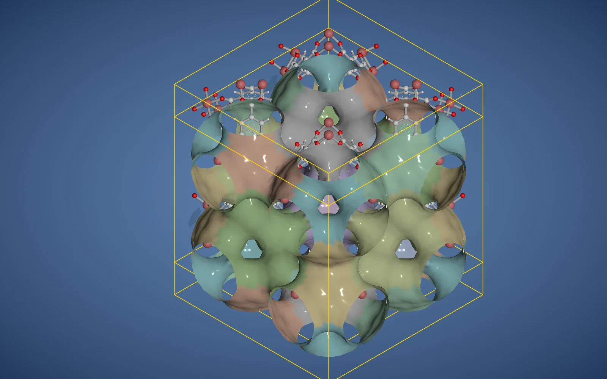

::: {.callout-note collapse="true" appearance="minimal"}
## Show code
Viewer: untick the pore surface, tick **Regions (PBC-merged)**, click **Ortho**, drag **Exploded** to 0.6, view direction `1 1 1`.

```bash
python scripts/dev/gallery_screenshot.py docs/interactive/cubtc_all_in_one_threejs.html \
  out.png --ortho --explode 0.6 --only Framework "Regions (PBC" \
  --view 1 1 1 --zoom 1.2
```
:::
:::

::: {.gallery-item}
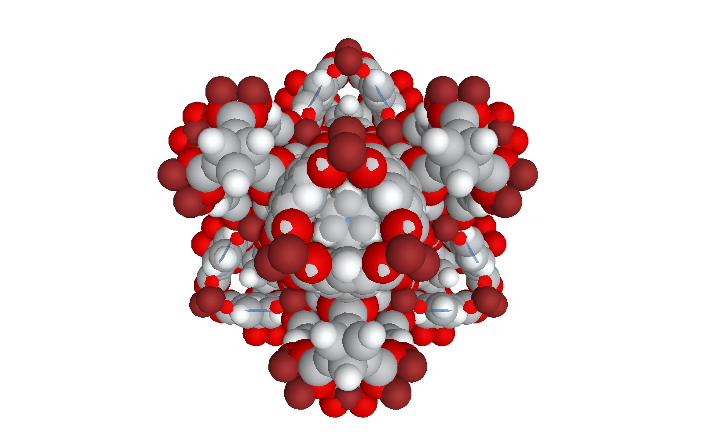

::: {.callout-note collapse="true" appearance="minimal"}
## Show code
Viewer: untick every layer except **Framework**, choose **Representation → Space-filling**, set **Bg** to `#ffffff` and press the solid (■) button.

```bash
python scripts/dev/gallery_screenshot.py docs/interactive/cubtc_all_in_one_threejs.html \
  out.png --only Framework --repr space_filling --bg "#ffffff" \
  --view 1 1 1 --zoom 1.15
```
:::
:::

::: {.gallery-item}
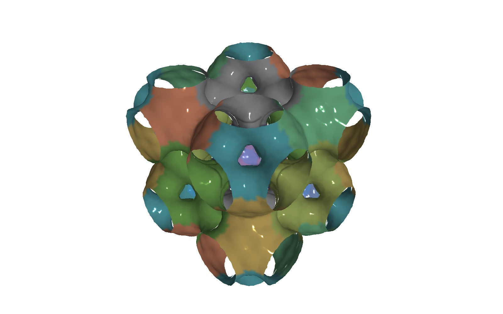

::: {.callout-note collapse="true" appearance="minimal"}
## Show code
Viewer: untick all layers except **Regions (PBC-merged)**, click the ⊡ (transparent) background button, then **Export PNG** (use PNG 2x for print).

```bash
python scripts/dev/gallery_screenshot.py docs/interactive/cubtc_all_in_one_threejs.html \
  out.png --only "Regions (PBC" --bg transparent --zoom 1.25
```
:::
:::

::: {.gallery-item}
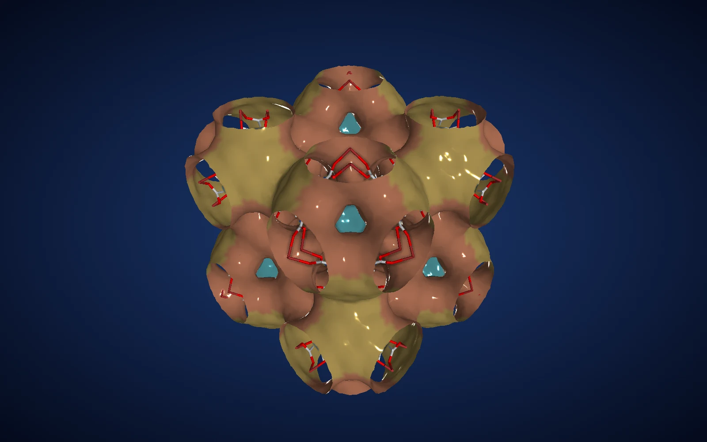

::: {.callout-note collapse="true" appearance="minimal"}
## Show code
Viewer: untick the pore surface, tick **Pocket types (env_cluster)**, choose **Representation → Stick**.

```bash
python scripts/dev/gallery_screenshot.py docs/interactive/cubtc_all_in_one_threejs.html \
  out.png --only Framework "Pocket types" --repr stick --zoom 1.3
```
:::
:::

:::

### NU-1000

[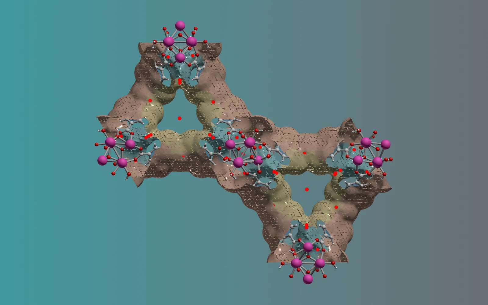](interactive/nu1000_pockets_windows_threejs.html){target="_blank"}

[Pockets and windows](interactive/nu1000_pockets_windows_threejs.html){target="_blank"} (hexagonal mesopore, triangular micropores) and [percolation history](interactive/nu1000_percolation_history_threejs.html){target="_blank"}: the percolating cluster for probe radii of 1 to 4 Å, one toggle per probe. The hero shows pocket types, framework and internal windows (red dots), seen down the c axis.

::: {.callout-note collapse="true" appearance="minimal"}
## Show code (hero)
Viewer: untick everything except **Framework**, **Pocket types (env_cluster)** and **Internal windows**, click **Ortho**, view direction `0 0 1` and **Set**.

```bash
python scripts/dev/gallery_screenshot.py docs/interactive/nu1000_pockets_windows_threejs.html \
  out.png --ortho --only Framework "Pocket types" "Internal windows" \
  --view 0 0 1 --zoom 0.85
```
:::

::: {.gallery-grid}

::: {.gallery-item}
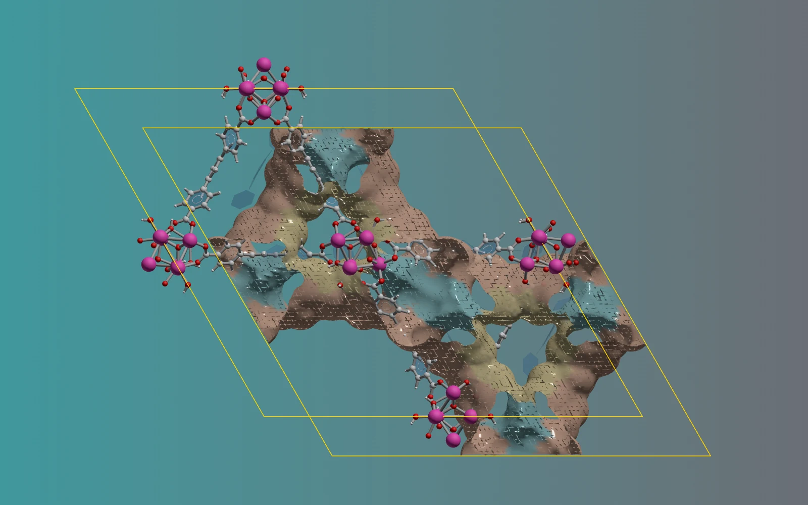

::: {.callout-note collapse="true" appearance="minimal"}
## Show code
Viewer: tick only **Framework** and **Pocket types (env_cluster)**, click **Ortho**, **Exploded** slider to 0.6, view direction `0 0 1`.

```bash
python scripts/dev/gallery_screenshot.py docs/interactive/nu1000_pockets_windows_threejs.html \
  out.png --ortho --explode 0.6 --only Framework "Pocket types" \
  --view 0 0 1 --zoom 0.95
```
:::
:::

::: {.gallery-item}
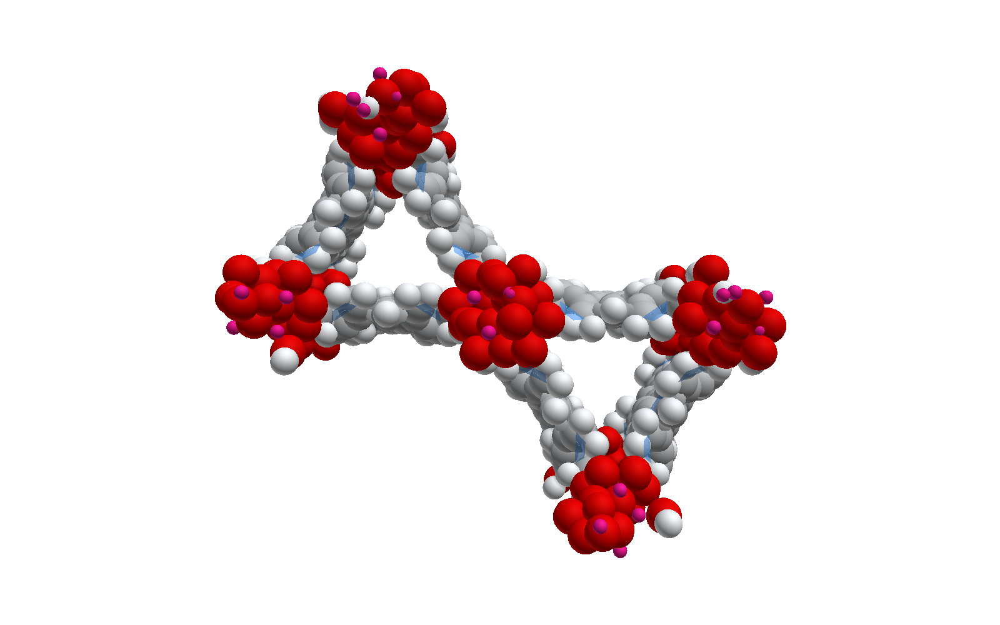

::: {.callout-note collapse="true" appearance="minimal"}
## Show code
Viewer: untick all layers except **Framework**, **Representation → Space-filling**, **Bg** `#ffffff` (■), view direction `0 0 1`.

```bash
python scripts/dev/gallery_screenshot.py docs/interactive/nu1000_pockets_windows_threejs.html \
  out.png --only Framework --repr space_filling --bg "#ffffff" \
  --view 0 0 1 --zoom 1.05
```
:::
:::

::: {.gallery-item}
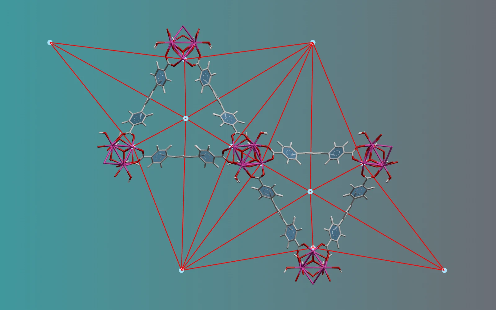

::: {.callout-note collapse="true" appearance="minimal"}
## Show code
Viewer: tick **Framework**, **Internal nodes**, **Internal connections** only; **Representation → Stick**; click **Ortho**; view `0 0 1`.

```bash
python scripts/dev/gallery_screenshot.py docs/interactive/nu1000_pockets_windows_threejs.html \
  out.png --ortho --only Framework "Internal nodes" "Internal connections" \
  --repr stick --view 0 0 1 --zoom 0.85
```
:::
:::

::: {.gallery-item}
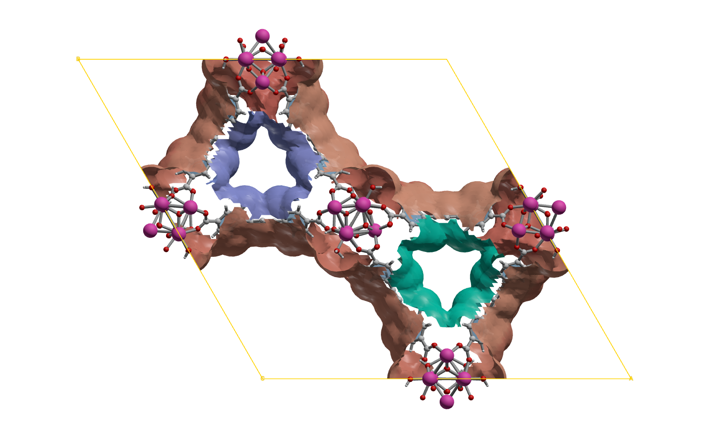

::: {.callout-note collapse="true" appearance="minimal"}
## Show code
Viewer (percolation scene): untick **Percolation windows**, keep the r = 3 Å cluster, click **Ortho**, view `0 0 1`.

```bash
python scripts/dev/gallery_screenshot.py docs/interactive/nu1000_percolation_history_threejs.html \
  out.png --ortho --off "Percolation windows" --view 0 0 1 --zoom 0.85
```
:::
:::

:::

### More materials

#### LTA

[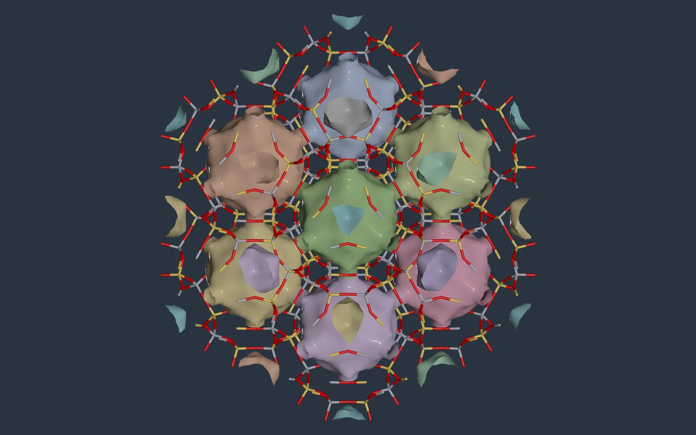](interactive/lta_pockets_windows_threejs.html){target="_blank"}

[Interactive LTA scene](interactive/lta_pockets_windows_threejs.html){target="_blank"}: sodalite and supercage pockets. Shown: **Regions (PBC-merged)**, framework sticks, orthographic along (1 1 1), dark slate default background.

::: {.callout-note collapse="true" appearance="minimal"}
## Show code
Viewer: tick only **Framework** and **Regions (PBC-merged)**, **Representation → Stick**, **Ortho**, view `1 1 1`.

```bash
python scripts/dev/gallery_screenshot.py docs/interactive/lta_pockets_windows_threejs.html \
  out.png --ortho --only Framework "Regions (PBC" --view 1 1 1 --repr stick --zoom 1.15
```
:::

#### ZIF-8

[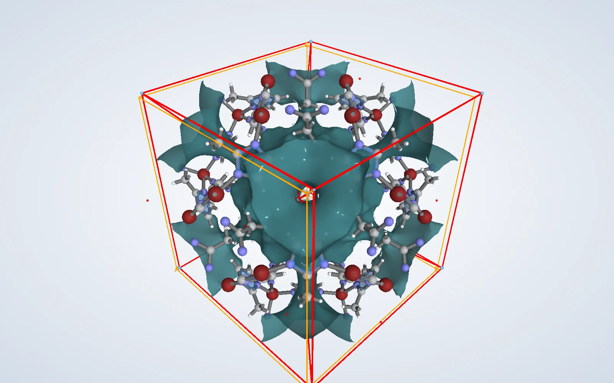](interactive/zif8_pockets_windows_threejs.html){target="_blank"}

[Interactive ZIF-8 scene](interactive/zif8_pockets_windows_threejs.html){target="_blank"}: two pockets per cell. Light gradient default background.

::: {.gallery-grid}

::: {.gallery-item}
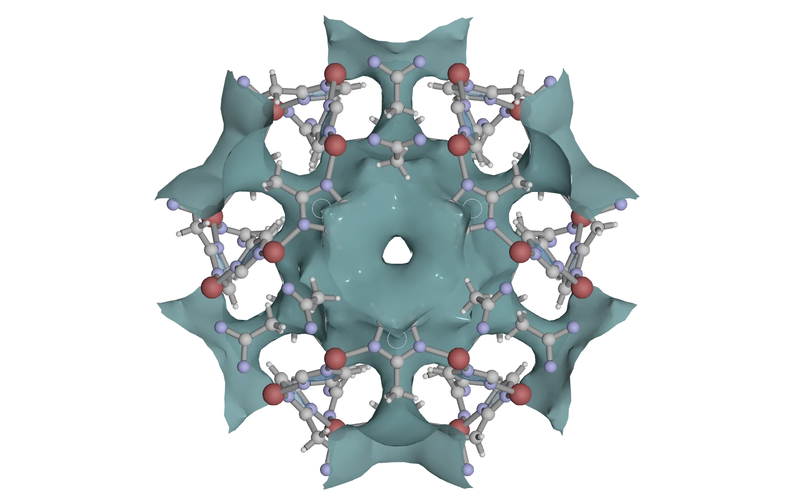

::: {.callout-note collapse="true" appearance="minimal"}
## Show code
Viewer: tick only **Framework** and **Pocket types (env_cluster)**, **Ortho**, ⊡ (transparent), view `1 1 1`.

```bash
python scripts/dev/gallery_screenshot.py docs/interactive/zif8_pockets_windows_threejs.html \
  out.png --ortho --only "Pocket types" Framework --bg transparent \
  --view 1 1 1 --zoom 1.2
```
Hero: `out.png --zoom 1.35` (default layers).
:::
:::

:::

#### IRMOF-1

[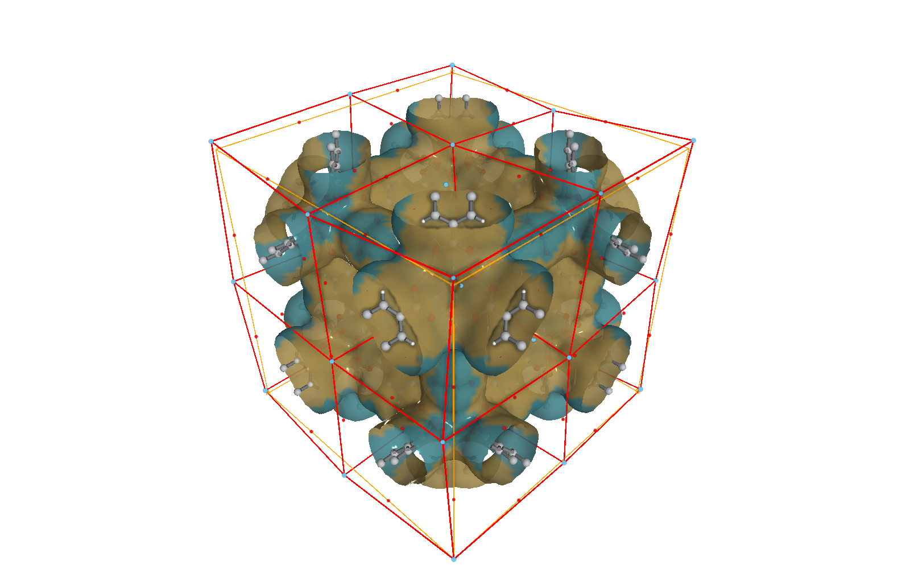](interactive/irmof1_pockets_windows_threejs.html){target="_blank"}

[Interactive IRMOF-1 scene](interactive/irmof1_pockets_windows_threejs.html){target="_blank"}: two cage populations from linker orientation. White default background.

::: {.gallery-grid}

::: {.gallery-item}
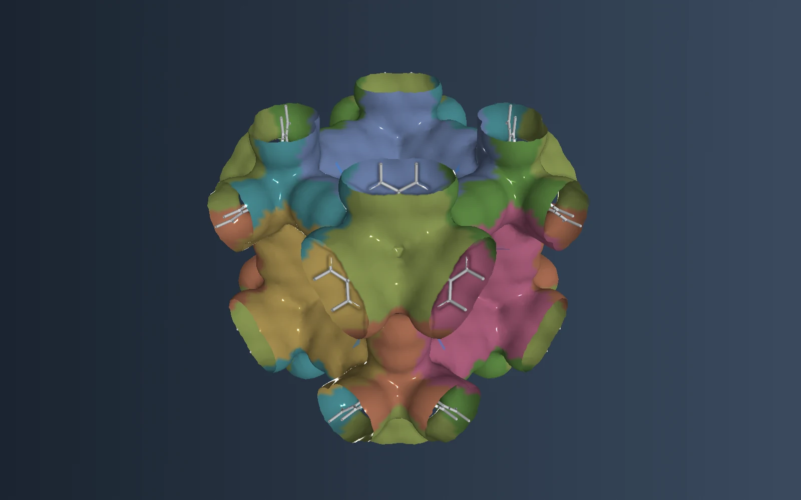

::: {.callout-note collapse="true" appearance="minimal"}
## Show code
Viewer: tick only **Framework** and **Regions (PBC-merged)**, **Representation → Stick**, **Bg** `#3a4a5e` with the ⬌ gradient button (approximate: the viewer shades the colour towards dark at the edges; for the exact two-colour gradient use `to_html(background=("linear", "#1b2430", "#3a4a5e"))`).

```bash
python scripts/dev/gallery_screenshot.py docs/interactive/irmof1_pockets_windows_threejs.html \
  out.png --only Framework "Regions (PBC" --repr stick \
  --bg linear:#1b2430:#3a4a5e --zoom 1.25
```
Hero: `out.png --zoom 1.35`.
:::
:::

::: {.gallery-item}
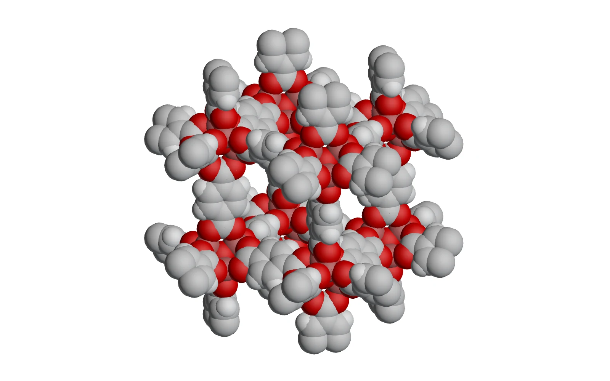

::: {.callout-note collapse="true" appearance="minimal"}
## Show code
Viewer: only **Framework**, **Representation → Space-filling**, **Ortho**, view direction `1 0.6 0.4`.

```bash
python scripts/dev/gallery_screenshot.py docs/interactive/irmof1_pockets_windows_threejs.html \
  out.png --ortho --only Framework --repr space_filling \
  --view 1 0.6 0.4 --zoom 1.1
```
:::
:::

:::

### Make your own

Every scene above is produced by one script. The core of the Cu-BTC scene is:

::: {.callout-note collapse="true"}
## Show code

```python
import numpy as np
import mofography as mgr
from mofography.cif_io import read_cif_to_ase

atoms = read_cif_to_ase("P1-Cu-BTC.cif")
dgrid = mgr.dgrid_from_atoms_rust(atoms, spacing=0.5).astype(np.float32)
seg = mgr.do_periodic_segmentation_rust(
    dgrid, atoms, spacing=0.5, mask_thickness=0.05, compute_connections=True,
    watershed_backend="rust_det",
)
# Layers, colours and the exact calls for every scene:
#   scripts/dev/gen_gallery_assets.py  (python scripts/dev/gen_gallery_assets.py --material cubtc)
```
:::

See [Three.js plotting](threejs_plotting.qmd) for the full set of layers and the notebook display, and [Adding to the gallery](add_to_gallery.qmd) for how to contribute a scene.

## Images from the publication



---

*Want your visualization featured here? See [Adding to the gallery](add_to_gallery.qmd), or reach out to us on [GitHub](https://github.com/mofography/mofography).*
