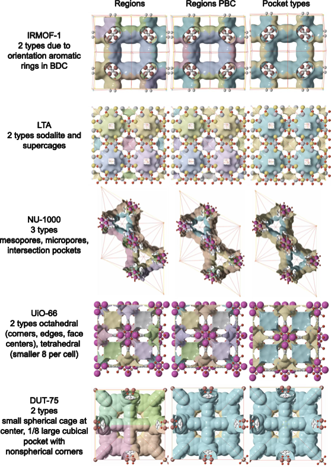
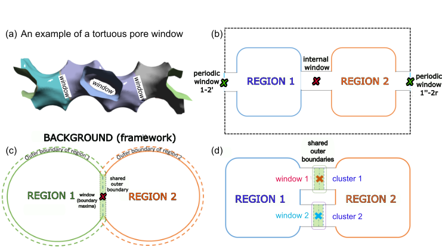
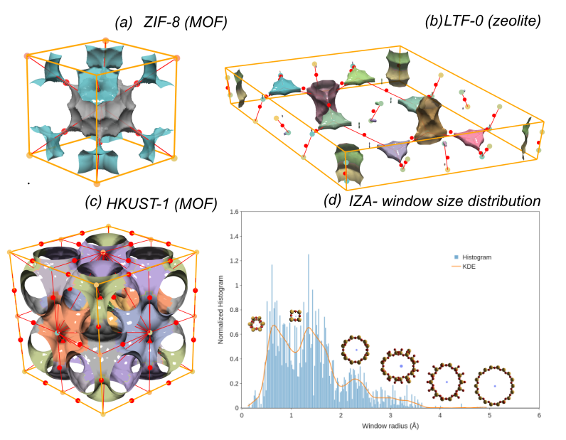
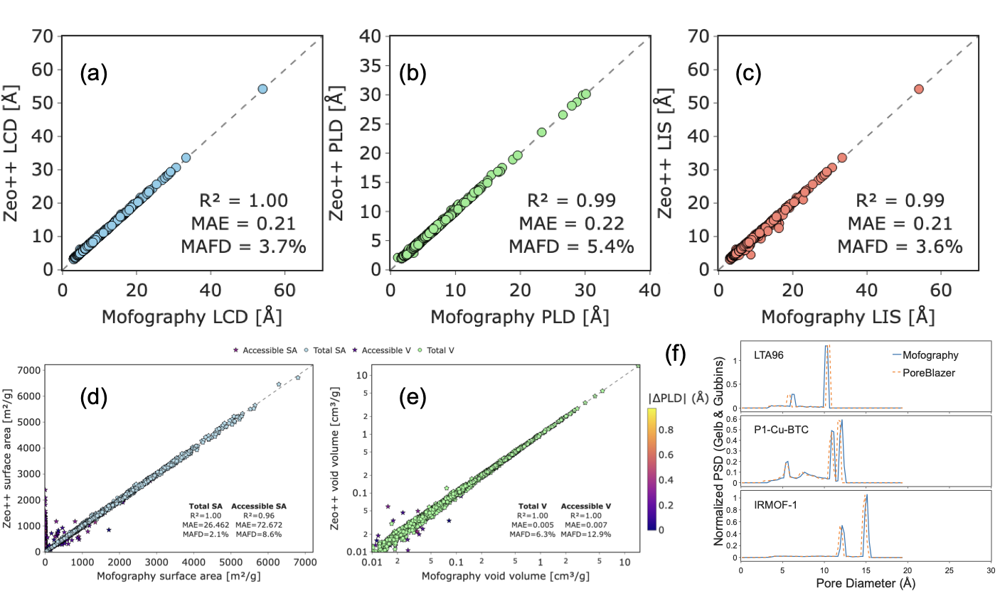
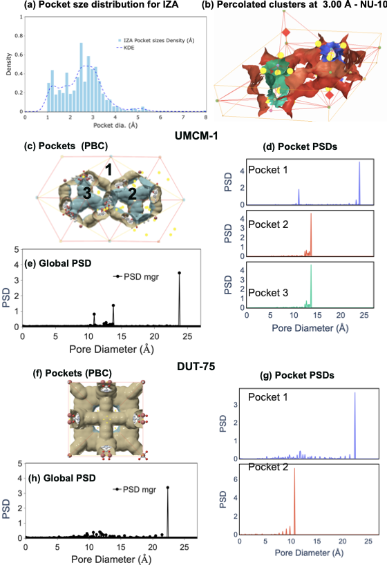

## Interactive 3D Scenes

Explore pore structures with interactive visualizations. For the full Three.js experience, download and open locally.

### IRMOF-1 — The Canonical MOF

```{python}
#| echo: false
from ase.io import read
from mofography.rust_fun import dgrid_from_atoms_rust, do_periodic_segmentation_rust
from mofography.workflow import show_mof_plotly, enrich_segmentation_with_pocket_psds, assign_pocket_types
import numpy as np

atoms = read("IRMOF-1.cif")
dgrid = dgrid_from_atoms_rust(atoms, spacing=0.5).astype(np.float32)
seg = do_periodic_segmentation_rust(dgrid, atoms, mask_thickness=0.05, h=0.2, min_distance=1.5, threshold_abs=1.5, spacing=0.5, compute_connections=True, watershed_backend='rust_det', disable_tqdm=True)
enriched = enrich_segmentation_with_pocket_psds(seg, atoms)
typed = assign_pocket_types(enriched, atoms, method='env_cluster')
fig = show_mof_plotly(seg, atoms, typed, framework_atoms=atoms, stylize=True)
fig.update_layout(title="IRMOF-1 — 8 pockets, 300 connections")
fig.show()
```

[Download Three.js Scene](interactive/irmof1_threejs.html){target="_blank"} (76 MB — full interactive 3D)

### Cu-BTC (HKUST-1) — Multi-Pocket Architecture

```{python}
#| echo: false
atoms = read("P1-Cu-BTC.cif")
dgrid = dgrid_from_atoms_rust(atoms, spacing=0.5).astype(np.float32)
seg = do_periodic_segmentation_rust(dgrid, atoms, mask_thickness=0.05, h=0.2, min_distance=1.5, threshold_abs=1.5, spacing=0.5, compute_connections=True, watershed_backend='rust_det', disable_tqdm=True)
enriched = enrich_segmentation_with_pocket_psds(seg, atoms)
typed = assign_pocket_types(enriched, atoms, method='env_cluster')
fig = show_mof_plotly(seg, atoms, typed, framework_atoms=atoms, stylize=True)
fig.update_layout(title="Cu-BTC — 16 pockets, 3 distinct types")
fig.show()
```

[Download Three.js Scene](interactive/cubtc_threejs.html){target="_blank"} (116 MB — full interactive 3D)


Pocket type detection results across NU-1000, LTF, IRMOF-1, UiO-66, and DUT-75.

### Window Detection



Window detection algorithm schematic with special cases: tortuous pores, multi-window boundaries, and PBC windows.



Window locations in ZIF-8, LTF, and HKUST-1, plus combined IZA window-size histogram.

### Global Textural Properties



Validation of LCD, PLD, directional free sphere, probe-centre void volume, accessible void volume, probe-centre SA, and accessible SA against Zeo++ on 2000 CoRE MOFs.

### Pocket-Wise Properties



Global PSD, maxima-centric segmentation, and DUT-75/UMCM-1 pocket PSDs.

---

*Want your visualization featured here? Reach out to us on [GitHub](https://github.com/arung-northwestern/mofography).*
