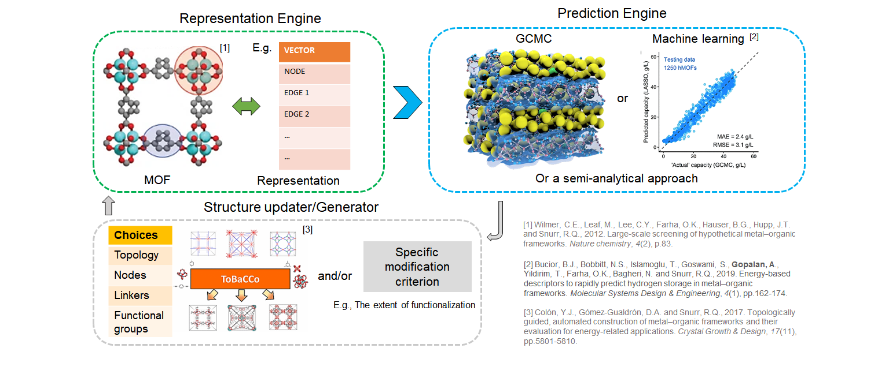
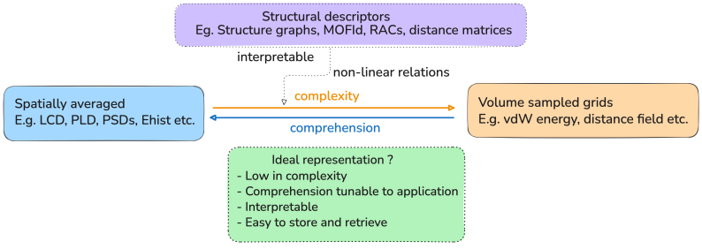
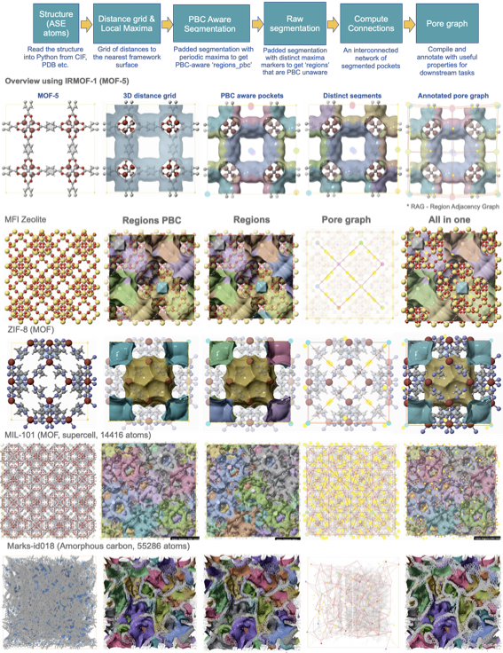

[//]: # (Badges)
[](https://github.com/REPLACE_WITH_OWNER_ACCOUNT/mofography/actions?query=workflow%3ACI)
[](https://codecov.io/gh/REPLACE_WITH_OWNER_ACCOUNT/mofography/branch/master)

<!-- Add logo -->


**MOFography turns a MOF's atomic structure into a pore graph** — a compact, NetworkX-based map of every pocket, channel, and window in the material — so you can featurize, search, cluster, and train ML models on nanoporous crystals at any scale. 🧪

## Quick Install 📦

Get MOFography running in seconds:

```bash
# From PyPI
pip install mofography
```

Or, for the latest development version, clone and install in editable mode:

```bash
git clone https://github.com/arung-northwestern/mofography.git
cd mofography
pip install -e .
```

Prefer a terminal? The companion CLI `mgrcli` wraps the same Rust-accelerated pipeline so you can batch-process CIFs without writing any Python:

```bash
pip install mgrcli
mgrcli process IRMOF-1.cif --dgrid-method rust_exact --b rust_det --pore-dia --psd --rag --types
```

Prefer a browser? Try the web demo — same pipeline, zero install: **[arung-northwestern-mofography-web-demo.hf.space](https://arung-northwestern-mofography-web-demo.hf.space)**.

## What's New ✨

The current release ships a **unified, Rust-accelerated pipeline** from CIF to pore graph:

- A single `dgrid_from_atoms_rust` → `do_periodic_segmentation_rust` call replaces the old multi-step workflow. Periodic boundary conditions are handled internally — no separate `apply_pbc` pass.
- The full pipeline is exposed through `mgrcli`, the command-line companion. One invocation produces the segmentation dict, LCD/PLD/DFSD, PSDs, the RAG pickle, and an HTML visualization.
- New `env_cluster` pocket-type detection groups pockets by environment fingerprint.
- New accessibility modes (winding-number and lattice variants) and window fingerprinting (Mechanism A / B) give accurate accessible surface area and void volume.
- Watershed backends now include `rust_det_parallel` for large unit cells.

For the full changelog see the [Releases page](https://github.com/arung-northwestern/mofography/releases) or the [CLI Quick Start](cli_quickstart.qmd) tutorial.

## The big picture 🖼️

Most of the state-of-the-art approaches to computational materials discovery of
MOFs via machine learning (ML), can be summarized in terms of three key
components,




- *Representation*: A way to represent the phase space of MOFs. (e.g., atoms and bonds, a periodic graph, a list of strigs representing topology, building blocks and functional groups etc.),
- *Prediction*: Some way to make predictions (a regression model, a data lookup
table etc.), and 
- *Optimization/Screening*: Some way to select/optimize materials to maximize the desired
property(s) (gradient descent, genetic algorithms, Bayes optimization etc.).

## Why MOFography? 🤔



How we represent materials plays a key-role in all these steps. In adsorption, the
shape, size, and connectivity of the cavities often play a bigger role than the
chemistry of the individual structural building blocks (SBUs) that make up the
MOF. Arriving at numerical features that capture the 3D confining environment
of a nanoporous materials remains a challenging task till date. Ideally, a good representation should have certain qualities, such as:

- *Comprehensive*: Capture all the relevant information about the
- *Interpretable*: Easy to understand and interpret.
- *Flexible*: Adaptable to different applications of MOFs involving adsorption.   
- *Compact*: Easy to store and retrieve, without being too cumbersome. 

So, we set out to create one such represention for crystalline nanopores `pore graphs` or `Region Adjacency Graphs (RAGs)` that meet at least some of the above criteria for characterization and prediction in adsoption applications.

## The Core Workflow 🚀


{width=100%}

We present a novel approach using advanced image processing techniques to
represent the cavities of a material as a *pore graph,* where the *nodes*
represent regions of arbitrary shape segmented around the local distance maxima,
and *edges* represent the connectivity of these regions. Regions connect through
one or more pore windows. As an example, 

These nodes and edges can then be annotated with properties relevant to
adsorption or pore characterization, which are then aggregated to create
MOF-level features. Thus, the pore graph allows us to retain relevant
information, without having to work with large 3D images of MOF cavities. Using
pore graphs, we can understand and represent MOF pores comprehensively, compare
the cavities of two MOFs towards unsupervised ML (E.g., clustering of MOFs),
regress pore-influenced properties such as adsorption uptake (supervised ML) and
identify key pore characteristics necessary for achieving specific separations.

## Functionality Overview 📚

```{mermaid}
graph TB
    style mofography fill:#f9d5e5,stroke:#333,stroke-width:2px
    style compute fill:#eeac99,stroke:#333,stroke-width:2px
    style visualize fill:#e06377,stroke:#333,stroke-width:2px
    style analyze fill:#c83349,stroke:#333,stroke-width:2px
    style data fill:#5b3758,stroke:#333,stroke-width:2px
    style helper fill:#5b3758,stroke:#333,stroke-width:2px
    mofography[Mofography]
    compute[Compute<br>Computing pore properties]
    visualize[Visualize<br>Visualizing things in Jupyter notebooks]
    analyze[Analyze<br>Doing cheminformatics on framework structure]
    data[Data<br>Pulling, modifying, storing and retrieving data]
    helper[Helper<br>A collection of utility functions]
    mofography --> compute
    mofography --> visualize
    mofography --> analyze
    mofography --> data
    mofography --> helper
```

MOFography (mgr) is feature packed, where you can automatically do a lot more. 

::: {.callout-tip}
This is not a comprehensive list, please refer to the expanding list of tutorials on the [Learn](learn.qmd) page and API docs on the [Reference](reference/index.qmd) page for more information.
:::

Just with the core workflow, you can:

- Compute distance / LJ energy grids (in parallel or GPU)
Segment empty space into individual pockets (cages or - sections along channels and what not)
- Compute the connections between these pockets
Account for PBC correctly, so you don't have to work with supercells
- Detect pocket connectivity and pore windows (both internal and periodic)
- Construct a 'pore graph'

And because what you end up with is a Networkx graph, you can annotate whatever property you want on it without having to store grids. So now with that possibility, the applications featured in the original paper are:

- Detect percolation paths on the graph using path finding. so that gives you PLD, pocket accessibility and stuff like that
- Node clustering tasks using some simple geometric or energy features, which tells the different types of pockets in the material
- *Shape matching molecules to pockets: Given a rigid molecule how can you quickly find a pocket that matches in LJ shape from a large database  like CoRE or IZA. Under the hood it uses energy minimization w/ Bayesian Optimization to do this.

And there is a lot of other useful things:
- Visualize framework and pores interactively in Jupyter notebook using (Plotly) and overlay as toggleable layers.

::: {.callout-note}
The structure visualization currently is not that advanced, but I am hoping people will contribute in the future. As of now it is good enough for paper figures and TOC images, etc. 
:::

- Pull large amounts of data from MOFDB asynchronously 
Geared towards high throughput: Apply any or all of the above functionality in parallel using Dask on HPC


## Our Software Goals 🎯

-  One stop shop for analysis, features, computing and visualization for you materials
-  Pure python, so it plays well with your other favorite libraries like ASE, Pymatgen, RDKit etc.
-  Very easy to extend. If something you need is not there, you should be able to add functionality to it, without worrying too much about nesting, inheritance and all that. In fact, we would encourage you to do exactly that and fine-tune it to your needs. We hope that the code organization is sensible.
- To create a community around this package, where users can share their issues, and contribute to the codebase, perhaps to applications that we have not thought of yet.

## How to learn 🧐

We have tutorials in [Docs](.)

The tutorials are grouped into `Basic` and `Advanced` tutorials. The `basic` tutorials are meant to give you a feel for the package and help to familiarize with the core workflow. The `advanced` tutorials are basically snippets of our actual research where we found use for `MOFography`.
For more information on the tutorial, please refer to the dedicated page [Learn](learn.qmd)

### Basic tutorials 😅

The basic tutorials are organized in a sequential way, so it is recommended to go through them in order. 

- Get a feel for the whole thing [Quick Start tutorial](./quick_cluster.qmd) 
- Basic structure analysis [Basic structure analysis notebook](./basic_structure_io.ipynb)
- Basic structure visualization [Basic structure visualization notebook](./quick_structure_visualization.ipynb)
- Distance Grid [Distance grid tutorial](./distance_grid.qmd)
- Region Segmentation [Region segmentation tutorial](./region_segmentation.qmd)
- Pore Graph [Pore graph tutorial](./pore_graph.md)
- Pore Windows [Connections and windows tutorial](./connections_and_windows.qmd)
- Applying Periodic Boundary Conditions [PBC tutorial](./applying_pbc.qmd)
- Detecting the types of pockets [Pocket type detection tutorial](./pockets_detection.qmd)


### Advanced tutorials 😪

The advanced tutorials should make sense in any order once the basic tutorials are completed. 

- Visualize framework atoms and bonds like a pro .[Advanced structure visualization notebook](./framework_visualization_example.ipynb)
- Visualize only a subset of the framework atoms and bonds [Framework subset visualization notebook](./plot_subset_as_mesh_tutorial.ipynb)
- Aromatic ring highlights (imidazole, benzene, fused linkers) and bond-length tolerances [Aromatic ring detection](./aromatic_ring_detection.qmd)
- Flexible framework + aligned component movies → Three.js HTML [Flexible framework movie export](./flexible_framework_movie_html.md)
- Compute percolation paths, pore limiting dia. and pocket accessibility [Percolation paths and PLD notebook](./percolated_paths_tutorial.ipynb)
- Grab a large DataFrame from MOFDB and do some calculations on some randomly chosen MOFs [MOFDB notebook](./mofdb_example.ipynb)
- Construct pore graphs for all of the IZA dataset in parallel using Mofography and Dask within Jupyter notebook[HTS Dask notebook](./hts_using_mofography.ipynb)
- Detect functional groups/moeities in a dataset like CoREMOF [Functional groups notebook](./detect_functional_groups_in_dataset.ipynb)
- Compile a dataset of RAGs from scratch and train a small Graph Convolutional Neural Network (GCN) on it to predict hydrogen adsorption at different pressures. [GCN tutorial](./graph_convolution_on_rags_ccr.ipynb)


## Feedback 📢
This is very much a work in progress, a lot of your use cases may not work out of the box right away. Hence, we appreciate any feedback you might have that can make this tool better. Please feel free to open an issue on the [GitHub Issues Page](https://github.com/arung-northwestern/mofography/issues). Thanks!!!!
<!-- 
## Get involved with community 🤝
We'd love for you to become a part of the `MOFography` community. You can do this by contributing to the codebase, by opening issues, by suggesting new features, or by simply using the package and providing feedback. You are also welcome to get in touch with the core developers
-->

## Copyright 📜

Copyright (c) 2022, Arun Gopalan


#### Acknowledgements 🙏
 
Project based on the 
[Computational Molecular Science Python Cookiecutter](https://github.com/molssi/cookiecutter-cms) version 1.6.
