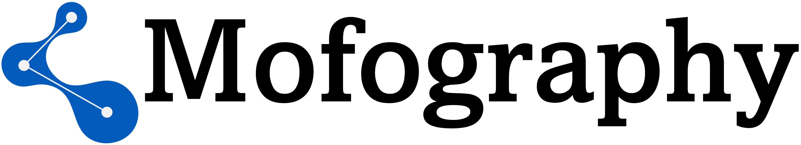
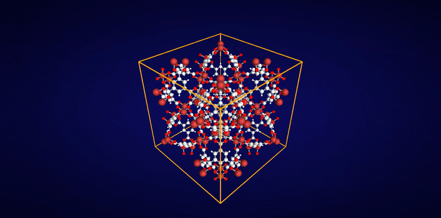

```{=html}
<div class="mg-mast">
  
  
  
  <p class="mg-tagline">Characterization toolkit for MOFs, zeolites, polymers, and other periodic nanoporous materials</p>
  <p class="mg-jumps">
    <a href="#features">Features</a> ·
    <a href="#who">Who is it for?</a> ·
    <a href="#install">Install</a> ·
    <a href="#quick-test">Quick test</a> ·
    <a href="#tutorials">Tutorials</a> ·
    <a href="#cite">Cite</a>
  </p>
  <div class="mg-media">
    <video autoplay muted loop playsinline preload="metadata" poster="assets/mofography_overview_poster.png" aria-label="Framework, pore segmentation, pore graph, and unfolded views">
      <source src="assets/mofography_overview.mp4" type="video/mp4">
    </video>
    
  </div>
</div>
```

**Mofography** segments the void space of periodic nanoporous materials (any structure with a valid unit cell, periodic in all three directions) into pockets and builds **pore graphs** from them. One segmentation gives you global and pocket-level textural properties, pore types, windows, and percolation, plus interactive 3D views and graph descriptors for screening and machine learning (see [Features](#features)).

Core numerics run in a **Rust** backend (`mgr_rust`) behind a **Python** API.

The path from a CIF file to that graph is the [Quick start](quick_start.qmd).

> **Canonical code:** [mofography/mofography](https://github.com/mofography/mofography) · **Latest release:** [`2026.10.09.1`](https://github.com/mofography/mofography/releases/tag/2026.10.09.1) · branch `master`

## Features {#features}

Everything below is available from the Python module. Global properties and pocket-level properties come from the same segmentation, so you can go from a material-level number down to the individual pore that produced it.

| Capability | What you get | Learn more |
|---|---|---|
| **Pore diameters** | Largest cavity diameter (LCD), pore limiting diameter (PLD), and largest included sphere (LIS) along percolating pathways | [Compute pore diameters](compute_pore_diameters.ipynb), [PLD and percolation](pld_and_percolation.ipynb) |
| **Surface area and void volume** | Total (probe-center occupiable) and accessible (probe-center accessible) values, globally and per pocket | [Surface area](surface_area.qmd), [Property calculation](property_calculation.qmd) |
| **Pore size distributions** | Global distributions, and pocket-wise distributions that do not undersample small pockets | [Pore size distributions](pore_size_distributions.qmd) |
| **Pocket segmentation** | The void space split into convex pockets with periodic boundary conditions handled | [Region segmentation](region_segmentation.qmd), [PBC considerations](pbc_considerations.qmd) |
| **Pocket types** | Fingerprinting of pockets by their local environment, to group chemically and geometrically similar pores | [Pocket type detection](pockets_detection.qmd) |
| **Pore windows** | Detection of the windows that connect pockets, including across periodic boundaries | [Connections and windows](connections_and_windows.qmd), [Window fingerprinting](window_fingerprinting.qmd) |
| **Pore graphs** | Pockets as nodes and windows as edges, annotated with local properties, as input for analysis and graph learning | [Region adjacency graph](region_adjacency_graph.ipynb), [PoroNet](PoroNet.qmd) |
| **Percolation** | Percolation thresholds for a given probe, and 3D plots of the accessible, percolating clusters of pockets | [PLD and percolation](pld_and_percolation.ipynb) |
| **Visualization** | Interactive 3D views of the framework, pore surfaces, pockets, and pore graphs | [Visualization](framework_visualization_example.ipynb) |
| **High throughput** | Parallel characterization of whole databases with a Rust core | [High-throughput characterization](hts_using_mofography.ipynb) |

Not a Python user? The same core is available as a **CLI** ([`mgr_cli_py`](https://github.com/arung-northwestern/mgr_cli_py)) for terminal users and AI agents, and as a **web app** for anyone who prefers a GUI and does not code or use a terminal. Both expose a subset of the features above; see [Who should use what](#who).

Using an AI coding agent? Copy [`skills/mofography/SKILL.md`](https://github.com/mofography/mofography/blob/master/skills/mofography/SKILL.md) into your agent's skills folder (for Claude Code, `.claude/skills/mofography/`) so it knows the Python API, the textural-property and percolation functions, and common pitfalls.

## Who should use what? {#who}

Pick your path by **role**. Three tools, one shared science core:

- **① Library** — this repo (`mofography` org)
- **② CLI + Streamlit** — [`mgr_cli_py`](https://github.com/arung-northwestern/mgr_cli_py) (personal repo)
- **③ Web demo** — [Hugging Face Space](https://arung-northwestern-mofography-web-demo.hf.space/) (hosted)

```{mermaid}
%%| eval: true
%%{init: {'themeVariables': {'fontSize': '16px'}, 'flowchart': {'htmlLabels': true, 'curve': 'basis', 'nodeSpacing': 28, 'rankSpacing': 40, 'padding': 16}}}%%
flowchart TB
  V("<b>Just curious?</b>")
  E("<b>A few MOFs?</b>")
  G("<b>Scripts / agents?</b>")
  R("<b>Research / ML?</b>")
  HF("<b>Web demo</b> ③<br/>No install · hosted")
  CLI("<b>CLI + app</b> ②<br/>Local · mgr_cli_py")
  LIB("<b>Library</b> ①<br/>Fastest · this repo")
  V --> HF
  E --> CLI
  G --> CLI
  R --> LIB
  classDef ask fill:transparent,stroke:#94a3b8,stroke-width:1.5px,stroke-dasharray:4 3
  classDef hf fill:#f9731614,stroke:#f97316,stroke-width:2.5px
  classDef cli fill:#14b8a614,stroke:#14b8a6,stroke-width:2.5px
  classDef lib fill:#8b5cf614,stroke:#8b5cf6,stroke-width:2.5px
  class V,E,G,R ask
  class HF hf
  class CLI cli
  class LIB lib
  linkStyle 0 stroke:#f97316,stroke-width:2px
  linkStyle 1,2 stroke:#14b8a6,stroke-width:2px
  linkStyle 3 stroke:#8b5cf6,stroke-width:2px
```

| | **① Library** (this repo) | **② CLI + web app** (`mgr_cli_py`) | **③ Web demo** (HF) |
|---|---|---|---|
| **Best for** | Papers, notebooks, HTS, custom analysis | A few structures, interactive UI, automation without a full env | Try before you install |
| **Install** | Clone + build `mgr_rust` ([below](#install)) | Separate repo; `pip install -e .` + Rust ([README](https://github.com/arung-northwestern/mgr_cli_py)) | None — [open demo](https://arung-northwestern-mofography-web-demo.hf.space/) |
| **Performance** | **Fastest** on your hardware (`--release`, tuned to your CPU) | Fast locally; extra caching vs library | Shared **queue**, **~2 vCPUs** — often slower than local; **16 GB RAM** helps large cells |
| **Maintainer** | [`mofography`](https://github.com/mofography/mofography) org | Personal repo [`arung-northwestern/mgr_cli_py`](https://github.com/arung-northwestern/mgr_cli_py) (will go public; PRs via maintainer) | Hosted demo only |
| **AI / agents** | `import mofography` in code | **`mgrcli`** subprocess — no notebook context | Not for batch/agent pipelines |

> **Tip:** For serious work on medium/large cells, prefer **①** or **②** on your machine. Use **③** to explore the UI and export HTML; expect queueing at busy times.

**Self-hosted web app:** clone [`mgr_cli_py`](https://github.com/arung-northwestern/mgr_cli_py), install, then run Streamlit interactive mode (see that repo's README). It is **not** the same package as `pip install mofography` from this tree.

## Cite this code {#cite}

- **Software:** release tag **`2026.10.09.1`** + commit hash — [releases and citing](releases-and-citing.md), [CITATION.cff](https://github.com/mofography/mofography/blob/master/CITATION.cff).
- **Paper:** A. Gopalan, C. Zheng, B. Azdapour, K. Shi, L. Sarkisov. *Advanced High-Throughput Characterization of Nanoporous Materials using Pore Graphs.* In preparation.
- **Application (machine learning on pore graphs):** C. Zheng, A. Gopalan, K. Shi. *PoroNet: An Intrinsically Interpretable Pore Graph Neural Network for Resolving Pore-Level Adsorption in Metal–Organic Frameworks.* *J. Chem. Theory Comput.* 2026, 22 (11), 5716–5730. [doi:10.1021/acs.jctc.6c00100](https://doi.org/10.1021/acs.jctc.6c00100)

```python
import mofography as m
print(m.__version__, m.__git_revision__)
```

## Install the library {#install}

This repository is the **full Python package**. There is no PyPI wheel yet: you install dependencies, compile **`mgr_rust`** with [maturin](https://www.maturin.rs/) in **release** mode (important for speed on your CPU), then `pip install -e .`.

**Python:** 3.10–3.12 (3.11 recommended) · **Rust:** [rustup](https://rustup.rs/) · **OS:** Linux, macOS, Windows

**Pin a paper/release checkout (optional):**

```bash
git clone https://github.com/mofography/mofography.git && cd mofography
git checkout 2026.10.09.1
```

### One command (Linux / macOS)

**A. Fresh sandbox with [uv](https://github.com/astral-sh/uv)** (creates `.venv` in the clone):

```bash
curl -fsSL https://raw.githubusercontent.com/mofography/mofography/master/scripts/install_mofography.sh | bash -s -- --mode uv-sandbox
```

**B. Active conda / venv** (installs into the Python you already activated):

```bash
curl -fsSL https://raw.githubusercontent.com/mofography/mofography/master/scripts/install_mofography.sh | bash -s -- --mode pip-existing
```

Pin a release in the one-liner:

```bash
curl -fsSL https://raw.githubusercontent.com/mofography/mofography/master/scripts/install_mofography.sh | bash -s -- --mode uv-sandbox --ref 2026.10.09.1
```

From an existing clone: `./scripts/install_mofography.sh --mode uv-sandbox` or `--mode pip-existing --repo-dir .`

### Windows (PowerShell)

```powershell
git clone https://github.com/mofography/mofography.git
cd mofography
git checkout 2026.10.09.1 # optional
.\scripts\install_mofography.ps1
```

Manual conda steps, the Rust rebuild, and the verify command are on the [install page](install.qmd). More on the backend: [Rust backend](rust_backend_documentation.md).

We do **not** ship prebuilt `mgr_rust` wheels per OS. Local `--release` builds match your machine best.

## Quick test {#quick-test}

```python
import mofography as mgr
from ase.io import read

atoms = read("examples/TestCIFs/P1-IRMOF-1.cif")
figures = mgr.quick_cluster(atoms)
```

Interactive **Three.js HTML** is not stored in this repo; export from the **web demo** or [`mgr_cli_py`](https://github.com/arung-northwestern/mgr_cli_py), or regenerate with `examples/gen_*_threejs.py`.

## Tutorials {#tutorials}

Tutorials are Jupyter notebooks and Quarto pages in this site. [Learn](learn.qmd) is the longer index. [API reference](reference/index.qmd) lists every function.

### Basic tutorials (recommended order)

**Basic**

1. [Quick start](quick_start.qmd) — end-to-end workflow with `dgrid_from_atoms_rust` and `do_periodic_segmentation_rust` **(new)**
2. [Basic structure analysis](basic_structure_io.ipynb)
3. [Basic structure visualization](quick_structure_visualization.ipynb)
4. [Distance grid](distance_grid.qmd)
5. [Region segmentation](region_segmentation.qmd)
6. [PBC considerations](pbc_considerations.qmd)
7. [Connections and windows](connections_and_windows.qmd)
8. [Pore graph (region adjacency graph, RAG)](region_adjacency_graph.ipynb)
9. [Compute pore diameters](compute_pore_diameters.ipynb)
10. [Surface area and void volume](surface_area.qmd)
11. [PLD and percolation (winding method)](pld_and_percolation.ipynb)
12. [Pore size distributions](pore_size_distributions.qmd)
13. [Pocket type detection](pockets_detection.qmd) **(new)**
14. [Three.js plotting](threejs_plotting.qmd) **(new)**

**Advanced**

- [MOFDB example](mofdb_example.ipynb)
- [High-throughput characterization](hts_using_mofography.ipynb)
- [Graph neural network model on pore graphs (PoroNet)](PoroNet.qmd) **(new)**
- [Crosslinked polymer properties](property_calculation.qmd)
- [Functional group detection](detect_functional_groups_in_dataset.ipynb)
- [Advanced structure visualization](framework_visualization_example.ipynb)
- [Framework subset visualization](plot_subset_as_mesh_tutorial.ipynb)

**Deeper knowledge** (inner workings, tuning, older approaches)

- [Tuning and safe ranges](parameter_tuning.qmd)
- [Distance grid methods](dgrid_methods.qmd)
- [Selective smoothing](selective_smoothing.qmd)
- [Watershed backends](watershed_backends.qmd) **(new)**
- [VDW radii and segmentation](vdw_radii.qmd)
- [Accessibility methods](accessibility.qmd)
- [Window fingerprinting](window_fingerprinting.qmd)
- [Pathfinding on the pore graph](percolated_paths_tutorial.ipynb)
- [Fast Rust CIF reader](fast_cif_reader.qmd) **(new)**
- [Aromatic ring detection](aromatic_ring_detection.qmd)
- [Periodic segmentation Rust vs Python (HTS)](hts_periodic_seg_benchmark.ipynb)

Also: [install](install.qmd), [CLI quick start](cli_quickstart.qmd), [gallery](gallery.qmd).
