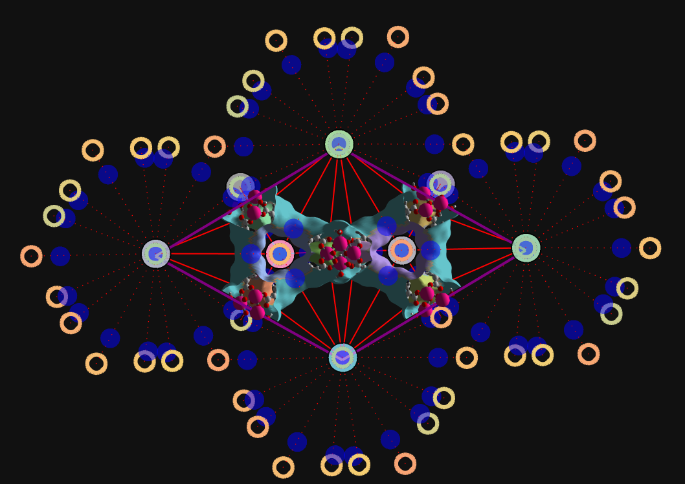

# 🌟 Periodic Segmentation in MOFography


## Overview

The `do_periodic_segmentation` function performs **periodic watershed segmentation** on the distance field of a periodic, crystalline (possibly non-orthogonal) ASE atoms object. It accounts for **periodic boundary conditions (PBC)**, ensuring accurate segmentation of pores in crystalline systems.

### Why Do We Need This? 🤔

In crystalline systems, local maxima outside the unit cell can influence the segmentation inside the box due to PBC. Properly accounting for these periodic effects is crucial for:
- **Realistic pore segmentation** in periodic systems
- **Accurate identification of periodic groups** of maxima
- **Simplified downstream analysis** of pore networks

### How Does It Work? 🛠️

The algorithm works by:
1. **Padding the distance grid** with periodic copies to mimic PBC.
2. **Identifying periodic maxima groups** using `h_maxima` and grouping periodic images.
3. **Performing watershed segmentation** on the padded grid.
4. **Reindexing maxima** to ensure consistent indexing for downstream analysis.

The padding thickness is determined by:
```python
padding_thickness = dgrid.max() / min_perpendicular_voxel_length + 5 / spacing
```
An additional `extra_padding` parameter allows users to add more padding for safety.

## Theory 📚

### Key Steps in the Workflow

1. **Maxima Detection (`maxima_pbc`)**
   - Compute local maxima in the grid using `h_maxima` with a 1-voxel-thick padding.
   - Identify periodic images of maxima and group them into **PBC groups**.
   - For example, in ZIF-8, you'd get:
     - 2 periodic maxima: one at the corner and one at the unit cell center.

2. **Locate All Periodic Images**
   - Identify all periodic images of `maxima_pbc` within the padded grid domain.

3. **Definitions of Maxima Terms**
   - **`maxima_pbc`**: Local maxima in the original grid, one per PBC group.
   - **`maxima` (or `unique_regions`)**: Local maxima influencing the unit cell, which may lie outside the box.
   - **`all_maxima`**: All periodic images of `maxima_pbc` within the padded domain.
   - **`close_by_maxima`**: Maxima inside the unit cell or within a `wall_thickness` of the unit cell. Default `wall_thickness` is 7.5% of the perpendicular lengths of the unit cell (reciprocal system for non-orthogonal cells).

4. **Maxima Information (`maxima_info`)**
   - A 2D array of shape `(N_all_maxima, 7)`:
     | Column         | Description                                      |
     |----------------|--------------------------------------------------|
     | `maxima_label` | Label of the maxima                              |
     | `pbc_x/y/z`    | Coordinates of the corresponding PBC maxima      |
     | `offset_x/y/z` | Grid shifts to locate the periodic image         |

   - To compute the actual indices of a maxima `k`:
     ```python
     maxima_indices = maxima_info[k-1, 1:4] + maxima_info[k-1, 4:7] * np.array(dgrid.shape)
     ```

5. **Regions Segmentation**
   - **`regions_pbc`**: Use periodic maxima markers (same label for each `maxima_pbc` and its periodic images) to segment the padded grid. Extract the central region corresponding to the original grid.
   - **`regions_without_pbc` (or `regions`)**: Use separate markers for each `maxima_pbc` and its periodic images to segment the padded grid. Extract the central region corresponding to the original grid.

6. **Connections**
   - Identify touching regions in `regions_padded` and compute shared boundaries to populate the **connections list**.
   - Ignore regions near the padded grid boundary to avoid unreliable connections.

7. **Reindexing Maxima**
   - Maxima are reindexed in the order of decreasing importance:
     1. `maxima_pbc` get indices `1, 2, ..., N_maxima_pbc`.
     2. `close_by_maxima` get the next indices if not already assigned.
     3. `unique_regions` maxima influencing the unit cell get the next indices.
     4. Maxima in the padded regions connected to `close_by_maxima` get indices.
     5. Remaining maxima in the padded regions get indices.

   - This reindexing simplifies downstream analysis:
     - For example, to filter maxima corresponding to `unique_regions`:
       ```python
       maxima = all_maxima[:regions.max()] # or 
       maxima = all_maxima[:(len(unique_regions)+1)]
       ```

### Advantages of Reindexing
- Ensures consistent indexing across all outputs (`regions_pbc`, `regions`, `maxima_pbc`, etc.).
- Simplifies filtering and visualization of specific maxima groups.
- Facilitates incremental graph extension using more and more padding, indices of the maxima wil remain somewhat consistent across increases.

## Advantages of Periodic Segmentation✨

- **Realistic periodic segmentation** for crystalline systems.
- Unified processing of regions (`regions_pbc`, `regions`) and connections.
- Accurate identification of periodic maxima groups.
- Simplified downstream analysis with consistent maxima indexing.
- Optional padded regions for extended graph analysis.


## Usage 💻

```python
import mofography as mgr
from ase.io import read

# Load structure and compute distance grid
# you can use other dgrid methods here as well, should be ok.
atoms = read("structure.cif")
spacing = 0.5
dgrid = mgr.dgrid_from_atoms_cpu(atoms, spacing=spacing)

# Run periodic segmentation
results = mgr.do_periodic_segmentation(
    dgrid, 
    atoms,
    spacing=spacing,
    mask_thickness=0.05,
    h=0.2,
    threshold_abs=1.5,
    minimum_window_separation=1.5,
    wall_thickness=0.08,
    extra_padding=10,
    return_padded_regions=True
)
```

### Key Parameters 🔧

- `mask_thickness`: Void space threshold
- `h`: h-maxima threshold
- `threshold_abs`: Absolute threshold for maxima
- `minimum_window_separation`: Minimum distance between windows
- `wall_thickness`: Thickness for boundary detection
- `extra_padding`: Additional padding thickness

## Detailed Step-by-Step Example 📝

### 1. Import Required Libraries
```python
from pathlib import Path
import numpy as np
import mofography as mgr
from ase.io import read
import plotly.express as px
import plotly.graph_objects as go
```

### 2. Load and Prepare Structure
```python
# List of tested materials for the exact same input params as above
# you can find cif files under docs/TestCIFs in the GitHub repo
materials = [
    'AXINAX_clean',
    'fidriv_clean',
    'NU-1000_S1',
    'LTA96',
    'P1-Cu-BTC',
    'zif-4_1',
    'ABAVIJ_clean',
    'ACOGEF_clean',
    'P1-IRMOF-1',
    'ZIF-8-RASPA',
    'MIL-47-RASPA'
]

# Example using IRMOF-1
material = 'P1-IRMOF-1'
path_to_cif = Path(f"cif_files/{material}.cif")
mat_atoms = read(path_to_cif)

# Update structure with covalent bonds
mat_updated = mgr.update_with_covalent_bonds(mat_atoms)
```

### 3. Generate and Process Distance Grid
```python
# Set grid parameters
spacing = 0.5 # grid spacing in angstroms
zoom_factor = 1 # how much to make finer using interpolation 
extra_padding = 10 # this is in angstroms

# Generate distance grid (try other dgrid methods as well here, should be fine)
dgrid = mgr.dgrid_from_atoms_cpu(mat_atoms, spacing=spacing, block_size=50000)

# Apply zoom and smoothing, here we are not zooming if zoom_factor is 1
dgrid = mgr.zoom_grid(dgrid, zoom_factor).compute()
dgrid = mgr.periodic_gaussian_filter(dgrid, sigma=spacing*zoom_factor*2)

```

### 4. Run Periodic Segmentation
```python
results = mgr.do_periodic_segmentation(
    dgrid, 
    mat_atoms, 
    spacing=spacing/zoom_factor,
    return_padded_regions=True,
    mask_thickness=0.05,
    h=0.2,
    threshold_abs=1.5,
    minimum_window_separation=1.5,
    wall_thickness=0.08,
    extra_padding=extra_padding
)
```

### 5. Extract Results
The output is a dictionary, so you'll have to grab whatever you need, here's all of the outputs as vars

```python
# Extract all variables from results
maxima_info = results['maxima_info']
unique_regions = results['unique_regions']
regions = results['regions']
maxima_pbc_dict = results['maxima_pbc_dict']
maxima_pbc = results['maxima_pbc']
connections = results['connections']
all_maxima = results['all_maxima']
pbc_groups = results['pbc_groups']
maxima = all_maxima[:regions.max()]
regions_pbc = results['regions_pbc']
close_maxima = results['close_or_inside_maxima']
regions_padded = results['regions_padded']
close_or_inside_regions = results['close_or_inside_regions']
```

#### 5.1 Trim Connections
```python
# Trim connections to relevant regions
connections_trimmed = np.vstack([
    c for c in connections 
    if np.any(np.isin(c[0], unique_regions))
])
```

### 6. Visualization
```python
# Set visualization parameters
surface_value = 1.5
cscale = px.colors.qualitative.Pastel

# Create individual traces
cell_trace = mgr.plot_cell(mat_atoms)
frame_trace = mgr.plot_framework_as_mesh(mat_updated, stylize=True)

# Plot different types of maxima
close_maxima_trace = mgr.plot_maxima(
    dgrid, 
    close_maxima, 
    mat_atoms, 
    name='Close maxima',
    show_spheres=False,
    marker_colorscale=cscale
)

maxima_trace = mgr.plot_maxima(
    dgrid,
    maxima,
    mat_atoms,
    name='maxima influencing box',
    show_spheres=False,
    marker_colorscale=cscale
)

maxima_trace_pbc = mgr.plot_maxima(
    dgrid,
    maxima_pbc,
    mat_atoms,
    name='Maxima PBC',
    show_spheres=False,
    marker_colorscale=cscale
)

# Plot surfaces
surface_trace_pbc = mgr.plot_surface_dgrid(
    dgrid,
    isovalue=surface_value,
    region_labels=regions_pbc,
    ase_atoms=mat_atoms,
    cscale=cscale,
    name=f'Regions PBC at {surface_value}Å',
    stylize=True
)

surface_trace = mgr.plot_surface_dgrid(
    dgrid,
    isovalue=surface_value,
    region_labels=regions,
    ase_atoms=mat_atoms,
    cscale=cscale,
    name=f'Regions at {surface_value}Å',
    stylize=True
)

# Plot connections and windows
connections_trace = mgr.plot_connections_as_it_is(
    connections_trimmed,
    all_maxima,
    regions.shape,
    mat_atoms,
    cscale=cscale,
    plot_disconnected=True
)

windows_trace = mgr.plot_windows(connections_trimmed, marker_color='blue')

# Combine all traces and create figure
fig = go.Figure(
    data=[
        cell_trace,
        surface_trace_pbc,
        surface_trace,
        *connections_trace,
        close_maxima_trace,
        maxima_trace,
        maxima_trace_pbc,
        windows_trace,
        *frame_trace,
    ],
    layout=mgr.dark_layout
)

# Update figure layout
fig.update_layout(scene_aspectmode="data")
fig.update_layout(legend_groupclick="toggleitem")
# if you want to visualize in orthographic instead of perspective projection
fig = mgr.make_fig_orthographic(fig)


# Save figure
fig.write_html('visualization.html')
```

## Advantages ✨

- Realistic representation of periodic systems
- Unified processing of regions_pbc, regions and connections
- Accurate periodic group detection
- Simplified downstream analysis since now all maxima are exact periodic images of `maxima_pbc`
- Optional padded regions for extended analysis or extending the grap

## Limitations ⚠️

- Computationally intensive for large cells
- Higher memory requirements
- Complex initial setup and intuition

## Tips & Tricks 💡

1. Increase `extra_padding` if seeing floating windows
2. Filter connections for visualization:
```python
filtered_connections = [c for c in connections if np.any(np.isin(c[0], unique_regions))]
```
3. Most of the old functions, like `rag_from_connections` or `apply_pbc` and all should still work (**I haven't tested the all**), so if you want to make a rag (not periodic just yet, coming soon!), you can do, 
```python
rag = mgr.rag_from_connections(connections, all_maxima) # or (connections_trimmed, all_maxima) if that's all you need for rag
```
or you can make connections list also like before,
```python
connections_old = mgr.connections_from_regions_and_dgrid(regions, dgrid, maxima, mat_atoms)
```
of course, these connections won't have anything past the maxima corresponding to the unique regions. (** I haven't tested this extensively**)

## Future Development Roadmap🚀
                                                                                               
- Bug fixes, of course
- Performance optimization for connections calculations
- Alternative faster watershed implementations for large grids perhaps from opencv for something like that.
- Custom maxima_pbc specifications as an optional input from user.
- GPU acceleration options

## Conclusions 🎯

The periodic segmentation algorithm provides a robust solution for analyzing pore networks in crystalline materials, properly accounting for periodic boundary conditions and providing rich structural information for downstream analysis.
