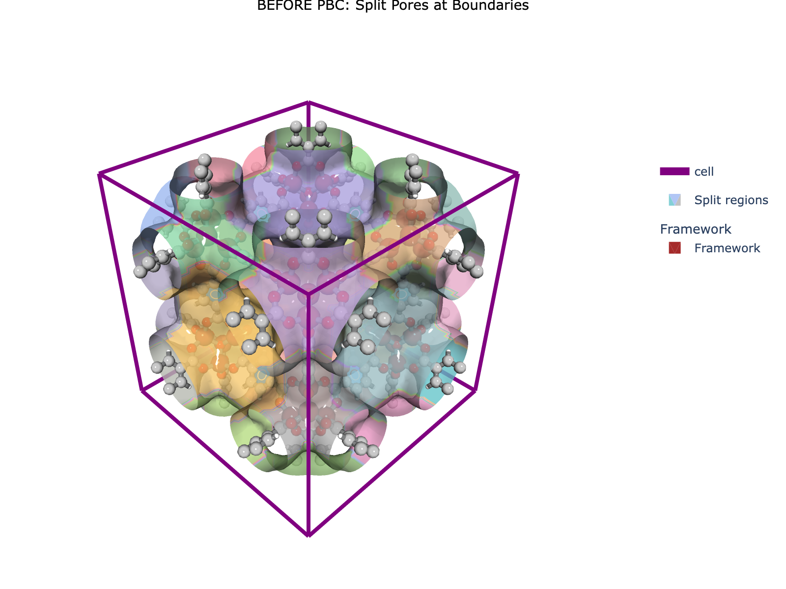
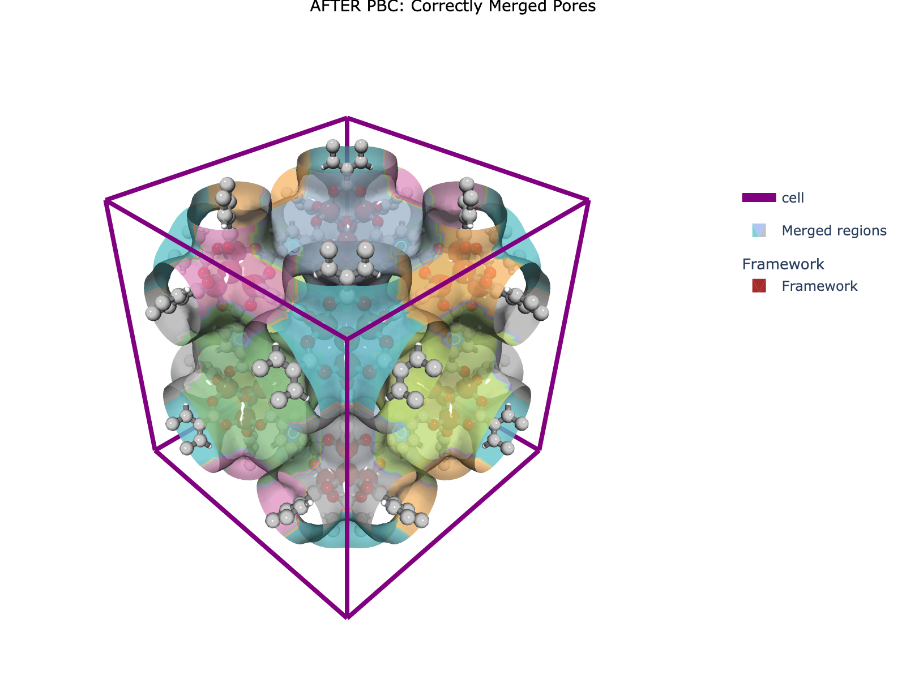
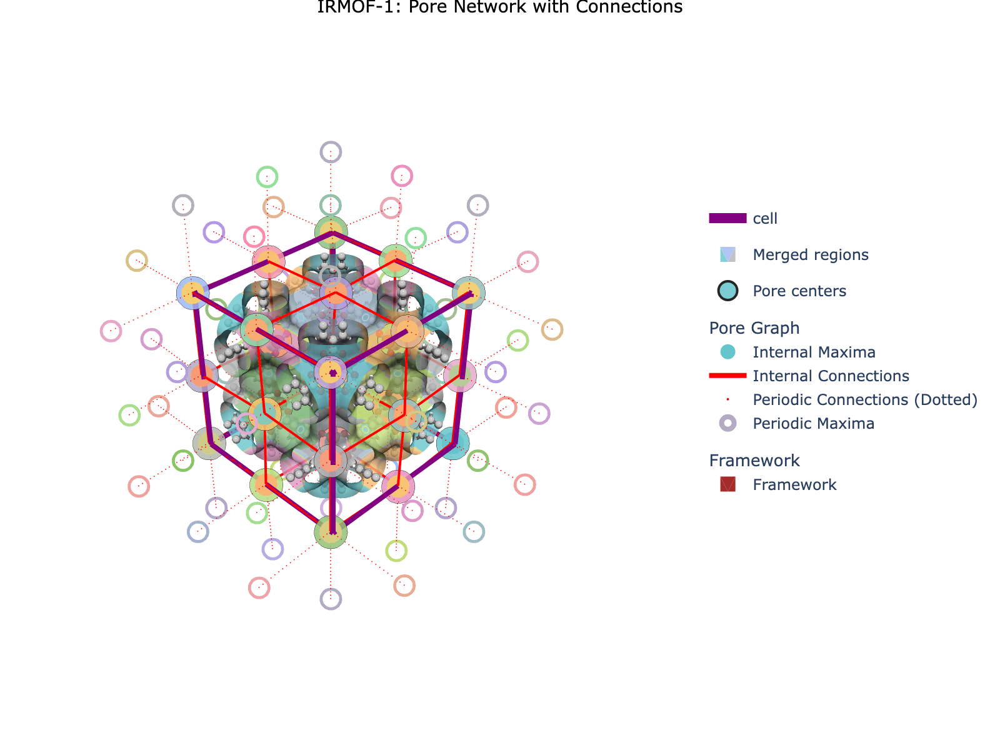

# 🌟 Periodic Segmentation Quick Start

> **A beginner-friendly introduction to analyzing pore networks in crystalline nanoporous materials using MOFography**

---

## 📚 Citation

**MOFography** is a powerful Python package for analyzing pore networks in crystalline materials like MOFs, COFs, and zeolites.

📖 **Full Paper**: [MOFography: Decoupling Long-Range and Short-Range Influences in Nanoporous Materials via Graph-Based Pore Network Analysis](https://doi.org/10.26434/chemrxiv-2024-xxxxx) *(Coming soon!)*

```bibtex
@article{mofography2024,
  title={MOFography: Decoupling Long-Range and Short-Range Influences in Nanoporous Materials via Graph-Based Pore Network Analysis},
  author={[Author names]},
  journal={ChemRxiv},
  year={2024},
  doi={https://doi.org/10.26434/chemrxiv-2024-xxxxx}
}
```

---

## 🎯 What is MOFography?

At its core, **MOFography** breaks down the complex cavities of nanoporous materials into manageable, convex segments centered around **local maxima** in the distance field. By carefully accounting for **periodic boundary conditions (PBC)**, it constructs a **pore graph** (also called a Region Adjacency Graph or RAG) that represents the pore network as an interconnected network of pockets.

### Why is this Powerful? 🚀

Traditional textural properties (surface area, pore volume, pore size distribution) provide valuable **bulk insights** but cannot capture the **spatial relationships** between pores. MOFography's graph-based approach:

1. **Decouples Influences** 🔀
   - **Short-range**: Local pore geometry (size, shape, chemistry)
   - **Long-range**: How pores connect and arrange throughout the material

2. **Flexible & Compact** 📦
   - Graphs are much more compact than 3D grids
   - Easy to manipulate, query, and analyze
   - Perfect for network theory algorithms

3. **ML-Ready** 🤖
   - Natural input for graph neural networks (GNNs)
   - Features can be extracted at node, edge, or graph level
   - Enables transfer learning across materials

4. **Physically Interpretable** 🧠
   - Each node = a real pore you can visualize
   - Each edge = a real window for molecular transport
   - Graph properties map to material behavior

---

## ⚠️ Tutorial Scope

**This is a QUICK START tutorial**, not a comprehensive guide!

✅ **What this tutorial covers:**
- The basic periodic segmentation workflow
- How to get started quickly with your own material
- Important parameters and what they mean
- Key outputs and how to interpret them
- Basic visualization using Plotly

❌ **What this tutorial does NOT cover:**
- Detailed algorithmic nuances of each step
- Advanced parameter tuning strategies
- All available outputs and their uses
- Advanced analysis (percolation, path finding, ML applications)
- Performance optimization tricks

🔗 **For deeper understanding**, we strongly recommend going through the series of **Basic** and **Advanced tutorials** listed in the [README](../README.md). Each tutorial focuses on specific aspects in detail.

---

## 🔄 The Old Workflow (Legacy)

Before we dive into the new workflow, it's worth mentioning the **legacy approach** that MOFography used to use:

**The Old Way (Legacy):**
1. Compute distance grid → Find local maxima → Regular watershed segmentation
2. Get split pores at unit cell boundaries
3. Use `apply_pbc()` to manually merge periodic images
4. Compute connections separately

**Problems with the old approach:**
- ❌ Manual post-processing required
- ❌ Error-prone (easy to miss merges)
- ❌ Slower (multiple separate steps)
- ❌ Hard to maintain consistent indexing

**The New Way (Current):**
- ✅ One function call: `do_periodic_segmentation_rust()`
- ✅ Handles PBC automatically from the start
- ✅ 5-20x faster with Rust backend
- ✅ Returns all outputs with consistent indexing

📜 **Legacy tutorials** (for reference/educational purposes):
- [Applying PBC](applying_pbc.ipynb) - How the old manual merging worked
- [Region Segmentation](region_segmentation.ipynb) - Segmentation methods
- [Region Adjacency Graph](region_adjacency_graph.ipynb) - Working with pore graphs
- [Connections and Windows](connections_and_windows.ipynb) - Window detection

These are kept for educational value and for users maintaining legacy code, but **new projects should use the periodic segmentation workflow** covered in this tutorial.

---

## 🌟 Why Do We Need Periodic Segmentation?

If you're working with **crystalline nanoporous materials**, you've encountered a fundamental problem:

**Pores don't respect unit cell boundaries!** 😤

Imagine a cubic unit cell with a large pore at each corner. When you segment it, you get **8 separate pore regions** at the 8 corners. But wait - these are all actually the **same pore**, just cut off by the arbitrary boundaries we drew around the unit cell!



*Without PBC: The same pore appears as 8 separate regions at the corners. This is not ideal for the purposes of averaging properties!*

**Periodic segmentation solves this** by expanding the grid to "see" across periodic boundaries, identifying which regions belong together, and merging them correctly.



*With PBC: Regions are correctly merged. The 8 corner pieces are recognized as one pore. Same with opposing faces, sets of 4 parallel edges along each direction etc. you get the idea :) *

---

## 🎓 What You'll Learn

By the end of this tutorial, you'll be able to:

1. ✅ Load a crystalline structure (CIF file)
2. ✅ Compute a distance grid (how far each point is from the nearest atom)
3. ✅ Run **periodic segmentation** to identify pores and their connections
4. ✅ Trim connections to avoid artifacts from padded regions
5. ✅ Create a pore graph (Region Adjacency Graph) for analysis
6. ✅ Visualize the pore network in 3D

*(Note: Pocket type detection is covered in the [Pockets Detection](pockets_detection.ipynb) tutorial)*

---

## 🔧 Prerequisites

- Python 3.8+
- MOFography installed (`uv pip install -e .`)
- Basic familiarity with Python and NumPy arrays
- (Optional) ASE for structure handling

---

## 📖 The Workflow in a Nutshell

```
Structure (CIF) → Distance Grid → Periodic Segmentation → Trim Connections → Pore Graph → Visualization
```

---

## Step 1: Imports and Setup 📦

```python
import os
import sys
import numpy as np
from pathlib import Path

import mofography as mgr
from ase.io import read

# Set up paths - adjust for your setup
repo_root = Path('/path/to/mofography')
path_to_cif = repo_root / 'examples' / 'TestCIFs' / 'P1-IRMOF-1.cif'
```

---

## Step 2: Load the Structure 🏗️

```python
mat_atoms = read(path_to_cif)

print(f"Loaded structure: {mat_atoms.get_chemical_formula()}")
print(f"  Number of atoms: {len(mat_atoms)}")
print(f"  Unit cell: {mat_atoms.cell.cellpar()[:3]} Angstroms")
```

**What is this?**
- An ASE `Atoms` object containing atomic positions, unit cell dimensions, and atomic numbers

---

## Step 3: Set Parameters ⚙️

```python
# Grid parameters
spacing = 0.5  # Grid spacing in Angstroms

# Segmentation parameters
mask_thickness = 1.0  # Void space threshold (Angstroms)
h = 0.2  # h-maxima persistence (suppress noise)
threshold_abs = 1.5  # Absolute threshold (ignore small maxima)

# Periodic segmentation parameters
minimum_window_separation = 1.5  # Min distance between windows (Angstroms)
wall_thickness = 0.08  # Boundary detection (fraction of cell)
extra_padding = 10  # Extra padding (Angstroms)
```

**Parameter Guide:**

| Parameter | What it does | Typical range |
|-----------|--------------|---------------|
| `spacing` | Grid resolution (lower = more detailed) | 0.3 - 1.0 Å |
| `mask_thickness` | Minimum pore size to consider | 0.8 - 1.5 Å |
| `h` | Suppress noise in maxima detection | 0.1 - 0.5 |
| `threshold_abs` | Ignore small maxima | 1.0 - 2.0 Å |
| `wall_thickness` | PBC boundary detection sensitivity | 0.05 - 0.15 |
| `extra_padding` | Safety margin for large pores | 5 - 20 Å |

**Tip:** Start with defaults and adjust only if results don't look right!

---

## Step 4: Compute the Distance Grid 📏

The **distance grid** is a 3D array where each voxel contains the distance to the nearest atom. This is the foundation for pore analysis.

```python
# Compute distance grid
dgrid = mgr.dgrid_from_atoms_cpu(mat_atoms, spacing=spacing, block_size=50000)

# Apply smoothing
dgrid = mgr.zoom_grid(dgrid, zoom_factor=1).compute()
dgrid = mgr.periodic_gaussian_filter(dgrid, sigma=spacing*2)

# CRITICAL: Convert to float32 for Rust backend
dgrid = dgrid.astype(np.float32)

print(f"Distance grid shape: {dgrid.shape}")
print(f"Distance grid range: {dgrid.min():.2f} to {dgrid.max():.2f} Angstroms")
```

**Understanding the Distance Grid:**
- 🟢 **High values** = far from atoms (inside pores)
- 🔴 **Low values** = close to atoms (inside walls/framework)
- 🎯 We're looking for **local maxima** - the "centers" of pores

---

## Step 5: Run Periodic Segmentation 🎯

One function call does it all!

```python
results = mgr.do_periodic_segmentation_rust(
    dgrid,
    mat_atoms,
    spacing=spacing,
    mask_thickness=mask_thickness,
    h=h,
    threshold_abs=threshold_abs,
    minimum_window_separation=minimum_window_separation,
    wall_thickness=wall_thickness,
    extra_padding=extra_padding,
    return_padded_regions=True,
    compute_connections=True
)

print(f"\n✅ Periodic segmentation complete!")
print(f"Found {len(results['maxima_pbc'])} unique periodic maxima")
print(f"Found {len(results['unique_regions'])} unique regions")
print(f"Found {len(results['pbc_groups'])} PBC groups")
print(f"Found {len(results['connections'])} region connections")
```

**What just happened?**
1. **Padding** → Grid expanded to see across periodic boundaries
2. **Maxima Detection** → Found local maxima (pore centers) in padded grid
3. **PBC Grouping** → Identified which maxima are periodic images
4. **Watershed Segmentation** → Assigned each voxel to nearest maximum
5. **Connection Detection** → Found where regions touch (windows)
6. **Reindexing** → Organized outputs by importance

---

## Step 6: Extract Results 📊

```python
# Extract all results
maxima_pbc = results['maxima_pbc']           # One per PBC group
regions_pbc = results['regions_pbc']         # Segmentation WITH PBC merged
regions = results['regions']                 # Segmentation WITHOUT PBC (split)
connections = results['connections']         # Windows between pores
all_maxima = results['all_maxima']           # All periodic images
unique_regions = results['unique_regions']   # Regions influencing unit cell
pbc_groups = results['pbc_groups']           # Lists of periodic image groups

# Maxima influencing the unit cell
maxima = all_maxima[:regions.max()]

print(f"\nmaxima_pbc: {maxima_pbc.shape}  (representative pore centers)")
print(f"regions_pbc: {regions_pbc.shape}, max={regions_pbc.max()}  (merged)")
print(f"regions: {regions.shape}, max={regions.max()}  (split)")
```

**The Output Arrays:**

| Output | What is it? | Why care? |
|--------|-------------|-----------|
| `maxima_pbc` | One representative per pore type | Canonical pore centers |
| `regions_pbc` | Segmentation with PBC merged | Same pore = same label |
| `regions` | Segmentation without PBC | Each piece has different label |
| `all_maxima` | All periodic images | For plotting connections |
| `pbc_groups` | Which maxima belong together | For pocket type detection |
| `connections` | Windows between pores | For pore graph analysis |
| `unique_regions` | Regions influencing unit cell | For filtering/trimming |

**Clever Indexing Trick:** Maxima are ordered by importance, so `all_maxima[:regions.max()]` gives you just the maxima influencing the unit cell! ✨

---

## Step 7: Trim Connections (Recommended!) ✂️

```python
# Trim to connections that influence the unit cell
connections_trimmed = np.array([
    c for c in connections
    if np.any(np.isin(c[0], unique_regions))
])

print(f"Original connections: {len(connections)}")
print(f"Trimmed connections: {len(connections_trimmed)}")
```

**Why trim?**
- The full `connections` list includes connections into padded regions
- These can create artifacts in analysis
- Trimming ensures we only analyze pores that influence the unit cell

---

## Step 8: Create the Pore Graph (RAG) 🕸️

```python
# Create RAG from trimmed connections
rag = mgr.rag_from_connections(connections_trimmed, all_maxima)

print(f"\nPore Graph Statistics:")
print(f"  Nodes (pores): {rag.number_of_nodes()}")
print(f"  Edges (connections): {rag.number_of_edges()}")
```

**What is the RAG?**
- **Nodes**: Individual pores
- **Edges**: Windows/connections between pores
- **Node attributes**: Position, volume, shape, etc.
- **Edge attributes**: Window center, radius, type

The RAG is useful for:
- 📍 Path finding (percolation analysis)
- 📊 Network properties (coordination, clustering)
- 🤖 Feature extraction for machine learning

---

## Step 9: Visualize the Results 🎨

```python
import plotly.graph_objects as go
import plotly.express as px

# Set up colorscale
cscale = px.colors.qualitative.Pastel

# Update structure with covalent bonds
mat_updated = mgr.update_with_covalent_bonds(mat_atoms)

# Create base traces
cell_trace = mgr.plot_cell(mat_atoms)
frame_trace = mgr.plot_framework_as_mesh(mat_updated, stylize=True)

# Plot merged regions
surface_trace = mgr.plot_surface_dgrid(
    dgrid,
    isovalue=1.5,
    region_labels=regions_pbc,
    ase_atoms=mat_atoms,
    cscale=cscale,
    name='Pores (PBC merged)',
    stylize=True,
    opacity=0.8
)

# Plot pore centers
maxima_trace = mgr.plot_maxima(
    dgrid, maxima, mat_atoms,
    name='Pore centers',
    show_spheres=False,
    marker_colorscale=cscale
)

# Plot connections
connections_traces = mgr.plot_connections_as_it_is(
    connections_trimmed,
    all_maxima,
    dgrid.shape,
    mat_atoms,
    cscale=cscale,
    plot_disconnected=False,
    show_spheres=False
)

# Combine into figure
fig = go.Figure(
    data=[cell_trace, surface_trace, maxima_trace, *connections_traces, *frame_trace],
    layout=mgr.dark_layout
)

fig.update_layout(
    scene_aspectmode='data',
    title=dict(
        text="IRMOF-1: Pore Network with Connections",
        x=0.5,
        xanchor='center',
        font=dict(size=16, color='white')
    ),
    scene=dict(
        xaxis=dict(title='X (Å)'),
        yaxis=dict(title='Y (Å)'),
        zaxis=dict(title='Z (Å)')
    )
)

fig.show()
```

**Expected Output:**



*IRMOF-1 pore network showing merged pores (surfaces), pore centers (dots), and connections (lines).*

---

## 🛠️ Troubleshooting

| Issue | Solution |
|-------|----------|
| **Too many/few maxima** | Adjust `h` (higher = fewer) or `threshold_abs` (higher = fewer) |
| **Regions not merged correctly** | Increase `extra_padding` or check `wall_thickness` |
| **Missing connections** | Decrease `minimum_window_separation` or increase `mask_thickness` |
| **Memory error** | Increase `spacing` (lower resolution) or reduce `extra_padding` |
| **Wrong dtype error** | Make sure to do `dgrid = dgrid.astype(np.float32)` |

---

## 🚀 Next Steps

### Learn More in Detail:
- **[Periodic Segmentation Guide](periodic_segmentation_notes_ai.md)** - Deep dive into the algorithm
- **[Output Reference](outputs_from_periodic_segmentation.md)** - Understand all outputs
- **[Rust Backend Documentation](rust_backend_documentation.md)** - Performance details

### Explore Basic Tutorials:
- `region_segmentation.ipynb` - Alternative segmentation methods
- `region_adjacency_graph.ipynb` - Working with pore graphs
- `connections_and_windows.ipynb` - Window detection details
- `pockets_detection.ipynb` - Classify pocket types

### Explore Advanced Tutorials:
- `pld_and_percolation.ipynb` - Pore limiting diameter & percolation
- `hts_using_mofography.ipynb` - High-throughput screening
- `percolated_paths_tutorial.ipynb` - Path finding analysis

---

## 📝 Summary

| Step | Function | Output |
|------|----------|--------|
| 1. Load structure | `ase.io.read()` | Atoms object |
| 2. Compute grid | `dgrid_from_atoms_cpu()` | Distance grid |
| 3. Segment | `do_periodic_segmentation_rust()` | All results |
| 4. Extract | Access dict keys | Maxima, regions, connections |
| 5. Trim | Filter connections | Trimmed connections |
| 6. Create RAG | `rag_from_connections()` | Pore graph |
| 7. Visualize | `plot_surface_dgrid()`, etc. | 3D figure |

**Key Takeaway:** Periodic segmentation replaces the old multi-step workflow with ONE fast function call, while properly handling PBC from the start! 🎉

---

## 🎁 Bonus: Standalone Script

For your convenience, a standalone Python script is provided:

```bash
cd docs
python periodic_segmentation_quick_start.py
```

This will:
✅ Run the complete workflow
✅ Generate an interactive HTML visualization
✅ Save results to your current directory
✅ Open the visualization in your browser

Happy analyzing! 🎊
