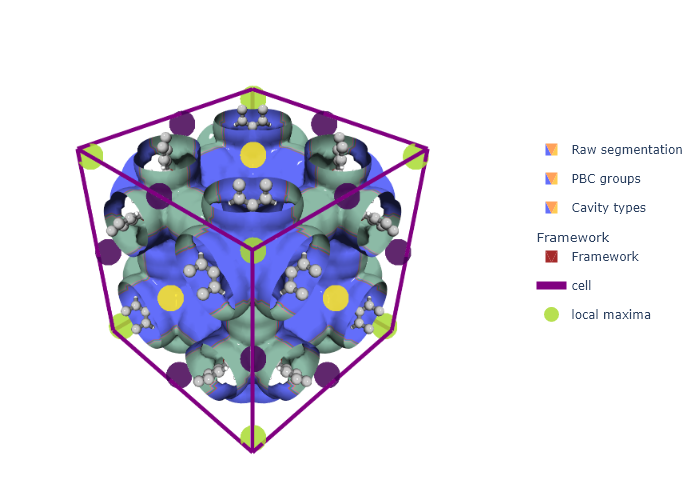
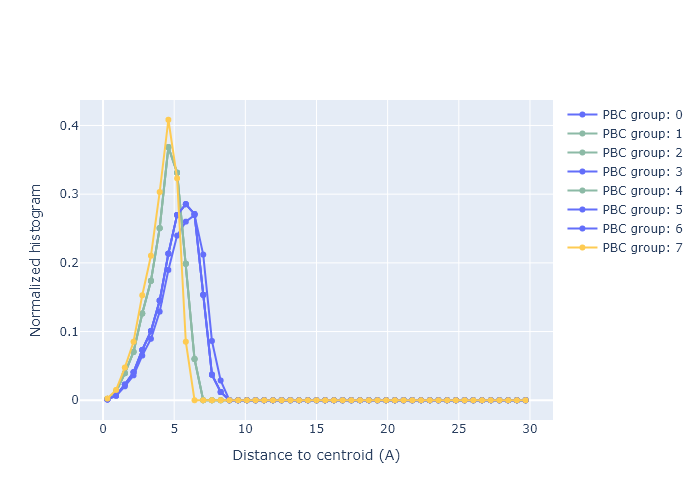

# Detecting Types of Pockets

> **Using unsupervised machine learning to classify pore types in crystalline materials**

---

## Related Documentation

This is part of the MOFography tutorial series:
- [Periodic Segmentation Quick Start](periodic_segmentation_quick_start.md) - Complete workflow
- [Pore Graph](pore_graph.md) - Building and analyzing pore networks
- [Connections and Windows](connections_and_windows.md) - Window detection
- [Region Segmentation](region_segmentation.md) - Segmentation fundamentals

---

## What is Pocket Detection?

Pocket detection classifies pores into different **types** based on their geometric or energetic properties. This is useful for:

1. **Characterization** 📊
   - Understand material structure (cages vs channels)
   - Identify unique pore environments

2. **Machine Learning** 🤖
   - Generate features for ML models
   - Cluster similar materials together

3. **Property Prediction** 🔮
   - Correlate pocket types with performance
   - Screen materials for specific applications

### The Core Concept 🧠

```
Cavity Size Distribution (CSD) Features
    ↓
Agglomerative Clustering (Jensen-Shannon divergence)
    ↓
Pocket Type Labels (0, 1, 2, ...)
```

---

## ⚠️ Tutorial Scope

**This is an ADVANCED tutorial** on pocket detection and classification.

✅ **What this tutorial covers:**
- Computing Cavity Size Distribution (CSD) features
- Performing agglomerative clustering with PBC
- Visualizing pocket types in 3D
- Using geometric vs energy-based features

❌ **What this tutorial does NOT cover:**
- Basic segmentation - see [Periodic Segmentation Quick Start](periodic_segmentation_quick_start.md)
- Graph construction - see [Pore Graph](pore_graph.md)
- Window detection - see [Connections and Windows](connections_and_windows.md)

---

## 🎓 What You'll Learn

1. ✅ Compute Cavity Size Distribution (CSD) features for each pocket
2. ✅ Perform hierarchical clustering using Jensen-Shannon divergence
3. ✅ Handle periodic boundary conditions in clustering
4. ✅ Visualize pocket types on 3D pore surfaces
5. ✅ Compare geometric vs energy-based clustering

---

## 🔧 Prerequisites

- Python 3.8+
- MOFography installed (`uv pip install -e .`)
- [Periodic Segmentation Quick Start](periodic_segmentation_quick_start.md) completed
- [Pore Graph](pore_graph.md) completed
- NetworkX installed

---

## 📖 Step-by-Step Tutorial

### Step 1: Setup and Imports 📦

```python
import os
import sys
import numpy as np
from pathlib import Path
from skimage.measure import regionprops

import mofography as mgr
from ase.io import read

repo_root = Path('/path/to/mofography')
path_to_cif = repo_root / 'examples' / 'TestCIFs' / 'P1-IRMOF-1.cif'
```

---

### Step 2: Run Periodic Segmentation 🎯

Use `do_periodic_segmentation_rust()` to get everything in one call:

```python
mat_atoms = read(path_to_cif)
mat_updated = mgr.update_with_covalent_bonds(mat_atoms)

spacing = 0.5
dgrid = mgr.dgrid_from_atoms_cpu(mat_atoms, spacing=spacing, block_size=50000)
dgrid = mgr.zoom_grid(dgrid, zoom_factor=1).compute()
dgrid = mgr.periodic_gaussian_filter(dgrid, sigma=spacing*2).astype(np.float32)

results = mgr.do_periodic_segmentation_rust(
    dgrid, mat_atoms,
    spacing=spacing,
    mask_thickness=1.0,
    h=0.2,
    threshold_abs=1.5,
    minimum_window_separation=1.5,
    wall_thickness=0.08,
    extra_padding=10,
    compute_connections=True
)

print(f"✅ Segmentation complete!")
print(f"  Found {len(results['maxima_pbc'])} unique pores")
print(f"  Found {len(results['connections'])} connections")
```

---

### Step 3: Extract Key Results 📊

```python
maxima_pbc = results['maxima_pbc']      # One per unique pore
regions_pbc = results['regions_pbc']    # Merged regions (PBC applied)
regions = results['regions']            # Split regions
connections = results['connections']    # All connections
all_maxima = results['all_maxima']      # All periodic images
unique_regions = results['unique_regions']  # Regions in unit cell

# Maxima for unit cell (for RAG construction)
maxima = all_maxima[:regions.max()]
print(f"  Maxima in unit cell: {len(maxima)}")
```

---

### Step 4: Construct the Pore Graph 🕸️

Build the RAG using `unique_regions` and trimmed connections:

```python
# Trim connections to unit cell
connections_trimmed = np.array([
    c for c in connections
    if np.any(np.isin(c[0], unique_regions))
])

# Build RAG from connections
rag = mgr.rag_from_connections(connections_trimmed, maxima)

print(f"\nPore Graph Statistics:")
print(f"  Nodes (pores): {rag.number_of_nodes()}")
print(f"  Edges (connections): {rag.number_of_edges()}")
```

---

### Step 5: Add PBC Information 📋

```python
# Compute PBC groups (which pores are connected across boundaries)
pbc_groups = mgr.apply_pbc(regions, maxima, maxima_pbc, mat_atoms)

# Add PBC info to RAG
rag = mgr.add_pbc_to_rag(rag, pbc_groups)

# Add centroids with PBC
props = regionprops(regions)
rag = mgr.add_centroids_to_rag_with_pbc(rag, props, pbc_groups, mat_atoms, regions.shape)

print(f"  Added PBC groups and centroids to RAG")
```

---

### Step 6: Compute Cavity Size Distribution Features 📈

The **Cavity Size Distribution (CSD)** is defined as:

```
CSD = |r_i - r_c|
```

Where:
- `r_i` = every point in the PBC-included region label
- `r_c` = the centroid of the region (computed with PBC awareness)

This is a **simpler alternative to the Pore Size Distribution (PSD)** which is much more compute intensive.

```python
# Define histogram bins
bins = np.linspace(0, 30, 50)

# Add CSD features with PBC
# Note: add_psd_to_rag_with_pbc actually computes CSD (distance to centroid)
rag = mgr.add_psd_to_rag_with_pbc(rag, props, pbc_groups, bins, mat_atoms, regions.shape)

print(f"  Computed CSD features for {rag.number_of_nodes()} pockets")
```

**What the CSD represents:**
- X-axis: Distance from region centroid (Angstroms)
- Y-axis: Normalized probability density (histogram)
- Pockets with similar shapes have similar CSDs
- Much faster to compute than full PSD

---

### Step 7: Perform Clustering 🔬

Use **Agglomerative Clustering** with **Jensen-Shannon divergence**:

```python
# Cluster using CSD features with PBC
rag = mgr.add_clustering_to_rag_geometry_js(
    rag, props, pbc_groups, mat_atoms, dgrid.shape
)

# Get cluster labels
cluster_labels = mgr.nx.get_node_attributes(rag, 'cluster_geom_pbc')

# Count clusters
unique_clusters = set(cluster_labels.values())
print(f"\nClustering Results:")
print(f"  Number of pocket types: {len(unique_clusters)}")
print(f"  Cluster labels: {sorted(unique_clusters)}")
```

**Clustering Parameters:**
- `js_threshold`: Default 0.15 (15% difference = different pocket)
- Uses single linkage clustering
- Symmetric, bounded distance (0-1)

---

### Step 8: Create Cluster Grid 🎨

Convert cluster labels to a 3D grid for visualization:

```python
# Create grid showing pocket types
regions_clusters = mgr.clustering_grid_from_regions(
    regions, rag, cluster_key='cluster_geom_pbc'
)

unique_values = np.unique(regions_clusters)
print(f"Cluster grid values: {unique_values}")
# 0 = background, 1 = pocket type 1, 2 = pocket type 2, etc.
```

---

### Step 9: Visualize Pocket Types 📊

```python
import plotly.graph_objects as go
import plotly.express as px

cscale = px.colors.qualitative.Pastel

# Surface colored by pocket type
isosurface_clusters = mgr.plot_surface_dgrid(
    dgrid, isovalue=1.75,
    region_labels=regions_clusters,
    ase_atoms=mat_atoms,
    name='Pocket Types',
    cscale=cscale
)

# Framework
cell_trace = mgr.plot_cell(mat_atoms)
frame_trace = mgr.plot_framework_as_mesh(mat_updated, stylize=True)

fig = go.Figure(data=[
    isosurface_clusters,
    cell_trace,
    *frame_trace
], layout=mgr.white_layout)

fig.update_layout(
    scene_aspectmode='data',
    title=dict(text="IRMOF-1: Pocket Types", x=0.5),
    scene=dict(
        xaxis=dict(title="X (A)"),
        yaxis=dict(title="Y (A)"),
        zaxis=dict(title="Z (A)")
    )
)

fig.show()
```

**Expected output shows:**
- Different colors for different pocket types (toggle layers to see)
- Shows 3 isosurfaces stacked: raw segmentation, PBC groups, cavity types
- Typically 2 pocket types in IRMOF-1 (large cages vs small cages)



---

### Step 10: Plot CSD Features by Cluster 📉

Compare CSD curves for different pocket types:

```python
csd_traces = mgr.plot_csds(
    rag, pbc_groups,
    cscale=cscale,
    cluster_key='cluster_geom_pbc'
)

fig_csd = go.Figure(data=[*csd_traces], layout=mgr.white_layout)
fig_csd.update_layout(
    title=dict(text="Cavity Size Distribution by Pocket Type", x=0.5),
    xaxis=dict(title="Distance from Centroid (A)"),
    yaxis=dict(title="Probability Density")
)
fig_csd.show()
```

**Key insight:** Pockets of the same type have nearly identical CSD curves.



---

### Step 11: Adjust Clustering Threshold 🔧

```python
# Higher threshold = fewer clusters (more tolerance)
rag2 = mgr.add_clustering_to_rag_geometry_js(
    rag, props, pbc_groups, mat_atoms, dgrid.shape,
    js_threshold=0.5  # 50% - much higher tolerance
)

regions_clusters2 = mgr.clustering_grid_from_regions(
    regions, rag2, cluster_key='cluster_geom_pbc'
)
print(f"With 50% threshold: {len(np.unique(regions_clusters2))} cluster(s)")
```

---

## 🛠️ Troubleshooting

| Issue | Solution |
|-------|----------|
| **Too many clusters** | Increase `js_threshold` |
| **Too few clusters** | Decrease `js_threshold` |
| **Wrong PBC groups** | Check `extra_padding` is large enough |
| **Memory error** | Use larger `spacing` value |
| **No clustering** | Verify CSD features were added |

---

## 📝 Summary

| Step | What we did | Key Function |
|------|-------------|--------------|
| 1. Load structure | Read CIF file | `ase.io.read()` |
| 2. Segment | Run periodic segmentation | `do_periodic_segmentation_rust()` |
| 3. Extract | Get results | Dictionary access |
| 4. Build RAG | Create graph | `rag_from_connections()` |
| 5. Add PBC | Add periodic info | `add_pbc_to_rag()` |
| 6. Features | Compute CSD | `add_psd_to_rag_with_pbc()` |
| 7. Cluster | Hierarchical clustering | `add_clustering_to_rag_geometry_js()` |
| 8. Visualize | Plot pocket types | `plot_surface_dgrid()` |

**Key Takeaway:** Pocket detection uses CSD features + agglomerative clustering to automatically classify pore types! CSD is a fast alternative to PSD.

---

## 🚀 Next Steps

### Learn More:
- [Connections and Windows](connections_and_windows.md) - Window detection
- [Percolated Paths Tutorial](percolated_paths_tutorial.ipynb) - Path finding

### Advanced Analysis:
- [Energy-based Clustering](#) - Use VdW energy instead of geometry
- [Graph Convolution on RAGs](graph_convolution_on_rags_ccr.ipynb) - ML applications

---

## 🎁 Bonus: Energy-Based Clustering

Instead of geometric features, you can use **Van der Waals energy** for clustering:

```python
# Compute energy grid
egrid = mgr.egrid_from_atoms2(mat_atoms, spacing=0.5, probe_symbol='He').compute()
einterpolator = mgr.interpolate_dgrid(egrid)

# Cluster using energy features
rag_energy = mgr.add_clustering_to_rag_energy_js(
    rag, regions,
    energy_interpolator=einterpolator,
    js_threshold=0.05,  # Energy is more sensitive
    pbc_groups=pbc_groups
)

print(f"Energy-based clusters: {len(set(mgr.nx.get_node_attributes(rag_energy, 'cluster_energy_pbc').values()))}")
```

**When to use energy-based clustering:**
- More sensitive to framework proximity
- Better for diffusion-related applications
- Useful when geometry alone is ambiguous

---

Happy pocket detecting! 🎊
