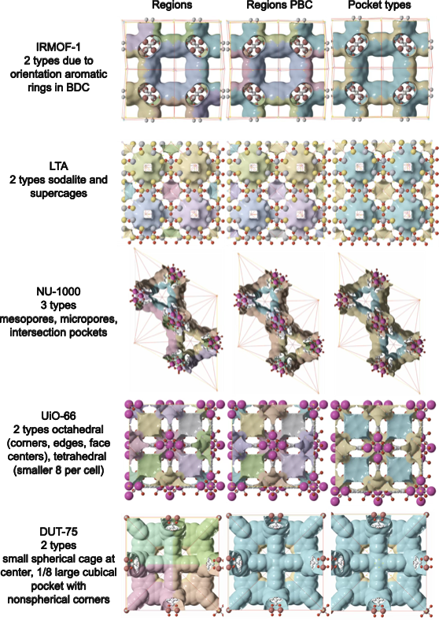

{width=100%}

{width=100%}

## Overview

Once you have a periodic segmentation, the next question is *which pockets are the same kind of pocket?* — i.e. how many **pocket types** does the MOF contain?

This is more than a clustering exercise. Chemically distinct adsorption sites (e.g. small tetrahedral cages vs large octahedral cages in UiO-66, or window families of slightly different aperture in ZIF-20) need to be:

- **Stable** under reasonable numerical choices (grid spacing, VDW table).
- **Physically interpretable** — a "type" should correspond to a real cavity family.
- **Robust to over-segmentation** — watershed often splits one cage into multiple fragments; these must collapse into one type.

The new `env_cluster` flow replaces the old kmeans-on-PSD approach with **multi-modal fingerprinting**: it seeds bands from the peak probe radius, then merges or splits them using a rotation-invariant environment fingerprint (pocket PSD + framework spherical harmonics + connectivity SH).

```
CIF  →  dgrid  →  periodic segmentation  →  pocket PSDs  →  env_cluster typing
                                                                       ↓
                                                          typed.n_types, .type_summary
```

## Prerequisites

- A working `mofography` install (`uv pip install -e .`).
- The [Quick Cluster tutorial](quick_cluster.qmd) — read it first for the segmentation basics.

## Imports

```{python}
import mofography as mgr
from ase.io import read
import numpy as np
```

## Step 1: Load a Structure

IRMOF-1 is a clean test case: two cage-size families in one cubic cell.

```{python}
atoms = read("IRMOF-1.cif")
print(f"Atoms: {len(atoms)}")
print(f"Cell: {atoms.cell.cellpar()[:3].round(2)} Å")
```

## Step 2: Compute the Distance Grid

The dgrid is the foundation: a per-voxel radius of the largest probe sphere that fits. Every downstream feature is derived from it.

```{python}
spacing = 0.5  # Å — the canonical default for pocket typing

dgrid = mgr.dgrid_from_atoms_rust(atoms, spacing=spacing)
print(f"Grid shape: {dgrid.shape}  ({dgrid.size:,} voxels)")
print(f"Void max:   {dgrid.max():.2f} Å")
```

> **Don't use `dgrid_from_atoms_gpu` or `dgrid_from_atoms_cpu` here.** They are deprecated and known to mis-handle non-orthorhombic cells. The `*_rust` backends are correct for all cell types.

## Step 3: Periodic Segmentation (Single Call)

`do_periodic_segmentation_rust` gives you the maxima, regions, PBC grouping, and connections in one call.

```{python}
dgrid_f32 = dgrid.astype(np.float32)

seg = mgr.do_periodic_segmentation_rust(
    dgrid_f32, atoms,
    mask_thickness=0.05,
    h=0.2,
    min_distance=1.5,
    threshold_abs=1.5,
    spacing=spacing,
    compute_connections=True,
    watershed_backend="rust_det",
    disable_tqdm=True,
)
print(f"Pockets (PBC-grouped): {len(seg['maxima_pbc'])}")
print(f"Unique regions:        {len(seg['unique_regions'])}")
```

## Step 4: Enrich with Pocket PSDs (Run Once, Reuse)

`enrich_segmentation_with_pocket_psds` runs a pocketwise probe-occupiable PSD (sampled with the Rust backend) and stashes the result on the segmentation dict under `pocket_psds`. The typing pass reads it back — so you only pay the sampling cost once per structure.

```{python}
seg = mgr.enrich_segmentation_with_pocket_psds(seg, atoms)
print("pocket_psds cached:", seg.get("pocket_psds") is not None)
print("probe radius used: ", seg.get("pocket_psd_probe_radius_a"), "Å")
```

This step also computes **per-pocket** quantities that the fingerprint needs (peak probe radius `max_r`, representative region label, void cloud).

## Step 5: Assign Pocket Types with `env_cluster`

This is the heart of the tutorial. The default `method='env_cluster'` runs:

1. **Initial bands** — sort pockets by peak probe radius (`max_r`); start a new band whenever the gap to the previous pocket exceeds 0.15 Å (one third of a grid spacing — a sensible grid-noise floor).
2. **Merge adjacent bands** whose full environment fingerprints (pocket PSD + framework SH + connectivity SH) agree:
   - Tight merge: cosine ≥ 0.90 for small `max_r` gaps (≤ 0.20 Å).
   - Loose merge: cosine ≥ 0.80 for larger gaps (≤ 0.50 Å, = 1 grid spacing).
3. **Optional singleton merge** — 1-pocket bands whose `max_r` is within 0.40 Å of a neighbour are folded in (e.g. ZIF-8 corner vs center cages, grid-offset artefacts).

Each surviving band is one **pocket type**.

```{python}
typed = mgr.assign_pocket_types(seg, atoms, method="env_cluster")
print(typed.ok, "—", typed.method)
```

## Step 6: Inspect the Result

`PocketTypingResult` exposes everything you need as plain attributes.

### Type counts and pocket mapping

```{python}
print(f"n_types:   {typed.n_types}")
print(f"n_pockets: {typed.n_pockets}")
print()
print("rep_to_type (PBC-rep label → type id):")
for rep, t in sorted(typed.rep_to_type.items()):
    print(f"  rep {rep:>2} → type {t}")
```

### Per-type summary

`type_summary` is a list of dicts, one per type, sorted by `type_id`. Each row aggregates the per-pocket stats of every pocket in that type.

```{python}
for t in typed.type_summary:
    print(
        f"type {t['type_id']}: "
        f"n={t['n_pockets']}, "
        f"max_r ∈ [{t['max_r_min_a']:.2f}, {t['max_r_max_a']:.2f}] Å, "
        f"vol ∈ [{t['volume_min_a3']:.0f}, {t['volume_max_a3']:.0f}] ų, "
        f"d1 ∈ [{t['d1_min_a']:.2f}, {t['d1_max_a']:.2f}] Å, "
        f"reps={t['rep_ids']}"
    )
```

For IRMOF-1 you should see **2 types** — one family of 4 small cages, one family of 4 large cages, each with tight `max_r` and `d1` ranges.

### Typed region grid (for visualization)

`typed.regions_cluster` is a 3-D label array with one entry per voxel, values = type id. Pass it to `show_mof_plotly` (or `plot_surface_dgrid` directly) to colour the pore surface by type.

```{python}
print("regions_cluster shape:", typed.regions_cluster.shape)
print("unique type labels:  ", sorted(np.unique(typed.regions_cluster)))
```

## Step 7: Visualize

The simplest path is `show_mof_plotly`, which automatically renders the typed region surface when you pass `typed_result=`.

```{python}
fig = mgr.show_mof_plotly(seg, atoms, typed_result=typed, stylize=True)
fig.show()
```

Expected behaviour:

- One isosurface layer per pocket type, coloured by `type_id`.
- Toggle layers in the legend to compare.
- IRMOF-1 should show two distinct cage families (small and large).

## How `env_cluster` Sees a Pocket

For each pocket, `assign_pocket_types` builds a `PocketFingerprint` that combines three orthogonal signals:

| Channel | What it measures | Why it helps |
|---------|------------------|--------------|
| **Pocket PSD** | Histogram of probe-occupiable sizes inside the pocket | Captures local *size* and *shape* of void |
| **Framework SH** | Spherical-harmonic power spectrum of framework atoms inside an adaptive shell around the pocket centroid | Captures the *chemical + geometric* environment of the cage wall |
| **Connectivity SH** | Spherical harmonics of unit vectors to trusted periodic neighbours | Captures the pocket's *network role* (e.g. channel segment vs isolated cage) |

The cosine similarity between two `PocketFingerprint`s is what the merge step thresholds on. This means pockets with similar `max_r` but different framework chemistry or different connectivity are kept as **separate** types — and pockets with the same environment at slightly different sizes are **merged**.

For the full algorithm + parameter list, see `mofography/pocket_typing.py::assign_pocket_types_env_cluster`. For an honest discussion of when `env_cluster` is *not* robust (specifically: VDW table choice, NU-1000 micropore case), see the [Pocket Typing VDW Sensitivity Problem](pocket-typing-radii-sensitivity-problem.md) deep dive.

## Parameter Reference

`assign_pocket_types` exposes the major env_cluster thresholds as keyword arguments; sensible defaults are pre-set for the canonical `spacing=0.5` Å Bondi/CRC workflow.

| Parameter | Default | Effect |
|-----------|---------|--------|
| `method` | `'env_cluster'` | `'env_cluster'` (default), `'shape_refined'` (legacy d₁-first), or `'max_probe_radius'` (bands-only, no fingerprint) |
| `band_gap_a` | 0.04 Å | Initial `max_r` band split (legacy default — env_cluster uses 0.15) |
| `merge_singleton_bands` | `True` | Fold 1-pocket bands into a neighbour within `singleton_band_gap_a` |
| `singleton_band_gap_a` | 0.40 Å | Singleton fold tolerance |
| `env_cluster_initial_band_gap_a` | 0.15 Å | `env_cluster` band split (override; grid-noise floor) |
| `typing_radii` | `'bondi_crc_fallback'` | VDW table for `max_r` typing bands; pass `'segmentation'` to use the analysis `dgrid` directly |

## Tips

- **Trust the defaults.** The defaults are calibrated for the canonical workflow (`spacing=0.5` Å, Bondi/CRC VDW, 0.15 Å band gap) and validated against NU-1000, ZIF-20, UiO-66, IRMOF-1, and Cu-BTC.
- **Always run `enrich_segmentation_with_pocket_psds` first.** The pocket PSD is sampled in Rust and reused by both the typing and any downstream RAG feature code — running it once keeps the pipeline fast.
- **Inspect `typed.rep_to_type` first** if results look wrong. If a known single cage has been split into two `type_id`s, the bands are too aggressive; if two chemically different cages are merged, the fingerprint merge is too lenient.
- **For radii sensitivity questions**, read the [deep dive](pocket-typing-radii-sensitivity-problem.md) before changing parameters — type counts are intentionally calibrated to a specific Bondi+0.5 Å regime.

## Next Steps

- [Quick Cluster tutorial](quick_cluster.qmd) — the segmentation basics this builds on.
- [Pocket Typing VDW Sensitivity Problem](pocket-typing-radii-sensitivity-problem.md) — the open problem of VDW-stable typing, with NU-1000 as the canonical failure case.
- [Distance Grid tutorial](distance_grid.qmd) — alternative dgrid backends for very large systems.
- [Pore Graph](pore_graph.md) — what to do with the typed pockets (build a typed RAG).
