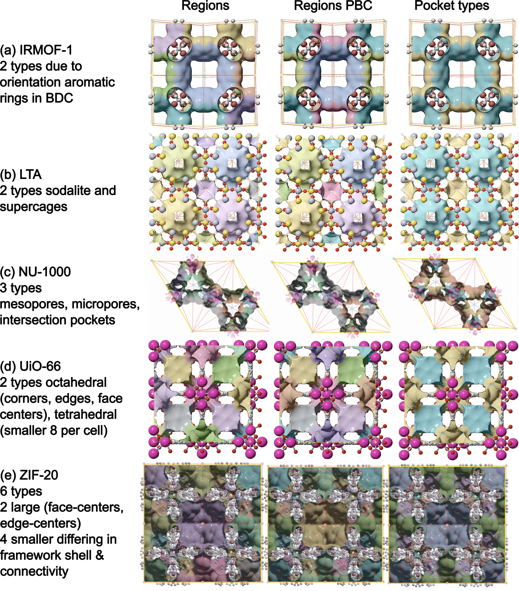
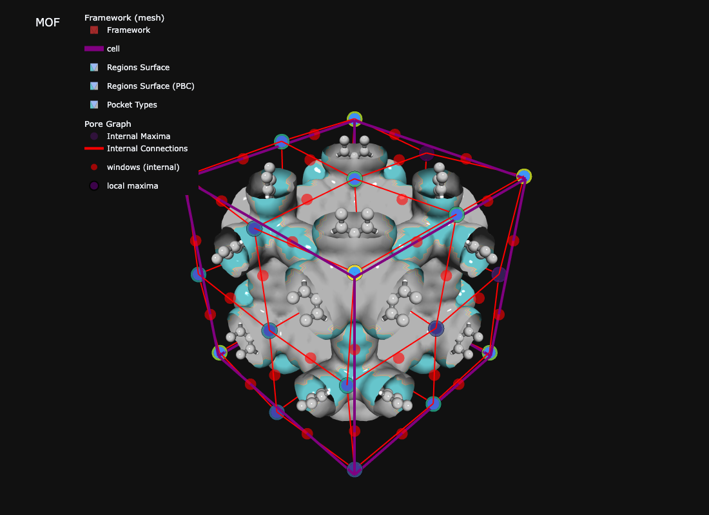

{width=100%}

{width=100%}

## Overview

Once you have a periodic segmentation, the next question is *which pockets are the same kind of pocket?* — i.e. how many **pocket types** does the MOF contain?

This is more than a clustering exercise. Chemically distinct adsorption sites (e.g. small tetrahedral cages vs large octahedral cages in UiO-66, or window families of slightly different aperture in ZIF-20) need to be:

- **Stable** under reasonable numerical choices (grid spacing, VDW table).
- **Physically interpretable** — a "type" should correspond to a real cavity family.
- **Robust to over-segmentation** — watershed often splits one cage into multiple fragments; these must collapse into one type.

`env_cluster` is the default (and recommended) pocket-typing method. It uses **multi-modal fingerprinting**: it seeds bands from the peak probe radius $r_{max}$ and then merges adjacent bands whose rotation-invariant fingerprints agree. The fingerprint has three channels: size (pocket PSD), a SOAP-like framework environment, and pore connectivity.

```{mermaid}
flowchart LR
    A[CIF] --> B[dgrid]
    B --> C[periodic segmentation]
    C --> D[pocket PSDs]
    D --> E[env_cluster typing]
    E --> F["typed.n_types, typed.type_summary"]
```

## Prerequisites

- A working `mofography` install (`uv pip install -e .`).
- The [Quick Start tutorial](quick_start.qmd) — read it first for the segmentation basics.

## Imports

```{python}
import mofography as mgr
from ase.io import read
import numpy as np
```

## Step 1: Load a Structure

IRMOF-1 is a clean test case: two cage-size families in one cubic cell.

```{python}
atoms = read("IRMOF-1.cif")
print(f"Atoms: {len(atoms)}")
print(f"Cell: {atoms.cell.cellpar()[:3].round(2)} Å")
```

## Step 2: Compute the Distance Grid

The dgrid is the foundation: a per-voxel radius of the largest probe sphere that fits. Every downstream feature is derived from it.

```{python}
spacing = 0.5  # Å — the canonical default for pocket typing

dgrid = mgr.dgrid_from_atoms_rust(atoms, spacing=spacing)
print(f"Grid shape: {dgrid.shape}  ({dgrid.size:,} voxels)")
print(f"Void max:   {dgrid.max():.2f} Å")
```

> **Don't use `dgrid_from_atoms_gpu` or `dgrid_from_atoms_cpu` here.** They are deprecated and known to mis-handle non-orthorhombic cells. The `*_rust` backends are correct for all cell types.

## Step 3: Periodic Segmentation (Single Call)

`do_periodic_segmentation_rust` gives you the maxima, regions, PBC grouping, and connections in one call.

```{python}
dgrid_f32 = dgrid.astype(np.float32)

seg = mgr.do_periodic_segmentation_rust(
    dgrid_f32, atoms,
    mask_thickness=0.05,
    h=0.2,
    min_distance=1.5,
    threshold_abs=1.5,
    spacing=spacing,
    compute_connections=True,
    watershed_backend="rust_det",
    disable_tqdm=True,
)
print(f"Pockets (PBC-grouped): {len(seg['maxima_pbc'])}")
print(f"Unique regions:        {len(seg['unique_regions'])}")
```

## Step 4: Enrich with Pocket PSDs (Run Once, Reuse)

`enrich_segmentation_with_pocket_psds` runs a pocketwise probe-occupiable PSD (sampled with the Rust backend) and stashes the result on the segmentation dict under `pocket_psds`. The typing pass reads it back — so you only pay the sampling cost once per structure.

```{python}
seg = mgr.enrich_segmentation_with_pocket_psds(seg, atoms)
print("pocket_psds cached:", seg.get("pocket_psds") is not None)
print("probe radius used: ", seg.get("pocket_psd_probe_radius_a"), "Å")
```

This step also computes **per-pocket** quantities that the fingerprint needs (peak probe radius `max_r`, representative region label, void cloud).

## Step 5: Assign Pocket Types with `env_cluster`

This is the heart of the tutorial. The default `method='env_cluster'` runs:

1. **Initial bands** — sort pockets by peak probe radius (`max_r`); start a new band whenever the gap to the previous pocket exceeds 0.15 Å (one third of a grid spacing — a sensible grid-noise floor).
2. **Merge adjacent bands** repeatedly when their mean `max_r` differ by at most 0.50 Å (one grid spacing) *and* the mean fingerprint cosine over all cross-band pocket pairs is ≥ 0.90. Bands farther apart in `max_r` are never merged. (Internally a tighter/looser cosine tier exists for gaps ≤/> 0.20 Å; both default to 0.90.)
3. **Singleton merge** (on by default) — 1-pocket bands whose `max_r` is within 0.40 Å of a neighbour are folded in (e.g. ZIF-8 corner vs centre cages, grid-offset artefacts).

Each surviving band is one **pocket type**.

```{python}
typed = mgr.assign_pocket_types(seg, atoms, method="env_cluster")
print(typed.ok, "—", typed.method)
```

## Step 6: Inspect the Result

`PocketTypingResult` exposes everything you need as plain attributes.

### Type counts and pocket mapping

```{python}
print(f"n_types:   {typed.n_types}")
print(f"n_pockets: {typed.n_pockets}")
print()
print("rep_to_type (PBC-rep label → type id):")
for rep, t in sorted(typed.rep_to_type.items()):
    print(f"  rep {rep:>2} → type {t}")
```

### Per-type summary

`type_summary` is a list of dicts, one per type, sorted by `type_id`. Each row aggregates the per-pocket stats of every pocket in that type.

```{python}
for t in typed.type_summary:
    print(
        f"type {t['type_id']}: "
        f"n={t['n_pockets']}, "
        f"max_r ∈ [{t['max_r_min_a']:.2f}, {t['max_r_max_a']:.2f}] Å, "
        f"vol ∈ [{t['volume_min_a3']:.0f}, {t['volume_max_a3']:.0f}] ų, "
        f"d1 ∈ [{t['d1_min_a']:.2f}, {t['d1_max_a']:.2f}] Å, "
        f"reps={t['rep_ids']}"
    )
```

For IRMOF-1 you should see **2 types** — one family of 4 small cages, one family of 4 large cages, each with tight `max_r` and `d1` ranges.

### Typed region grid (for visualization)

`typed.regions_cluster` is a 3-D label array with one entry per voxel, values = type id. Pass it to `show_mof_plotly` (or `plot_surface_dgrid` directly) to colour the pore surface by type.

```{python}
print("regions_cluster shape:", typed.regions_cluster.shape)
print("unique type labels:  ", sorted(np.unique(typed.regions_cluster)))
```

## Step 7: Visualize

The simplest path is `show_mof_plotly`, which automatically renders the typed region surface when you pass `typed_result=`.

```{python}
fig = mgr.show_mof_plotly(seg, atoms, typed_result=typed, stylize=True)
fig.write_image("tutorial_images/pockets_detection_types.png", width=1100, height=800)  # static preview for the docs
```



::: {.callout-note collapse="true" title="Interactive version"}
```python
fig = mgr.show_mof_plotly(seg, atoms, typed_result=typed, stylize=True)
fig.show()
```
:::

[Open the interactive version](interactive/irmof1_pockets_windows_threejs.html){target="_blank"}

Expected behaviour:

- One isosurface layer per pocket type, coloured by `type_id`.
- In the interactive version, toggle layers in the legend to compare.
- IRMOF-1 should show two distinct cage families (small and large).

## How `env_cluster` Sees a Pocket

For each pocket, `assign_pocket_types` builds a `PocketFingerprint` that combines three orthogonal channels (paper Section 3.3):

| Channel | What it measures | Why it helps |
|---------|------------------|--------------|
| **Pocket PSD** | Normalized pocket-wise probe-occupiable PSD | Local *size* of the void |
| **Framework environment** | SOAP-like spherical-harmonic power spectrum ($\ell = 0..6$) of wall atoms: void voxels within 1.5 Å of the vdW surface define a shell, atoms within 3.5 Å of those voxels are included. Computed for all wall atoms (shape), per element (chemistry), plus per-element radial histograms | Wall *shape and chemistry*, independent of crystal orientation |
| **Connectivity** | Same power spectrum on minimum-image unit vectors to pore-graph neighbours | Pocket's *network role* (how many windows, where they point) |

**The SOAP-like power spectrum.** Void voxels within 1.5 Å of the framework van der Waals surface form a wall-proximity shell around the pocket, and the framework atoms within 3.5 Å of those voxels are the atoms that shape it. Unit vectors $\hat{u}_k$ from the pore centre (the distance-grid maximum) to each wall atom $k$ are expanded in spherical harmonics $Y_{\ell m}$. The rotation-invariant power spectrum is

$$
P_\ell = \sum_{m=-\ell}^{\ell} \left| \sum_k Y_{\ell m}(\hat{u}_k) \right|^2 , \qquad \ell = 0,\ldots,6 ,
$$

where the sum over $k$ runs over the wall atoms with equal weight. It is computed for all wall atoms together (wall shape) and for each element separately (chemistry), and per-element radial histograms add distance information. Because $P_\ell$ does not change when the structure is rotated, equivalent pockets match regardless of crystal orientation.

**The connectivity channel.** For each neighbour of the pocket in the pore graph, take the unit vector to the neighbour centre with the minimum-image convention. The same $P_\ell$ construction on those directions encodes how many windows the pocket has and where they point.

**Comparing pockets.** Fingerprints are compared by cosine similarity. The fingerprint cosine is the mean over active channels. The connectivity channel is weighted fivefold when both pockets have at least 3 windows, and is omitted for pockets with fewer than 3 connections, so topologically distinct cages with similar walls stay separable (e.g. UiO-66). Pockets of the same type have cosines near 1, and distinct types in the benchmark set fall below the merge threshold of 0.90.

**Assigning types** takes two steps:

1. Sort pockets by $r_\mathrm{max}$, the peak distance-field value in the pocket (peak probe radius), and start a new band wherever consecutive values differ by more than 0.15 Å (three times the 0.5 Å grid step, a noise floor).
2. Repeatedly merge adjacent bands when their mean $r_\mathrm{max}$ differ by at most 0.5 Å and the mean fingerprint cosine over all pocket pairs across the two bands is at least 0.90. Bands further apart in $r_\mathrm{max}$ are never merged.

So pockets with similar $r_\mathrm{max}$ but different framework chemistry or connectivity stay **separate** types, and pockets with the same environment at slightly different sizes are **merged**.

For the full algorithm + parameter list, see `mofography/pocket_typing.py::assign_pocket_types_env_cluster`. 

::: {.callout-caution}
## Caution: radii and grid spacing
Pocket types are calibrated with Bondi radii on a 0.5 Å grid. By default the peak probe radius used for typing comes from a separate Bondi-radii grid, so changing the VDW table for the analysis does not change type counts. Passing your own radii as `typing_radii` can split or merge types in some structures (for example the micropores of NU-1000). Check the type count and `typed.rep_to_type` after changing radii or spacing.
:::

## Parameter Reference

`mgr.assign_pocket_types(seg, atoms, method='env_cluster', **kwargs)` forwards kwargs to `assign_pocket_types_from_segmentation`. For `env_cluster` the tunable ones are:

| Parameter | Default | Effect |
|-----------|---------|--------|
| `method` | `'env_cluster'` | Recommended. Legacy alternatives (`'shape_refined'`, `'max_probe_radius'`) are kept for reproducing old results only. |
| `env_cluster_initial_band_gap_a` | 0.15 Å | Initial `max_r` band split (grid-noise floor; 3× the 0.5 Å grid step). |
| `merge_singleton_bands` | `True` | Fold 1-pocket bands into a neighbour. |
| `singleton_band_gap_a` | 0.40 Å | Singleton fold tolerance. |
| `typing_radii` | `'bondi_crc_fallback'` | VDW table for `max_r` typing; `'segmentation'` reuses the analysis `dgrid`; or a per-atom radii array. |
| `probe_radius_psd` | 1.2 Å | Probe-centre radius for the pocket PSD (set it in `enrich_segmentation_with_pocket_psds`). |

The merge thresholds (0.50 Å `max_r` gap, 0.90 cosine) are module constants in `mofography.pocket_typing` (`ENV_CLUSTER_*`), not call arguments. `band_gap_a`, `subsplit_gap_a`, `adjacent_merge_max_r_gap_a` and `merge_cosine` only affect the legacy `shape_refined` method.

## Tips

- **Trust the defaults.** The defaults are calibrated for the canonical workflow (`spacing=0.5` Å, Bondi/CRC VDW, 0.15 Å band gap) and validated against NU-1000, ZIF-20, UiO-66, IRMOF-1, and Cu-BTC.
- **Always run `enrich_segmentation_with_pocket_psds` first.** The pocket PSD is sampled in Rust and reused by both the typing and any downstream RAG feature code — running it once keeps the pipeline fast.
- **Inspect `typed.rep_to_type` first** if results look wrong. If a known single cage has been split into two `type_id`s, the bands are too aggressive; if two chemically different cages are merged, the fingerprint merge is too lenient.
- **After changing radii**, re-check the type count and `typed.rep_to_type`: type counts are calibrated to the Bondi, 0.5 Å regime (see the caution above).

## Next Steps

- [Quick Start tutorial](quick_start.qmd) — the segmentation basics this builds on.
- [Distance Grid tutorial](distance_grid.qmd) — alternative dgrid backends for very large systems.
- [Pore Graph](pore_graph.md) — what to do with the typed pockets (build a typed RAG).
