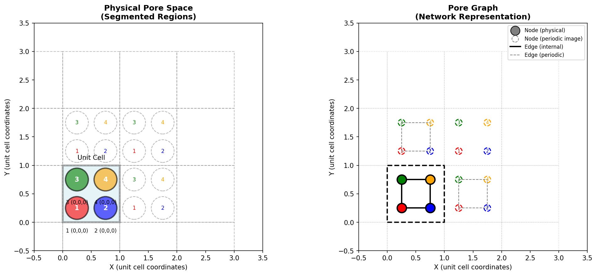
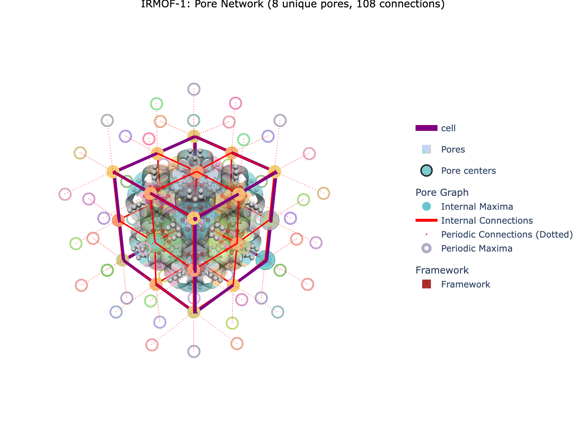
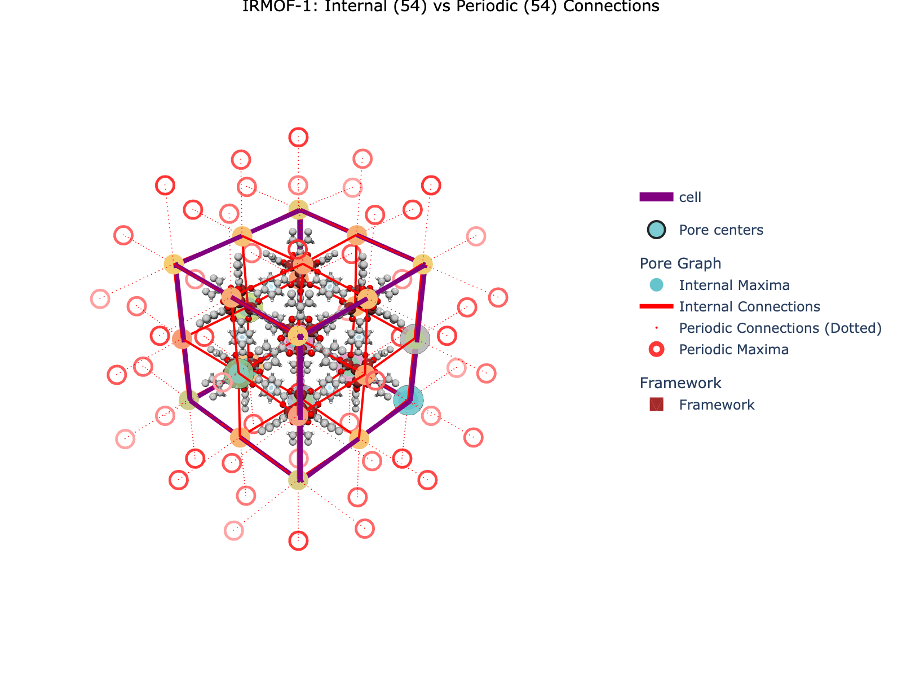

# 🌟 Building Pore Graphs (Region Adjacency Graphs)

> **A beginner-friendly guide to constructing and analyzing pore networks in crystalline materials**

---

## 📚 Related Documentation

This is part of the MOFography tutorial series. For the main quick start guide, see:
- [Periodic Segmentation Quick Start](periodic_segmentation_quick_start.md) - Complete workflow
- [Region Segmentation](region_segmentation.qmd) - Segmentation fundamentals
- [Connections and Windows](connections_and_windows.qmd) - Window detection

---

## 🎯 What is a Pore Graph?

A **Pore Graph** (also called a Region Adjacency Graph or RAG) represents the pore network of a material as a mathematical graph:

- **Nodes** = Individual pores (regions from segmentation)
- **Edges** = Physical connections between pores (windows)
- **Node positions** = Located at pore centers (local maxima)

### Why are Pore Graphs Powerful? 🚀

1. **Compact Representation** 📦
   - Instead of working with large 3D grids, work with a graph
   - Easy to analyze, visualize, and compare

2. **Network Analysis** 🕸️
   - Calculate coordination numbers (how many neighbors each pore has)
   - Find shortest paths between pores
   - Identify bottlenecks and well-connected regions

3. **Machine Learning Ready** 🤖
   - Natural input for graph neural networks (GNNs)
   - Extract node, edge, and graph-level features
   - Compare structures mathematically

4. **Property Mapping** 📊
   - Annotate nodes with pore volumes, surface areas, etc.
   - Annotate edges with window sizes, pore-limiting diameters
   - Correlate graph properties with material performance

### The Core Concept 🧠

**Pore Graph = Segmented regions + Their connections**

```
Physical Space (Unit Cell)           Graph Representation
┌─────────────────────────┐         ┌───┐     ┌───┐
│    ●───────────────●    │         │ 1 │─────│ 2 │
│   ╱│    ↑        ╱ │    │    →    │   │     │   │
│  ● │   │        ●  │    │         │   │     │   │
│  ╲ │   ↓        ╲ │    │         │   │     │   │
│    ●───────────────●    │         │ 3 │─────│ 4 │
└─────────────────────────┘         └───┘     └───┘
   Segmented regions                   Pore graph
```

Each node in the graph represents a physical pore region. Edges represent windows connecting pores.

---

## 🎯 Understanding Periodic Boundary Conditions

When working with crystalline materials, **periodic boundary conditions (PBC)** are essential. A pore that spans across unit cell boundaries will have **periodic images** in neighboring cells.

### Physical Space vs. Pore Graph



*The left panel shows the physical pore space with numbered pore compartments. The right panel shows the corresponding pore graph with nodes (circles) and edges (lines). Periodic images are shown as dashed outlines.*

**Key observations:**
- **Physical space**: Pores are numbered 1-4 within the unit cell. Each has periodic images in neighboring cells.
- **Pore graph**: Each unique pore type becomes one node. Edges connect neighboring pores.
- **Numbering convention**: A node is labeled as `pore_id (offset_x, offset_y, offset_z)` where `(0,0,0)` means it's the original in the unit cell.

**Example:**
- `1 (0,0,0)` = Pore 1 at its original position in the unit cell
- `1 (1,0,0)` = Periodic image of pore 1 shifted by one unit cell in the x-direction
- `1 (0,1,0)` = Periodic image of pore 1 shifted by one unit cell in the y-direction
- `1 (1,1,0)` = Periodic image at the diagonal (x+1, y+1)

---

## ⚠️ Tutorial Scope

**This is a FOUNDATIONAL tutorial** on pore graph construction.

✅ **What this tutorial covers:**
- What a pore graph is and why it matters
- How periodic boundary conditions affect the graph
- How to build a pore graph from periodic segmentation
- Understanding internal vs. periodic connections
- Visualizing the pore graph in 3D
- Basic graph analysis with NetworkX

❌ **What this tutorial does NOT cover:**
- Pocket type classification - see [Pockets Detection](pockets_detection.qmd)
- Percolation analysis - see [PLD & Percolation](pld_and_percolation.ipynb)
- Path finding - see [Percolated Paths Tutorial](percolated_paths_tutorial.ipynb)
- Graph neural networks

---

## 🎓 What You'll Learn

By the end of this tutorial, you'll be able to:

1. ✅ Understand what a pore graph represents
2. ✅ Explain the difference between internal and periodic connections
3. ✅ Build a pore graph from periodic segmentation results
4. ✅ Visualize the pore network using `plot_connections_as_it_is()`
5. ✅ Use NetworkX to analyze graph properties
6. ✅ Interpret node and edge attributes

---

## 🔧 Prerequisites

- Python 3.8+
- MOFography installed (`uv pip install -e .`)
- [Periodic Segmentation Quick Start](periodic_segmentation_quick_start.md) completed
- [Region Segmentation](region_segmentation.qmd) completed
- NetworkX installed
- (Optional) ASE for structure handling

---

## 📖 Step-by-Step Tutorial

### Step 1: Setup and Imports 📦

```python
import os
import sys
import numpy as np
from pathlib import Path

import mofography as mgr
from ase.io import read
import networkx as nx

# Set up paths
repo_root = Path('/path/to/mofography')
path_to_cif = repo_root / 'examples' / 'TestCIFs' / 'P1-IRMOF-1.cif'
```

---

### Step 2: Load the Structure 🏗️

```python
mat_atoms = read(path_to_cif)
mat_updated = mgr.update_with_covalent_bonds(mat_atoms)

print(f"Loaded: {mat_atoms.get_chemical_formula()}")
print(f"  Atoms: {len(mat_atoms)}")
print(f"  Cell: {mat_atoms.cell.cellpar()[:3]} Å")
```

---

### Step 3: Run Periodic Segmentation 🎯

The key advantage of the new workflow is that **connections are computed automatically**:

```python
# Parameters
spacing = 0.5
mask_thickness = 0.05
h = 0.2
threshold_abs = 1.5
minimum_window_separation = 1.5
wall_thickness = 0.08
extra_padding = 10

# Compute distance grid
dgrid = mgr.dgrid_from_atoms_cpu(mat_atoms, spacing=spacing, block_size=50000)
dgrid = mgr.zoom_grid(dgrid, zoom_factor=1).compute()
dgrid = mgr.periodic_gaussian_filter(dgrid, sigma=spacing*2)
dgrid = dgrid.astype(np.float32)

# Run periodic segmentation (computes connections automatically!)
results = mgr.do_periodic_segmentation_rust(
    dgrid,
    mat_atoms,
    spacing=spacing,
    mask_thickness=mask_thickness,
    h=h,
    threshold_abs=threshold_abs,
    minimum_window_separation=minimum_window_separation,
    wall_thickness=wall_thickness,
    extra_padding=extra_padding,
    return_padded_regions=True,
    compute_connections=True
)

print(f"✅ Segmentation complete!")
print(f"  Found {len(results['maxima_pbc'])} unique pores")
print(f"  Found {len(results['connections'])} connections")
```

---

### Step 4: Extract Results 📊

```python
# Extract key results
maxima_pbc = results['maxima_pbc']           # One per unique pore
regions_pbc = results['regions_pbc']         # Merged regions
regions = results['regions']                 # Split regions
connections = results['connections']         # All connections
all_maxima = results['all_maxima']           # All periodic images
unique_regions = results['unique_regions']   # Regions influencing unit cell

# Maxima influencing the unit cell
maxima = all_maxima[:regions.max()]
```

---

### Step 5: Trim Connections ✂️

The `connections` list includes connections to regions in the padded grid. We need to trim them:

```python
# Trim to connections between regions in the unit cell
connections_trimmed = np.array([
    c for c in connections
    if np.any(np.isin(c[0], unique_regions))
])

print(f"Original connections: {len(connections)}")
print(f"Trimmed connections: {len(connections_trimmed)}")
```

---

### Step 6: Build the Pore Graph 🕸️

Now build the graph from connections:

```python
# Build RAG from trimmed connections
rag = mgr.rag_from_connections(connections_trimmed, all_maxima)

print(f"\nPore Graph Statistics:")
print(f"  Nodes (pores): {rag.number_of_nodes()}")
print(f"  Edges (connections): {rag.number_of_edges()}")
```

---

### Step 7: Analyze Graph Properties 📈

Use NetworkX to analyze the graph:

```python
# Get degree (coordination number) of each node
degrees = dict(rag.degree())
print(f"\nCoordination numbers:")
for node in sorted(degrees.keys())[:5]:
    print(f"  Node {node}: {degrees[node]} neighbors")

# Check connectivity
if nx.is_connected(rag):
    diameter = nx.diameter(rag)
    print(f"\nGraph is connected!")
    print(f"  Diameter: {diameter}")
    print(f"  Average shortest path: {nx.average_shortest_path_length(rag):.2f}")
else:
    components = list(nx.connected_components(rag))
    print(f"\nGraph has {len(components)} connected components")
```

---

### Step 8: Visualize the Pore Network 🎨

Use `plot_connections_as_it_is()` to visualize the pore network:

```python
import plotly.graph_objects as go
import plotly.express as px

# Set up colorscale
cscale = px.colors.qualitative.Pastel

# Create base traces
cell_trace = mgr.plot_cell(mat_atoms)
frame_trace = mgr.plot_framework_as_mesh(mat_updated, stylize=True)

# Plot merged regions
surface_trace = mgr.plot_surface_dgrid(
    dgrid,
    isovalue=1.5,
    region_labels=regions_pbc,
    ase_atoms=mat_atoms,
    cscale=cscale,
    name='Pores (PBC merged)',
    stylize=True,
    opacity=0.6
)

# Plot pore centers
maxima_trace = mgr.plot_maxima(
    dgrid, maxima_pbc, mat_atoms,
    name='Pore centers',
    show_spheres=False,
    marker_colorscale=cscale
)

# Plot connections (edges of the pore graph)
connections_traces = mgr.plot_connections_as_it_is(
    connections_trimmed,
    all_maxima,
    dgrid.shape,
    mat_atoms,
    cscale=cscale,
    plot_disconnected=False,
    show_spheres=False
)

# Combine into figure
fig = go.Figure(
    data=[
        cell_trace,
        surface_trace,
        maxima_trace,
        *connections_traces,
        *frame_trace
    ],
    layout=mgr.dark_layout
)

fig.update_layout(
    scene_aspectmode='data',
    title=dict(
        text="IRMOF-1: Pore Network",
        x=0.5,
        xanchor='center',
        font=dict(size=16, color='white')
    ),
    scene=dict(
        xaxis=dict(title='X (Å)'),
        yaxis=dict(title='Y (Å)'),
        zaxis=dict(title='Z (Å)')
    )
)

fig.show()
```

**Expected Output:**



*The pore network shows nodes (pore centers) and edges (connections) overlaid on the segmented pore regions.*

---

### Step 9: Internal vs. Periodic Connections 🔄

Connections can be **internal** (within the unit cell) or **periodic** (across boundaries):

```python
# Categorize connections
internal_connections = [c for c in connections_trimmed if c[2] == 'internal']
periodic_connections = [c for c in connections_trimmed if c[2] == 'periodic']

print(f"Connection types:")
print(f"  Internal: {len(internal_connections)}")
print(f"  Periodic: {len(periodic_connections)}")

# Visualize both types separately
internal_traces = mgr.plot_connections_as_it_is(
    np.array(internal_connections),
    all_maxima,
    dgrid.shape,
    mat_atoms,
    cscale=cscale,
    name='Internal'
)

red_cscale = ["rgb(255, 200, 200)", "rgb(255, 50, 50)"]
periodic_traces = mgr.plot_connections_as_it_is(
    np.array(periodic_connections),
    all_maxima,
    dgrid.shape,
    mat_atoms,
    cscale=red_cscale,
    name='Periodic'
)
```



*Internal connections (blue) connect pores within the unit cell. Periodic connections (red) connect pores across unit cell boundaries.*

---

### Step 10: Add Node Attributes 📝

Add custom properties to nodes:

```python
# Add pore volume to each node
for node in rag.nodes():
    region_mask = (regions_pbc == node)
    volume = np.sum(region_mask) * (spacing ** 3)
    rag.nodes[node]['volume'] = volume

# Access node attributes
for node in list(rag.nodes())[:3]:
    print(f"\nNode {node}:")
    for key, value in rag.nodes[node].items():
        print(f"  {key}: {value}")
```

---

## 🛠️ Troubleshooting

| Issue | Solution |
|-------|----------|
| **Graph not connected** | Use `nx.connected_components()` to find components |
| **Too many/few edges** | Adjust `minimum_window_separation` parameter |
| **Missing connections** | Check that `compute_connections=True` was set |
| **Visualization cluttered** | Hide regions (`opacity=0`) and show only connections |
| **Memory error** | Use larger `spacing` or smaller `extra_padding` |

---

## 📝 Summary

| Step | What we did | Key Function |
|------|-------------|--------------|
| 1. Load structure | Read CIF file | `ase.io.read()` |
| 2. Compute grid | Create distance field | `dgrid_from_atoms_cpu()` |
| 3. Segment | Run periodic segmentation | `do_periodic_segmentation_rust()` |
| 4. Extract | Get connections and maxima | Dictionary access |
| 5. Trim | Filter to unit cell | List comprehension |
| 6. Build RAG | Create graph | `rag_from_connections()` |
| 7. Analyze | Use NetworkX | Various functions |
| 8. Visualize | Plot in 3D | `plot_connections_as_it_is()` |

**Key Takeaway:** The periodic segmentation workflow computes connections automatically. Use `plot_connections_as_it_is()` to visualize the pore graph! 🎉

---

## 🚀 Next Steps

Now that you have a pore graph, you can:

### Learn More:
- [Connections and Windows](connections_and_windows.qmd) - Detailed window analysis
- [Pockets Detection](pockets_detection.qmd) - Classify pore types
- [PLD and percolation](pld_and_percolation.ipynb) - Percolation analysis

### Advanced Analysis:
- [Percolated Paths Tutorial](percolated_paths_tutorial.ipynb) - Find transport paths
- [PLD & Percolation](pld_and_percolation.ipynb) - Pore-limiting diameter
- [Graph Convolution on RAGs](graph_convolution_on_rags_ccr.ipynb) - ML applications

---

## 🎁 Bonus: Complete Analysis Script

```python
#!/usr/bin/env python3
"""
Complete pore graph analysis workflow.
Run this to generate statistics and visualization.
"""

import numpy as np
import networkx as nx
import plotly.graph_objects as go
import plotly.express as px
from pathlib import Path

import mofography as mgr
from ase.io import read

# Setup
repo_root = Path('/path/to/mofography')
path_to_cif = repo_root / 'examples' / 'TestCIFs' / 'P1-IRMOF-1.cif'
mat_atoms = read(str(path_to_cif))

# Parameters
spacing = 0.5
params = {
    'mask_thickness': 1.0,
    'h': 0.2,
    'threshold_abs': 1.5,
    'minimum_window_separation': 1.5,
    'wall_thickness': 0.08,
    'extra_padding': 10,
}

# Compute
dgrid = mgr.dgrid_from_atoms_cpu(mat_atoms, spacing=spacing, block_size=50000)
dgrid = mgr.zoom_grid(dgrid, zoom_factor=1).compute()
dgrid = mgr.periodic_gaussian_filter(dgrid, sigma=spacing*2).astype(np.float32)

results = mgr.do_periodic_segmentation_rust(dgrid, mat_atoms, spacing=spacing, **params)

# Build RAG
unique_regions = results['unique_regions']
connections = results['connections']
all_maxima = results['all_maxima']

connections_trimmed = np.array([
    c for c in connections
    if np.any(np.isin(c[0], unique_regions))
])

rag = mgr.rag_from_connections(connections_trimmed, all_maxima)

# Statistics
print("="*50)
print("PORE GRAPH STATISTICS")
print("="*50)
print(f"Nodes: {rag.number_of_nodes()}")
print(f"Edges: {rag.number_of_edges()}")
degrees = [rag.degree(n) for n in rag.nodes()]
print(f"Coordination: min={min(degrees)}, max={max(degrees)}, mean={np.mean(degrees):.2f}")

if nx.is_connected(rag):
    print(f"Diameter: {nx.diameter(rag)}")
    print(f"Average shortest path: {nx.average_shortest_path_length(rag):.2f}")

print("="*50)

# Visualization
cscale = px.colors.qualitative.Pastel
mat_updated = mgr.update_with_covalent_bonds(mat_atoms)

fig = go.Figure(data=[
    mgr.plot_cell(mat_atoms),
    mgr.plot_surface_dgrid(dgrid, isovalue=1.5, region_labels=results['regions_pbc'],
                          ase_atoms=mat_atoms, cscale=cscale, opacity=0.6),
    *mgr.plot_connections_as_it_is(connections_trimmed, all_maxima, dgrid.shape,
                                   mat_atoms, cscale=cscale, show_spheres=False),
    mgr.plot_maxima(dgrid, results['maxima_pbc'], mat_atoms, show_spheres=False),
    *mgr.plot_framework_as_mesh(mat_updated, stylize=True),
], layout=mgr.dark_layout)

fig.update_layout(scene_aspectmode='data',
                  title=dict(text="Pore Graph Analysis", x=0.5))
fig.write_html('pore_graph_results.html')
print("Saved: pore_graph_results.html")
```

Happy graph analyzing! 🎊
