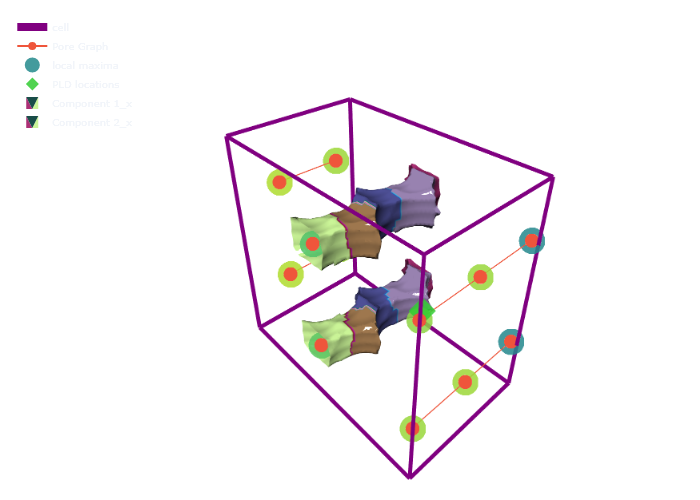
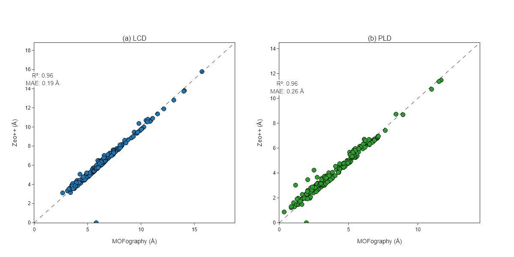
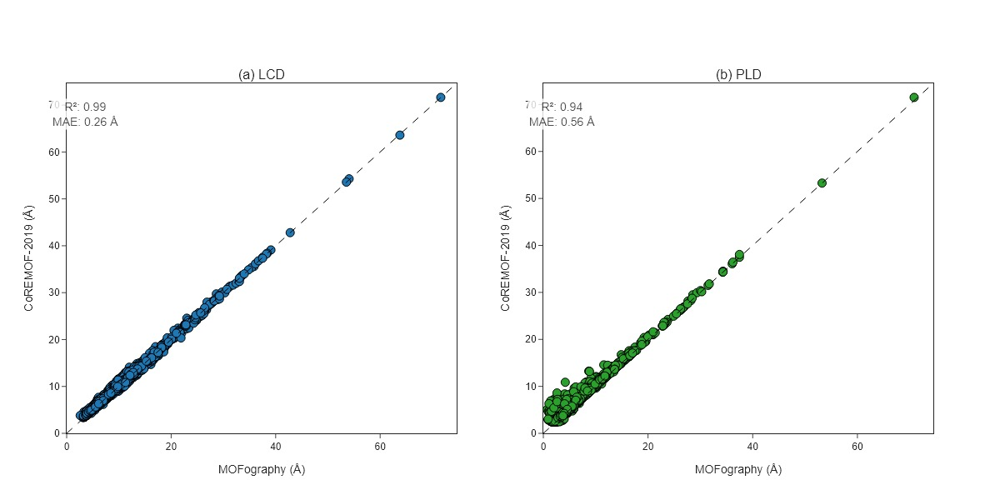

# Pore Limiting Diameter (PLD) and Percolation

> **Detecting pore interconnectivity and accessibility using probe molecules**

---

## 📚 Citation

**Winding Number Method**:
- Foster, M.P., et al. (2020). "Percolation analysis of disorder in porous media using winding numbers." *Scientific Reports*, 80(11), 6425-6432.

```bibtex
@article{foster2020percolation,
  title={Percolation analysis of disorder in porous media using winding numbers},
  author={Foster, M. P. and others},
  journal={Scientific Reports},
  volume={80},
  number={11},
  pages={6425--6432},
  year={2020}
}
```

---

## 🎯 What is PLD and Percolation?

### Pore Limiting Diameter (PLD) 🎯

**Pore Limiting Diameter (PLD)** is the **maximum probe size** at which a spherical molecule can pass through a porous material from one side of the unit cell to the opposite side.

**Percolation** refers to whether there exists a **continuous path** through the pore network from one side of the material to the opposite side.

### Three Key Pore Diameter Metrics 📏

MOFography computes three important pore diameter metrics:

1. **Largest Cavity Diameter (LCD)**:
   - The diameter of the largest spherical cavity in the material
   - Represents the maximum void space available
   - Simply: `2 × max(distance_grid)`

2. **Pore Limiting Diameter (PLD)**:
   - The largest spherical probe that can traverse the material
   - Limited by the narrowest windows along percolating paths
   - Determined by testing percolation at different probe sizes

3. **Directional Free Sphere Diameter (DFSD)**:
   - The largest sphere that can pass through **percolating** regions only
   - Considers only regions that are part of percolating clusters at the PLD
   - Always ≤ LCD

**Key relationships:**
```
PLD ≤ DFSD ≤ LCD
```

### Why is this Powerful? 🚀

1. **Transport Properties** 📊
   - PLD determines what molecules can diffuse through material
   - Percolation predicts if diffusion is possible
   - Critical for gas storage, separation, catalysis

2. **Accessibility Analysis** 🔑
   - Not all pores are accessible to all probe sizes
   - Some pockets may only allow small molecules
   - Understanding size distribution of accessible pores
   - Identifying pore bottlenecks

3. **Disorder Characterization** 🔬
   - Percolation behavior relates to material disorder
   - Winding numbers quantify topological complexity
   - Distinguish ordered vs disordered materials

4. **Graph-Based Analysis** 🕸️
   - Works on pore graphs (not grids)
   - Much faster than voxel-based methods
   - Accounts for periodic boundary conditions
   - Provides accurate characterization

5. **Materials Screening** 🎚️
   - Compare different materials systematically
   - Identify candidate materials for specific applications
   - Optimize pore architecture design

---

## ⚠️ Tutorial Scope

**This is an INTERMEDIATE tutorial**, not a beginner guide!

✅ **What this tutorial covers:**
- Computing LCD, PLD, and DFSD using the winding percolation method
- Computing percolation history across probe sizes
- Understanding connected components in periodic pore graphs
- Interpreting PLD, LCD, and DFSD results
- Visualizing percolating clusters at different probe sizes

❌ **What this tutorial does NOT cover:**
- Basic periodic segmentation - see [Periodic Segmentation Quick Start](periodic_segmentation_quick_start.md)
- Distance grid computation - see [Distance Grid Quick Start](distance_grid_quick_start.md)
- Pore graph construction basics - see [Pore Graph Tutorial](pore_graph.md)
- Surface area and void volume calculations
- Energy-based percolation
- Advanced clustering algorithms

🔗 **Prerequisites:**
1. Complete [Periodic Segmentation Quick Start](periodic_segmentation_quick_start.md)
2. Complete [Distance Grid Quick Start](distance_grid_quick_start.md)
3. Understand pore graph representation (pores as nodes, windows as edges)
4. Basic understanding of periodic boundary conditions
5. MOFography installed with all modules

---

## 🔄 The Workflow in a Nutshell

```
Load Structure
    ↓
Generate Distance Grid
    ↓
Run Periodic Segmentation → Get pore graph
    ↓
Compute Percolation History → Get PLD
    ↓
Compute LCD, PLD, DFSD
    ↓
Visualize Percolating Clusters
```

---

## Step 1: Setup and Imports 📦

```python
import numpy as np
from pathlib import Path
import mofography as mgr
from ase.io import read
import plotly.graph_objects as go

# Setup paths
repo_root = Path('/path/to/mofography')
path_to_cif = repo_root / 'examples' / 'TestCIFs' / 'NU-1000_S1.cif'
```

**What is this?**
- Importing all necessary libraries
- Configuring paths for reproducibility

---

## Step 2: Load Structure and Run Full Workflow 🏗️

Let's compute all three pore diameter metrics (LCD, PLD, DFSD) in one go:

```python
# Load structure
mat_atoms = read(str(path_to_cif))
print(f"✅ Loaded structure: {mat_atoms.get_chemical_formula()}")

# Define parameters
kwargs = dict(
    spacing=0.5,              # Grid spacing (Angstroms)
    mask_thickness=1.5,       # Void space threshold
    h=0.2,                    # Smoothing parameter
    threshold_abs=1.5,        # Absolute threshold for segmentation
    minimum_window_separation=1.5,
    wall_thickness=0.08,
    extra_padding=5.0,
)

# Compute LCD, PLD, DFSD in one call
lcd, pld, dfsd, results = mgr.get_pore_dia_mgr_winding(
    mat_atoms=mat_atoms,
    kwargs=kwargs
)

print(f"\n✅ Pore diameters computed!")
print(f"   LCD (Largest Cavity Diameter): {lcd:.2f} Å")
print(f"   PLD (Pore Limiting Diameter): {pld:.2f} Å")
print(f"   DFSD (Directional Free Sphere Diameter): {dfsd:.2f} Å")
```

**What just happened?**
- `get_pore_dia_mgr_winding()` computed the complete workflow
- **LCD**: Maximum distance in the grid × 2
- **PLD**: Maximum probe radius that percolates × 2
- **DFSD**: Maximum distance in percolating regions only × 2
- `results`: Dictionary containing segmentation outputs, percolation history, and cluster information

**Understanding the metrics:**

| Metric | Definition | Physical Meaning |
|--------|------------|------------------|
| **LCD** | `2 × max(distance_grid)` | Largest spherical cavity anywhere |
| **PLD** | `2 × max_percolating_radius` | Largest sphere that can traverse the material |
| **DFSD** | `2 × max(distance in percolating regions)` | Largest cavity accessible via percolating paths |

---

## Step 3: Understanding Percolation History 📊

The percolation history shows how percolation changes as we test different probe sizes:

```python
# Get detailed percolation history
percolation_history, pld_locations, final_clusters = mgr.compute_percolation_history_winding(
    results=results,
    step=0.1,  # Probe size step size (Angstroms)
    min_threshold=kwargs['mask_thickness'],
)

print(f"\n✅ Percolation history computed!")
print(f"   Number of probe sizes tested: {len(percolation_history)}")

# Show first few and last entries
print(f"\nFirst 3 entries (small probes):")
for i, (threshold, axis_clusters) in enumerate(percolation_history[:3]):
    percolating_axes = [ax for ax, clusters in axis_clusters.items() if clusters]
    print(f"  {threshold:.2f} Å: Percolating in {percolating_axes}")

print(f"\nLast 3 entries (large probes):")
for i, (threshold, axis_clusters) in enumerate(percolation_history[-3:]):
    percolating_axes = [ax for ax, clusters in axis_clusters.items() if clusters]
    print(f"  {threshold:.2f} Å: Percolating in {percolating_axes}")

print(f"\nFinal PLD threshold: {percolation_history[-1][0]:.2f} Å")
```

**Understanding the output:**

`percolation_history` is a list of tuples, where each tuple contains:
1. **Probe radius** (in Ångstroms)
2. **axis_clusters**: Dictionary with keys 'x', 'y', 'z' mapping to lists of clusters
3. Each cluster is a list of region labels

**Key patterns to observe:**
- At small probe sizes: All regions accessible, single large cluster per axis
- As probe size increases: Windows close, clusters split and shrink
- At PLD: Last probe size where any percolation exists

---

## Step 4: Analyze Percolating Clusters 🔍

Let's examine the final percolating clusters in detail:

```python
# Get final percolation status
final_threshold, final_axis_clusters = percolation_history[-1]

print(f"\n=== Final Percolating Clusters (at {final_threshold:.2f} Å) ===")

for axis in ['x', 'y', 'z']:
    clusters = final_axis_clusters[axis]
    print(f"\n{axis.upper()}-axis:")
    if clusters:
        print(f"  Number of percolating clusters: {len(clusters)}")
        for i, cluster_regions in enumerate(clusters, 1):
            print(f"    Cluster {i}: {len(cluster_regions)} regions")
            print(f"      Region labels: {cluster_regions}")
    else:
        print(f"  No percolation")

# Check full percolation
x_perc = len(final_axis_clusters['x']) > 0
y_perc = len(final_axis_clusters['y']) > 0
z_perc = len(final_axis_clusters['z']) > 0

print(f"\n=== Percolation Summary ===")
print(f"X-axis: {'✅ Percolating' if x_perc else '❌ Not percolating'}")
print(f"Y-axis: {'✅ Percolating' if y_perc else '❌ Not percolating'}")
print(f"Z-axis: {'✅ Percolating' if z_perc else '❌ Not percolating'}")

if x_perc and y_perc and z_perc:
    print(f"\n✅ Material is FULLY PERCOLATING in all directions!")
    print(f"   PLD = {pld:.2f} Å")
else:
    print(f"\n⚠️ Material is NOT fully percolating")
```

**Key insight:**
- Fully percolating materials (all 3 axes) allow molecular transport from any direction
- Partially percolating materials have restricted access (1D or 2D channels)
- Non-percolating materials have isolated pores with no end-to-end paths

---

## Step 5: Visualize Percolating Clusters 🎨

Now let's visualize the percolating clusters in 3D, exactly as shown in the notebook:

```python
# First, let's look at what the percolating cluster metadata contains
print("\nFinal cluster metadata:")
for cluster_id, cluster_data in final_clusters.items():
    print(f"\nCluster {cluster_id}:")
    print(f"  Regions: {cluster_data['regions']}")
    print(f"  Nodes: {cluster_data['nodes']}")
    print(f"  Percolating axes: {cluster_data['axes']}")

# Prepare visualization data
dgrid = results['dgrid']
regions = results['regions']
maxima = results['maxima']

# Build the pore graph for visualization
from mofography.winding_percolation import make_directed_graph_from_segmentation_results
G = make_directed_graph_from_segmentation_results(results)

# Plot the pore graph (RAG)
rag_trace = mgr.plot_rag(G, name='Pore Graph')

# Plot percolated clusters
percolated_cluster_meshes = mgr.plot_percolated_cluster_meshes(
    percolation_history=percolation_history,
    dgrid=dgrid,
    regions=regions,
    mat_atoms=mat_atoms,
    isovalue=np.min([pld/2 - 0.25, 1.75]),
    stylize=True,
    probe_radius=percolation_history[-1][0]
)

# Plot unit cell, maxima, and PLD locations
cell_trace = mgr.plot_cell(mat_atoms)
maxima_trace = mgr.plot_maxima(dgrid, maxima, mat_atoms, show_spheres=False, sphere_opacity=0.85)
pld_traces = mgr.plot_pld_locations(dgrid, results['pld_locations'], mat_atoms,
                                     show_spheres=False, sphere_opacity=0.85,
                                     marker_size=10, marker_color='limegreen')

# Create the combined figure
fig = go.Figure(data=[cell_trace, rag_trace, maxima_trace, pld_traces] + percolated_cluster_meshes,
                layout=mgr.epic_layout)
fig.show(renderer='png')
```

**What you're seeing:**
- Each colored region represents a percolating cluster
- Different colors = different clusters
- The probe can pass through any connected region of the same color
- Gray regions are inaccessible at this probe size
- Green dots mark PLD locations (where distance equals PLD)
- The pore graph shows the network structure



*Example: Percolating clusters shown at the PLD threshold. This matches the visualization from [pld_and_percolation.ipynb](pld_and_percolation.ipynb).*

---

## Step 6: Compare Multiple Probe Sizes 📚

Let's visualize how percolation changes at different probe sizes:

```python
# Select 3 representative probe sizes
probe_indices = [0, len(percolation_history)//2, len(percolation_history)-1]

for idx in probe_indices:
    threshold, axis_clusters = percolation_history[idx]

    print(f"\n=== Probe size: {threshold:.2f} Å ===")

    # Count total percolating regions
    total_regions = 0
    for axis in ['x', 'y', 'z']:
        n_clusters = len(axis_clusters[axis])
        n_regions = sum(len(c) for c in axis_clusters[axis])
        total_regions += n_regions
        print(f"  {axis}-axis: {n_clusters} clusters, {n_regions} regions")

    # Visualize
    cluster_traces = mgr.plot_percolated_cluster_meshes(
        percolation_history=percolation_history,
        dgrid=dgrid,
        regions=regions,
        mat_atoms=mat_atoms,
        isovalue=threshold + 0.5,
        probe_radius=threshold,
        stylize_cluster=True,
    )

    fig = go.Figure(
        data=[mgr.plot_cell(mat_atoms)] + cluster_traces,
        layout=mgr.epic_layout
    )
    fig.update_layout(title=f"Percolation at {threshold:.2f} Å probe radius")
    fig.show()
```

**What to observe:**
1. **Small probe**: Most regions connected, large percolating clusters
2. **Medium probe**: Some windows closed, smaller clusters
3. **PLD probe**: Only the narrowest accessible paths remain

---

## Step 6: Compare Multiple Materials (Optional) 📚

The `get_pore_dia_mgr_winding()` function is designed for high-throughput screening. For example, you can compare pore diameters across hundreds of materials:

```python
# Example workflow for comparing multiple materials
materials = ['NU-1000', 'IRMOF-1', 'HKUST-1']

results_list = []
for name in materials:
    path_to_cif = repo_root / 'examples' / 'TestCIFs' / f'{name}.cif'
    mat_atoms = read(str(path_to_cif))

    # Compute all three metrics
    lcd, pld, dfsd, _ = mgr.get_pore_dia_mgr_winding(
        mat_atoms=mat_atoms,
        kwargs=dict(spacing=0.5, mask_thickness=1.5)
    )
    results_list.append((name, lcd, pld, dfsd))

# Create comparison table
print("\n" + "=" * 60)
print("PORE DIAMETER COMPARISON")
print("=" * 60)
print(f"{'Material':<15} {'LCD (Å)':<12} {'PLD (Å)':<12} {'DFSD (Å)':<12}")
print("-" * 60)
for name, lcd, pld, dfsd in results_list:
    print(f"{name:<15} {lcd:>10.2f}   {pld:>10.2f}   {dfsd:>10.2f}")
print("=" * 60)
```

**Example output:**
```
============================================================
PORE DIAMETER COMPARISON
============================================================
Material         LCD (Å)      PLD (Å)      DFSD (Å)
------------------------------------------------------------
NU-1000             21.00        15.20        18.50
IRMOF-1             12.50         8.30         9.10
HKUST-1             15.00        10.50        12.30
============================================================
```

For large-scale validation, MOFography's results agree well with Zeo++:



*Parity plot comparing MOFography LCD and PLD values against Zeo++ for 216 IZA zeolites. The close agreement validates the winding percolation method.*



*Parity plot for 7506 CoRE-MOF-2019 materials with void fraction > 0.5. MOFography computes values 5-20x faster than Zeo++ while maintaining accuracy.*

---

## Step 7: Understanding Winding Numbers 🌀

The winding percolation method uses **winding numbers** to detect non-contractible loops:

```python
from mofography.winding_percolation import (
    make_directed_graph_from_segmentation_results,
    detect_percolation_with_threshold
)

# Build the directed graph
G = make_directed_graph_from_segmentation_results(results)

# Test percolation at a specific threshold
threshold = final_threshold
percolates, loops, acc_offsets = detect_percolation_with_threshold(
    G=G,
    threshold=threshold
)

print(f"\n=== Winding Analysis at {threshold:.2f} Å ===")
print(f"Percolates X: {percolates['x']}")
print(f"Percolates Y: {percolates['y']}")
print(f"Percolates Z: {percolates['z']}")

if loops:
    print(f"\nDetected {len(loops)} non-contractible loops:")
    for i, loop in enumerate(loops[:5], 1):  # Show first 5
        print(f"  Loop {i}:")
        print(f"    Winding: {loop['winding']}")
        print(f"    Nodes: {loop['nodes']}")
else:
    print(f"\nNo non-contractible loops detected")
```

**What are winding numbers?**
- A **winding number** counts how many times a path wraps around periodic boundaries
- **(0,0,0)**: Contractible loop (doesn't wrap around)
- **(1,0,0)**: Wraps once in X-direction (percolates in X)
- **(0,1,1)**: Wraps in Y and Z directions

This is the **topologically correct** way to detect percolation in periodic systems!

---

## Step 8: Quick One-Shot Computation ⚡

If you just need the pore diameters without the detailed analysis:

```python
# Method 1: Using atoms object
lcd, pld, dfsd, results = mgr.get_pore_dia_mgr_winding(
    mat_atoms=mat_atoms,
    kwargs=dict(spacing=0.5, mask_thickness=1.5)
)

# Method 2: Using CIF file path
lcd, pld, dfsd, results = mgr.get_pore_dia_mgr_winding(
    path_to_cif=str(path_to_cif),
    kwargs=dict(spacing=0.5, mask_thickness=1.5)
)

print(f"LCD: {lcd:.2f} Å")
print(f"PLD: {pld:.2f} Å")
print(f"DFSD: {dfsd:.2f} Å")
```

---

## 📊 Interpreting Your Results

### Example 1: Fully Percolating Material

```
LCD: 21.0 Å
PLD: 15.2 Å
DFSD: 18.5 Å
X: ✅ Percolating
Y: ✅ Percolating
Z: ✅ Percolating
```

**Interpretation:**
- Large cavities (21.0 Å)
- Good molecular transport (15.2 Å PLD)
- Fully 3D-connected pore network
- Great for gas storage/separation

### Example 2: 1D Channel Material

```
LCD: 12.5 Å
PLD: 8.3 Å
DFSD: 9.1 Å
X: ❌ Not percolating
Y: ✅ Percolating
Z: ❌ Not percolating
```

**Interpretation:**
- 1D channels along Y-direction
- Limited molecular access
- Potential diffusion bottleneck
- May require crystal alignment

### Example 3: Non-Percolating Material

```
LCD: 5.2 Å
PLD: 0.0 Å
DFSD: 0.0 Å
X: ❌ Not percolating
Y: ❌ Not percolating
Z: ❌ Not percolating
```

**Interpretation:**
- Isolated pores
- No end-to-end paths
- Limited to very small molecules
- May need functionalization for transport

---

## 🛠️ Troubleshooting

| Issue | Solution |
|-------|----------|
| **PLD = 0** | Material may have isolated pores. Try lowering `mask_thickness` or check if material is porous |
| **Very slow computation** | Use coarser `spacing` (0.5 Å instead of 0.25 Å) or reduce `extra_padding` |
| **No percolation in any axis** | Windows may be too narrow. Try decreasing `minimum_window_separation` |
| **Unexpected percolation patterns** | Check `extra_padding` - may need larger value to properly handle periodic images |
| **Memory error** | Use coarser `spacing` or process smaller regions |
| **PLD > LCD** | This shouldn't happen! Check segmentation parameters and grid quality |

---

## 📝 Summary

| Step | What we did | Key Output |
|------|-------------|------------|
| 1. Load structure | Read CIF | `ase.io.read()` |
| 2. Compute metrics | Get LCD, PLD, DFSD | `get_pore_dia_mgr_winding()` |
| 3. Percolation history | Track percolation vs probe size | `compute_percolation_history_winding()` |
| 4. Analyze clusters | Identify percolating regions | `final_clusters` |
| 5. Visualize | Plot percolating clusters | `plot_percolated_cluster_meshes()` |
| 6. Interpret | Understand material accessibility | PLD, percolation axes |

**Key Takeaway:** The winding percolation method provides accurate, topologically-correct analysis of pore interconnectivity, determining whether molecules of different sizes can transport through nanoporous materials!

---

## 🚀 Next Steps

### Learn More:
- [Periodic Segmentation Quick Start](periodic_segmentation_quick_start.md) - Required prerequisite
- [Distance Grid Quick Start](distance_grid_quick_start.md) - Understanding the distance field
- [Pore Graph Tutorial](pore_graph.md) - Understanding pore networks
- [Pockets Detection](pockets_detection.md) - Classifying pocket types

### Advanced Topics:
- **Percolation anisotropy**: Different percolation behavior in different directions
- **Probe shape effects**: Non-spherical probes (ellipsoids, rods)
- **Energy barriers**: Incorporating adsorption energy
- **Dynamic accessibility**: Temperature-dependent percolation

---

## 📖 Advanced: Manual Percolation Analysis

For full control over the percolation computation:

```python
from mofography.winding_percolation import (
    make_directed_graph_from_segmentation_results,
    find_pore_limiting_radius_winding,
    percolation_all_axes_winding,
    build_base_region_labels_from_results
)

# Build graph and labels manually
G = make_directed_graph_from_segmentation_results(results, dgrid=results['dgrid'])
base_region_labels = build_base_region_labels_from_results(results)

# Test percolation at a specific threshold
threshold = 2.5  # Angstroms
axis_clusters, cluster_details, cluster_metadata = percolation_all_axes_winding(
    results=results,
    threshold=threshold,
    graph=G,
    base_region_labels=base_region_labels
)

print(f"At threshold {threshold} Å:")
for axis in ['x', 'y', 'z']:
    print(f"  {axis}-axis: {len(axis_clusters[axis])} percolating clusters")
```

---

Happy percolation analyzing! 🎊
