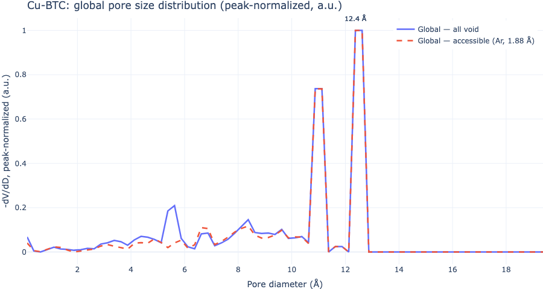
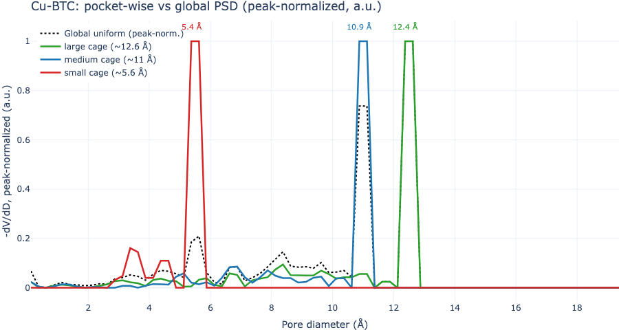
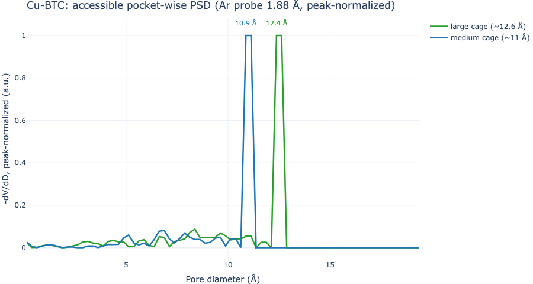

## Overview

Global textural properties such as largest cavity diameter, pore limiting diameter, and **pore size distributions (PSDs)** are easy to compute but can **hide distinct pockets and network topology behind one curve**. Mofography segments void space into pockets and can report the same Gelb–Gubbins histogram **per pocket**, so local cage sizes are visible instead of being washed out by volume-weighted sampling.

A PSD starts from **largest-including-sphere diameters** (Gelb & Gubbins): at each sample site in the void, mofography finds the largest sphere that contains the site without overlapping framework atoms. The sphere radius at the center equals the distance-grid value there; the reported size is the **diameter** (2× radius).

Two sampling strategies matter:

1. **Global (uniform) PSD** — `compute_psd_uniform_rust` draws a fixed total number of points uniformly in the unit cell. Large cages dominate by volume, so **small pocket families are undersampled** and may not appear as peaks.
2. **Pocket-wise PSD** — `compute_psds_pocketwise_rust` draws a fixed number of samples **per segmented pocket** (`regions_pbc`). Each pocket gets equal statistical weight. This is the PSD that feeds **pocket typing** via `enrich_segmentation_with_pocket_psds` (see [Pocket detection](pockets_detection.qmd)).

**Accessibility** at a probe radius uses the same winding percolation as accessible surface area: only void that **percolates** through the pore network at that probe size counts as accessible. **Total** PSDs use all void; **accessible** PSDs drop pockets (or void fragments) that do not percolate.

This page uses **Cu-BTC** (`P1-Cu-BTC.cif`), which has three cage families (~5.6, ~11, and ~12.6 Å peaks in the paper). IRMOF-1 is a poor teaching example here: its two cage peaks are close in size and global vs accessible curves barely differ at helium probe size.

You need a `seg` dict from [`do_periodic_segmentation_rust`](reference/do_periodic_segmentation_rust.qmd) with `return_dgrid=True`. See [Quick start](quick_start.qmd) first.

### Choosing `num_samples_per_region`, bins, and `max_diameter`

- **`num_samples_total` (global)** and **`num_samples_per_region` (pocket-wise)** control Monte Carlo noise, not physics. More samples → smoother curves; 800–8000 is usually enough for tutorials.
- **`max_diameter`** should exceed the largest void radius in the structure (check `dgrid.max()` × 2). Cu-BTC cages stay below ~15 Å; we use 20 Å (PoreBlazer's default).
- **`binsize`** sets the PSD resolution. We use 0.25 Å, PoreBlazer's default, so curves compare directly with PoreBlazer; finer bins sharpen peaks but make the \(-\mathrm{d}V/\mathrm{d}D\) derivative noisier and need more samples.

## How the curve is calculated

The sampling gives a list of pore diameters \(D_s\) (one per sample point). The plotted curve is the Gelb–Gubbins PSD, computed exactly like [PoreBlazer](https://github.com/SarkisovGroup/PoreBlazer) so results compare one-to-one:

1. **Cumulative pore volume.** With bins of width \(\Delta\) (0.25 Å), the fraction of the void whose largest-including sphere has diameter at least \(D_k = k\Delta\) is
\[
V(\ge D_k) = \frac{\#\{s : D_s \ge D_k\}}{\#\{s : D_s \ge 0\}}, \qquad V(\ge 0)=1 .
\]
2. **Derivative.** The PSD is the negative derivative of this cumulative curve, by a central difference,
\[
\mathrm{PSD}(D_i) = -\frac{\mathrm{d}V}{\mathrm{d}D}\bigg|_{D_i} \approx -\frac{V(\ge D_{i+1}) - V(\ge D_{i-1})}{2\Delta},
\]
reported at the bin centre \(D_i = i\Delta - \Delta/2\) (PoreBlazer's convention).
3. **Peak normalisation.** Each curve is divided by its own maximum, \(\mathrm{PSD}/\max\mathrm{PSD}\), so the y axis is in arbitrary units and curves from different samplers or materials share a scale.

`mgr.psd_gelb_gubbins(counts, binsize)` implements steps 1 and 2 and is unit-tested against a direct port of PoreBlazer's `pore_distribution`. The pocket-wise PSD applies the same transformation to the diameters sampled inside each pocket.

## Imports and settings

```{python}
import logging
import numpy as np
import plotly.graph_objects as go
import mofography as mgr
from mofography.cif_io import read_cif_to_ase

logging.getLogger("mofography").setLevel(logging.WARNING)

num_samples_total = 50000       # global sampler (paper-style)
num_samples_per_region = 5000   # per pocket
max_diameter = 20.0
binsize = 0.25                  # PoreBlazer default bin width (Å)
bins = np.arange(0, max_diameter + binsize / 2, binsize)


def gelb_gubbins(counts):
    """Diameter histogram -> -dV/dD (the Gelb-Gubbins curve), peak-normalized (a.u.)."""
    _, y = mgr.psd_gelb_gubbins(counts, binsize)
    m = y.max()
    return y / m if m > 0 else y

# diameters (Å) that the -dV/dD values belong to (interior bins)
x_gg, _ = mgr.psd_gelb_gubbins(np.ones(len(bins) - 1), binsize)


def peak_diameter(y, x=x_gg):
    return float(x[int(np.argmax(y))])
```

The sampling helpers return **histograms of diameters**. The curve in the paper (and in PoreBlazer's `Total_psd.txt`) is not that histogram but the **Gelb–Gubbins PSD**, \(-\mathrm{d}V/\mathrm{d}D\): build the cumulative pore volume \(V(\geq D)\) from the samples, normalise it to 1 at \(D=0\), and take its central difference with the same 0.25 Å bins as PoreBlazer. `mgr.psd_gelb_gubbins(counts, binsize)` does this conversion. We then **divide each curve by its own maximum** (arbitrary units), exactly as in the paper figure, so curves from different samplers are comparable and the results can be compared one-to-one with PoreBlazer.

## Step 1: Structure, distance grid, segmentation

```{python}
atoms = read_cif_to_ase("P1-Cu-BTC.cif")
print(f"{atoms.get_chemical_formula()}: {len(atoms)} atoms")
print("Cell (Å):", atoms.cell.cellpar()[:3].round(2))

spacing = 0.5
dgrid = mgr.dgrid_from_atoms_rust(atoms, spacing=spacing).astype(np.float32)
print(f"dgrid {dgrid.shape}, max void radius {dgrid.max():.2f} Å")

seg = mgr.do_periodic_segmentation_rust(
    dgrid, atoms,
    spacing=spacing,
    mask_thickness=0.05,
    h=0.2,
    min_distance=1.5,
    threshold_abs=1.5,
    watershed_backend="rust_det",
    compute_connections=True,
    return_dgrid=True,
    disable_tqdm=True,
)
regions_pbc = seg["regions_pbc"]
n_pbc_groups = len(seg["pbc_groups"])
print(f"PBC pockets: {len(seg['maxima_pbc'])} | PBC groups: {n_pbc_groups}")
```

`return_dgrid=True` keeps `dgrid` inside `seg`; accessible PSD helpers also need window `connections` for percolation.

## Step 2: Pick a probe radius for accessibility

We sweep probe radii and count **PBC-complete pocket groups** that still percolate (via `compute_accessible_psd_from_results`, same winding logic as `compute_psd_global_accessible`).

Probe radii are taken from the **Bondi van der Waals table** (the same CRC/Bondi table mofography uses for atoms, `mofography.vdw_radii.CRC_VDW_RADII_PM`), by **element name**: H 1.20, He 1.40, N 1.55, Ar 1.88 Å. Any of these can be the probe (nitrogen is the usual choice for textural properties, helium and hydrogen are common too), as long as the radius matches the name you report and you use it consistently across properties. For this tutorial the choice only matters for contrast: in Cu-BTC, H, He and N all reach every pocket, while Ar is large enough to be blocked from the small cages.

```{python}
regions = seg["regions"]
void_voxels = int((regions != 0).sum())
from mofography.vdw_radii import CRC_VDW_RADII_PM
probe_names = ["H", "He", "N", "Ar"]
probe_candidates = [float(CRC_VDW_RADII_PM[n]) / 100.0 for n in probe_names]  # Å, Bondi table

print(f"{'probe':>6} {'r (Å)':>6}  {'PBC groups acc':>16}  {'void frac acc':>14}")
accessible_rows = []
for name, pr in zip(probe_names, probe_candidates):
    out = mgr.compute_accessible_psd_from_results(
        seg, atoms, pr, bin_edges=bins,
        samples_per_region=num_samples_per_region, accessible_only=True,
    )
    acc_fragments = set(out["accessible_region_ids"])
    acc_groups = sum(
        1 for g in seg["pbc_groups"]
        if acc_fragments.intersection(int(x) for x in g)
    )
    acc_vox = int(np.isin(regions, list(acc_fragments)).sum())
    void_frac = acc_vox / void_voxels
    accessible_rows.append((pr, acc_groups, void_frac))
    print(f"{name:>6} {pr:6.2f}  {acc_groups:5d} / {n_pbc_groups:5d}      {void_frac:14.4f}")

# Ar (Bondi 1.88 Å): small tetrahedral pockets drop out; large/medium cages remain.
probe_name = "Ar"
probe_radius = float(CRC_VDW_RADII_PM[probe_name]) / 100.0
acc_groups, void_frac = next(r[1:] for r in accessible_rows if r[0] == probe_radius)
print(
    f"\nUsing {probe_name} probe, radius = {probe_radius:.2f} Å: "
    f"{acc_groups}/{n_pbc_groups} PBC pocket groups accessible, "
    f"accessible void fraction {void_frac:.4f} (vs 1.0000 for a small probe)."
)
```

H, He and N reach every pocket (void fraction 1). **Ar (1.88 Å)** removes the eight small-cage PBC groups while keeping the medium and large cages—clear contrast for accessible PSDs.

## Step 3: Global PSD — all void vs accessible (peak-normalized)

```{python}
hist_global = mgr.compute_psd_uniform_rust(
    dgrid, atoms,
    num_samples_total=num_samples_total,
    bins=bins,
    density=False,   # raw counts; psd_gelb_gubbins builds -dV/dD from them
    material="Cu-BTC (all void)",
)

hist_global_acc = mgr.compute_psd_global_accessible(
    seg, atoms,
    probe_radius=probe_radius,
    bins=bins,
    samples_per_region=num_samples_per_region,
    density=False,
)

y_all = gelb_gubbins(hist_global)
y_acc = gelb_gubbins(hist_global_acc)
pk_all = peak_diameter(y_all)
pk_acc = peak_diameter(y_acc)

fig_global = go.Figure()
fig_global.add_trace(go.Scatter(
    x=x_gg, y=y_all, mode="lines", name="Global — all void",
    line=dict(width=2.5),
))
fig_global.add_trace(go.Scatter(
    x=x_gg, y=y_acc, mode="lines",
    name=f"Global — accessible ({probe_name}, {probe_radius:.2f} Å)",
    line=dict(width=2.5, dash="dash"),
))
for xpk, label in [(pk_all, f"{pk_all:.1f} Å"), (pk_acc, f"{pk_acc:.1f} Å")]:
    fig_global.add_annotation(
        x=xpk, y=1.02, text=label, showarrow=False, yref="paper", font=dict(size=11),
    )
fig_global.update_layout(
    title="Cu-BTC: global pore size distribution (peak-normalized, a.u.)",
    xaxis_title="Pore diameter (Å)",
    yaxis_title="-dV/dD, peak-normalized (a.u.)",
    template="plotly_white",
    legend=dict(yanchor="top", y=0.99, xanchor="right", x=0.99),
    width=900,
    height=480,
)
fig_global.write_image("tutorial_images/psd_global_cubtc.png", width=900, height=480)
print(f"Global peak (all void): {pk_all:.2f} Å — dominated by large cages")
print(f"Global peak (accessible @ {probe_name} {probe_radius:.2f} Å): {pk_acc:.2f} Å")
```



The global all-void curve peaks near **12.6 Å**; the **~5.6 Å small-cage mode is absent** because those pockets contribute little volume. Accessible global PSD with the Ar probe peaks among the remaining large cages (small pockets already non-percolating).

## Step 4: Pocket-wise PSD — three cage families

Pocket labels are grouped into **small / medium / large** cages from the inscribed diameter at each PBC representative label. Each family trace is the mean of peak-normalized pocket histograms in that family.

```{python}
pocket_psds = mgr.compute_psds_pocketwise_rust(
    dgrid, regions_pbc, atoms,
    num_samples_per_region=num_samples_per_region,
    bins=bins,
    material="Cu-BTC — all pockets",
)

def cage_family(diameter):
    if diameter < 7.0:
        return "small cage (~5.6 Å)"
    if diameter < 12.0:
        return "medium cage (~11 Å)"
    return "large cage (~12.6 Å)"

family_hist = {}
family_members = {}
for g in seg["pbc_groups"]:
    rep = int(min(g))
    d_pocket = 2.0 * float(dgrid[regions_pbc == rep].max())
    fam = cage_family(d_pocket)
    h = gelb_gubbins(pocket_psds[rep]["hist"])
    family_hist.setdefault(fam, []).append(h)
    family_members.setdefault(fam, []).append(rep)

# Volume-weighted global curve for overlay (same density + peak norm)
y_global_overlay = y_all

colors = {
    "small cage (~5.6 Å)": "#d62728",
    "medium cage (~11 Å)": "#1f77b4",
    "large cage (~12.6 Å)": "#2ca02c",
}

fig_pock = go.Figure()
fig_pock.add_trace(go.Scatter(
    x=x_gg, y=y_global_overlay, mode="lines",
    name="Global uniform (peak-norm.)",
    line=dict(width=2, color="black", dash="dot"),
))
for fam in sorted(family_hist.keys()):
    mean_h = np.mean(family_hist[fam], axis=0)
    pk = peak_diameter(mean_h)
    fig_pock.add_trace(go.Scatter(
        x=x_gg, y=mean_h, mode="lines", name=fam,
        line=dict(width=2.5, color=colors.get(fam, "gray")),
    ))
    fig_pock.add_annotation(
        x=pk, y=float(mean_h.max()) + 0.06,
        text=f"{pk:.1f} Å", showarrow=False, font=dict(size=11, color=colors.get(fam, "gray")),
    )

fig_pock.update_layout(
    title="Cu-BTC: pocket-wise vs global PSD (peak-normalized, a.u.)",
    xaxis_title="Pore diameter (Å)",
    yaxis_title="-dV/dD, peak-normalized (a.u.)",
    template="plotly_white",
    legend=dict(yanchor="top", y=0.99, xanchor="left", x=0.01),
    width=900,
    height=480,
)
fig_pock.write_image("tutorial_images/psd_pocketwise_cubtc.png", width=900, height=480)
print("Pocket families:", {k: len(v) for k, v in family_members.items()})
```



Pocket-wise sampling reveals **three peaks** (paper modes near 5.6, 11, and 13 Å); the global uniform curve shows essentially **one** dominant peak.

## Step 5: Pocket-wise accessible PSD at the chosen probe

```{python}
pocket_psds_acc = mgr.compute_psds_pocketwise_accessible(
    seg, atoms,
    probe_radius=probe_radius,
    num_samples_per_region=num_samples_per_region,
    bins=bins,
    material=f"Cu-BTC — accessible @ {probe_name} {probe_radius:.2f} Å",
)
# Keys are fragment region ids in seg["regions"], not regions_pbc labels.
print(f"Accessible fragment regions with PSDs: {len(pocket_psds_acc)}")

acc_family_hist = {}
for rid, psd in pocket_psds_acc.items():
    mask = regions == int(rid)
    if not mask.any():
        continue
    d_pocket = 2.0 * float(dgrid[mask].max())
    fam = cage_family(d_pocket)
    acc_family_hist.setdefault(fam, []).append(gelb_gubbins(psd["hist"]))

fig_acc = go.Figure()
for fam in sorted(acc_family_hist.keys()):
    mean_h = np.mean(acc_family_hist[fam], axis=0)
    pk = peak_diameter(mean_h)
    fig_acc.add_trace(go.Scatter(
        x=x_gg, y=mean_h, mode="lines", name=fam,
        line=dict(width=2.5, color=colors.get(fam, "gray")),
    ))
    fig_acc.add_annotation(
        x=pk, y=float(mean_h.max()) + 0.06,
        text=f"{pk:.1f} Å", showarrow=False, font=dict(size=11, color=colors.get(fam, "gray")),
    )

fig_acc.update_layout(
    title=f"Cu-BTC: accessible pocket-wise PSD ({probe_name} probe {probe_radius:.2f} Å, peak-normalized)",
    xaxis_title="Pore diameter (Å)",
    yaxis_title="-dV/dD, peak-normalized (a.u.)",
    template="plotly_white",
    width=900,
    height=480,
)
fig_acc.write_image("tutorial_images/psd_pocketwise_accessible_cubtc.png", width=900, height=480)
```



All **small-cage** pockets are gone with the Ar probe; only medium and large percolating groups remain (`compute_psds_pocketwise_accessible` drops non-percolating regions before sampling).

For pocket typing, run `enrich_segmentation_with_pocket_psds(seg, atoms)` to cache these pocket-wise histograms on `seg` before `assign_pocket_types` ([Pocket detection](pockets_detection.qmd)).

## Summary

| Quantity | Function | What changes |
|---|---|---|
| Global, all void | `compute_psd_uniform_rust` | Uniform samples in unit cell; histogram, then `psd_gelb_gubbins` |
| Global, accessible | `compute_psd_global_accessible` | Percolating pockets only, volume-weighted; `samples_per_region` not `num_samples_total` |
| Pocket-wise, all | `compute_psds_pocketwise_rust` | Fixed samples per `regions_pbc` label |
| Pocket-wise, accessible | `compute_psds_pocketwise_accessible` | Same, but non-percolating pockets dropped |
| Histogram → paper curve | `psd_gelb_gubbins` | Cumulative volume, then \(-\mathrm{d}V/\mathrm{d}D\) (PoreBlazer-style) |

For a one-shot CLI run (CSV + plots), see [CLI quick start](cli_quickstart.qmd). Method background: Gelb & Gubbins (Langmuir **1998**, *14*, 1887–1902) and [Gelb–Gubbins PSD notes](pore_size_distributions_gelb_gubbins.md).

::: {.callout-note}
**Probe-center occupiable vs accessible:** Sample sites can also be restricted to voxels with `dgrid ≥ probe_radius` via `probe_center_min_radius` on the Rust samplers. This page contrasts **all void** with **percolation-accessible** void; see [Accessibility](accessibility.qmd).
:::
