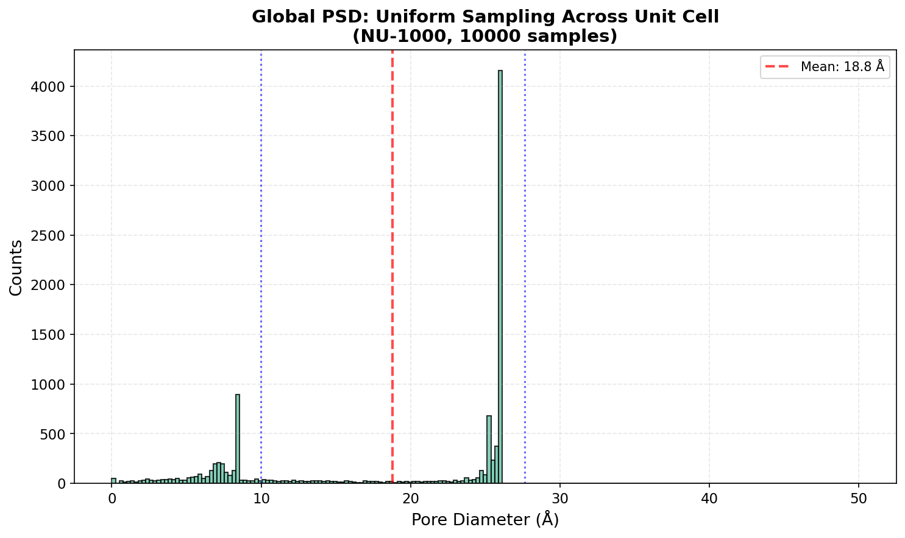
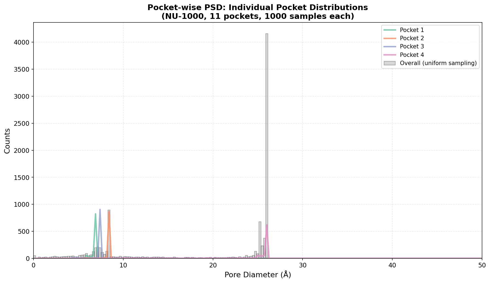
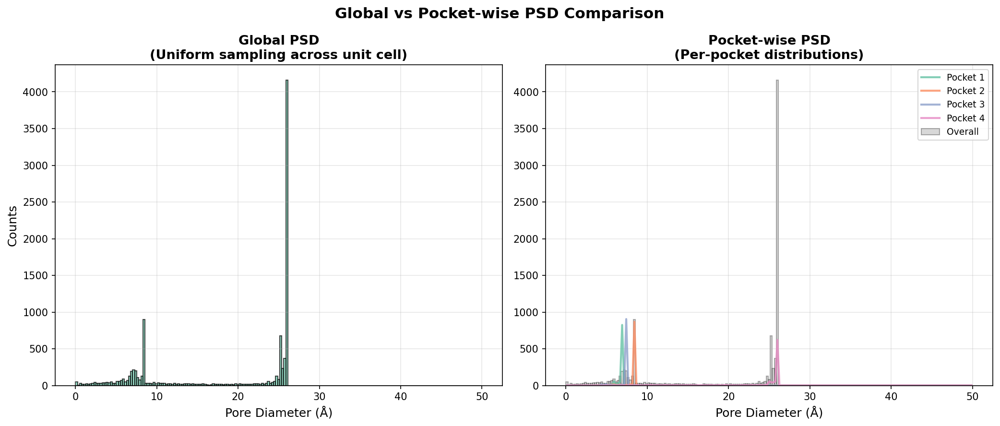

# Pore Size Distributions (Gelb & Gubbins)

> **Using accurate pore size analysis to characterize nanoporous materials at both global and pocket levels**

---

## 📚 Citation

**Gelb & Gubbins Method**: The Pore Size Distribution method described by:
- Gelb, L.D., & Gubbins, K.E. (1998). "Characterization of Porous Solids and Pore-Size Distributions Using a Mean-Field Method." *Langmuir*, 14(8), 1887-1902.
```bibtex
@article{gelb1998,
  title={Characterization of porous solids and pore-size distributions using a mean-field method},
  author={Gelb, L. D. and Gubbins, K. E.},
  journal={Langmuir},
  volume={14},
  number={8},
  pages={1887--1902},
  year={1998}
}
```

---

## 🎯 What is Pore Size Distribution (PSD)?

**Pore Size Distribution (PSD)** is a histogram of the **largest inscribed sphere sizes** for points sampled throughout the void space of a nanoporous material.

### The Core Concept 🧠

For any point in the void space:
1. Find the largest sphere that includes this point
2. This sphere must NOT overlap with any framework atom
3. Record the diameter of this sphere
4. Repeat for many sample points
5. Create histogram of all diameters

This is fundamentally different from simple distance grid analysis:
- **Distance Grid**: Gives distance to nearest atom surface from the grid
- **Gelb-Gubbins PSD**: Finds the LARGEST inscribed sphere at each sample point

### Why is Gelb & Gubbins Powerful? 🚀

1. **Accurate for Non-Spherical Pores** 🎯
   - Cubic or irregular pores have sharp corners
   - Largest inscribed spheres vary significantly throughout the pore
   - Distance grid alone misses these variations

2. **Captures Pore Geometry** 📐
   - Different parts of the same pore have different sphere sizes
   - Provides detailed geometric characterization
   - Essential for understanding molecular transport

3. **Two Levels of Analysis** 📊
   - **Global PSD**: Material-wide average across unit cell
   - **Pocket-wise PSD**: Individual distributions per pore region
   - Enables comparing heterogeneity within structure

4. **Benchmarking Standard** 📏
   - Well-established method in literature (since 1998)
   - Widely used for nanoporous materials characterization
   - Comparable across different studies

---

## ⚠️ Tutorial Scope

**This is an INTERMEDIATE tutorial**, not a beginner guide!

✅ **What this tutorial covers:**
- Computing global PSD using uniform sampling across unit cell
- Computing pocket-wise PSDs for individual pore regions
- Understanding the difference between the two approaches
- Visualizing and comparing both methods
- Using PSDs for pocket type detection

❌ **What this tutorial does NOT cover:**
- Basic periodic segmentation - see [Periodic Segmentation Quick Start](periodic_segmentation_quick_start.md)
- Surface area and void volume calculations - coming soon
- Accessibility criteria and percolation - coming soon
- Energy-based pore size calculations

🔗 **Prerequisites:**
1. Complete [Periodic Segmentation Quick Start](periodic_segmentation_quick_start.md)
2. Have [Rust backend installed](rust_backend_documentation.md) (for speed)
3. Understand segmentation outputs (`regions_pbc`, `maxima_pbc`)
4. Basic knowledge of histograms and statistical analysis

---

## 🔧 Prerequisites

- Python 3.8+
- MOFography installed (`uv pip install -e .`)
- Rust backend compiled and installed (`mgr_rust` module available)
- [Periodic Segmentation Quick Start](periodic_segmentation_quick_start.md) completed
- NumPy, Matplotlib, Plotly installed

---

## 📖 The Workflow in a Nutshell

```
Load Structure
    ↓
Generate Distance Grid
    ↓
Run Periodic Segmentation → Get regions_pbc
    ↓
Compute Global PSD (uniform sampling)
    ↓
Compute Pocket-wise PSD (per region sampling)
    ↓
Visualize & Compare
```

---

## Step 1: Setup and Imports 📦

```python
import numpy as np
from pathlib import Path
import mofography as mgr
from ase.io import read
import logging

# Enable progress output
logging.basicConfig(level=logging.INFO)

# Setup paths
repo_root = Path('/path/to/mofography')
path_to_cif = repo_root / 'examples' / 'TestCIFs' / 'NU-1000_S1.cif'
```

**What is this?**
- Importing all necessary libraries
- Setting up logging to see progress
- Configuring paths for reproducibility

---

## Step 2: Load Structure and Compute Distance Grid 📏

```python
# Load structure
mat_atoms = read(str(path_to_cif))
print(f"✅ Loaded structure: {mat_atoms.info.get('chemical_formula')}")

# Compute distance grid with Rust backend
spacing = 0.25  # Fine spacing for accurate PSD
dgrid = mgr.dgrid_from_atoms_rust(mat_atoms, spacing=spacing)

print(f"✅ Distance grid shape: {dgrid.shape}")
print(f"   Spacing: {spacing} Å")
print(f"   Voxel size: {dgrid.nbytes / 1e6:.1f} MB")
```

**What is this?**
- Computing distance from framework atoms to every grid point
- Fine spacing (0.25 Å) is recommended for accurate PSD
- Rust backend provides 10-15x speedup

**Parameter Guide:**

| Parameter | What it does | Typical range |
|-----------|--------------|---------------|
| `spacing` | Grid spacing (Å) | 0.25 - 0.5 (finer = more accurate but slower) |
| Grid shape | `(nx, ny, nz)` | Depends on cell size and spacing |

---

## Step 3: Run Periodic Segmentation 🔄

```python
# Run periodic segmentation to get pore regions
results = mgr.do_periodic_segmentation_rust(
    dgrid=dgrid,
    mat_atoms=mat_atoms,
    spacing=spacing,
    mask_thickness=0.05,
    h=0.2,
    threshold_abs=1.5,
    minimum_window_separation=1.5,
    wall_thickness=0.08,
    extra_padding=5.0,
    compute_connections=True,
    return_padded_regions=False
)

# Extract key outputs
regions_pbc = results['regions_pbc']
maxima_pbc = results['maxima_pbc']
connections = results['connections']
all_maxima = results['all_maxima']
unique_regions = results['unique_regions']

print(f"\n✅ Segmentation complete!")
print(f"   Found {len(np.unique(regions_pbc))} unique pore regions")
print(f"   Found {len(maxima_pbc)} periodic maxima groups")
```

**What is this?**
- Identifying individual pore regions
- Merging regions connected across periodic boundaries
- Getting `regions_pbc` for pocket-wise PSD

**Key Outputs:**

| Output | What is it? | Why care? |
|--------|-------------|-----------|
| `regions_pbc` | Pore regions with PBC merged | Labels for pocket-wise sampling |
| `maxima_pbc` | Representative maxima per pore | One per unique pore |
| `connections` | Windows between pores | Pore network analysis |

> **Note**: For detailed explanation of these outputs, see [Outputs from Periodic Segmentation](outputs_from_periodic_segmentation.md).

---

## Step 4: Compute Global PSD (Uniform Sampling) 🌍

### Understanding Global PSD

**Global PSD** samples points **uniformly across the entire unit cell**:
- Every part of the unit cell has equal probability of being sampled
- Provides material-wide average pore size
- Good for comparing different materials
- Standard approach in literature

```python
# Compute pore sizes with uniform sampling
num_samples_total = 10000  # Total samples across unit cell

sample_points_uniform, pore_sizes_uniform = mgr.compute_pore_sizes_uniform_rust(
    dgrid,
    mat_atoms,
    num_samples_total=num_samples_total
)

print(f"\n✅ Global PSD computed!")
print(f"   Number of samples: {len(pore_sizes_uniform)}")
print(f"   Mean pore diameter: {np.mean(pore_sizes_uniform * 2):.2f} Å")
print(f"   Std dev: {np.std(pore_sizes_uniform * 2):.2f} Å")
```

**What just happened?**
1. Generated 10,000 random points uniformly in unit cell
2. For each point, found largest inscribed sphere
3. Recorded sphere diameter (pore size)
4. Returned all pore sizes as array (in Angstroms, radius)

**Visualizing Global PSD:**

```python
import plotly.graph_objects as go

# Create histogram
bins = np.linspace(0, 50, 200)  # 0 to 50 Å
hist, bin_edges = np.histogram(pore_sizes_uniform * 2, bins=bins, density=False)
bin_centers = (bin_edges[1:] + bin_edges[:-1]) / 2

# Create figure
fig_global = go.Figure()
fig_global.add_trace(go.Bar(
    x=bin_centers,
    y=hist,
    name='Global PSD',
    marker_color='#66c2a5',
    marker_line_color='black',
    marker_line_width=1,
    opacity=0.8
))

# Add statistics
mean_pore = np.mean(pore_sizes_uniform * 2)
std_pore = np.std(pore_sizes_uniform * 2)

fig_global.update_layout(
    title=f'Global Pore Size Distribution (NU-1000)<br><sub>Uniform sampling, {num_samples_total} points</sub>',
    xaxis_title='Pore Diameter (Å)',
    yaxis_title='Counts',
    showlegend=True,
    width=1000,
    height=600
)

fig_global.show()
```


*Global PSD showing material-wide pore size distribution*

---

## Step 5: Compute Pocket-wise PSD 🎯

### Understanding Pocket-wise PSD

**Pocket-wise PSD** samples points **within each identified pore region**:
- Each region gets `num_samples_per_region` points
- Different pores can have very different distributions
- Reveals heterogeneity within the material
- More compute-intensive but more detailed

```python
# Compute pore sizes for each pocket
num_samples_per_region = 1000  # Samples per pore region

sample_points_pocketwise, pore_sizes_pocketwise, region_labels = mgr.compute_pore_sizes_pocketwise_rust(
    dgrid,
    regions_pbc,
    mat_atoms,
    samples_per_region=num_samples_per_region
)

print(f"\n✅ Pocket-wise PSD computed!")
print(f"   Number of pockets: {len(np.unique(region_labels))}")
print(f"   Total samples: {len(pore_sizes_pocketwise)}")
print(f"   Samples per pocket: {num_samples_per_region}")
```

**What just happened?**
1. Generated `num_samples_per_region` random points **within each region**
2. For each point, found largest inscribed sphere
3. Grouped results by region label
4. Returned sample points, pore sizes, and region labels

**Visualizing Pocket-wise PSD:**

```python
# Compute PSDs for each pocket
from mofography.helper import compute_psds_from_points_pocketwise

# Convert pore sizes to diameters (pore_sizes are radii)
pore_diameters = pore_sizes_pocketwise * 2

# Compute histograms per pocket
pocket_psds = compute_psds_from_points_pocketwise(
    region_labels,
    pore_diameters,
    bins=bins
)

# Create comparison figure
fig_pocketwise = go.Figure()

# Add overall histogram (gray)
fig_pocketwise.add_trace(go.Bar(
    x=bin_centers,
    y=hist,
    name='Overall (uniform)',
    marker_color='gray',
    marker_line_color='black',
    marker_line_width=1,
    opacity=0.3
))

# Add individual pocket PSDs
colors = ['#66c2a5', '#fc8d62', '#8da0cb', '#e78ac3']
for i, (label, psd_data) in enumerate(pocket_psds.items()):
    if i >= len(colors):
        break
    fig_pocketwise.add_trace(go.Scatter(
        x=psd_data['bin_centers'],
        y=psd_data['hist'],
        mode='lines',
        name=f'Pocket {label}',
        line=dict(width=2, color=colors[i]),
        hovertemplate=f'Pocket {label}<br>Diameter: %{{x:.1f}} Å<br>Count: %{{y}}'
    ))

fig_pocketwise.update_layout(
    title=f'Pocket-wise Pore Size Distributions (NU-1000)<br><sub>{len(pocket_psds)} pockets, {num_samples_per_region} samples each</sub>',
    xaxis_title='Pore Diameter (Å)',
    yaxis_title='Counts',
    showlegend=True,
    legend=dict(x=0.8, y=0.99),
    width=1000,
    height=600
)

fig_pocketwise.show()
```


*Individual pore size distributions for each identified pocket region*

**Key Insight:**
- Different pockets often have different average pore sizes
- This heterogeneity is invisible in global PSD
- Pocket-wise PSD reveals material complexity

---

## Step 6: Comparing Global vs Pocket-wise PSD ⚖️

Understanding the differences between the two approaches is crucial for material analysis.

```python
# Create side-by-side comparison
from plotly.subplots import make_subplots

fig_comparison = make_subplots(rows=1, cols=2, subplot_titles=('Global PSD', 'Pocket-wise PSD'))

# Left: Global PSD
fig_comparison.add_trace(
    go.Bar(x=bin_centers, y=hist, marker_color='#66c2a5',
              marker_line_color='black', opacity=0.8),
    row=1, col=1
)

# Right: Pocket-wise PSD (overlay curves)
fig_comparison.add_trace(
    go.Bar(x=bin_centers, y=hist, marker_color='gray',
              marker_line_color='black', opacity=0.3),
    row=1, col=2
)

for i, (label, psd_data) in enumerate(pocket_psds.items()):
    if i >= len(colors):
        break
    fig_comparison.add_trace(
        go.Scatter(x=psd_data['bin_centers'], y=psd_data['hist'],
                   mode='lines', name=f'Pocket {label}',
                   line=dict(width=2, color=colors[i])),
        row=1, col=2
    )

fig_comparison.update_layout(height=500, width=1400, showlegend=True)
fig_comparison.show()
```


*Side-by-side comparison of global vs pocket-wise PSD methods*

### Key Differences:

| Aspect | Global PSD | Pocket-wise PSD |
|---------|-------------|-----------------|
| **Sampling** | Uniform across unit cell | Within each region |
| **Output** | Single histogram | Multiple histograms |
| **Accuracy** | Material average | Per-pore detail |
| **Use Case** | Material screening | Heterogeneous analysis |
| **Computation** | Faster | Slower (but parallelized) |
| **Information** | Bulk property | Spatially resolved |

---

## Step 7: Using PSDs for Pocket Detection (Optional) 🎯

PSDs can be used as features for clustering pockets into types, similar to CSD but more accurate.

### When to Use PSD vs CSD?

| Method | Speed | Accuracy | Best Use Case |
|---------|-------|----------|---------------|
| **CSD** | Very fast | Approximate | Quick screening, pocket detection |
| **PSD** | Slow | Accurate | Detailed characterization, publication |

**PSD Features for Clustering:**
- More sensitive to pore shape variations
- Better for distinguishing similar-sized pockets with different geometries
- Computationally expensive but worth it for publication quality

```python
# Example: Extract PSDs as features
# Each pocket now has a histogram (bins, hist)
# Can use these histograms as features in clustering
# Similar to how CSD is used in pocket detection tutorial

# For publication-quality analysis:
# 1. Use smaller bin_width (e.g., 0.25 Å instead of 0.25 Å default)
# 2. Increase num_samples_per_region (e.g., 2000-5000)
# 3. Use PSD-based clustering instead of CSD

# Note: This is advanced usage - see Pocket Detection tutorial for implementation
```

---

## 🛠️ Troubleshooting

| Issue | Solution |
|-------|----------|
| **ImportError: No module named 'mgr_rust'** | Compile Rust backend: `cd mgr_rust && maturin build --release && pip install target/wheels/*.whl` |
| **MemoryError during PSD** | Reduce `num_samples_total` or `num_samples_per_region` |
| **Computation too slow** | Increase grid spacing to 0.3-0.5 Å, or reduce samples |
| **Wrong dtype error** | Ensure dgrid is float32: `dgrid = dgrid.astype(np.float32)` |
| **Few regions found** | Check segmentation parameters (h, threshold_abs, extra_padding) |
| **PSD looks noisy** | Increase number of samples or smooth the histogram |
| **Inconsistent results** | Set random seed for reproducibility: `np.random.seed(42)` |

---

## 📝 Summary

| Step | What we did | Key Function |
|------|-------------|--------------|
| 1. Load structure | Read CIF file | `ase.io.read()` |
| 2. Generate dgrid | Distance to atoms | `dgrid_from_atoms_rust()` |
| 3. Segment | Identify pore regions | `do_periodic_segmentation_rust()` |
| 4. Global PSD | Uniform sampling | `compute_psd_uniform_rust()` |
| 5. Pocket PSD | Per-region sampling | `compute_psds_pocketwise_rust()` |
| 6. Visualize | Plot histograms | Plotly/Matplotlib |

**Key Takeaway:** Gelb & Gubbins PSD provides accurate pore size distributions at both global and pocket levels, enabling detailed geometric characterization of nanoporous materials!

---

## 🚀 Next Steps

### Learn More:
- [Periodic Segmentation Quick Start](periodic_segmentation_quick_start.md) - Required prerequisite
- [Rust Backend Documentation](rust_backend_documentation.md) - More on Rust functions
- [Outputs from Periodic Segmentation](outputs_from_periodic_segmentation.md) - Understanding segmentation outputs

### Explore Related Tutorials:
- [Distance Grid](distance_grid.qmd) - Understanding distance fields
- [Region Segmentation](region_segmentation.qmd) - Segmentation fundamentals
- [Pocket Detection](pockets_detection.qmd) - Using CSD features for clustering

### Coming Soon:
- Surface Area and Void Volume with Accessibility Criteria
- Percolation Analysis with Winding Number
- Energy-based Pore Size Distributions

---

## 🎁 Bonus: Quick One-Liner Functions

For convenience, MOFography provides wrapper functions that combine all steps:

### Global PSD (Quick)

```python
# Compute global PSD and get figure in one call
psd_hist, fig = mgr.compute_psd_uniform_rust(
    dgrid, mat_atoms,
    num_samples_total=10000,
    bins=np.linspace(0, 50, 200),
    density=False,
    material='NU-1000',
    return_fig=True
)

fig.show()
```

### Pocket-wise PSD (Quick)

```python
# Compute pocket-wise PSDs and get figure in one call
pocket_psds, fig = mgr.compute_psds_pocketwise_rust(
    dgrid, regions_pbc, mat_atoms,
    num_samples_per_region=1000,
    bins=np.linspace(0, 50, 200),
    material='NU-1000',
    return_fig=True
)

fig.show()
```

These functions are convenient for:
- **Quick analysis** without manually implementing plotting
- **Standardized visualization** across different materials
- **Publication-ready figures** with proper formatting

---

### Performance Tips 💡

1. **Use Rust Backend** - Provides 8-12x speedup for pore size calculations
2. **Adjust Sampling** - More samples = more accurate but slower
3. **Balance Accuracy vs Speed** - 0.25 Å spacing is a good default
4. **Parallel Processing** - Rust automatically uses multiple CPU cores
5. **Memory Management** - For large structures, use `dask` or reduce samples

---

Happy pore size analyzing! 🎊
