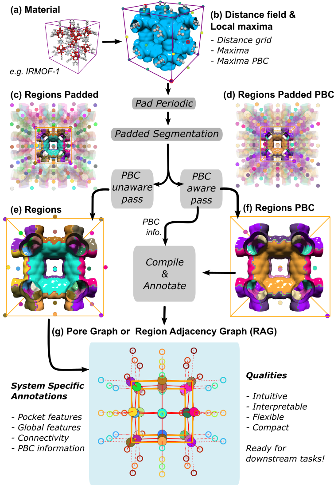
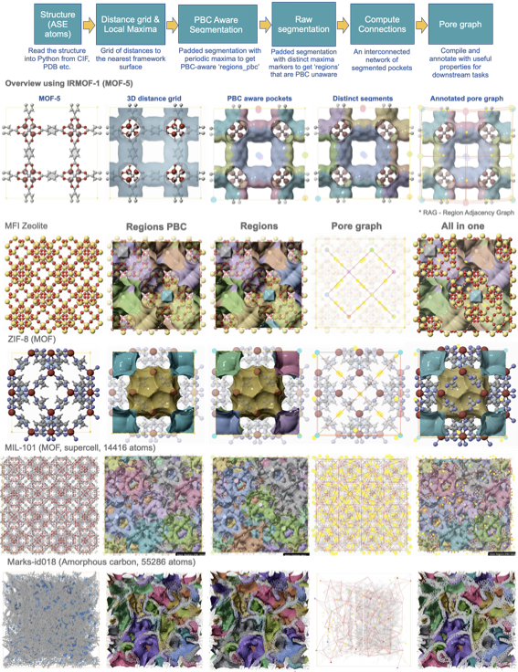

{width=100%}

## Overview

This is the **canonical mofography workflow** — go from a CIF file to a fully analyzed pore graph in three function calls:

1. `dgrid_from_atoms_rust()` — compute the 3D distance grid
2. `do_periodic_segmentation_rust()` — detect pore regions, handle PBC, compute connections
3. `show_mof_plotly()` — interactive 3D visualization

This replaces the old multi-step workflow (7+ manual calls) with a clean, tested pipeline.

## Imports

```{python}
import mofography as mgr
from ase.io import read
import numpy as np
```

## Step 1: Load a Structure

```{python}
# Load a MOF from CIF — use any CIF/PDB file
atoms = read("IRMOF-1.cif")

print(f"Atoms: {len(atoms)}")
print(f"Cell: {atoms.cell.cellpar()[:3].round(2)} Å")
print(f"Angles: {atoms.cell.cellpar()[3:].round(1)}°")
print(f"Formula: {atoms.get_chemical_formula()}")
```

## Step 2: Compute the Distance Grid

The distance grid is the foundation. Every downstream step depends on it.

```{python}
# Default: thread-parallel Rust backend — correct for all cell types
spacing = 0.5  # Å — most impactful parameter (halve it → 8× more voxels)

dgrid = mgr.dgrid_from_atoms_rust(atoms, spacing=spacing)
print(f"Grid shape: {dgrid.shape} ({dgrid.size:,} voxels)")
print(f"Void max: {dgrid.max():.1f} Å")
```

> **Alternative backends:** For large systems, try `dgrid_from_atoms_aabb_rust(spacing=0.5, n_neighbors=10)` (R-tree, less RAM) or `dgrid_from_atoms_aabb_interp_rust(spacing=1.0, coarse_factor=2)` (coarse + interpolation). See the [Distance Grid tutorial](distance_grid.qmd) for details.

## Step 3: Periodic Segmentation (Single Call)

`do_periodic_segmentation_rust` replaces **5-7 old manual steps**: maxima detection, watershed segmentation, PBC-aware watershed, connection detection, and pore graph construction — all in one call.

```{python}
dgrid_f32 = dgrid.astype(np.float32)
seg = mgr.do_periodic_segmentation_rust(
    dgrid_f32, atoms,
    mask_thickness=0.05,        # void-space threshold (Å)
    h=0.2,                      # H-maxima persistence
    min_distance=1.5,           # min separation between distinct maxima (Å)
    threshold_abs=1.5,          # absolute threshold for maxima (Å)
    spacing=spacing,
    compute_connections=True,   # detect windows + build pore graph
    watershed_backend="rust_det",
    disable_tqdm=True,
)
```

```{python}
# What did we get?
print(f"Pore pockets (PBC-grouped): {len(seg['maxima_pbc'])}")
print(f"Total maxima detected:      {len(seg['all_maxima'])}")
print(f"Unique regions:             {len(seg['unique_regions'])}")
print(f"Window connections:         {len(seg['connections'])}")
print(f"PBC equivalence groups:     {len(seg['pbc_groups'])}")
print(f"Regions shape:              {seg['regions_pbc'].shape}")
```

## Step 4: Visualize

```{python}
# Full interactive 3D visualization (Plotly)
fig = mgr.show_mof_plotly(seg, atoms, framework_atoms=atoms, stylize=True)
fig.show()
```

> For **interactive ThreeJS** output (rotatable, zoomable, exportable to standalone HTML), use `show_mof_threejs(seg, atoms, output_html="my_mof.html")`.

## Step 5: Downstream Analysis

```{python}
# Pore Size Distribution (global, uniform sampling)
psd = mgr.compute_psd_uniform_rust(seg['dgrid'], atoms, num_samples_total=10000)

# Pocket-wise PSD
psds_pocket = mgr.compute_psds_pocketwise_rust(
    seg['dgrid'], seg['regions_pbc'], atoms,
    num_samples_per_region=1000
)

# Enrich segmentation with PSD data
enriched = mgr.enrich_segmentation_with_pocket_psds(seg, atoms)

# Detect pocket types (multi-modal fingerprinting)
typed = mgr.assign_pocket_types(enriched, atoms, method='env_cluster')
print(f"Found {typed.n_types} pocket types across {typed.n_pockets} pockets")
for t in typed.type_summary:
    print(f"  Type {t['type_id']}: {t['n_pockets']} pockets, "
          f"radius {t['max_r_min_a']:.1f}–{t['max_r_max_a']:.1f} Å")
```

## Parameter Reference

### Essential parameters (tune these first)

| Parameter | Default | Effect |
|-----------|---------|--------|
| `spacing` | 0.5 Å | Grid resolution — halve it → 8× more voxels |
| `mask_thickness` | 0.05 Å | Void-space threshold — increase to merge nearby pockets |
| `h` | 0.2 Å | H-maxima persistence — higher = fewer, larger maxima |
| `min_distance` | 1.5 Å | Minimum separation between maxima — higher = fewer pockets |
| `threshold_abs` | 1.5 Å | Absolute threshold — maxima must be at least this far from framework |

### Advanced parameters

| Parameter | Default | Effect |
|-----------|---------|--------|
| `preserve_threshold` | 3.0 Å | Maxima below this are untouched during smoothing |
| `smooth_threshold` | 6.0 Å | Maxima above this are always smoothed |
| `max_smooth_radius` | 2.0 Å | Cap on smoothing radius |
| `extra_padding` | 5.0 Å | Extra PBC padding beyond standard +5 Å |
| `watershed_backend` | `"rust_det"` | `rust_det` \| `rust_bucket` \| `rust_det_parallel` \| `skimage` |
| `vdw_radii_set` | `"bondi"` | VDW radii table: `bondi` \| `crc` \| `alvarez` |
| `compactness` | 0 | Region compactness filter (0 = disabled) |
| `min_region_size` | 0.001 | Fraction of padded grid volume — filter tiny regions |

## Tips

- **Start with defaults.** The defaults (`h=0.2`, `min_distance=1.5`, `threshold_abs=1.5`) work well for most MOFs.
- **Check `maxima_pbc` count.** This is your pore count — should match your expectation for the MOF's topology.
- **Tune `h` for over/under-segmentation.** Too many small pockets → increase `h`. Missing pockets → decrease `h`.
- **For very large systems,** use `dgrid_from_atoms_aabb_rust` (R-tree) or `dgrid_from_atoms_aabb_interp_rust` (coarse + interpolation).

## Next Steps

- [Periodic Segmentation Deep Dive](periodic_segmentation_quick_start.md) — understand every output key
- [Pore Size Distributions](pore_size_distributions_gelb_gubbins.md) — PSD theory and interpretation
- [PLD & Percolation](pore_limiting_diameter_pld_and_percolation.md) — pore limiting diameter and accessibility
- [Surface Area](monte_carlo_surface_area.md) — Monte Carlo shell method
