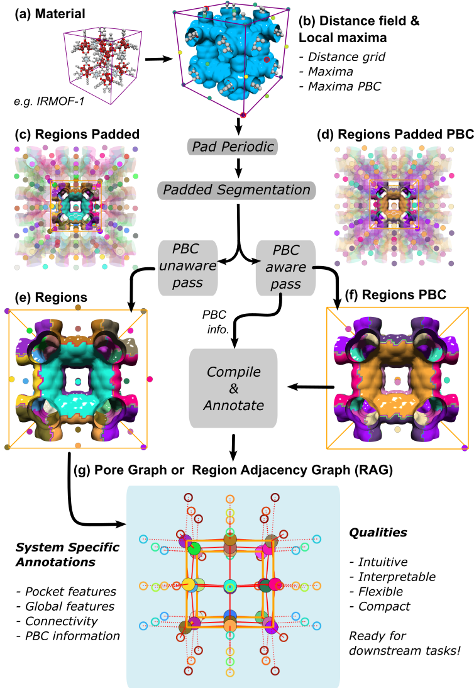
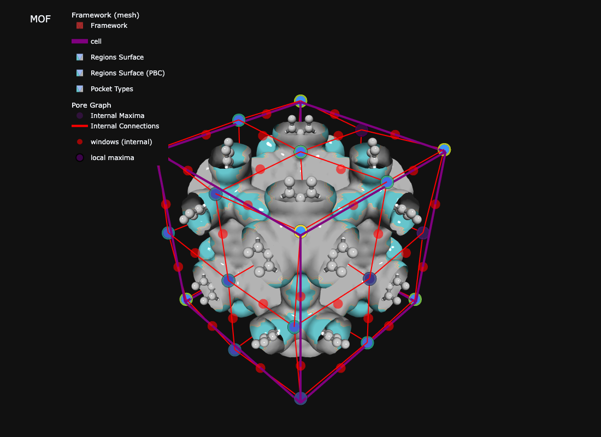

## Overview

Two functions do the heavy lifting. Everything else reads their output.

1. `dgrid_from_atoms_rust(atoms, spacing)` computes the distance grid (distance from each voxel to the nearest framework surface).
2. `do_periodic_segmentation_rust(dgrid, atoms, ...)` finds pockets, handles periodic boundaries, and detects windows. It returns one dictionary (`seg`).

From `seg` you get a pore graph, pocket types, windows, and textural properties (LCD, PLD, surface area, void volume). This page runs all of it on IRMOF-1. Parameter safe ranges live on [Tuning and safe ranges](parameter_tuning.qmd).

## Imports and structure

```{python}
import numpy as np
import mofography as mgr
from mofography.cif_io import read_cif_to_ase  # fast Rust CIF reader, returns ase.Atoms (see the Fast Rust CIF reader page)

atoms = read_cif_to_ase("IRMOF-1.cif")   # or examples/TestCIFs/P1-IRMOF-1.cif from the repo root; ase.io.read works too
print(f"{atoms.get_chemical_formula()}: {len(atoms)} atoms")
print("Cell (Å):", atoms.cell.cellpar()[:3].round(2))
```

## 1. Distance grid

```{python}
spacing = 0.5  # Å. Halving it gives 8x more voxels.
dgrid = mgr.dgrid_from_atoms_rust(atoms, spacing=spacing).astype(np.float32)
print(f"Grid {dgrid.shape}, largest void radius {dgrid.max():.2f} Å")
```

`radii=None` uses Bondi van der Waals radii. For other grid backends see [Distance grid](distance_grid.qmd) and [Distance grid methods](dgrid_methods.qmd).

## 2. Periodic segmentation

```{python}
seg = mgr.do_periodic_segmentation_rust(
    dgrid, atoms,
    spacing=spacing,             # always pass it; otherwise it is inferred
    mask_thickness=0.05,         # Å, voxels closer than this to the framework are background
    h=0.2,                       # Å, maxima persistence
    min_distance=1.5,            # Å, minimum separation between maxima
    threshold_abs=1.5,           # Å, minimum height of a maximum
    watershed_backend="rust_det",
    compute_connections=True,    # windows + connections
    return_dgrid=True,           # keep dgrid inside seg for later steps
    disable_tqdm=True,
)
print(f"Pockets (PBC-merged): {len(seg['maxima_pbc'])}")
print(f"Unique regions:       {len(seg['unique_regions'])}")
print(f"Window connections:   {len(seg['connections'])}")
print(f"PBC groups:           {len(seg['pbc_groups'])}")
```

Those are the defaults (written out for clarity). `seg` also holds `regions_pbc` (labelled grid), `maxima_info`, `all_maxima` and `input_params`. See [Region segmentation](region_segmentation.qmd) and [PBC considerations](pbc_considerations.qmd).

::: {.callout-note}
Messages starting with `[pocket_maxima_check]` mean a pocket's recorded maximum is a bit lower than the true peak of its region (a few tenths of an Å). They are informational. See the [tuning page](parameter_tuning.qmd) if you want to remove them.
:::

## 3. Pore graph

Pockets become nodes. Windows between pockets become edges.

```{python}
rag = mgr.rag_from_connections(seg["connections"], seg["all_maxima"])
print(rag)
```

It is a `networkx` graph. See [Pore graph](region_adjacency_graph.ipynb).

## 4. Pocket types

```{python}
seg = mgr.enrich_segmentation_with_pocket_psds(seg, atoms)   # per-pocket PSDs, reused by typing
typed = mgr.assign_pocket_types(seg, atoms, method="env_cluster")
print(f"{typed.n_types} types across {typed.n_pockets} pockets")
for t in typed.type_summary:
    print(f"  type {t['type_id']}: {t['n_pockets']} pockets, "
          f"max radius {t['max_r_min_a']:.2f}-{t['max_r_max_a']:.2f} Å")
```

More in [Pocket type detection](pockets_detection.qmd).

## 5. Windows

Each entry of `seg["connections"]` is `[region_pair, flag, "internal"|"periodic", centre, radius]`. Keep those that touch a unique region to avoid counting windows from the padding.

```{python}
unique = seg["unique_regions"]
windows = [c for c in seg["connections"] if np.any(np.isin(c[0], unique))]
radii = np.array([float(np.ravel(c[4])[0]) for c in windows])
print(f"{len(windows)} windows in the cell; radii {radii.min():.2f}-{radii.max():.2f} Å")
```

See [Connections and windows](connections_and_windows.qmd).

## 6. Textural properties

LCD and PLD come from the winding method, which tests percolation across periodic images. Surface area and void volume are computed on the same `seg`.

```{python}
lcd, pld, dfsd, _ = mgr.get_pore_dia_mgr_winding(atoms, dgrid=dgrid, results=seg)
print(f"LCD {lcd:.2f} Å | PLD {pld:.2f} Å | DFSD {dfsd:.2f} Å")

probe = 1.2  # Å, helium; use a probe radius below PLD/2 or nothing percolates
sa = mgr.compute_surface_area_mc_winding(seg, atoms, probe_radius=probe)
vv = mgr.compute_void_volume_from_results_winding(seg, atoms, probe_radius=probe)
print(f"Surface area: {sa['accessible_surface_area']:.0f} m²/g "
      f"(total {sa['total_surface_area']:.0f})")
print(f"Void volume:  {vv['accessible_void_volume']:.3f} cm³/g "
      f"(total {vv['total_void_volume']:.3f})")
```

Details: [Surface area](surface_area.qmd) and [Accessibility](accessibility.qmd).

## 7. Visualize

```{python}
fig = mgr.show_mof_plotly(seg, atoms, typed_result=typed, framework_atoms=atoms, stylize=True)
fig.write_image("tutorial_images/quick_start_structure.png", width=1100, height=800)  # static preview for the docs
```



::: {.callout-note collapse="true" title="Interactive version"}
```python
fig = mgr.show_mof_plotly(seg, atoms, typed_result=typed, framework_atoms=atoms, stylize=True)
fig.show()   # rotatable Plotly figure in a notebook
# or a standalone page:
mgr.show_mof_threejs(seg, atoms, typed_result=typed, output_html="mof.html")
```
:::

[Open the interactive version](interactive/irmof1_pockets_windows_threejs.html){target="_blank"}

## Notes

- `mgr.quick_cluster(atoms)` is a legacy one-call helper that builds a figure set (and opens a browser renderer). Use the explicit steps above in scripts.
- Cast `dgrid` to `float32` before segmentation, as above.
- Defaults are a good start for most MOFs. If pocket counts look wrong, go to [Tuning and safe ranges](parameter_tuning.qmd).

## Next

- [Tuning and safe ranges](parameter_tuning.qmd)
- [Selective smoothing](selective_smoothing.qmd) and [Watershed backends](watershed_backends.qmd)
- [PLD and percolation](pld_and_percolation.ipynb)
