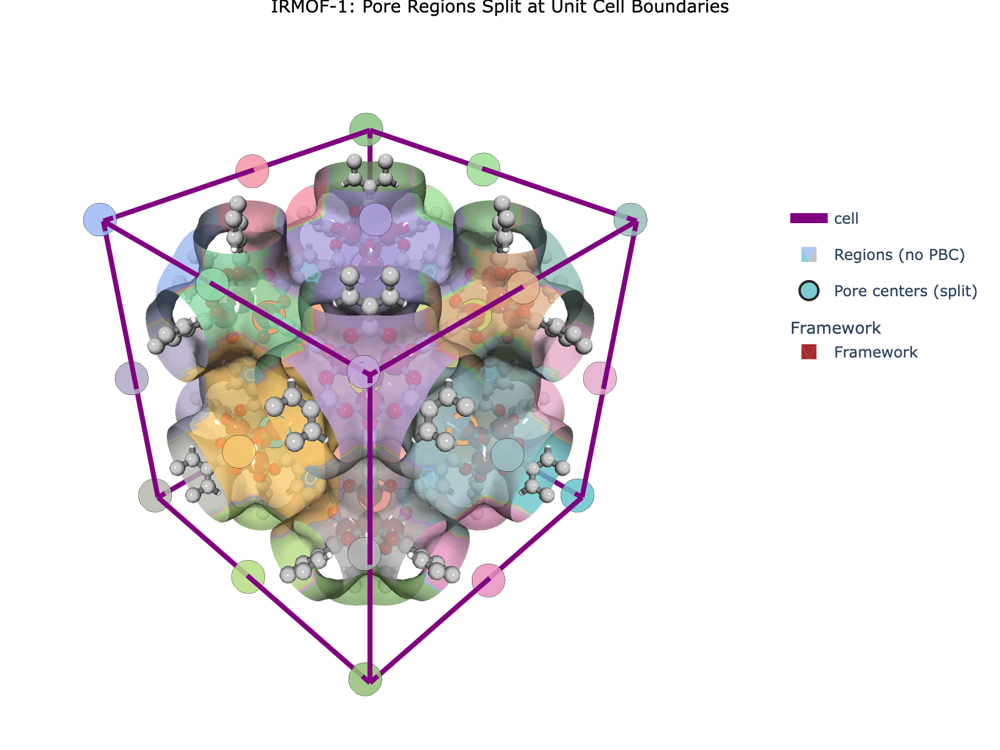
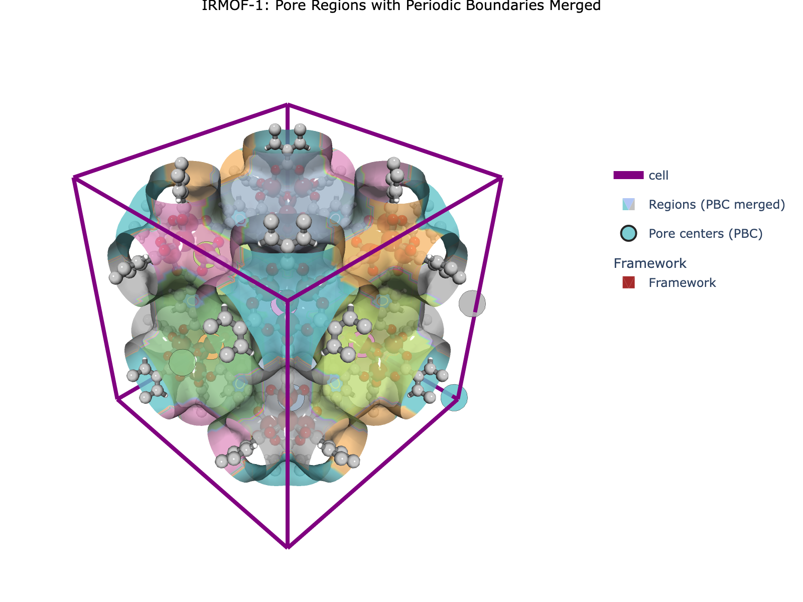
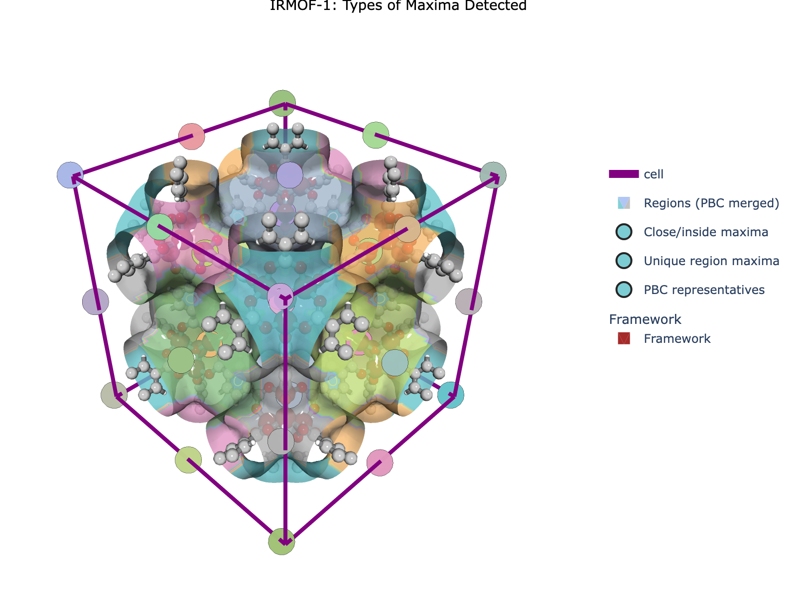
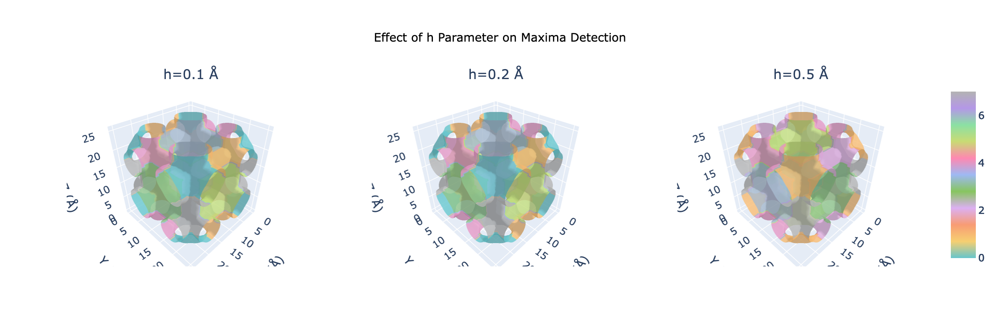
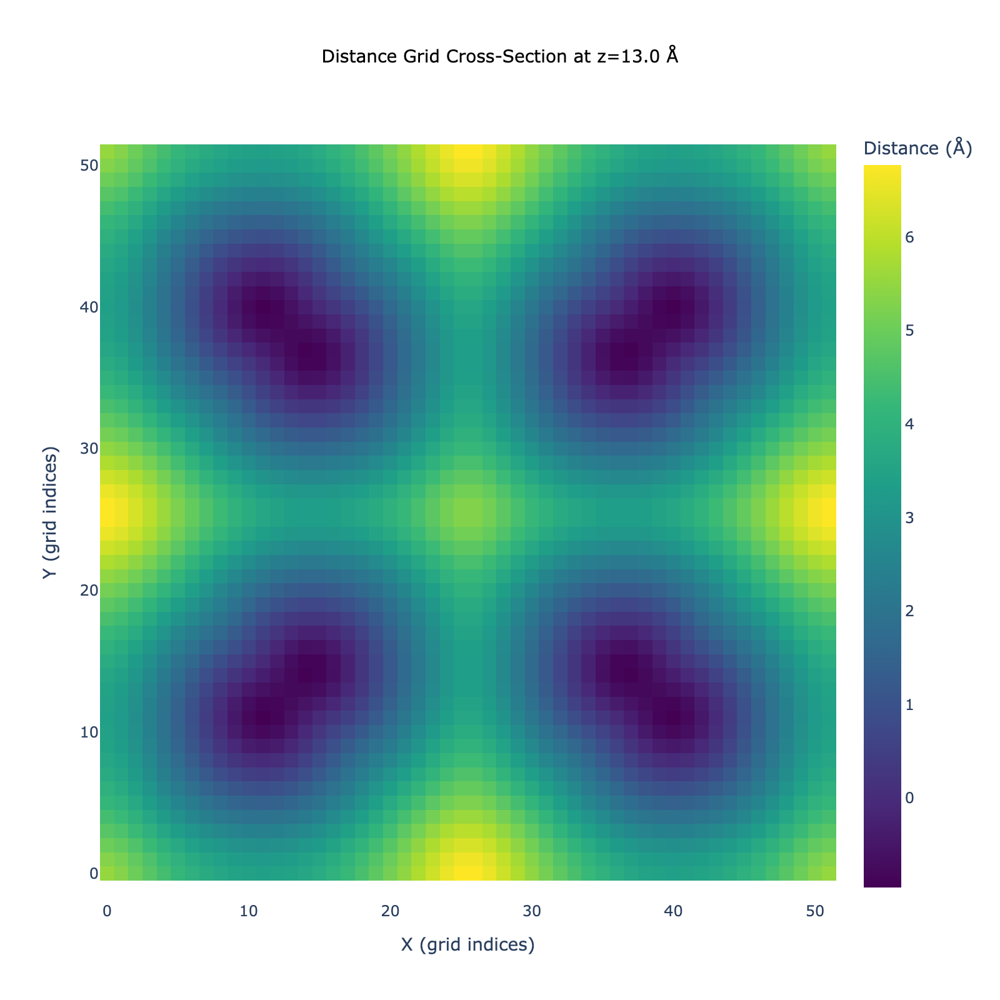

# 🌟 Region Segmentation in MOFography

> **A beginner-friendly guide to segmenting pore space into discrete regions using periodic boundary conditions**

---

## 📚 Related Documentation

This is part of the MOFography tutorial series. For the main quick start guide, see:
- [Periodic Segmentation Quick Start](periodic_segmentation_quick_start.md) - Complete workflow
- [Computing the Distance Grid](distance_grid.md) - Distance grid foundation
- [Framework Visualization](framework_visualization_example.md) - Visualizing structures

---

## 🎯 What is Region Segmentation?

At the heart of MOFography's pore analysis lies **region segmentation** - the process of breaking down the complex void space of a material into discrete, manageable pockets. Each pocket is centered around a **local maximum** in the distance field and represents a distinct region where molecules could potentially reside.

### Why is this Important? 🚀

Region segmentation is the foundation for all downstream analysis in MOFography:

1. **Pocket Identification** 📍
   - Identifies distinct void spaces (pockets/cavities)
   - Each region corresponds to a physically meaningful pore
   - Enables averaging of properties within each pocket

2. **Pore Network Construction** 🕸️
   - Regions become nodes in the pore graph
   - Connections between regions become edges
   - Enables network theory analysis of transport

3. **Property Calculation** 📊
   - Calculate pore volumes, surface areas per pocket
   - Determine pocket shapes and sizes
   - Classify pocket types for characterization

4. **Transport Analysis** 🚪
   - Identify windows between pockets
   - Calculate pore-limiting diameters
   - Study molecular diffusion pathways

### The Core Concept 🧠

**Segmentation** answers the question: *"Which pore does this voxel belong to?"*

Imagine pouring water into a landscape with multiple valleys (pores) separated by mountains (walls). Each valley collects water from its surrounding area. Similarly, segmentation assigns each point in the void space to the nearest pore center.

**Key Insight:**
- 🎯 **Local maxima** = pore centers (where water would pool)
- 🏔️ **Watershed boundaries** = where valleys meet (windows between pores)
- 💧 **Voxels** = points assigned to a specific pore

---

## ⚠️ Tutorial Scope

**This is a FOUNDATIONAL tutorial** on region segmentation.

✅ **What this tutorial covers:**
- What region segmentation is and why it matters
- How maxima detection works (h-maxima)
- How watershed segmentation assigns voxels to regions
- Understanding periodic boundary conditions in segmentation
- Key parameters and their effects on results
- Visualizing segmented regions

❌ **What this tutorial does NOT cover:**
- High-throughput analysis - see [HTS Tutorial](hts_using_mofography.ipynb)
- Percolation analysis - see [PLD & Percolation](pld_and_percolation.ipynb)
- Advanced parameter tuning strategies
- Pocket type classification - see [Pockets Detection](pockets_detection.ipynb)

---

## 🎓 What You'll Learn

By the end of this tutorial, you'll be able to:

1. ✅ Understand the difference between segmentation with and without PBC
2. ✅ Explain how selective smoothing works for maxima detection
3. ✅ Understand key maxima detection parameters (preserve_threshold, smooth_threshold, h)
4. ✅ Understand how watershed segmentation assigns voxels to pore regions
5. ✅ Explain why periodic boundary conditions matter for segmentation
6. ✅ Run the periodic segmentation workflow
7. ✅ Interpret the different output arrays
8. ✅ Visualize segmented regions with proper coloring
9. ✅ Tune key parameters for your system

---

## 🔄 Segmentation With vs Without PBC

MOFography provides two complementary approaches for region segmentation:

### Periodic Segmentation (Recommended for Most Cases)

This is the **default and recommended approach** for crystalline materials:

**What it does:**
- Handles periodic boundary conditions automatically from the start
- Identifies which regions are periodic images of each other
- Merges them correctly into single pores
- Returns `regions_pbc` with merged regions

**When to use:**
- ✅ Crystalline materials (MOFs, COFs, zeolites)
- ✅ When you want to average properties correctly
- ✅ When constructing pore graphs for transport analysis
- ✅ When you need physically meaningful pore volumes

**Key outputs:**
- `regions_pbc` - Segmented regions with PBC correctly merged
- `maxima_pbc` - One representative maximum per unique pore
- `pbc_groups` - Lists of periodic image groupings

### Non-Periodic Segmentation (For Special Cases)

Sometimes you may want segmentation **without** PBC merging:

**What it does:**
- Treats each periodic image as a separate region
- Returns `regions` where corner/face/edge regions have different labels
- Each piece gets its own label, even if they're physically connected

**When to use:**
- ✅ When you need distinct nodes for each pocket in a pore graph
- ✅ Studying how pockets are distributed across unit cell boundaries
- ✅ Some machine learning applications requiring explicit spatial separation
- ✅ Non-periodic systems (surfaces, amorphous materials)
- ✅ Very large systems where padding is prohibitive

**Key outputs:**
- `regions` - Segmented regions WITHOUT PBC merging (split at boundaries)
- `all_maxima` - All periodic images as separate maxima

### Quick Comparison

| Feature | With PBC (`regions_pbc`) | Without PBC (`regions`) |
|---------|-------------------------|------------------------|
| Corner pore label | All 8 corners = label 1 | Each corner = different label |
| Property averaging | Correct (one pore = one value) | Requires post-processing |
| Pore graph | Merged nodes | Distinct nodes per image |
| Memory usage | Higher (requires padding) | Lower |
| Use case | Most crystalline analyses | Special cases above |

### When Would You Use Non-PBC?

1. **Constructing a detailed pore graph** where you want each pocket piece to be a distinct node, allowing you to study how they're connected across boundaries explicitly.

2. **Some ML applications** where having explicit spatial separation between features is beneficial for the model.

3. **Large-scale screening** where memory is a concern and approximate PBC merging via `apply_pbc()` is acceptable.

4. **Non-periodic systems** like surfaces, interfaces, or amorphous materials.

**Note:** For property averaging (e.g., computing average pore volume), you should use `regions_pbc`. For non-PBC segmentation, you would need to manually post-process to merge properties across periodic images.

---

## 🌟 Why Do We Need Periodic Segmentation?

If you're working with **crystalline nanoporous materials**, periodic boundary conditions (PBC) create a fundamental challenge:

**Pores don't respect unit cell boundaries!** 😤

Consider a cubic unit cell with a large pore at each corner. When you segment it without PBC handling, you get **8 separate pore regions** at the 8 corners. But physically, these are all the **same pore** - just cut off by the arbitrary boundaries we drew!



*Without PBC: The same pore appears as 8 separate regions at the corners.*

**Periodic segmentation solves this** by:
1. Expanding the grid to "see" across periodic boundaries
2. Identifying which regions are periodic images of each other
3. Merging them correctly into single pores



*With PBC: Regions are correctly merged. The 8 corner pieces are recognized as one pore.*

---

## 🎯 Maxima Detection: Finding Pore Centers

Before we segment the void space, we need to find the **local maxima** in the distance grid - these are the centers of our pores. MOFography uses a sophisticated **selective smoothing** algorithm for this task.

### The Challenge: Noise vs. Features

The distance grid from real materials often contains:
- **Noise** from grid discretization and the distance field is not smooth near the framwork surface, as the atom responsible for the shortest distance to the framework can change abruptly, causing the corresponding distance values to jump, even with AABB cell list.
- **Real features** like small pockets, large channels, and tunnels
- **Surface roughness** that shouldn't create multiple closeby maxima, where there shouldn't be distinct pores.

Besides, simply finding all local maxima that are one voxel jumps with no constraints, would give us hundreds of tiny, spurious pockets. We need a smarter approach, involving smoothing and sensible parameter defaults.

### Selective Smoothing Algorithm 🔬

MOFography's `do_periodic_segmentation_rust()` uses the **selective smoothing** algorithm implemented in the Rust backend. Here's how it works:

**Step 1: Create a Smoothing Radius Field**

The algorithm computes a spatially-varying smoothing radius for each voxel based on the local distance value:

```python
# Pseudocode for the algorithm
for each voxel (i, j, k):
    local_pore_size = dgrid[i, j, k]
    
    if local_pore_size < preserve_threshold:
        # Small pockets - no smoothing (preserve features)
        smooth_radius = 0.0
    elif local_pore_size > smooth_threshold:
        # Large channels - maximum smoothing (remove roughness)
        smooth_radius = max_smooth_radius
    else:
        # Intermediate - linear interpolation
        fraction = (local_pore_size - preserve_threshold) / \
                   (smooth_threshold - preserve_threshold)
        smooth_radius = fraction * max_smooth_radius
```

**Step 2: Apply Spatially-Varying Gaussian Smoothing**

Each voxel is smoothed with a Gaussian kernel whose size depends on its local smooth_radius:

```python
# Apply Gaussian smoothing with local radius
for each voxel (i, j, k):
    sigma = smooth_radius[i, j, k]
    if sigma > 0.1:
        # Apply 3-sigma Gaussian kernel with periodic boundaries
        smoothed_grid[i, j, k] = gaussian_filter_periodic(
            dgrid, center=(i, j, k), sigma=sigma
        )
```

**Step 3: Detect Maxima on Smoothed Grid**

After smoothing, we apply h-maxima detection to find the true pore centers:

```python
# h-maxima suppresses peaks smaller than h
merged_maxima, unmerged_maxima, raw_maxima = (
    mgr_rust.detect_maxima_selective_smoothing_parallel(
        dgrid,
        preserve_threshold=3.0,    # Preserve features < 3 Å
        smooth_threshold=6.0,      # Smooth features > 6 Å
        max_smooth_radius=2.0,     # Max smoothing radius (grid units)
        h=0.2,                     # h-maxima threshold
        threshold_abs=1.5,         # Absolute threshold
        min_distance=1.5,          # Minimum distance between maxima
        cell=cell,                 # For PBC-aware distance
    )
)
```

### Key Parameters for Maxima Detection

| Parameter | What it does | Typical range | Effect |
|-----------|--------------|---------------|--------|
| `preserve_threshold` | Below this distance, don't smooth | 3.0 - 4.0 Å | Smaller = preserve more small pockets |
| `smooth_threshold` | Above this distance, apply max smoothing | 5.0 - 7.0 Å | Larger = more aggressive smoothing |
| `max_smooth_radius` | Maximum smoothing radius | 1.5 - 3.0 | Larger = smoother results |
| `h` | h-maxima suppression | 0.1 - 0.5 | Larger = fewer maxima |
| `threshold_abs` | Minimum distance for a valid pore | 1.0 - 2.0 Å | Larger = only large pores |
| `min_distance` | Minimum distance between maxima | 1.0 - 2.0 Å | Larger = more merging |

### Why Selective Smoothing?



*The selective smoothing algorithm preserves small pockets (red) while smoothing large channels (blue), resulting in accurate pore center detection.*

**Benefits:**
- ✅ Preserves small, well-defined pockets
- ✅ Removes noise from large channel walls
- ✅ Produces cleaner segmentation
- ✅ Reduces spurious connections

**Visual Comparison:**

| Approach | Small Pockets | Large Channels | Noise |
|----------|--------------|----------------|-------|
| No smoothing | Preserved | Rough walls | Present |
| Uniform smoothing | May blur | Smoothed | Removed |
| **Selective smoothing** | **Preserved** | **Smoothed** | **Removed** |

### Understanding the Outputs

The maxima detection returns three arrays:

```python
# From detect_maxima_selective_smoothing_parallel:
merged_maxima     # Maxima merged with PBC (one per unique pore)
unmerged_maxima   # Maxima without PBC merging (all images)
raw_maxima        # Raw maxima before merging
```

**Example:**
```python
print(f"Merged maxima: {len(merged_maxima)}  (one per pore type)")
print(f"Unmerged maxima: {len(unmerged_maxima)}  (all periodic images)")
print(f"Raw maxima: {len(raw_maxima)}  (before any merging)")
```

**Practical Tip:** Use `merged_maxima` (`maxima_pbc` in results) for most analyses. Use `unmerged_maxima` (`all_maxima` in results) when you need to track individual periodic images.

---

## 📖 Step-by-Step Tutorial

### Step 1: Setup and Imports 📦

```python
import os
import sys
import numpy as np
from pathlib import Path

import mofography as mgr
from ase.io import read

# Set up paths
repo_root = Path('/path/to/mofography')
path_to_cif = repo_root / 'examples' / 'TestCIFs' / 'P1-IRMOF-1.cif'
```

---

### Step 2: Load the Structure 🏗️

```python
mat_atoms = read(path_to_cif)
mat_updated = mgr.update_with_covalent_bonds(mat_atoms)

print(f"Loaded: {mat_atoms.get_chemical_formula()}")
print(f"  Atoms: {len(mat_atoms)}")
print(f"  Cell: {mat_atoms.cell.cellpar()[:3]} Å")
```

**What is this?**
- An ASE `Atoms` object containing atomic positions and unit cell

---

### Step 3: Compute the Distance Grid 📏

```python
# Grid parameters
spacing = 0.5  # Angstroms

# Compute distance grid
dgrid = mgr.dgrid_from_atoms_cpu(mat_atoms, spacing=spacing, block_size=50000)

# Apply smoothing
dgrid = mgr.zoom_grid(dgrid, zoom_factor=1).compute()
dgrid = mgr.periodic_gaussian_filter(dgrid, sigma=spacing*2)

# CRITICAL: Convert to float32 for Rust backend
dgrid = dgrid.astype(np.float32)

print(f"Grid shape: {dgrid.shape}")
print(f"Distance range: {dgrid.min():.2f} to {dgrid.max():.2f} Å")
```

**What is this?**
- Creates a 3D array where each voxel contains the distance to the nearest atom
- Smoothing reduces noise that could create false maxima
- float32 conversion is required for the Rust backend

**See Also:**
- [Computing the Distance Grid](distance_grid.md) for detailed coverage

---

### Step 4: Set Parameters ⚙️

```python
# Segmentation parameters
mask_thickness = 1.0  # Void space threshold (Angstroms)
h = 0.2  # h-maxima persistence (suppress noise)
threshold_abs = 1.5  # Absolute threshold (ignore small maxima)

# Periodic segmentation parameters
minimum_window_separation = 1.5  # Min distance between windows (Å)
wall_thickness = 0.08  # Boundary detection (fraction of cell)
extra_padding = 10  # Extra padding (Angstroms)
```

**Parameter Guide:**

| Parameter | What it does | Typical range |
|-----------|--------------|---------------|
| `mask_thickness` | Minimum distance from surface to consider as pore | 0.8 - 1.5 Å |
| `h` | Suppress noise in maxima detection | 0.1 - 0.5 Å |
| `threshold_abs` | Ignore maxima smaller than this | 1.0 - 2.0 Å |
| `wall_thickness` | PBC boundary detection sensitivity | 0.05 - 0.15 |
| `extra_padding` | Safety margin for large pores | 5 - 20 Å |

**Tip:** Start with defaults and adjust only if results don't look right!

---

### Step 5: Run Periodic Segmentation 🎯

```python
results = mgr.do_periodic_segmentation_rust(
    dgrid,
    mat_atoms,
    spacing=spacing,
    mask_thickness=mask_thickness,
    h=h,
    threshold_abs=threshold_abs,
    minimum_window_separation=minimum_window_separation,
    wall_thickness=wall_thickness,
    extra_padding=extra_padding,
    return_padded_regions=True,
    compute_connections=True
)

print(f"\n✅ Segmentation complete!")
print(f"  Found {len(results['maxima_pbc'])} unique periodic maxima")
print(f"  Found {len(results['unique_regions'])} unique regions")
print(f"  Found {len(results['pbc_groups'])} PBC groups")
```

**What just happened?**

The function performs these key steps:

1. **Padding** → Expands the grid to see across periodic boundaries
2. **Maxima Detection** → Finds local maxima (pore centers) using h-maxima
3. **PBC Grouping** → Identifies which maxima are periodic images of each other
4. **Watershed Segmentation** → Assigns each voxel to the nearest maximum
5. **Connection Detection** → Finds where regions touch (windows)
6. **Reindexing** → Organizes outputs by importance

---

### Step 6: Understanding Maxima Types 📍

One of the most important concepts in periodic segmentation is understanding the different types of maxima:

```python
# Extract the different maxima arrays
maxima_pbc = results['maxima_pbc']           # One representative per PBC group
all_maxima = results['all_maxima']           # All periodic images
unique_regions = results['unique_regions']   # Regions influencing unit cell
close_maxima = results['close_or_inside_maxima']  # Maxima inside/near unit cell
pbc_groups = results['pbc_groups']           # Lists of periodic image groups

# Get maxima influencing the unit cell
maxima = all_maxima[:regions.max()]

print(f"maxima_pbc: {len(maxima_pbc)}  (one per unique pore type)")
print(f"all_maxima: {len(all_maxima)}  (including all periodic images)")
print(f"unique_regions: {len(unique_regions)}  (regions influencing unit cell)")
print(f"close_maxima: {len(close_maxima)}  (inside or near unit cell)")
```

**The Maxima Hierarchy:**

| Type | Count | Description |
|------|-------|-------------|
| `maxima_pbc` | N | One representative per unique pore (canonical centers) |
| `close_maxima` | M ≥ N | Maxima inside or within `wall_thickness` of unit cell |
| `unique_regions` | K | Maxima with at least one voxel in the unit cell |
| `all_maxima` | Total | All periodic images including those in padded regions |

**Why this matters:**
- `maxima_pbc` = what you want for most analyses (one per pore)
- `close_maxima` = useful for visualization
- `unique_regions` = for filtering/trimming results
- `all_maxima` = needed for plotting connections


*Different colors show different types of maxima detected in the segmentation.*

---

### Step 7: Understanding Regions 🔪

The segmentation produces two types of region arrays:

```python
# Extract region arrays
regions_pbc = results['regions_pbc']  # WITH PBC merged (same pore = same label)
regions = results['regions']          # WITHOUT PBC (split at boundaries)

print(f"regions_pbc: {regions_pbc.shape}, max={regions_pbc.max()} (merged)")
print(f"regions: {regions.shape}, max={regions.max()} (split)")
```

**The Key Difference:**

| Array | PBC Handling | Use Case |
|-------|--------------|----------|
| `regions_pbc` | ✅ Merged | Visualization, property averaging |
| `regions` | ❌ Split | Computing connections, legacy code |

**Key insight:** `regions_pbc.max()` tells you how many unique pores were found!

```python
# Number of unique pores
num_unique_pores = regions_pbc.max()
print(f"Number of unique pores: {num_unique_pores}")
```


*Regions with PBC merged - each color represents a unique pore.*


*Regions without PBC - the same pore appears at corners and faces.*

---

### Step 8: The Clever Indexing Trick ✨

MOFography uses a clever indexing scheme that makes it easy to get the right maxima:

```python
# Maxima are ordered by importance, so this gives you just the
# maxima that influence the unit cell!
maxima = all_maxima[:regions.max()]

print(f"Using {len(maxima)} maxima for analysis")
print(f"(These are all_maxima[0:{regions.max()}] = first {regions.max()} elements)")
```

**Why this works:**
1. Maxima are reindexed by importance after segmentation
2. `regions.max()` = number of unique pores
3. The first `regions.max()` maxima are the ones influencing the unit cell

**This is much cleaner than:**
```python
# Old way (still works but more verbose)
maxima = all_maxima[:len(unique_regions)]
```

---

## 🛠️ Understanding the Algorithm

### Maxima Detection (h-maxima)

The `h_maxima` algorithm from scikit-image finds local maxima that are at least `h` units above their surroundings:

```python
# Conceptually equivalent to:
local_maxima = find_peaks(dgrid, height=h)
```

**Why use h-maxima?**
- Suppresses noise in the distance grid
- Small fluctuations don't create false pockets
- Higher `h` = fewer, larger pockets
- Lower `h` = more, smaller pockets



*The h parameter controls how significant a maximum must be to be counted.*

### Watershed Segmentation

Once maxima are found, watershed segmentation assigns each voxel to the nearest maximum:

**The "water filling" analogy:**
1. Imagine pouring water into the distance field (inverted)
2. Water collects in valleys around each maximum
3. Where water from different valleys meets, a "ridge" forms
4. These ridges become the boundaries between regions

**Visualizing with cross-sections:**



*A cross-section of the distance grid showing how voxels are assigned to different regions.*

### Periodic Boundary Handling

The key innovation of periodic segmentation is handling PBC correctly:

1. **Pad the grid** - Add extra voxels using periodic wrapping
2. **Find maxima** - Now maxima near edges can "see" their periodic images
3. **Group images** - Identify which maxima are the same pore
4. **Segment with grouping** - Use same label for all periodic images
5. **Extract central region** - Grab the part corresponding to original unit cell

---

## 🎨 Visualizing Segmented Regions

```python
import plotly.graph_objects as go
import plotly.express as px

# Set up colorscale
cscale = px.colors.qualitative.Pastel

# Update structure with covalent bonds
mat_updated = mgr.update_with_covalent_bonds(mat_atoms)

# Create traces
cell_trace = mgr.plot_cell(mat_atoms)
frame_trace = mgr.plot_framework_as_mesh(mat_updated, stylize=True)

# Plot merged regions (PBC applied)
surface_trace = mgr.plot_surface_dgrid(
    dgrid,
    isovalue=1.5,
    region_labels=regions_pbc,
    ase_atoms=mat_atoms,
    cscale=cscale,
    name='Pores (PBC merged)',
    stylize=True,
    opacity=0.8
)

# Plot pore centers
maxima_trace = mgr.plot_maxima(
    dgrid, maxima, mat_atoms,
    name='Pore centers',
    show_spheres=False,
    marker_colorscale=cscale
)

# Combine into figure
fig = go.Figure(
    data=[cell_trace, surface_trace, maxima_trace, *frame_trace],
    layout=mgr.dark_layout
)

fig.update_layout(
    scene_aspectmode='data',
    title=dict(
        text="IRMOF-1: Segmented Pore Regions",
        x=0.5,
        xanchor='center',
        font=dict(size=16, color='white')
    ),
    scene=dict(
        xaxis=dict(title='X (Å)'),
        yaxis=dict(title='Y (Å)'),
        zaxis=dict(title='Z (Å)')
    )
)

fig.show()
```

**What you're seeing:**
- **Colors** = different pore regions (same color = same pore)
- **Dots** = pore centers (local maxima)
- **Surfaces** = isosurface colored by region assignment

---

## 📝 Parameter Tuning Guide

### Getting More/Fewer Pockets

| Issue | Parameter | Adjustment |
|-------|-----------|------------|
| Too many small pockets | `h` | Increase (e.g., 0.2 → 0.4) |
| Missing small pockets | `h` | Decrease (e.g., 0.2 → 0.1) |
| Ignoring small cavities | `threshold_abs` | Decrease (e.g., 1.5 → 1.0) |
| Too many tiny regions | `mask_thickness` | Increase (e.g., 1.0 → 1.5) |

### Getting Better PBC Merging

| Issue | Parameter | Adjustment |
|-------|-----------|------------|
| Regions not merging | `extra_padding` | Increase (e.g., 10 → 20) |
| Boundary detection issues | `wall_thickness` | Adjust (0.05 - 0.15) |
| Missing connections | `minimum_window_separation` | Decrease |

### Memory Issues

| Issue | Solution |
|-------|----------|
| Out of memory | Increase `spacing` (e.g., 0.5 → 0.8) |
| Out of memory | Decrease `extra_padding` |
| Slow computation | Use `dgrid_from_atoms_rust()` instead of CPU |

---

## 🛠️ Troubleshooting

| Issue | Solution |
|-------|----------|
| **Too many/few maxima** | Adjust `h` (higher = fewer) or `threshold_abs` (higher = fewer) |
| **Regions not merged correctly** | Increase `extra_padding` or check `wall_thickness` |
| **Memory error** | Increase `spacing` or decrease `extra_padding` |
| **Wrong dtype error** | Ensure `dgrid = dgrid.astype(np.float32)` |
| **Fragmented regions** | Decrease `h` slightly or increase `mask_thickness` |
| **Missing small pockets** | Decrease `threshold_abs` or `h` |

---

## 📝 Summary

| Step | What we did | Key Function |
|------|-------------|--------------|
| 1. Load structure | Read CIF file | `ase.io.read()` |
| 2. Compute grid | Create distance field | `dgrid_from_atoms_*()` |
| 3. Segment | Run periodic segmentation | `do_periodic_segmentation_rust()` |
| 4. Extract results | Get maxima, regions, connections | Dictionary access |
| 5. Visualize | Plot with Plotly | `plot_surface_dgrid()` |

**Key Takeaway:** Periodic segmentation correctly handles pores that span unit cell boundaries, giving you physically meaningful regions for downstream analysis! 🎉

---

## 🚀 Next Steps

Now that you understand region segmentation, you can:

### Learn More in Detail:
- [Periodic Segmentation Guide](periodic_segmentation_notes_ai.md) - Deep dive into algorithm
- [Output Reference](outputs_from_periodic_segmentation.md) - Understand all outputs
- [Rust Backend Documentation](rust_backend_documentation.md) - Performance details

### Explore Related Tutorials:
- [Region Adjacency Graph](region_adjacency_graph.ipynb) - Build pore networks
- [Connections and Windows](connections_and_windows.ipynb) - Window detection
- [Pockets Detection](pockets_detection.ipynb) - Classify pocket types

### Advanced Topics:
- [PLD & Percolation](pld_and_percolation.ipynb) - Pore limiting diameter
- [Percolated Paths](percolated_paths_tutorial.ipynb) - Path finding analysis

---

## 🎁 Legacy Workflow (Optional)

The legacy non-periodic segmentation workflow is still available for:

1. **Non-crystalline systems** (amorphous materials, surfaces)
2. **Very large systems** where padding is prohibitive
3. **Legacy code compatibility**

```python
# Legacy workflow (NOT recommended for new projects)
regions_old, maxima_old = mgr.regions_from_dgrid(dgrid, mask_thickness=1.5)

# Then manually apply PBC (approximate)
regions_merged = mgr.apply_pbc(regions_old, dgrid.shape, mat_atoms.cell)
```

**Important caveats:**
- The `apply_pbc()` step is approximate
- May miss some periodic image merges
- Not recommended for new projects
- Only use when periodic segmentation is not feasible

**For most crystalline materials, use periodic segmentation!**

---

## 🎁 Bonus: Standalone Script

A standalone Python script is provided for testing:

```bash
cd docs
python region_segmentation_quick_start.py
```

This will:
✅ Run the complete segmentation workflow
✅ Generate visualizations
✅ Save results to your current directory

Happy segmenting! 🎊
