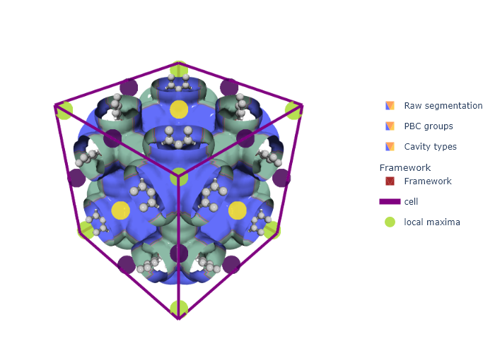
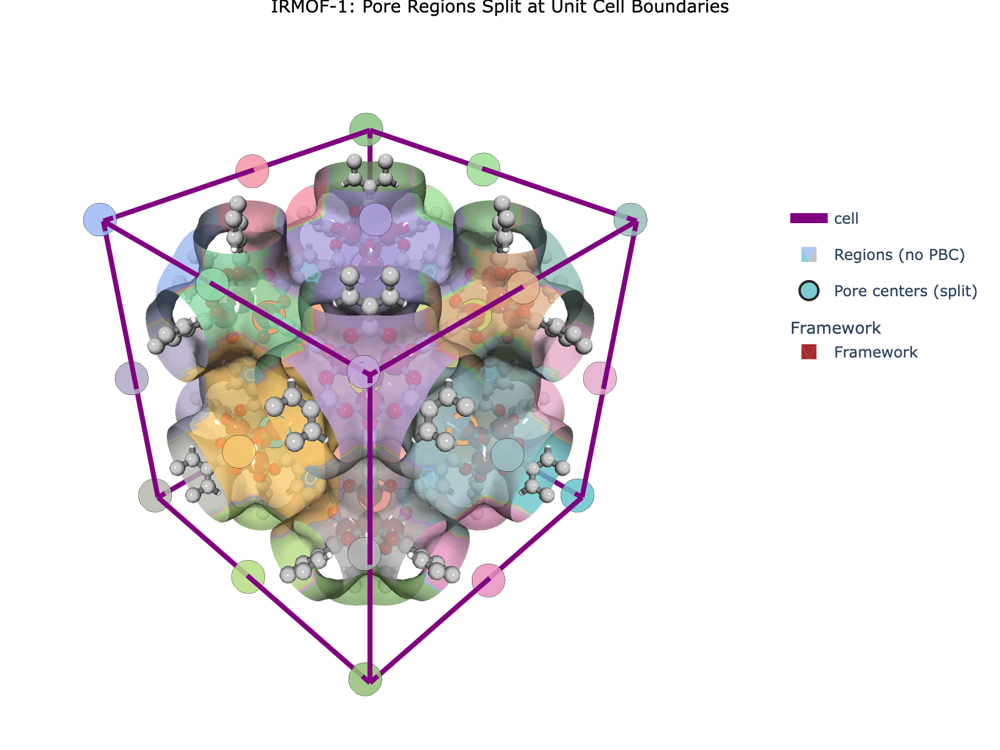
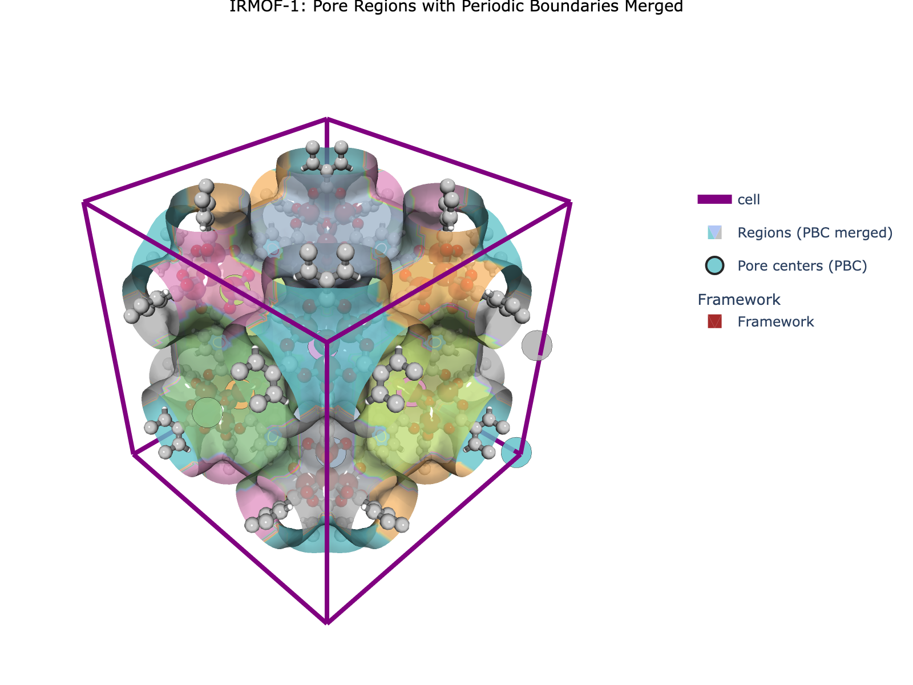
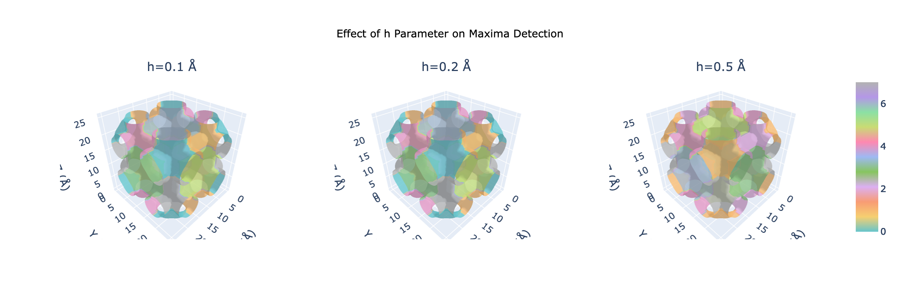
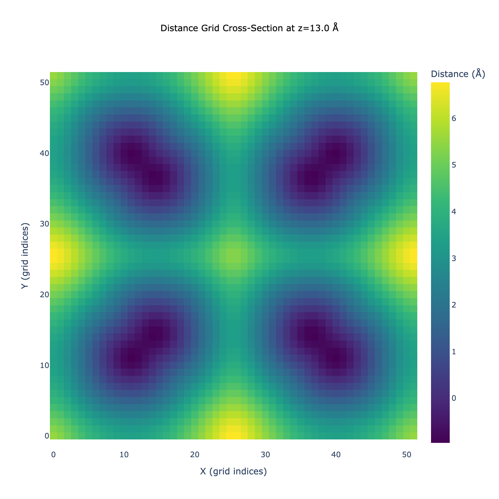
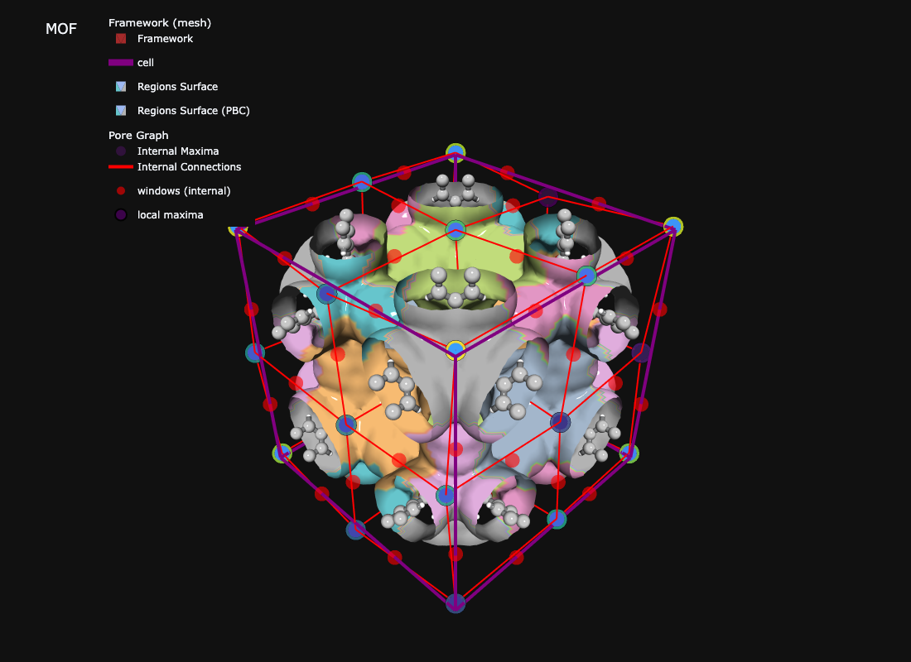
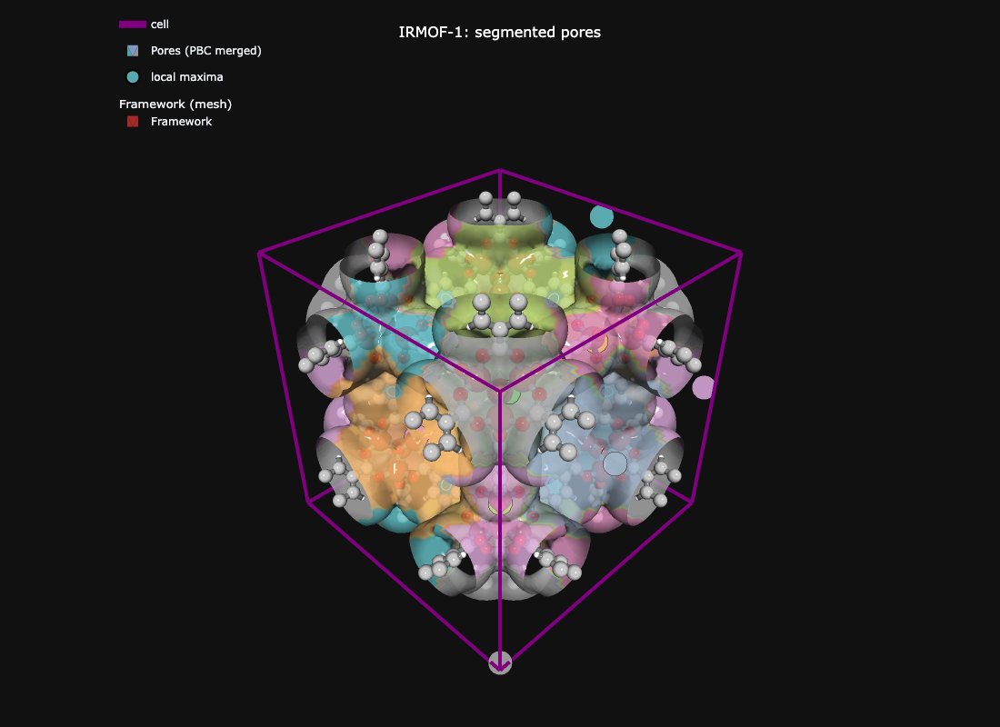

## Overview

Region segmentation breaks the void space of a nanoporous material into **discrete pockets**, each centered on a local maximum of the distance field. It is the conceptual bridge between the [distance grid](distance_grid.qmd) (a continuous scalar field) and the [pore graph](pore_graph.md) (a discrete graph you can analyze with NetworkX).

This tutorial covers the *why* behind the algorithm: what maxima and watershed do, why periodic boundary conditions (PBC) matter, and which parameters to tune. For the hands-on three-call pipeline, see the [Quick Start](quick_start.qmd). For defaults and safe ranges of every parameter, see [Tuning and safe ranges](parameter_tuning.qmd).

## The Core Question

**Segmentation** answers: *"Which pore does this voxel belong to?"*

Imagine the distance field as a landscape:

- 🎯 **Local maxima** → pore centers (peaks where a probe would sit)
- 🏔️ **Watershed boundaries** → pore walls (ridges between adjacent valleys)
- 💧 **Voxels** → assigned to the basin of the nearest maximum



This metaphor — *pour water into the inverted distance field, label each voxel by which basin it drains into* — is exactly what watershed segmentation does.

## Why We Need Periodic Segmentation

Crystalline materials repeat across unit cell boundaries, but **pores don't respect those boundaries**. A large pore sitting at the corner of a cubic cell appears as 8 fragments (one per corner) when you segment without PBC handling. Physically, those 8 fragments are *one* pore cut off by the box.



Periodic segmentation solves this by:

1. Padding the grid so maxima near edges can "see" their periodic images
2. Identifying which maxima are periodic images of the same pore
3. Assigning the same label to all images
4. Trimming back to the original unit cell

The result: the 8 corner pieces merge into a single pore.



## Concept 1: Maxima Detection (Finding Pore Centers)

The first step is to find the **local maxima** of the distance field. These are the pore centers.

### The challenge: noise vs. features

A real distance grid has:

- Noise from grid discretization (atom responsible for nearest distance can jump abruptly, causing distance values to wobble)
- Real features: small pockets, large channels, tunnels
- Surface roughness that would spawn spurious maxima if treated as features

A naive "every voxel that's higher than its 26 neighbors" pass would give you hundreds of fake pockets. We need a *selective* approach.

### h-maxima

The classic tool is **h-maxima** from scikit-image: keep only those local maxima that stand at least `h` units above their surroundings. Smaller peaks get suppressed. The parameter `h` is the **persistence** — how significant a peak has to be to count.

```python
# Conceptual: keep peak P iff (value(P) - value(any neighbor)) >= h
# Smaller h  ->  more, smaller pockets
# Larger h   ->  fewer, larger pockets
```



### Selective smoothing

MOFography's Rust backend adds a layer on top of h-maxima: **selective smoothing**. The idea is to smooth the distance field with a spatially-varying Gaussian kernel that:

- Does *not* smooth small features (distance < `preserve_threshold`) — they are real pockets
- Smooths heavily for large features (distance > `smooth_threshold`) — this is roughness in channel walls that should not produce maxima
- Linearly interpolates the smoothing radius in between

After smoothing, h-maxima runs on the cleaned-up field. The result is cleaner pore centers with fewer spurious ones.

The three smoothing parameters you can tune:

| Parameter | Default | Effect |
|-----------|---------|--------|
| `preserve_threshold` | 3.0 Å | Features below this distance are not smoothed (kept as pockets) |
| `smooth_threshold` | 6.0 Å | Features above this distance are smoothed at `max_smooth_radius` |
| `max_smooth_radius` | 2.0 Å | Cap on the smoothing radius (grid units) |

## Concept 2: Watershed Segmentation

Once maxima are found, **watershed segmentation** assigns every void-space voxel to one of them.

### The water-filling analogy

1. Take the (inverted) distance field — maxima become valleys
2. Pour water simultaneously into each valley
3. Where water from two valleys would meet, raise a "dam" — that is the watershed boundary
4. When the water covers everything, each voxel is in the basin of exactly one maximum

Equivalently, in MOFography, the watershed assigns each void voxel to the *nearest* maximum, where "nearest" is geodesic (respecting the topology of the void). The output is a 3D integer array where every void voxel has a region label.



### With and without PBC

You get two region arrays from the same call:

| Array | PBC handling | Use case |
|-------|--------------|----------|
| `regions_pbc` | ✅ Merged (all periodic images share a label) | Property averaging, visualization, most analyses |
| `regions` | ❌ Split (each periodic image is its own region) | Detailed pore graph, ML, non-periodic systems |

For most analyses of crystalline MOFs, use `regions_pbc`. The number of unique pores is simply `regions_pbc.max()`.

## The Single API Call

The whole pipeline — distance grid prep, selective smoothing, maxima detection, PBC grouping, watershed, connection detection — happens inside `do_periodic_segmentation_rust()`. It takes the distance grid and the ASE atoms, and returns a dictionary of 15 keys.

```{python}
import mofography as mgr
from ase.io import read
import numpy as np

# Step 1: load the structure
atoms = read("IRMOF-1.cif")
print(f"Loaded {atoms.get_chemical_formula()}, {len(atoms)} atoms")
print(f"Cell: {atoms.cell.cellpar()[:3].round(2)} Å")
```

```{python}
# Step 2: compute the distance grid (see distance_grid.qmd for details)
spacing = 0.5
dgrid = mgr.dgrid_from_atoms_rust(atoms, spacing=spacing)
print(f"Grid: {dgrid.shape}, void max: {dgrid.max():.1f} Å")
```

```{python}
# Step 3: run periodic segmentation — one call replaces 5-7 manual steps
dgrid_f32 = dgrid.astype(np.float32)

seg = mgr.do_periodic_segmentation_rust(
    dgrid_f32, atoms,
    mask_thickness=0.05,       # void-space threshold (Å) — default and recommended; anything closer to framework is "wall"
    h=0.2,                     # h-maxima persistence (Å) — keep only peaks this tall
    min_distance=1.5,          # min separation between distinct maxima (Å)
    threshold_abs=1.5,         # absolute height threshold — ignore maxima shallower than this
    preserve_threshold=3.0,    # selective smoothing: don't smooth features below this (Å)
    smooth_threshold=6.0,      # selective smoothing: fully smooth features above this (Å)
    max_smooth_radius=2.0,     # selective smoothing: max Gaussian radius
    spacing=spacing,
    compute_connections=True,  # also detect windows between regions
    disable_tqdm=True,
)
```

```{python}
# What did we get?
print(f"Pockets (PBC-grouped): {len(seg['maxima_pbc'])}")
print(f"All maxima (with periodic images): {len(seg['all_maxima'])}")
print(f"Unique regions influencing unit cell: {len(seg['unique_regions'])}")
print(f"Window connections: {len(seg['connections'])}")
print(f"PBC equivalence groups: {len(seg['pbc_groups'])}")
```

## The 15 Output Keys

`do_periodic_segmentation_rust` returns a flat dictionary. Group by purpose:

### Maxima arrays (pore centers)

| Key | What it is | Typical size |
|-----|-----------|--------------|
| `maxima_pbc` | One representative per unique pore (after PBC grouping) | Small — your pore count |
| `all_maxima` | All periodic images, including those in the padded region | Larger |
| `close_or_inside_maxima` | Subset of `all_maxima` that touch or sit inside the unit cell | Medium |
| `maxima_info` | Per-maxima metadata (radius, location, etc.) | Same as `all_maxima` |
| `maxima_pbc_dict` | Maps each PBC representative to the list of its images | Same as `maxima_pbc` |
| `maxima_relative_locations` | Fractional coordinates of every maximum | Same as `all_maxima` |

### Region arrays (the labeled voxel grids)

| Key | What it is |
|-----|-----------|
| `regions_pbc` | 3D array, PBC-merged — same pore = same label (use this for most analyses) |
| `regions` | 3D array, PBC-split — each periodic image is a distinct label |
| `unique_regions` | Region labels that have at least one voxel in the unit cell |
| `close_or_inside_regions` | Region labels touching or inside the unit cell |

### Connections (the pore graph)

| Key | What it is |
|-----|-----------|
| `connections` | List of window connections between regions — used to build the pore graph |

### Bookkeeping

| Key | What it is |
|-----|-----------|
| `pbc_groups` | Lists grouping `all_maxima` by their PBC equivalence class |
| `input_params` | Echo of the parameters you passed (for reproducibility) |
| `dgrid` | The distance grid used (only present if `return_dgrid=True`) |
| `mat_atoms` | The ASE atoms object echoed back |

## Accessing the Results

The four keys you will reach for most often:

```{python}
maxima_pbc  = seg['maxima_pbc']   # one representative per unique pore
all_maxima  = seg['all_maxima']   # all periodic images
regions_pbc = seg['regions_pbc'] # the labeled voxel grid (PBC-merged)
pbc_groups  = seg['pbc_groups']   # which images belong to which pore

print(f"maxima_pbc  : {maxima_pbc.shape}  -> one entry per unique pore")
print(f"all_maxima  : {all_maxima.shape}  -> all periodic images")
print(f"regions_pbc : {regions_pbc.shape} -> labeled voxel grid")
print(f"pbc_groups  : {len(pbc_groups)} groups")

# Number of unique pores in this material
n_pores = int(regions_pbc.max())
print(f"\nNumber of unique pores: {n_pores}")
```

### The clever indexing trick

Maxima are reindexed by importance, so the first `regions.max()` entries of `all_maxima` are exactly the ones that influence the unit cell:

```{python}
# "maxima inside the unit cell" — same as close_or_inside_maxima[:regions.max()]
unit_cell_maxima = all_maxima[: int(regions_pbc.max())]
print(f"Maxima influencing the unit cell: {len(unit_cell_maxima)}")
```

### Inspecting connections

Each connection is a tuple of region indices plus a geometry record:

```{python}
# First three connections
for c in seg['connections'][:3]:
    print(c)
```

## Parameter Tuning

### Most important parameters

These four control the *number and shape* of the detected pores:

| Parameter | Default | Effect |
|-----------|---------|--------|
| `h` | 0.2 Å | h-maxima persistence. Higher → fewer, larger pockets. |
| `min_distance` | 1.5 Å | Maxima closer than this get merged. Higher → fewer pockets. |
| `threshold_abs` | 1.5 Å | Ignore peaks shallower than this. Higher → only large pores. |
| `mask_thickness` | 0.05 Å | Voxels closer to framework than this are "wall", not pore. 0.05 is the default and recommended; raise to ~0.15 only to drop wall slivers. Keep it well below the plotting isovalue. |

### Advanced smoothing parameters

If you see spurious small maxima in the middle of large channels, or you are losing real small pockets, tune the selective-smoothing triad:

| Parameter | Default | Effect |
|-----------|---------|--------|
| `preserve_threshold` | 3.0 Å | Below this distance, smoothing is *off* (real pockets preserved) |
| `smooth_threshold` | 6.0 Å | Above this distance, smoothing is at `max_smooth_radius` |
| `max_smooth_radius` | 2.0 Å | Cap on smoothing kernel (Å) |

Lower `smooth_threshold` to smooth more aggressively; raise `preserve_threshold` to protect more small pockets.

### PBC handling parameters

| Parameter | Default | Effect |
|-----------|---------|--------|
| `extra_padding` | 5 Å | Extra padding beyond the standard +5 Å, for very large pores |
| `wall_thickness` | 0.05 | Fraction of cell — controls how "wall" is defined near boundaries |
| `minimum_window_separation` | auto | Min separation for two windows to count as distinct |
| `watershed_backend` | `"rust_det"` | One of `rust_det` \| `rust_bucket` \| `rust_det_parallel` \| `skimage` |
| `min_region_size` | 0.001 | Fraction of padded volume — regions smaller than this are dropped |

### Recipes

| Symptom | Try |
|---------|-----|
| Too many tiny pockets | Increase `h` (e.g. 0.2 → 0.4), or increase `min_distance` |
| Missing small pockets | Decrease `threshold_abs` (1.5 → 1.0) or `h` (0.2 → 0.1) |
| Spurious maxima in large channels | Decrease `smooth_threshold` or increase `max_smooth_radius` |
| Real small pockets getting smoothed away | Increase `preserve_threshold` (3.0 → 4.0) |
| Wall fragments in `regions` | Increase `mask_thickness` (0.05 → 0.15; see [Tuning](parameter_tuning.qmd)) |
| Out of memory | Use `dgrid_from_atoms_rtree_rust` (R-tree, less RAM) |

## Visualization

The fastest way to see what you got is `show_mof_plotly`, which lays framework, isosurface, regions, and maxima in one figure (static preview below, interactive version linked):

```{python}
# Interactive 3D — framework + regions + maxima
# plot_surface_isovalue is a distance-from-framework contour (Å); keep it well above mask_thickness
fig = mgr.show_mof_plotly(seg, atoms, framework_atoms=atoms, stylize=True, plot_surface_isovalue=1.5)
fig.write_image("tutorial_images/region_segmentation_overview.png", width=1100, height=800)  # static preview for the docs
```



::: {.callout-note collapse="true" title="Interactive version"}
```python
fig = mgr.show_mof_plotly(seg, atoms, framework_atoms=atoms, stylize=True, plot_surface_isovalue=1.5)
fig.show()
```
:::

[Open the interactive version](interactive/irmof1_pockets_windows_threejs.html){target="_blank"}

If you want more control (e.g. coloring a specific subset of regions), pull out the lower-level helpers:

```{python}
import plotly.graph_objects as go
import plotly.express as px

cscale = px.colors.qualitative.Pastel
maxima = seg['all_maxima'][: int(seg['regions_pbc'].max())]

# Region isosurface, colored by pore label.
# isovalue = distance from framework (Å); it must be well above mask_thickness (0.05)
# or the surface hugs the masked wall and looks blotchy.
surf = mgr.plot_surface_dgrid(
    dgrid, isovalue=1.5,
    ase_atoms=atoms,
    region_labels=seg['regions_pbc'],
    cscale=cscale,
    name='Pores (PBC merged)',
    stylize=True,
    opacity=0.8,
)

# Pore centers
pts = mgr.plot_maxima(dgrid, maxima, atoms, show_spheres=False, marker_colorscale=cscale)

# Cell box
cell = mgr.plot_cell(atoms)

# Framework mesh
mat_updated = mgr.update_with_covalent_bonds(atoms)
frame = mgr.plot_framework_as_mesh(mat_updated, stylize=True)

fig = go.Figure(
    data=[cell, surf, pts, *frame],
    layout=mgr.dark_layout,
)
fig.update_layout(
    scene_aspectmode='data',
    title=dict(text='IRMOF-1: segmented pores', x=0.5, xanchor='center', font=dict(color='white', size=16)),
)
fig.write_image("tutorial_images/region_segmentation_custom.png", width=1100, height=800)  # static preview; use fig.show() interactively
```



## Common Pitfalls

| Issue | Fix |
|-------|-----|
| `dgrid` dtype error from Rust | `dgrid = dgrid_from_atoms_rust(...)` already returns float32 — do not pass a float64 grid from Dask. |
| Wrong unit cell conventions | Use the Rust backend (`dgrid_from_atoms_rust`) — it handles non-orthogonal cells correctly. Avoid the deprecated `_gpu` and `_cpu_no_aabb` variants. |
| Pore count doesn't match expectation | Check `regions_pbc.max()` (not `len(maxima_pbc)`) — both should agree, but `regions_pbc.max()` is the ground truth. |
| Some regions missing from unit cell | Increase `extra_padding` — large pores may need more room around the cell to be detected. |

## Next Steps

- **[Quick Start](quick_start.qmd)** — the canonical three-call pipeline (load → grid → segment → visualize) in one page
- **[Distance Grid](distance_grid.qmd)** — how the distance grid is computed, with method comparisons
- **[Tuning and safe ranges](parameter_tuning.qmd)** — defaults, safe ranges, and symptoms for every segmentation parameter
- **[Pore Graph](pore_graph.md)** — once you have regions and connections, build the Region Adjacency Graph
- **[Connections and Windows](connections_and_windows.qmd)** — the window detection step in detail
