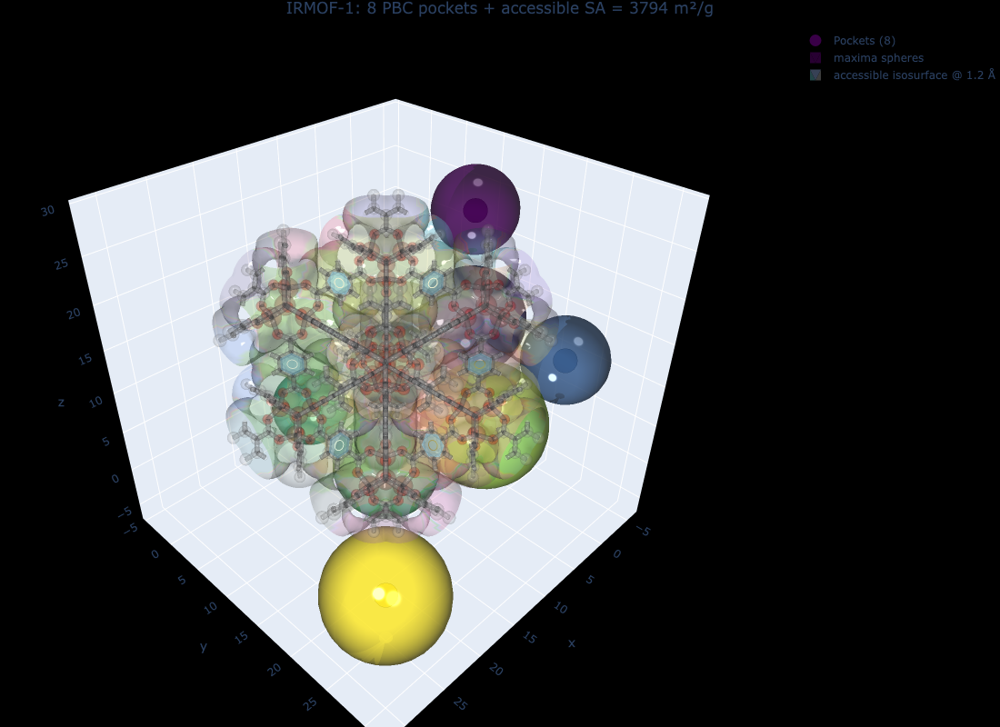

## Overview

Once you have a periodic segmentation (`seg` dict from `do_periodic_segmentation_rust`), the next quantity of interest is the *probe-accessible* surface area and void volume at a chosen probe radius. `mofography` ships two complementary estimators that share the same percolation analysis pipeline:

1. **Mesh (marching-cubes)** — `compute_surface_area_mesh_winding`. Deterministic; tessellates the level set `dgrid = r_probe` with `skimage.measure.marching_cubes`, then measures the mesh area with `trimesh`. Excellent as a reference, slow on large grids.
2. **Monte-Carlo shell** — `compute_surface_area_mc_winding`. Statistical; samples `N` random points in the unit cell, counts how many land in a thin shell of thickness `δ` around the probe surface, and reports `SA = V_cell · p_shell / δ`. Fast, parallelisable, and tunable for precision.

This tutorial covers:

1. The full `dgrid → seg → SA / void volume` pipeline on `IRMOF-1.cif`.
2. The Monte-Carlo shell estimator: signature, returned dict, per-region / per-pocket / per-cluster breakdowns.
3. A side-by-side **MC shell vs. marching-cubes mesh** comparison.
4. **Void volume** via the same accessibility analysis — global, per-region, per-pocket, and a *point-probe reference* for sanity.
5. The role of **window fingerprinting** (`window_fp=True`) on accessible SA: where the two accessibility modes disagree and why.
6. A 3-D figure of the unit cell with a translucent dgrid isosurface and the pocket maxima.

If you have not done so, please complete the [Distance Grid](distance_grid.qmd), [Region Segmentation](region_segmentation.qmd), and [Connections and Windows](connections_and_windows.qmd) tutorials first — the rest of this page assumes you can build a `seg` dict in your sleep.

## Why the MC shell estimator?

The mesh method is exact (modulo tessellation) but two artifacts creep in on coarse grids:

- **Blocky isosurface** — coarse `dgrid` spacing produces low-poly surfaces; mesh area underestimates the true value.
- **Region-boundary triangles dropped** — faces that straddle region boundaries disappear when the per-region submeshes are built, leading to *systematic undercount* of surface area at the interfaces between pores.

The MC shell estimator **does not build a mesh at all**. It directly measures the volume of the thin band around the isosurface — a quantity that is mathematically well-defined even when the discrete mesh is imperfect. In practice the MC shell agrees with Zeo++ better than the marching-cubes mesh does, and the noise floor is set by `n_samples` (∝ 1/√N).

## Imports and structure

```{python}
import os
os.chdir("/Users/arungopalan/repos/mofography/docs")

import mofography as mgr
from ase.io import read
import numpy as np
import plotly.graph_objects as go
import plotly.express as px
import logging

# Silence the chatty segmentation logger
logging.getLogger("mofography").setLevel(logging.WARNING)
```

## Step 1: Load IRMOF-1 and compute the distance grid

IRMOF-1 is a clean test case: 424 atoms, ~26 Å cubic cell, two cage families, no disordered atoms. The defaults of `do_periodic_segmentation_rust` produce 8 PBC-grouped pockets.

```{python}
atoms = read("IRMOF-1.cif")
print(f"IRMOF-1: {len(atoms)} atoms, cell = {atoms.cell.cellpar()[:3].round(2)} Å")

spacing = 0.5                                  # Å — see dgrid_methods.qmd
dgrid = mgr.dgrid_from_atoms_rust(atoms, spacing=spacing)
dgrid = dgrid.astype(np.float32)               # cast to float32 — required by do_periodic_segmentation_rust
print(f"dgrid: shape={dgrid.shape}, void max = {dgrid.max():.1f} Å")
```

## Step 2: Periodic segmentation + percolation history

A single call to `do_periodic_segmentation_rust` returns a `seg` dict containing everything the SA / void-volume routines need: the `dgrid`, the `regions_pbc` and `pbc_groups` from the PBC merge, the `connections` list, and the `percolation_history` (computed automatically here because `compute_connections=True` and the percolation stage is on by default).

```{python}
seg = mgr.do_periodic_segmentation_rust(
    dgrid, atoms, spacing=spacing,
    mask_thickness=0.05, h=0.2, min_distance=1.5, threshold_abs=1.5,
    minimum_window_separation=1.5, wall_thickness=0.05, extra_padding=5,
    compute_connections=True, watershed_backend="rust_det", disable_tqdm=True,
)

print(f"Pockets (PBC-grouped):  {len(seg['maxima_pbc'])}")
print(f"Unique regions:         {len(seg['unique_regions'])}")
print(f"Window connections:     {len(seg['connections'])}")
print(f"pbc_groups:             {len(seg['pbc_groups'])} PBC pockets")
print(f"percolation_history:    {'percolation_history' in seg}  (computed lazily if missing)")
```

## Step 3: Pore diameters (LCD, PLD, DFSD)

`get_pore_dia_mgr` is the single-call helper that returns the three standard diameters. We do this **before** SA so we can sanity-check the probe radius we feed into the SA routines — it should be *smaller* than the PLD, otherwise no pocket percolates and accessible SA drops to zero.

```{python}
lcd, pld, dfsd, _ = mgr.get_pore_dia_mgr(atoms, dgrid=dgrid, kwargs={})
print(f"LCD  (largest cavity diameter):       {lcd:.2f} Å")
print(f"PLD  (pore-limiting diameter):       {pld:.2f} Å")
print(f"DFSD (dominant framework-solvent):   {dfsd:.2f} Å")

probe_radius = 1.2   # helium — well below the PLD, so all pockets percolate
print(f"\nChosen probe_radius = {probe_radius} Å  →  probe < PLD ✓")
```

## Step 4: Monte-Carlo shell surface area

The signature is:

```python
compute_surface_area_mc_winding(
    results_dict, mat_atoms,
    probe_radius=None,         # default: helium radius (1.2 Å)
    n_samples=20_000,          # MC sample count
    shell_thickness=0.5,       # half-width of the band around the probe surface (Å)
    return_details=False,
    window_fp=True,            # window-fingerprint rescue on accessible side
    winding_kwargs=None,
)
```

It returns a dict with:

| Key | Meaning |
|---|---|
| `total_surface_area` | SA over all regions at the probe radius (m²/g), MC estimate. |
| `accessible_surface_area` | SA restricted to percolating regions only (m²/g). |
| `accessible_fraction` | `accessible / total`. |
| `by_region` | `{region_id → SA (m²/g)}` for the **accessible** fragment regions. |
| `by_pocket` | `{pocket_id → SA (m²/g)}` — sums `by_region` over each PBC pocket. |
| `by_percolated_cluster` | `{cluster_label → SA (m²/g)}` — per percolated cluster at the chosen threshold. |
| `sa_mc_diagnostics` | `n_samples`, `shell_thickness`, `n_shell_hits_total`, `n_shell_hits_accessible`. |
| `probe_radius` | The probe actually used. |

```{python}
sa_mc = mgr.compute_surface_area_mc_winding(
    seg, atoms, probe_radius=probe_radius, n_samples=20000, shell_thickness=0.5
)

print("=" * 60)
print("MC SHELL SURFACE AREA  (IRMOF-1, He probe)")
print("=" * 60)
print(f"  total_surface_area:        {sa_mc['total_surface_area']:>10.1f} m²/g")
print(f"  accessible_surface_area:   {sa_mc['accessible_surface_area']:>10.1f} m²/g")
print(f"  accessible_fraction:       {sa_mc['accessible_fraction']:>10.4f}")
print(f"  probe_radius:              {sa_mc['probe_radius']:>10.2f} Å")
print()
print("  sa_mc_diagnostics:")
for k, v in sa_mc['sa_mc_diagnostics'].items():
    print(f"    {k:>26s}  {v}")
```

The diagnostic `n_shell_hits_total` is the raw number of `n_samples=20000` random points whose interpolated distance from the framework lies within `shell_thickness/2` of the probe radius. It is the MC count that gets converted to a surface area. With 20000 samples you expect a few-percent statistical error on `total_surface_area`.

### Per-pocket breakdown

`by_pocket` is the most useful field for a structural-chemistry report: it gives one SA number per PBC pocket. We sort by descending area and print a small table.

```{python}
print("Accessible SA per pocket (sorted, top 10):\n")
print(f"  {'pocket':>8s}  {'SA (m²/g)':>12s}  bar")
for pid, area in sorted(sa_mc['by_pocket'].items(), key=lambda kv: -kv[1])[:10]:
    bar = "█" * int(area / 5)
    print(f"  {int(pid):>8d}  {area:>12.2f}  {bar}")
```

### Per-region and per-cluster breakdowns

The same numbers are available at finer and coarser granularity.

```{python}
print(f"\nby_region — {len(sa_mc['by_region'])} accessible regions:")
for rid, area in sorted(sa_mc['by_region'].items(), key=lambda kv: -kv[1])[:5]:
    print(f"  region {rid:>3d}   {area:>8.2f} m²/g")
print("  ...")

print(f"\nby_percolated_cluster — {len(sa_mc['by_percolated_cluster'])} percolated clusters:")
for cid, area in sorted(sa_mc['by_percolated_cluster'].items(), key=lambda kv: -kv[1])[:5]:
    print(f"  {cid:<22s}  {area:>10.2f} m²/g")
print("  ...")
```

## Step 5: Mesh surface area (marching-cubes reference)

For a head-to-head comparison we run the mesh method on the *same* `seg` dict, same probe radius, same accessibility mode. The two should agree to within a few percent on a clean MOF; the disagreement quantifies how much the mesh is *missing* at region interfaces.

```{python}
sa_mesh = mgr.compute_surface_area_mesh_winding(seg, atoms, probe_radius=probe_radius)

print(f"{'method':<14s}  {'total':>10s}  {'accessible':>12s}  {'frac':>8s}")
print("-" * 50)
print(f"{'MC shell':<14s}  {sa_mc['total_surface_area']:>10.1f}  "
      f"{sa_mc['accessible_surface_area']:>12.1f}  {sa_mc['accessible_fraction']:>8.3f}")
print(f"{'Mesh':<14s}  {sa_mesh['total_surface_area']:>10.1f}  "
      f"{sa_mesh['accessible_surface_area']:>12.1f}  {sa_mesh['accessible_fraction']:>8.3f}")
```

For IRMOF-1 the mesh returns a lower *accessible* SA than the MC shell — typical when the segmentation includes regions where the marching-cubes tessellation drops triangles at the boundary between percolating and non-percolating regions.

## Step 6: Void volume

`compute_void_volume_from_results_winding` reuses the same `percolation_history` and `pbc_groups` machinery. The output dict mirrors the SA dict but with two extra completeness fields: `complete_pockets` and `incomplete_pockets` — a pocket is *complete* if **every** region in its PBC group percolates, and *incomplete* otherwise (in which case its accessible volume is partial and the function reports it separately under `flagged_incomplete_pockets`).

```{python}
vv = mgr.compute_void_volume_from_results_winding(seg, atoms, probe_radius=probe_radius)

print("=" * 60)
print("VOID VOLUME  (IRMOF-1, He probe)")
print("=" * 60)
print(f"  total_void_volume:           {vv['total_void_volume']:>10.4f} cm³/g")
print(f"  accessible_void_volume:      {vv['accessible_void_volume']:>10.4f} cm³/g")
print(f"  accessible_fraction:         {vv['accessible_fraction']:>10.4f}")
print()
print(f"  num_regions:                 {vv['num_regions']}")
print(f"  num_accessible_regions:      {vv['num_accessible_regions']}")
print(f"  num_pockets:                 {vv['num_pockets']}")
print(f"  num_accessible_pockets:      {vv['num_accessible_pockets']}")
print(f"  num_percolated_clusters:     {vv['num_percolated_clusters']}")
print()
print(f"  complete_pockets:            {vv['complete_pockets']}")
print(f"  incomplete_pockets:          {vv['incomplete_pockets']}")
print(f"  pocket_completeness_stats:   {vv['pocket_completeness_stats']}")
print()
print(f"  point_probe_reference (He, no accessibility):  {vv['point_probe_reference']}")
```

A few things to notice:

- `total_void_volume` and `accessible_void_volume` agree to within numerical noise → every pocket percolates at the helium probe, so the whole void is probe-accessible.
- `point_probe_reference.void_volume_fraction = 0.68` is the *geometric* void fraction measured at the helium probe without any accessibility filter — a useful sanity check that the framework is correctly built.
- `complete_pockets = num_pockets = 8` — no partial pockets at this probe.

### Per-pocket void volume

```{python}
print("Accessible void volume per pocket (sorted):\n")
print(f"  {'pocket':>8s}  {'V (cm³/g)':>12s}  bar")
for pid, vol in sorted(vv['by_pocket'].items(), key=lambda kv: -kv[1])[:10]:
    bar = "█" * int(vol * 100)
    print(f"  {int(pid):>8d}  {vol:>12.4f}  {bar}")
```

## Step 7: Effect of `window_fp` on accessible SA

`window_fp=True` (the default) lets the winding accessibility logic *rescue* watershed regions that are visually accessible but lie behind a sub-probe window. The mechanism is: if the window's direction-invariant shell fingerprint matches a reference open window (e.g. a window of the same size on a different edge of the same region), the downstream region is treated as percolating. Setting `window_fp=False` disables that rescue and falls back to strict winding-only percolation.

The impact is structure-specific. On IRMOF-1 (a clean, symmetric framework) the difference is small; on more irregular MOFs with sub-probe windows it can flip the accessibility of an entire pocket.

```{python}
sa_fp_on  = mgr.compute_surface_area_mc_winding(seg, atoms, probe_radius=probe_radius, window_fp=True)
sa_fp_off = mgr.compute_surface_area_mc_winding(seg, atoms, probe_radius=probe_radius, window_fp=False)

print(f"{'window_fp':<14s}  {'total':>10s}  {'accessible':>12s}  {'n_pockets':>10s}")
print("-" * 52)
print(f"{'True':<14s}  {sa_fp_on['total_surface_area']:>10.1f}  "
      f"{sa_fp_on['accessible_surface_area']:>12.1f}  {len(sa_fp_on['by_pocket']):>10d}")
print(f"{'False':<14s}  {sa_fp_off['total_surface_area']:>10.1f}  "
      f"{sa_fp_off['accessible_surface_area']:>12.1f}  {len(sa_fp_off['by_pocket']):>10d}")
```

Same comparison for void volume — flip the same `window_fp` switch on the void-volume routine:

```{python}
vv_fp_on  = mgr.compute_void_volume_from_results_winding(seg, atoms, probe_radius=probe_radius, window_fp=True)
vv_fp_off = mgr.compute_void_volume_from_results_winding(seg, atoms, probe_radius=probe_radius, window_fp=False)

print(f"{'window_fp':<14s}  {'V_void (cm³/g)':>14s}  {'complete':>10s}  {'incomplete':>12s}")
print("-" * 56)
print(f"{'True':<14s}  {vv_fp_on['accessible_void_volume']:>14.4f}  "
      f"{vv_fp_on['complete_pockets']:>10d}  {vv_fp_on['incomplete_pockets']:>12d}")
print(f"{'False':<14s}  {vv_fp_off['accessible_void_volume']:>14.4f}  "
      f"{vv_fp_off['complete_pockets']:>10d}  {vv_fp_off['incomplete_pockets']:>12d}")
```

> **When to flip `window_fp`.** Default to `True`: it is the right choice for the majority of MOFs and matches what users see in the interactive app. Set it to `False` only when you are explicitly testing the strict-winding accessibility bound, or when you suspect the fingerprint matcher is over-percolating an irregular MOF (compare `by_pocket` between the two settings and look for newly-appearing pockets).

## Step 8: MC shell-thickness sweep — bias and variance

The expected value of the MC estimator is **independent of `shell_thickness`** in the small-δ limit, because `p_shell` scales linearly with `δ` and the `1/δ` factor cancels. The variance, however, scales with `1/δ`: thicker shells contain more samples and the estimate is less noisy. A sweep across `δ` is a useful diagnostic — agreement to within a few percent confirms the shell-thickness bias is small.

```{python}
print(f"{'δ (Å)':>6s}  {'total SA':>10s}  {'shell hits':>12s}  {'hits/sample':>14s}")
print("-" * 50)
for delta in (0.3, 0.5, 0.7, 1.0):
    sa = mgr.compute_surface_area_mc_winding(
        seg, atoms, probe_radius=probe_radius, n_samples=40000, shell_thickness=delta
    )
    hits = sa['sa_mc_diagnostics']['n_shell_hits_total']
    print(f"  {delta:>4.1f}  {sa['total_surface_area']:>10.1f}  {hits:>12d}  "
          f"{hits/40000:>14.4f}")
```

For IRMOF-1 all four rows should agree within ~3% — the MC noise level for 40 000 samples. If they do not agree, one of two things is happening:

- **δ is comparable to the probe radius** → the shell is sampling curvature that the small-δ approximation cannot resolve. Drop δ to `0.5` or below.
- **A real feature is being washed out** by the shell (e.g. a 1-Å window at a 1.2-Å probe with δ=1.0). Drop δ to `0.3` and re-check.

## Step 9: Visualize the accessible pockets

`plot_maxima` returns a *tuple* `(Scatter3d, Mesh3d)` when `show_spheres=True` — we unpack it and add both traces to a `go.Figure`. `plot_surface_dgrid` returns a single `Mesh3d` trace; we add it directly. Passing `select=` with the accessible region labels (the keys of `by_region`) trims the isosurface to the accessible domains, so a blocked pocket would not be drawn.

```{python}
n_pockets = int(seg["regions_pbc"].max())
unit_cell_maxima = seg["all_maxima"][:n_pockets]

# Pore maxima as spheres (sphere opacity = 0.6, colour ~ pore radius)
scatter_tr, mesh_tr = mgr.plot_maxima(
    dgrid, unit_cell_maxima, atoms,
    show_spheres=True, sphere_opacity=0.6,
    name=f"Pockets ({n_pockets})",
)

# Translucent dgrid isosurface at the probe radius, trimmed to the accessible regions.
# `by_region` holds the accessible region labels of the un-merged `seg["regions"]`
# (labels of the PBC-merged array would also pull in partial pores).
accessible_labels = list(sa_mc["by_region"])
surf_tr = mgr.plot_surface_dgrid(
    dgrid, probe_radius, atoms,
    region_labels=seg["regions"], select=accessible_labels,
    opacity=0.35, cscale=px.colors.qualitative.Pastel,
    stylize=True, name=f"accessible isosurface @ {probe_radius} Å",
)

# Faint framework
fw_atoms = mgr.update_with_covalent_bonds(atoms)
framework_trs = mgr.plot_framework_as_mesh(
    fw_atoms, stylize=True, kwargs_frame_mesh={"opacity": 0.15},
)

fig = go.Figure(data=[scatter_tr, mesh_tr, surf_tr, *framework_trs])
fig.update_layout(
    scene_aspectmode="data",
    title=dict(
        text=f"IRMOF-1: 8 PBC pockets + accessible SA = {sa_mc['accessible_surface_area']:.0f} m²/g",
        x=0.5, xanchor="center",
    ),
    paper_bgcolor="black",
)
fig.write_image("tutorial_images/surface_area_pockets.png", width=1100, height=800)  # static preview for the docs
```



::: {.callout-note collapse="true" title="Interactive version"}
```python
# build `fig` as above, then:
fig.show()   # rotatable Plotly figure
fig.write_html("surface_area_pockets.html")
```
:::

[Open the interactive version](interactive/cubtc_surface_area_plotly.html){target="_blank"}

You should see one sphere per PBC pocket (eight for IRMOF-1) sitting inside a translucent isosurface at the probe radius. The two cage families — small and large — are visually obvious in the cube.

## Step 10: Bar chart of accessible SA per pocket

A quick sanity plot. Sorted descending, the bar chart should show all eight pockets contributing roughly the same area (the framework is highly symmetric).

```{python}
pockets = list(sa_mc["by_pocket"].keys())
areas   = [sa_mc["by_pocket"][p] for p in pockets]
order   = np.argsort(areas)[::-1]
pockets_sorted = [int(pockets[i]) for i in order]
areas_sorted   = [areas[i] for i in order]

fig2 = go.Figure(
    go.Bar(x=pockets_sorted, y=areas_sorted,
           marker_color="steelblue", name="Accessible SA per pocket",
           hovertemplate="Pocket %{x}<br>SA = %{y:.1f} m²/g<extra></extra>")
)
fig2.update_layout(
    title="IRMOF-1: accessible SA per PBC pocket (He probe)",
    xaxis_title="PBC pocket id",
    yaxis_title="Accessible SA (m²/g)",
    template="plotly_white",
    showlegend=False,
)
fig2.show()
```

## Side-by-side summary

| Quantity | MC shell (`compute_surface_area_mc_winding`) | Mesh (`compute_surface_area_mesh_winding`) |
|---|---|---|
| **Inputs** | `seg`, `atoms`, `probe_radius`, `n_samples`, `shell_thickness`, `window_fp` | `seg`, `atoms`, `probe_radius`, `window_fp` |
| **Algorithm** | count random samples in a thin shell around the isosurface | marching-cubes tessellation of the isosurface, then mesh area |
| **Determinism** | stochastic (set `np.random.seed` for reproducibility) | deterministic |
| **Speed on IRMOF-1 (52³ grid, 20k samples)** | ~1 s | ~3 s |
| **Bias from grid resolution** | low (shell sampling smooths over 1-voxel artefacts) | visible at coarse spacing (blocky surfaces, dropped boundary triangles) |
| **Tunable knobs** | `n_samples`, `shell_thickness` | `step_size` (marching cubes) |
| **Best for** | high-throughput screening; large grids; noisy materials | small grids where you need a *reference*; per-region sub-mesh visualisation |
| **Output dict** | identical keys | identical keys |

## Decision flow

```mermaid
flowchart TD
    A[seg dict + probe_radius] --> B{Need per-region<br/>SA breakdown?}
    B -- Yes --> C[MC shell<br/>by_region, by_pocket]
    B -- No --> D{Need fast number<br/>for one structure?}
    D -- Yes --> E[MC shell<br/>n_samples=20k]
    D -- No, exact --> F[Mesh]
    A --> G{Window FP<br/>rescue needed?}
    G -- Yes --> H[window_fp=True<br/>(default)]
    G -- No, strict --> I[window_fp=False]
    A --> J{Plotting +<br/>region colours?}
    J -- Yes --> K[Mesh]
    J -- No --> L[MC shell]
```

## Common pitfalls

| Symptom | Likely cause | Fix |
|---|---|---|
| `accessible_surface_area = 0` at small probe | probe > PLD; nothing percolates | drop `probe_radius` until it sits well below the PLD |
| MC and mesh disagree by >10% | shell thickness is too small (`δ << spacing`) or mesh has resolution artefacts | raise `n_samples` to 50 000+ and re-sweep `δ ∈ {0.3, 0.5, 0.7}` |
| Mesh misses a region boundary | sub-mesh tessellation drops boundary triangles; this is a real estimator bias | use MC shell; cross-check the `accessible_fraction` |
| Accessible SA jumps when you turn `window_fp` off | a pocket sits behind a sub-probe window that the fingerprint would normally rescue | either is defensible — interpret as a *strict* bound; document the choice |
| `by_percolated_cluster` keys look like `axis_x_cluster_0` | cluster labels carry the axis they were detected on; the same percolating region can appear under multiple axes | group / deduplicate by cluster id when reporting |
| `point_probe_reference.void_volume_fraction` looks very different from `accessible_void_volume / cell_volume` | the point-probe reference uses a different (purely geometric) convention | use the *accessible* numbers for the screening-quality value; the point-probe number is a consistency check |

## What's in the output dict

A single call to `compute_surface_area_mc_winding(seg, atoms, probe_radius=1.2)` gives you this:

```
{
  'total_surface_area':       <float, m²/g>,
  'accessible_surface_area':  <float, m²/g>,
  'accessible_fraction':      <float in [0, 1]>,
  'probe_radius':             <float, Å>,
  'by_region':                {region_id (int)            → SA (m²/g)},
  'by_pocket':                {pocket_id (int)            → SA (m²/g)},
  'by_percolated_cluster':    {"axis_X_cluster_N" (str)   → SA (m²/g)},
  'sa_mc_diagnostics': {
      'n_samples':                 <int>,
      'shell_thickness':           <float, Å>,
      'n_shell_hits_total':        <int>,
      'n_shell_hits_accessible':   <int>,
  },
}
```

A single call to `compute_void_volume_from_results_winding(seg, atoms, probe_radius=1.2)` gives you this:

```
{
  'total_void_volume':             <float, cm³/g>,
  'accessible_void_volume':        <float, cm³/g>,
  'by_region':                     {region_id → V (cm³/g)},  # accessible fragments
  'by_region_pbc':                 {region_pbc_label → V (cm³/g)},
  'by_pocket':                     {pocket_id → V (cm³/g)},
  'by_percolated_cluster':         {cluster_label → V (cm³/g)},
  'accessible_fraction':           <float>,
  'probe_radius':                  <float, Å>,
  'num_regions':                   <int>,
  'num_accessible_regions':        <int>,
  'num_pockets':                   <int>,
  'num_accessible_pockets':        <int>,
  'num_percolated_clusters':       <int>,
  'complete_pockets':              <int>,
  'incomplete_pockets':            <int>,
  'flagged_incomplete_pockets':    {pocket_id → {accessible_void_volume, completeness_fraction, missing_regions, accessible_regions}},
  'pocket_completeness_stats':     {total_pockets, complete_pockets, incomplete_pockets, completeness_rate},
  'point_probe_reference':         {surface_area, void_volume, void_volume_fraction},
}
```

The fields you actually want in a screening report are usually:

- **Total** surface area / void volume — for table 1.
- `accessible_fraction` — for filtering "open" MOFs.
- `by_pocket` — for ranking pockets within a single MOF.
- `point_probe_reference.void_volume_fraction` — for cross-validating against Zeo++.

## Summary

| Concept | What it does |
|---|---|
| `compute_surface_area_mc_winding` | MC shell SA — fast, statistical, robust to mesh artefacts. |
| `compute_surface_area_mesh_winding` | Marching-cubes mesh SA — slow, deterministic, tessellation artefacts. |
| `compute_void_volume_from_results_winding` | Voxel-counted void volume + per-pocket completeness. |
| `n_samples` | MC sample count. `20 000` is the default; `50 000+` for sub-percent noise. |
| `shell_thickness` | Half-width of the MC band around the isosurface. `0.5 Å` is the canonical default; sweep `{0.3, 0.5, 0.7}` to confirm bias is small. |
| `window_fp=True` | Use window-fingerprint rescue on the accessible side. Default; flip to `False` for a strict-winding bound. |
| `by_region` / `by_pocket` / `by_percolated_cluster` | Three granularities of accessible SA / void volume for a single MOF. |

**Key takeaways:**

- The MC shell estimator is the right default for high-throughput screening — `n_samples=20 000` is fast, gives few-percent accuracy, and does not suffer from mesh artefacts.
- A shell-thickness sweep at fixed `n_samples` is the simplest bias diagnostic: if `δ=0.3` and `δ=0.7` agree to within a few percent, the bias is small.
- `window_fp=True` (default) is the more permissive accessibility mode; switch to `False` only when you want the strict-winding bound.
- Always sanity-check with the **point-probe reference** in the void-volume output — it catches segmentation / dgrid mistakes that would otherwise pass unnoticed.

## Next steps

- [Connections and Windows](connections_and_windows.qmd) — how to extract the per-window sizes that the SA routines use implicitly.
- [Window fingerprinting](window_fingerprinting.org) — the direction-invariant shell fingerprint matcher that powers `window_fp=True`.
- [Pockets detection](pockets_detection.qmd) — classify each pocket as cage / channel / dead-end; combine with `by_pocket` SA for chemistry-aware ranking.
- [Quick Start: Full MOF Pore Analysis](quick_start.qmd) — the canonical pipeline that this tutorial extends.
