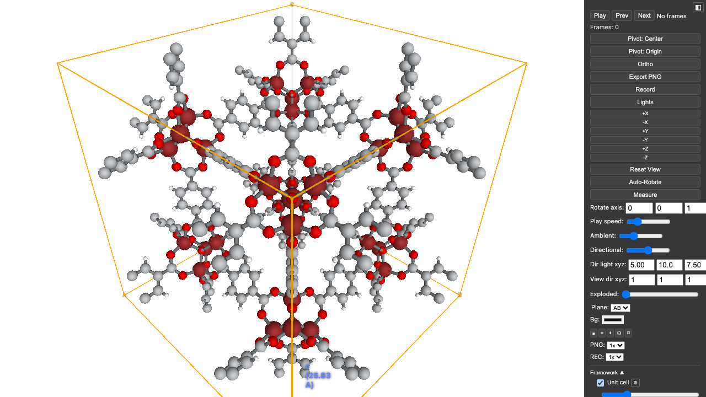
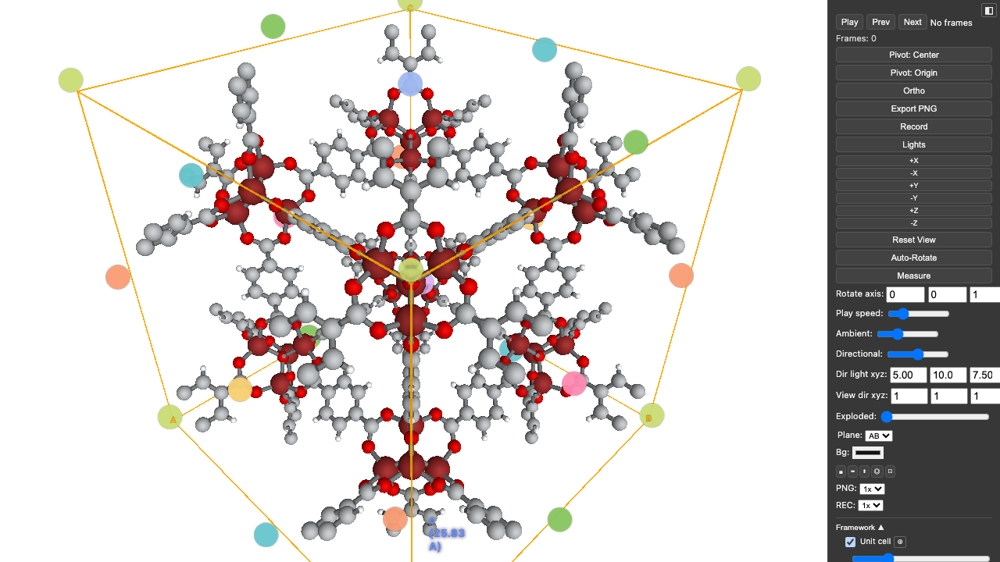
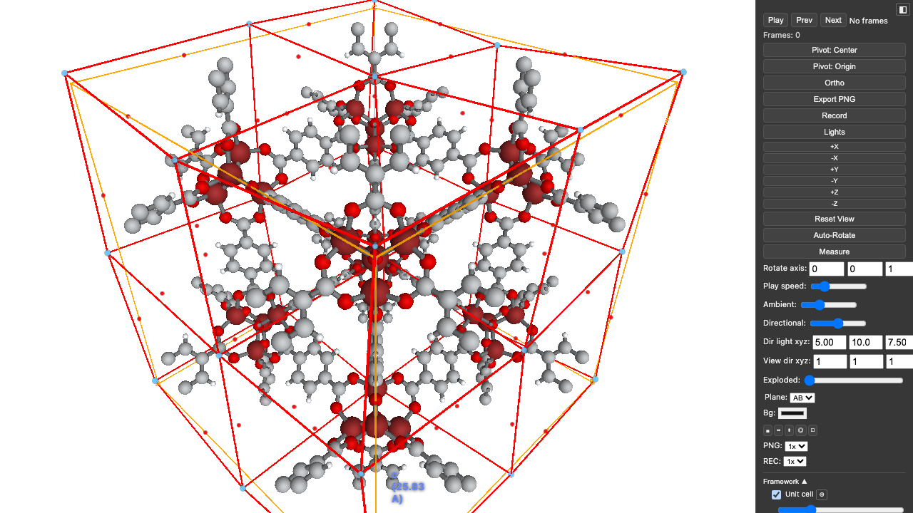
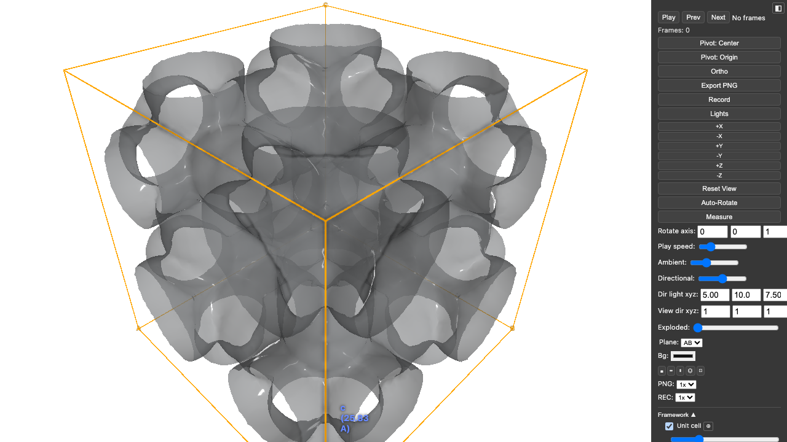
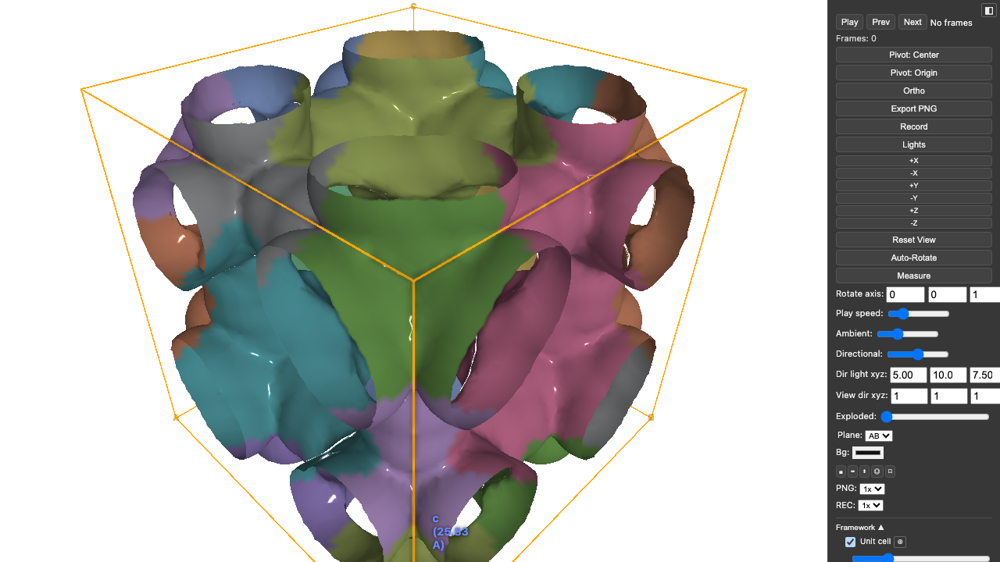
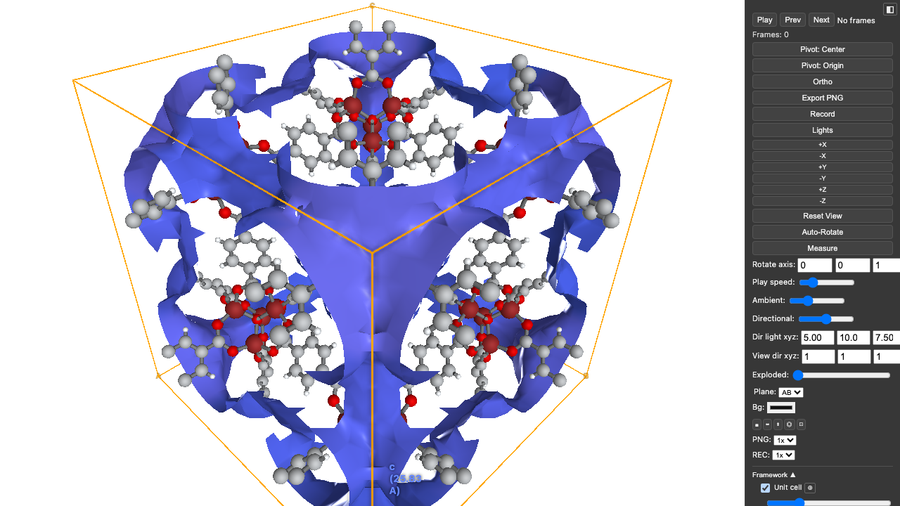
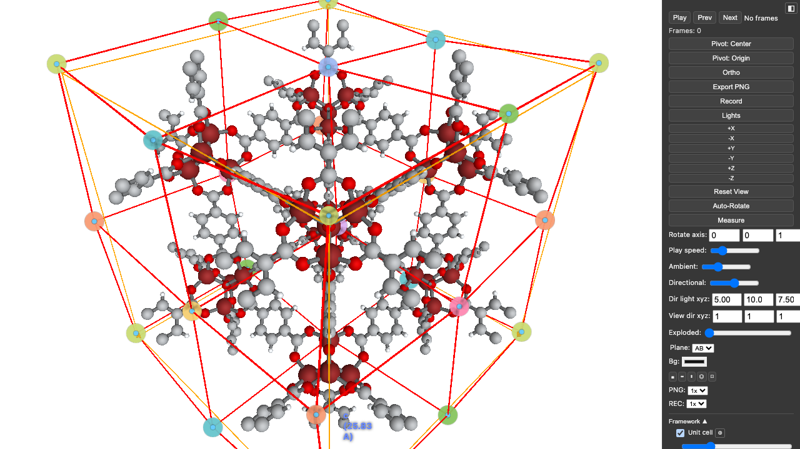

Mofography has a Three.js backend that mirrors the Plotly plotting API. The scenes are fully interactive (rotate, zoom, layer toggles, lighting, view buttons, measure tool, PNG export) and show up directly inside a notebook, like `plotly`'s `fig.show()`.

This page uses `eval: false` blocks, because the documentation site cannot run Python. The screenshots are real renders of the code shown, with the control panel visible. Each scene links to a standalone HTML file you can open and rotate.

## Use in a notebook

Build a `Figure3js` (alias `Figure3JS`), chain `plot_*` calls, and either call `.show()` or leave the figure as the last expression of a cell:

```{python}
#| eval: false
import mofography as mgr
from mofography import Figure3js
from ase.io import read

atoms = mgr.update_with_covalent_bonds(read("examples/TestCIFs/P1-IRMOF-1.cif"))

fig = Figure3js(layout="white").plot_framework_as_mesh_3js(atoms).plot_cell_3js(atoms, color="orange")
fig.show(height=600)          # or just: fig
fig.save_html("irmof1.html")  # standalone file, same controls
```

How it works:

- The scene is embedded as an `<iframe srcdoc="...">` with the HTML escaped, so it needs no server and works in Jupyter classic, JupyterLab, VS Code, and static `nbconvert` or Quarto output. Each figure gets a unique iframe id.
- `show(height=600, width="100%")` sets the size. Outside a Jupyter kernel `show()` serves the scene on `127.0.0.1` and opens your browser. Force either with `show(renderer="notebook")` or `show(renderer="browser")`.
- `show_percolation_threejs(...)` returns an HTML string that also renders inline and has `.show()` and `.save_html(path)`.

Limits:

- The scene HTML loads three.js from the jsdelivr CDN, so the viewer needs internet access. Offline or JupyterLite pages without outbound access will show an empty frame.
- The whole scene is inside the page. Isosurface scenes are several MB, and a notebook with many figures grows quickly. Use `save_html` and link to the file for large scenes.
- Remote kernels work, because rendering happens in your browser from the notebook output.

## Setup used on this page

```{python}
#| eval: false
import numpy as np
from mofography.threejs_viz import qualitative_colorscale

sp = 0.5
dgrid = mgr.dgrid_from_atoms_rust(atoms, spacing=sp).astype(np.float32)
seg = mgr.do_periodic_segmentation_rust(
    dgrid, atoms, spacing=sp, mask_thickness=0.05, h=0.2, min_distance=1.5,
    threshold_abs=1.5, compute_connections=True, return_dgrid=True,
)
regions, conns, maxima = seg["regions"], seg["connections"], seg["all_maxima"]
cs = qualitative_colorscale("Pastel")
```

The `plot_*_3js` methods on `Figure3js` mirror the Plotly functions, and each returns the figure, so they chain. `plot_framework_as_mesh_3js` and `plot_cell_3js` correspond to `plot_framework_as_mesh` and `plot_cell`.

## Framework and cell

```{python}
#| eval: false
fig = (Figure3js(layout="white")
       .plot_framework_as_mesh_3js(atoms)
       .plot_cell_3js(atoms, color="orange"))
fig.show()
```



[Open the interactive scene](assets/threejs/irmof1_framework.html)

## Maxima

`plot_maxima_3js(seg, atoms)` places a marker at each pocket center, colored by region.

```{python}
#| eval: false
fig = (Figure3js(layout="white")
       .plot_framework_as_mesh_3js(atoms)
       .plot_cell_3js(atoms, color="orange")
       .plot_maxima_3js(seg, atoms, cscale=cs))
fig.show()
```



[Open the interactive scene](assets/threejs/irmof1_maxima.html)

## Connections and windows

`plot_connections_3js(connections, maxima, grid_shape, atoms)` draws pore graph edges. `plot_windows_3js` adds a marker at each window.

```{python}
#| eval: false
fig = (Figure3js(layout="white")
       .plot_framework_as_mesh_3js(atoms)
       .plot_cell_3js(atoms, color="orange")
       .plot_connections_3js(conns, maxima, regions.shape, atoms)
       .plot_windows_3js(conns, name="Windows", marker_color="red",
                         grid_shape=regions.shape, maxima=maxima))
fig.show()
```



[Open the interactive scene](assets/threejs/irmof1_windows.html)

## Surface and isosurface

`plot_surface_dgrid_3js(dgrid, isovalue, atoms, ...)` meshes the isosurface at the given probe-center height. Lower `opacity` to see inside.

```{python}
#| eval: false
fig = (Figure3js(layout="white")
       .plot_cell_3js(atoms, color="orange")
       .plot_surface_dgrid_3js(seg["dgrid"], 1.6, atoms, opacity=0.6))
fig.show()
```



[Open the interactive scene](assets/threejs/irmof1_surface.html)

## Pockets

Pass `region_labels` to color the isosurface by pocket.

```{python}
#| eval: false
fig = (Figure3js(layout="white")
       .plot_cell_3js(atoms, color="orange")
       .plot_surface_dgrid_3js(seg["dgrid"], 1.6, atoms, region_labels=regions,
                               cscale=cs, name="Pockets"))
fig.show()
```



[Open the interactive scene](assets/threejs/irmof1_pockets.html)

## Percolation cluster

`compute_percolation_history_winding` returns the history; `plot_percolated_cluster_meshes_3js` draws the percolating cluster at a probe radius.

```{python}
#| eval: false
hist, _, _ = mgr.compute_percolation_history_winding(seg, step=0.1)
fig = (Figure3js(layout="white")
       .plot_framework_as_mesh_3js(atoms)
       .plot_cell_3js(atoms, color="orange")
       .plot_percolated_cluster_meshes_3js(hist, seg["dgrid"], regions, atoms,
                                           isovalue=1.6, probe_radius=hist[-1][0]))
fig.show()
```



[Open the interactive scene](assets/threejs/irmof1_percolation.html)

For a one-call PLD tab with windows and PLD locations, use `mofography.threejs_plotting.show_percolation_threejs(analysis, atoms, probe_radius)`.

## Pore graph

Maxima plus connections give the pore graph.

```{python}
#| eval: false
fig = (Figure3js(layout="white")
       .plot_framework_as_mesh_3js(atoms)
       .plot_cell_3js(atoms, color="orange")
       .plot_maxima_3js(seg, atoms, cscale=cs)
       .plot_connections_3js(conns, maxima, regions.shape, atoms, cscale=cs))
fig.show()
```



[Open the interactive scene](assets/threejs/irmof1_pore_graph.html)

## Everything on one page

The [Cu-BTC all-in-one scene](interactive/cubtc_all_in_one_threejs.html){target="_blank"} puts every layer above into one file, each toggleable from the side panel: unit cell, framework with aromatic rings, surface, regions (no-PBC and PBC merged), pocket types, maxima, windows, pore graph, and a percolated cluster. It is about 8 MB, so it is served as a separate page rather than embedded.

Build a scene like it by adding one call per layer to a single `Figure3js` and saving once:

```python
import numpy as np
import mofography as mgr
from mofography import Figure3js
from mofography.movies import make_aromatic_rings_trace, make_percolation_clusters_trace
from ase.io import read

atoms = read("P1-Cu-BTC.cif")
fw = mgr.update_with_covalent_bonds(atoms)
dgrid = mgr.dgrid_from_atoms_rust(atoms, spacing=0.5).astype(np.float32)
seg = mgr.do_periodic_segmentation_rust(dgrid, atoms, spacing=0.5, mask_thickness=0.05, h=0.2,
        min_distance=1.5, threshold_abs=1.5, extra_padding=5.0, compute_connections=True,
        return_dgrid=True, disable_tqdm=True)
typed = mgr.assign_pocket_types(seg, atoms, method="env_cluster")

fig = Figure3js(layout="white")
fig.plot_framework_instanced_3js(fw, atom_scale=0.45, name="Framework")
fig.add_traces(make_aromatic_rings_trace(fw))
fig.plot_cell(atoms, color="orange", name="Unit cell")
fig.plot_maxima(seg, atoms, name="Local maxima (PBC)", trace_id="maxima")
fig.plot_surface(seg["dgrid"], seg["regions_pbc"], atoms, isovalue=1.0, name="Regions (PBC merged)",
                 trace_id="surface_regions_pbc", stylize=True)
fig.plot_surface(seg["dgrid"], typed.regions_cluster, atoms, isovalue=1.0, name="Pocket types",
                 trace_id="surface_regions_cluster", stylize=True)
fig.to_html("cubtc_all_in_one.html", pack_binary=True)
```

The full recipe (pore graph, windows, percolated cluster, Taubin smoothing, which layers start hidden) is `scripts/dev/gen_gallery_assets.py::build_cubtc`.

::: {.callout-note}
## About the example scenes

The hosted example HTML files (the [gallery](gallery.qmd) scenes and the scenes on this page) are slimmed to keep the docs light, a few MB each:

- Meshes use full detail at 0.5 Å grid spacing (marching-cubes `step_size=1`).
- Atoms and bonds are instanced spheres and cylinders drawn by the viewer, not per-atom meshes.
- Per-vertex hover text on surfaces is off (`hover_label=""` in `plot_surface`).
- Binary packing is on: `to_html(..., pack_binary=True)` stores arrays as base64 float32/uint16 blobs, typically 3 to 4 times smaller than JSON lists.

Framework display styles are included through the **Representation** dropdown (Ball-and-stick, Stick, Space-filling). Each style is its own instanced trace, added with `plot_framework_instanced_3js(..., representation="stick")` or `representation="space_filling"`, and the dropdown shows only the selected one. In the Cu-BTC scene the region-labelled surfaces (**Regions (no PBC)**, **Regions (PBC-merged)**) and the pocket types are off by default but can be toggled in the legend.

To turn omitted features back on, see `scripts/dev/gen_gallery_assets.py`: call `add_framework(..., extra_styles=True)` for the extra framework styles, lower `step_size` or keep it at 1 for finer meshes (raise it to shrink files), drop `hover_label=""` to get per-vertex hover text, and pass `visible=True` to `add_surface` (or remove the id from the `hide` list) for layers that should start visible. Expect larger files.
:::

### Background and legend labels

`to_html(path, background=...)` sets the initial viewer background (default `None` keeps the standard look). It accepts a hex colour, `("linear", c1, c2, ...)` (left to right), `("radial", centre, edge)`, or a dict `{"type": ..., "colors": [...]}`. The Bg picker and gradient buttons in the viewer override it, and Export PNG captures it.

```python
fig.to_html("scene.html", pack_binary=True, background="#ffffff")                   # solid
fig.to_html("scene.html", pack_binary=True, background=("linear", "#0d4f55", "#25282d"))
fig.to_html("scene.html", pack_binary=True, background=("radial", "#1d3b73", "#040a1c"))
```

Give a layer a custom legend text with `legend_label` on its trace; it replaces the generic label:

```python
for t in fig.data:
    if t.get("id") == "surface":
        t["legend_label"] = "Pore surface (distance grid, isovalue 1.0 A)"
```

## Controls

- Drag to rotate, scroll to zoom, right-drag to pan.
- The panel on the right has view buttons (`+X` to `-Z`), perspective or orthographic projection, auto-rotate, a measure tool, light and background settings, and PNG export.
- Layer checkboxes at the bottom of the panel toggle the framework, cell, surfaces, maxima, connections, and windows.

## See also

- [Advanced structure visualization](framework_visualization_example.ipynb) (Plotly)
- [PLD and percolation](pld_and_percolation.ipynb)
