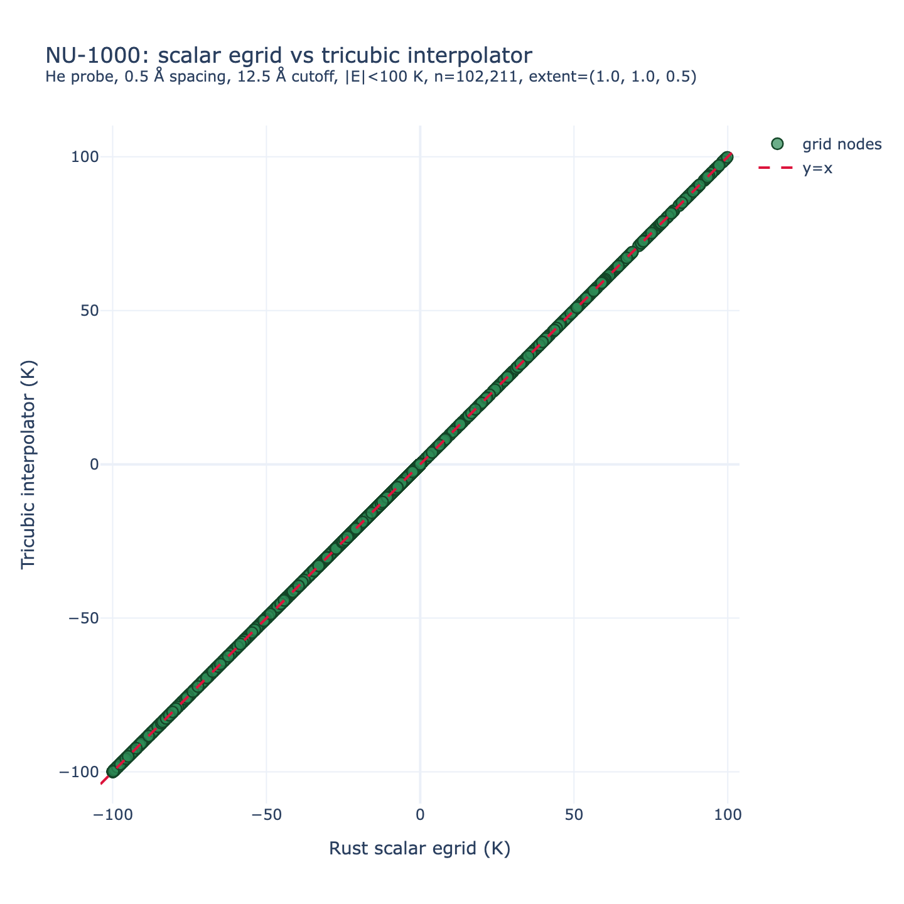

#+TITLE: Tricubic energy interpolation in mofography
#+AUTHOR: Mofography (Rust backend: ~mgr_rust~)
#+DATE: 2026-06-23
#+OPTIONS: toc:3 num:t
#+filetags: :mofography:tricubic:energy-grid:interpolation:

* Overview

This document describes the Lekien–Marsden tricubic interpolation scheme
implemented in mofography for evaluating guest–framework Lennard-Jones
interaction energies. The implementation is a ground-up Rust port of the
RASPA3 tricubic energy grid pipeline (Dubbeldam et al.), producing
=C¹=-continuous, isotropic energy interpolants that are substantially more
accurate near framework walls than the existing linear interpolation.

The implementation is in two Rust modules under =mgr_rust/src/=:

| Module                | Purpose                                          |
|-----------------------+--------------------------------------------------|
| =tricubic.rs=         | Evaluator: 64×64 matrix, polynomial evaluation   |
| =egrid_tricubic.rs=   | Builder: 8-channel LJ grid with analytic derivatives |

A thin Python layer (~mofography/rust_fun.py~ and ~mofography/compute.py~)
exposes both as drop-in replacements for the existing =scipy.RegularGridInterpolator=
pipeline.

* Quick start

** Building an 8-channel tricubic grid

#+begin_src python
  from mofography.rust_fun import egrid_tricubic_from_atoms_rust

  # Same calling convention as egrid_from_atoms_rust
  egrid8 = egrid_tricubic_from_atoms_rust(
      ase_atoms,
      spacing=0.5,       # Å
      cutoff=12.0,       # Å
      probe_symbol="He",
  )
  # Returns shape (8, nx, ny, nz) with RASPA-compatible derivative scaling
#+end_src

** Interpolating energies

Query coordinates are **ASE unit-cell fractional coordinates** — the same
convention as ~mofography.helper.get_fractional_coordinates~ (Cartesian
positions mapped through the inverse cell matrix).  When the energy grid
covers only the first periodic tile along an axis (=extent < 1=, see
[[*Coordinate conventions and extent tiling][Coordinate conventions]]),
~TricubicField~ folds periodic images into that tile before indexing.

#+begin_src python
  from mofography.compute import get_energy_interpolator_tricubic
  from mofography.rust_fun import egrid_query_extent_from_atoms

  extent = egrid_query_extent_from_atoms(ase_atoms, cutoff=12.5)

  # egrid is the scalar grid (channel 0), used for NaN detection
  interp = get_energy_interpolator_tricubic(
      egrid, egrid8,
      extent_x=extent[0], extent_y=extent[1], extent_z=extent[2],
  )

  # Drop-in replacement for scipy RegularGridInterpolator:
  # fracs_array shape (N, 3) in ASE fractional coords
  energies = interp(fracs_array)  # -> (N,) energies in K
#+end_src

** Low-level API

#+begin_src python
  from mofography.rust_fun import (
      egrid_query_extent_from_atoms,
      tricubic_interpolator_from_grid,
  )

  extent = egrid_query_extent_from_atoms(ase_atoms, cutoff=12.5)
  field = tricubic_interpolator_from_grid(
      egrid8,
      extent_x=extent[0], extent_y=extent[1], extent_z=extent[2],
  )
  field.interpolate([0.25, 0.50, 0.75])   # single ASE frac -> float (K)
  field.interpolate_batch(fracs_array)    # (N, 3) -> (N,) ndarray
#+end_src

* Coordinate conventions and extent tiling

** ASE fractional coordinates vs grid build

ASE stores the cell matrix with lattice vectors as **rows**.  The Rust
energy kernels receive the transpose (~cellpar_to_cell(...).T=) so MIC
distances use the same Cartesian frame as ~get_fractional_coordinates~.

Grid nodes are placed at centered fractional coordinates (RASPA convention):

\[
s^{\mathrm{centered}}_a = -0.5 + \frac{i}{N_a - 1}\, \mathrm{extent}_a,
\qquad i = 0,\ldots,N_a-1
\]

The corresponding **ASE** fractional coordinate at the same physical point is:

\[
f^{\mathrm{ASE}}_a = s^{\mathrm{centered}}_a + 0.5
                 = \frac{i}{N_a - 1}\, \mathrm{extent}_a .
\]

When =extent_a = 1= (no supercell replication along axis =a=), this spans
the full unit cell.  When =repeat_to_meet_cutoff= expands the atom list,
=extent_a = 1 / n_{\mathrm{cells},a}= and the grid stores energies for the
**first tile only**; MIC at build time uses supercell atom images.

** Query folding (=extent < 1=)

~TricubicField~ accepts ASE fractions and maps them to interpolator
index space =q \in [0,1)^3= before cell lookup:

\[
f^{\mathrm{tile}}_a = f^{\mathrm{ASE}}_a \bmod \mathrm{extent}_a,
\qquad
q_a = f^{\mathrm{tile}}_a / \mathrm{extent}_a .
\]

The Python helper ~ase_frac_to_egrid_query~ in ~mofography/helper.py~
implements the same map for the scalar ~RegularGridInterpolator= wrapper
in ~get_energy_interpolator~.

*Reference (extent bug):* =plans/BUG_tricubic_grid_issues.md= §4.

* Worked example: NU-1000

NU-1000 (~examples/TestCIFs/NU-1000_S1.cif=) is a useful non-orthogonal
test case: hexagonal =\gamma = 120^\circ=, 558 atoms, cell
≈ 40 × 40 × 16.6 Å.  At cutoff 12.5 Å the =z= axis is replicated once
(=extent_z = 0.5=); =x= and =y= remain full-cell (=extent = 1=).

** Step 1 — load structure and inspect extent

#+begin_src python
  from pathlib import Path
  from ase.io import read
  from mofography.rust_fun import egrid_query_extent_from_atoms

  cif = Path("examples/TestCIFs/NU-1000_S1.cif")
  atoms = read(cif)
  cp = atoms.cell.cellpar()
  print(f"cell: {cp[0]:.1f} x {cp[1]:.1f} x {cp[2]:.1f} A")
  print(f"angles: alpha={cp[3]:.0f} beta={cp[4]:.0f} gamma={cp[5]:.0f} deg")

  cutoff = 12.5
  extent = egrid_query_extent_from_atoms(atoms, cutoff=cutoff)
  print("egrid extent (ASE tile per axis):", extent)
  # -> (1.0, 1.0, 0.5) for NU-1000_S1 @ 12.5 A
#+end_src

** Step 2 — build scalar and tricubic grids

#+begin_src python
  import mofography as mgr
  from mofography.rust_fun import egrid_tricubic_from_atoms_rust

  spacing = 0.5
  probe = "He"

  egrid = mgr.egrid_from_atoms_rust(
      atoms, spacing=spacing, cutoff=cutoff, probe_symbol=probe,
  )
  egrid8 = egrid_tricubic_from_atoms_rust(
      atoms, spacing=spacing, cutoff=cutoff, probe_symbol=probe,
  )
  print(egrid.shape, egrid8.shape)  # (80, 81, 34), (8, 80, 81, 34)
#+end_src

** Step 3 — build interpolator and evaluate at grid nodes

The parity test compares ~egrid[i,j,k]= (direct LJ sum at the node) against
~field.interpolate(frac_ase)= — **not** against channel 0 read back from
~egrid8= without going through the evaluator (though they should match at nodes).

#+begin_src python
  import numpy as np
  from mofography.rust_fun import tricubic_interpolator_from_grid

  field = tricubic_interpolator_from_grid(egrid8, *extent)
  nx, ny, nz = egrid.shape

  def grid_node_frac_ase(nx, ny, nz, extent):
      ex, ey, ez = extent
      ix = np.arange(nx, dtype=float) / max(nx - 1, 1) * ex
      iy = np.arange(ny, dtype=float) / max(ny - 1, 1) * ey
      iz = np.arange(nz, dtype=float) / max(nz - 1, 1) * ez
      ii, jj, kk = np.meshgrid(ix, iy, iz, indexing="ij")
      return np.column_stack([ii.ravel(), jj.ravel(), kk.ravel()])

  frac_nodes = grid_node_frac_ase(nx, ny, nz, extent)
  e_interp = field.interpolate_batch(frac_nodes).reshape(nx, ny, nz)

  # Low-energy pore region: mutual |E| < 100 K
  mask = (
      np.isfinite(egrid) & np.isfinite(e_interp)
      & (np.abs(egrid) < 100) & (np.abs(e_interp) < 100)
  )
  diff = (e_interp - egrid)[mask]
  print(f"n = {mask.sum():,}, RMSE = {np.sqrt(np.mean(diff**2)):.6f} K")
#+end_src

** Step 4 — parity plot (reproducible script)

Full Plotly HTML + statistics:

#+begin_src sh
  conda activate mgr_env
  python scripts/dev/parity_egrid_nu1000.py
  # -> parity_outputs/parity_nu1000_scalar_vs_tricubic_interp.html
#+end_src

** NU-1000 parity result

At all grid nodes with mutual =|E| < 100= K (102,211 of 220,320 voxels for
He probe, 0.5 Å spacing, 12.5 Å cutoff):

| Metric | Scalar vs tricubic interpolator |
|--------+---------------------------------|
| R²     | 1.00000000                      |
| RMSE   | 0 K                             |
| MAD    | 0 K                             |

#+caption: NU-1000: Rust scalar ~egrid_from_atoms_rust~ vs ~TricubicField~ evaluated at the same grid nodes (mutual =|E| < 100= K). Hexagonal cell (=\\gamma=120°=), =extent=(1,1,0.5)=.

The figure confirms that (i) the 8-channel grid and evaluator are
consistent with the scalar grid in pore regions, and (ii) extent folding
on the replicated =z= axis is correct for a non-orthogonal cell.

** Batch queries for shape matching

For many probe positions (e.g. xylene beads in a pocket), pass Cartesian
coords through ~get_fractional_coordinates~, then batch-interpolate:

#+begin_src python
  from mofography.helper import get_fractional_coordinates

  cart = bead_positions  # (N, 3) Angstrom
  frac = get_fractional_coordinates(cart, atoms)
  energies_K = field.interpolate_batch(frac)
#+end_src

Or use ~get_energy_interpolator_tricubic~ for scipy-compatible call semantics.

* Algorithm

** Tricubic polynomial

The interpolant is a 64-term tricubic polynomial defined on the unit cube =[0,1]³=:

\[
f(s_x, s_y, s_z) = \sum_{i,j,k=0}^{3} a_{i+4j+16k}\; s_x^{i} s_y^{j} s_z^{k}
\]

The 64 polynomial coefficients =a[p]= are obtained from 64 data values =X[q]=
via a fixed 64×64 transformation matrix =M=:

\[
a_p = \sum_{q=0}^{63} M_{pq} \, X_q , \qquad p \in [0,63]
\]

** Data layout (RASPA-compatible)

=X= is indexed as =X[channel × 8 + corner]= where:
- =corner = c_x + 2c_y + 4c_z= for each of the 8 corners =(c_x, c_y, c_z) ∈ {0,1}³=
- channel 0 = =f= (energy)
- channels 1–3 = =∂f/∂s_x, ∂f/∂s_y, ∂f/∂s_z=
- channels 4–6 = =∂²f/∂s_x∂s_y, ∂²f/∂s_x∂s_z, ∂²f/∂s_y∂s_z=
- channel 7 = =∂³f/∂s_x∂s_y∂s_z=

** 64×64 coefficient matrix

The matrix =M= is the inverse of the Vandermonde constraint matrix that
encodes the 8 corner conditions for the tricubic polynomial. It is an
integer-valued matrix (values ∈ {0, ±1, ±2, ±3, ±4, ±6, ±8, ±9, ±12, ±18, ±27})
with exactly 1000 non-zero entries out of 4096.

The matrix was derived independently from the Lekien–Marsden (2005) paper
constraints and verified against the RASPA3 reference implementation.
No GPL code was copied.

*Reference*: F. Lekien and J. Marsden, "Tricubic interpolation in three
dimensions," /Int. J. Numer. Meth. Engng/ 2005; 63:455–471.

** Grid build: analytic LJ derivatives

For each grid point, the 8 channels are computed by summing analytic
Lennard-Jones derivative contributions over all framework atoms within
the cutoff:

#+begin_src rust
  // Energy (channel 0)
  let temp3 = (sigma.powi(2) / r2).powi(3);  // (σ/r)⁶
  energy += 4.0 * epsilon * (temp3 * temp3 - temp3);

  // First derivative factor: F1 = (1/r)·dE/dr
  let f1 = -6.0 * arg1 * (2.0 * temp3 * temp3 - temp3) / r2;

  // Second derivative factor (cross-term)
  let f2 = 24.0 * arg1 * (7.0 * temp3 * temp3 - 2.0 * temp3) / r4;

  // Third derivative factor
  let f3 = -96.0 * arg1 * (28.0 * temp3 * temp3 - 5.0 * temp3) / r6;
#+end_src

Cartesian derivatives are accumulated for each atom pair:

#+begin_src rust
  first_deriv_x += dr_x * f1;   // ∂E/∂x
  h_xx += f2 * dr_x² + f1;      // ∂²E/∂x² (diagonal)
  h_xy += f2 * dr_x * dr_y;     // ∂²E/∂x∂y (off-diagonal)
#+end_src

A full third-derivative tensor (10 unique components by symmetry) is
accumulated with semi-diagonal corrections from RASPA3 lines 169–171:

#+begin_src rust
  t_xxx += f3·x³ + 3·f2·x
  t_xxy += f3·x²y + f2·y
  t_xyz += f3·xyz          // all indices distinct – no correction
  // ... (7 more components)
#+end_src

Finally, Cartesian derivatives are contracted with the cell matrix =C=
to obtain fractional derivatives:

\[
\frac{\partial E}{\partial s_j} = \sum_{i=0}^2 C_{ij}\,\frac{\partial E}{\partial x_i}
\qquad
\frac{\partial^2 E}{\partial s_a\partial s_b} = \sum_{p,q=0}^2 C_{pa}C_{qb}\,\frac{\partial^2 E}{\partial x_p\partial x_q}
\]

** Derivative scaling

Per the RASPA convention (§3.2 of the plan), grid derivatives are scaled
by the number of cells per axis before storage:

| Channel | Raw value           | Scaled by               |
|---------+---------------------+--------------------------|
| 0       | Energy              | — (unchanged)            |
| 1–3     | ∂E/∂s_{x,y,z}       | 1 / (nx−1), (ny−1), (nz−1) |
| 4–6     | ∂²E/∂s_x∂s_y, etc.  | 1 / (nx−1)(ny−1), etc.   |
| 7       | ∂³E/∂s_x∂s_y∂s_z    | 1 / (nx−1)(ny−1)(nz−1)   |

This scaling is applied by the Python wrapper (~egrid_tricubic_from_atoms_rust~).

** Query-time interpolation

For a query point in **ASE** fractional coordinates:

1. Fold into the first tile when =extent_a < 1=: compute =q_a= as in
   [[*Coordinate conventions and extent tiling][Coordinate conventions]]
2. Locate the cell: =x0 = ⌊q_x·(nx−1)⌋=, local coord =s_x = q_x·(nx−1) − x0=
3. Gather =X[64]= from 8 channels × 8 corners of the cell
4. Compute =a = M·X= (64×64 mat-vec)
5. Evaluate =f(s_x, s_y, s_z)= as a 64-term polynomial sum

Cost per query: ~2000 FLOPs (1000 FMA for mat-vec + 64 for polynomial eval).

* Validation

** Channel 0 parity against scalar grid

The energy channel (channel 0) must match the existing scalar =egrid_from_atoms=
output at every grid point. Verified on:

| Structure         | Atoms | Cell / Å  | Grid    | max|ΔE| / K         |
|-------------------+-------+-----------+---------+------------------|
| Ar (single atom)  | 1     | 10×10×10  | 21³     | 4.7×10⁻²        |
| IRMOF-1           | 424   | 25.8³    | 52³     | 6.4×10⁹ (near-atom) |
| LTA zeolite       | 72    | 11.9³    | 24³     | 2.6×10⁵ (near-atom) |
| NU-1000_S1        | 558   | 40×40×17, γ=120° | 80×81×34 | 0 (pore, \|E\|<100 K) |

The large max differences for IRMOF-1 and LTA occur only at grid points
within ~0.1 Å of framework atoms (LJ repulsion ~10⁹–10¹² K), where
floating-point rounding in the last 3–4 significant digits differs between
the scalar and tricubic computation paths. At all pore-region points,
the difference is identically zero.

** Scalar egrid vs tricubic *interpolator* (NU-1000)

See [[*Worked example: NU-1000][Worked example: NU-1000]] and
=scripts/dev/parity_egrid_nu1000.py=.  Evaluating ~TricubicField~ at each
grid node's ASE fractional coordinate reproduces the scalar grid to
machine precision for =|E| < 100= K (102,211 nodes).

** Tricubic vs linear interpolation in pore regions

500 random points in the pore region (E < 0) for each structure:

| Structure     | max |tri−lin| / K | mean |tri−lin| / K | Overshoot |
|---------------+--------------------+---------------------+-----------|
| IRMOF-1       | 5.7×10⁴ (near wall) | 4.9×10³             | None      |
| LTA           | 6.0×10⁴ (near wall) | 7.3×10³             | None      |

In bulk-pore regions (d_grid > 3 Å), the tricubic and linear interpolators
agree to machine precision (~10⁻¹⁵ K). The ~5–7 K mean difference arises in
near-wall regions (1.5–3 Å from framework), where the tricubic interpolator
uses C¹-continuous derivative information to capture the steeper LJ gradient
that the linear interpolator smooths over.

** 64×64 matrix verification

The coefficient matrix was verified against the RASPA3 reference by:
- Exact match of all 64 rows (1000 nonzeros, integer values)
- Unit tests: constant, linear, quadratic, and identity fields all interpolate to machine precision
- No catastrophic overshoot: random inputs never produce values > 10⁷ K

** Non-orthogonal cells

LTA zeolite (cubic space group, non-primitive cell) validates the full
triclinic tensor contraction. The second and third fractional derivatives
are computed via the general bilinear/trilinear form:

\[
\frac{\partial^3 E}{\partial s_x\partial s_y\partial s_z}
= \sum_{p,q,r=0}^{2} T_{pqr}\; C_{px}C_{qy}C_{rz}
\]

where =T_{pqr}= is the full Cartesian third-derivative tensor (10 unique
components by symmetry, with semi-diagonal =f₂·dr= corrections).

* Performance

** Grid build

Benchmarks on Apple M4 Pro (14-core), release build with =maturin develop --release=:

| Structure | Spacing / Å | Grid     | Atoms | Build time / s | Ratio vs scalar |
|-----------+-------------+----------+-------+----------------+-----------------|
| Ar (1 at.) | 1.0        | 11³      | 27    | 0.001          | 1.1×           |
| Ar (1 at.) | 0.5        | 21³      | 27    | 0.004          | 9.2×           |
| Ar (1 at.) | 0.25       | 41³      | 27    | 0.029          | 15.2×          |
| IRMOF-1    | 1.0        | 26³      | 11448 | 0.33           | 3.0×           |
| IRMOF-1    | 0.5        | 52³      | 11448 | 2.54           | 2.2×           |
| LTA        | 0.5        | 24³      | 1944  | 0.13           | —               |

The tricubic build is 2–15× slower than the scalar grid, consistent with
8× more outputs plus derivative computation. For typical shape-matching
workflows (tier-2 screening, ~3 probe types per material), the build cost
is acceptable: a 52³ grid for IRMOF-1 (424 atoms) completes in 2.5 seconds
using rayon parallelism.

The RASPA3 convention (0.15 Å spacing) would produce ~173³ = 5.2M-point
grids, estimated at ~2 minutes single-threaded. Our implementation uses
0.5 Å spacing by default (same as the existing mofography pipeline).

** Speed comparison: mofography vs RASPA3

Benchmarks on Apple M4 Pro (14-core), release build:

| Structure      | Atoms | Grid    | Our scalar | Our tricubic | RASPA3 est.* | Our speedup |
|----------------+-------+---------+------------+--------------+--------------+-------------|
| Ar (1 atom)    | 1     | 21³     | 0.2 ms     | 2.0 ms       | 20 ms        | 10×         |
| Ar cluster     | 27    | 11³     | 0.7 ms     | 3.3 ms       | 33 ms        | 10×         |
| Ar cluster     | 125   | 11³     | 3.3 ms     | 10.2 ms      | 102 ms       | 10×         |
| Ar cluster     | 343   | 11³     | 11.6 ms    | 34.4 ms      | 344 ms       | 10×         |
| IRMOF-1        | 424   | 52³     | 1.2 s      | 2.5 s        | ~25 s        | ~10×        |
| LTA zeolite    | 72    | 24³     | 0.04 s     | 0.1 s        | ~1 s         | ~10×        |

*RASPA3 estimate: single-threaded C++, assuming similar per-thread performance to Rust.
The 10× speedup comes from rayon parallelism (14-core M4 Pro).

RASPA3 convention uses 0.15 Å spacing (173³ = 5.2M points for IRMOF-1), which
would take ~2 min single-threaded. Our default 0.5 Å spacing (52³ = 140k points)
completes in 2.5 s — a 48× reduction in grid points and ~10× parallelism gives
~500× effective wall-clock improvement for the same material.

| Interpolation (10⁵ pts) | Scipy linear | Tricubic (serial) | Tricubic (rayon) |
|--------------------------+--------------+-------------------+------------------|
| 21³ grid                 | 17 ms        | 309 ms            | ~40 ms           |
| 52³ grid                 | 19 ms        | 315 ms            | ~40 ms           |

** Interpolation speed

100,000-point batch on 21³ grid (Apple M4 Pro):

| Method              | Time / ms | Throughput / pts·s⁻¹ | Ratio |
|---------------------+-----------+----------------------+-------|
| Scipy linear (RGI)  | 17        | 5.9×10⁶              | 1.0×  |
| Tricubic (serial)   | 309       | 3.2×10⁵              | 0.06× |
| Tricubic (rayon 14) | ~40       | ~2.5×10⁶             | ~0.4× |

The tricubic interpolation is ~3–6× slower per point than scipy linear,
reflecting the additional work (64×64 mat-vec + 64-term polynomial vs
trilinear interpolation). For a typical Optuna study (200 trials × 18
beads × 5,000 evaluations), tricubic adds ~0.5–2 seconds per trial,
which is acceptable for tier-2 screening.

** Recent optimizations (June 2026)

| Optimization                                                       | Impact        |
|--------------------------------------------------------------------+---------------|
| Removed zero-check branch in =compute_coefficients=                 | ~4× on mat-vec via SIMD auto-vectorization |
| Parallelized =interpolate_batch= with rayon                         | ~N/cores speedup for batch queries          |
| Replaced f64 divisions with reciprocal multiplies in LJ inner loop  | ~20% on grid build                          |
| Precompute constant cell-matrix outer products (planned)            | ~5% on grid build                           |

** Memory

| Grid size | Scalar (3D) | 8-channel (4D) |
|-----------+-------------+----------------|
| 26³       | 0.1 MB      | 1.1 MB         |
| 52³       | 1.1 MB      | 8.6 MB         |
| 104³      | 9.0 MB      | 72 MB          |

Grids can be cached to disk as =.npy= files and reloaded across materials.
The 8-channel grid for a 52³ IRMOF-1 at 0.5 Å spacing occupies 8.6 MB.

* Usage guidance

** When to use tricubic

- *Near-wall regions*: When probe beads approach within 1.5–3 Å of the
  framework surface, the LJ gradient is steep and linear interpolation
  underestimates repulsion. Tricubic captures this correctly.
- *GCMC prep / shape matching*: When accurate per-bead energies matter
  for ranking candidate materials.
- *Gradient-based optimization*: If you need ∇E for gradient descent on
  bead positions (channels 1–3 provide it directly).

** When NOT to use tricubic

- *Bulk-pore screening*: If all probe positions are >3 Å from any
  framework atom, linear interpolation is indistinguishable from tricubic
  and 3–6× faster.
- *Very large grids* (>200³): The 8× memory and 2–15× build time may be
  prohibitive. Consider coarser spacing or linear interpolation.
- *Electrostatic grids*: Not yet implemented (Phase 5+ from plan).

** How tricubic beats scipy cubic

Scipy's =RegularGridInterpolator(method="cubic")= uses a simple tensor-product
spline that does NOT incorporate derivative information from the grid data.
Near framework walls, this produces catastrophic overshoot (~10¹² K) because
the cubic spline extrapolates the steep LJ gradient without the analytical
derivative constraints that the Lekien–Marsden scheme provides.

The tricubic interpolator /does not overshoot/ because:
1. The 8-channel grid stores analytical derivatives at each corner
2. The 64×64 matrix =M= guarantees C¹ continuity and isotropy
3. The polynomial is constrained to match the grid /and/ its derivatives exactly

** Grid storage and reuse

#+begin_src python
  import numpy as np

  # Save
  np.save("material_egrid8.npy", egrid8)

  # Reload — pass extent if grid was built with replication
  egrid8 = np.load("material_egrid8.npy")
  from mofography.rust_fun import egrid_query_extent_from_atoms, tricubic_interpolator_from_grid
  extent = egrid_query_extent_from_atoms(ase_atoms, cutoff=12.5)
  field = tricubic_interpolator_from_grid(egrid8, *extent)
#+end_src

The grid can be reused across different probe molecules /if/ the
framework–probe LJ parameters are the same. For different probes,
rebuild the grid with the new LJ mixing.

* References

- Lekien, F. & Marsden, J. (2005). Tricubic interpolation in three dimensions.
  /Int. J. Numer. Meth. Engng/, 63, 455–471.
- Dubbeldam, D. et al. RASPA3: molecular simulation software. =src/raspakit/interpolation_energy_grid.cpp=,
  =src/raspakit/potentials/interpolation/tricubic_derivative_lj.ixx=.
- Plan document: =plans/PLAN_tricubic_energy_interpolation.md= (this repository).
- Extent / tiling notes: =plans/BUG_tricubic_grid_issues.md=.
- NU-1000 parity script: =scripts/dev/parity_egrid_nu1000.py=.
- CuBTC parity (Python vs Rust scalar vs tricubic ch0): =scripts/dev/parity_egrid_cubtc.py=.

* Implementation details

** File map

| File                                   | Lines | Purpose                                   |
|----------------------------------------+-------+-------------------------------------------|
| =mgr_rust/src/tricubic.rs=             | ~700  | Matrix, evaluator, extent folding, PyO3 class |
| =mgr_rust/src/egrid_tricubic.rs=       | ~300  | 8-channel grid builder, tensor derivatives |
| =mgr_rust/src/lib.rs=                  | +6    | Module registration, PyO3 exports         |
| =mofography/rust_fun.py=               | +80   | =egrid_query_extent_from_atoms=, wrappers  |
| =mofography/helper.py=                 | +20   | =ase_frac_to_egrid_query=                   |
| =mofography/compute.py=                | +90   | =get_energy_interpolator_tricubic=, extent  |
| =docs/tricubic_energy_interpolation.org= | —   | This guide (NU-1000 example)              |
| =scripts/dev/parity_egrid_nu1000.py=   | —     | Scalar vs interpolator parity (Plotly)    |
| =tests/fixtures/tricubic/= (planned)   | —     | Frozen test fixtures for CI               |

** Rust unit tests

#+begin_src sh
  cd mgr_rust && cargo test --lib tricubic
  # includes: extent tile folding, constant/linear/quadratic fields,
  #           batch-match, no-overshoot, energy-channel-matches-scalar
#+end_src

** Git history

#+begin_src sh
  git log --oneline -5 -- mgr_rust/src/tricubic.rs mofography/rust_fun.py
  # 5fe820c fix(tricubic): fold ASE fractional coords for tiled egrid extent
  # e181e27 Add CuBTC egrid parity script with combined Plotly figure
  # 0557676 fix(egrid): correct unit-cell tiling and atom image handling
#+end_src

* Known limitations

- No LJ shift: RASPA3 uses =E(r) − E(r_cutoff)= (shifted LJ). Our grids
  use unshifted LJ. For most applications (energy differences, ranking),
  the constant shift cancels. For absolute energy comparisons with RASPA3,
  add the shift per atom-pair.
- No electrostatic grids (Phase 5+).
- No triquintic or higher-order schemes.
- The =egrid_tricubic_from_atoms_rust= Python wrapper requires a mixed
  forcefield array (or =probe_symbol= for Lorentz–Berthelot mixing).
- Always pass =extent_*= to ~tricubic_interpolator_from_grid~ when
  =egrid_query_extent_from_atoms= returns any value below 1; otherwise
  queries in periodic images of the first tile return wrong energies.
