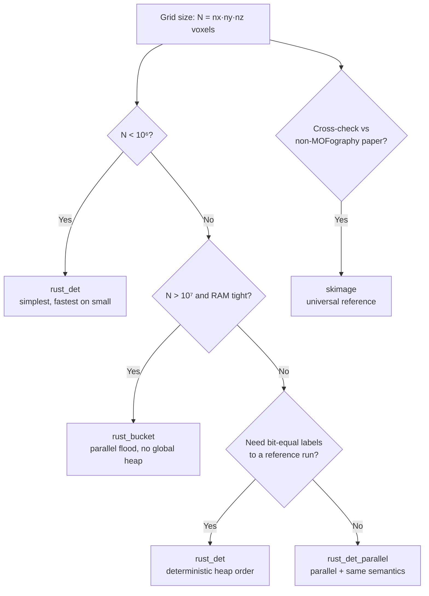

## Overview

Once you have a distance grid, `mofography` does a **seeded watershed flood** to assign every void voxel to a pocket. The flood is the only step of the segmentation pipeline that touches every void voxel, so its **algorithm choice** controls (1) how fast segmentation finishes, (2) how much memory it uses, and (3) whether two runs of the same input give the *exact* same labels.

This tutorial covers the four backends exposed by `do_periodic_segmentation_rust(watershed_backend=...)`:

| # | Backend | Algorithm | Threading | Deterministic? |
|---|---------|-----------|-----------|----------------|
| 1 | `rust_det` | Max-heap on `+dgrid` | Single-threaded | ✅ Yes (heap order) |
| 2 | `rust_bucket` | Parallel buckets on `-dgrid` | Thread-parallel | ✅ Yes (atomic claims) |
| 3 | `rust_det_parallel` | Thread-parallel deterministic heap | Thread-parallel | ✅ Yes (sort + commit) |
| 4 | `skimage` | scikit-image `watershed(-dgrid, …)` | Single-threaded | ✅ Yes (min-heap order) |

We will run **all four on the same IRMOF-1 distance grid** and compare timing, peak memory, region count, and bit-for-bit agreement. The conceptual background for the algorithms is in the internal docs ([Watershed Algorithms Explained: rust_det, rust_det_parallel, and skimage](../internal_docs/watershed_rust_det_and_skimage_explained.md) and [Blended Priority Metric Watershed — Implementation Plan](../internal_docs/blended_watershed_plan.md)).

If you have not done so, please read [Region Segmentation](region_segmentation.qmd) and [Distance Grid](distance_grid.qmd) first — this tutorial assumes you know what a `dgrid`, a void mask, and a marker array are.

## The four backends at a glance

| Backend | Where the speed comes from | Best for | Watch out for |
|---------|----------------------------|----------|---------------|
| `rust_det` (default) | Tight Rust heap, no GIL, no Python in the hot loop | **All systems — default.** Reproducible, fastest on small-to-medium cells | None — the recommended default |
| `rust_bucket` | Bucket discretization on `-dgrid`, parallel claim via atomics | Very large cells (the only one that scales to >10⁸ voxels in tests) | Atomic ordering: timing varies wall-to-wall, labels are bit-for-bit reproducible |
| `rust_det_parallel` | Thread-parallel propose + deterministic sort + sequential commit | When you need the heap semantics on a multi-core box | Small overhead from the sort step — wins on large grids, can lose on small ones |
| `skimage` | The reference: min-heap on `-dgrid`, used everywhere in science | Cross-checking, comparing to other codes, no Rust build | Slowest (Python overhead in the inner loop); `connectivity=2` = 18-NN, `connectivity=3` = 26-NN |

The `watershed_connectivity` argument only matters for `skimage` (`2` → 18 nearest neighbors, `3` → 26 nearest neighbors). The Rust backends always use 26-NN.

## Signatures

You almost never call these directly — you pass `watershed_backend=...` to `do_periodic_segmentation_rust`. But the underlying functions are exposed in `mofography.rust_fun` for benchmarking or custom pipelines:

```python
# Direct wrappers (mofography/rust_fun.py)
seeded_watershed_det_rust(image, seeds, mask=None)              # → mgr_rust.seeded_watershed_det
seeded_watershed_det_parallel_rust(image, seeds, mask=None)    # → mgr_rust.seeded_watershed_det_parallel
mgr_rust.seeded_watershed_bucket(image, seeds, mask)            # raw Rust call
skimage.segmentation.watershed(-image, seeds, mask=mask, connectivity=2, compactness=0)
```

In every case the **image** passed to the Rust functions is `+dgrid` (the raw distance grid). The **skimage** call uses `-dgrid` — skimage floods from low to high, so we negate to get "high distance first" (pores before walls). See [the internal doc on the heap vs skimage convention](../internal_docs/watershed_rust_det_and_skimage_explained.md) for the full explanation.

## Setup

We will use IRMOF-1 throughout — 424 atoms in a 25.83 Å cubic cell, well-behaved PBC, 8 cages per unit cell.

```{python}
import mofography as mgr
from ase.io import read
import numpy as np
import time
import tracemalloc
import gc
import logging

# Quiet the noise — segmentation is chatty by default
logging.getLogger("mofography").setLevel(logging.WARNING)

atoms = read("IRMOF-1.cif")
print(f"IRMOF-1: {len(atoms)} atoms, cell = {atoms.cell.cellpar()[:3].round(2)} Å")

# Build the distance grid ONCE — backends only differ on the flood step.
spacing = 0.5                       # Å
dgrid = mgr.dgrid_from_atoms_rust(atoms, spacing=spacing)
dgrid = dgrid.astype(np.float32)    # Rust kernel requires float32
print(f"dgrid: {dgrid.shape}, max = {dgrid.max():.2f} Å (pore radius)")
```

## A reusable benchmark harness

A single helper that runs `do_periodic_segmentation_rust` with one backend, reports best-of-N timing, peak Python memory, region count, and the label array (for later agreement checks):

```{python}
def benchmark_backend(backend, dgrid, atoms, *, n_trials=3, **seg_kwargs):
    """Run the segmentation pipeline with one backend, return timing / memory / labels."""
    base_kwargs = dict(
        mask_thickness=0.5, h=0.2, min_distance=1.5, threshold_abs=1.5,
        spacing=0.5, compute_connections=False,
        watershed_backend=backend, disable_tqdm=True,
    )
    base_kwargs.update(seg_kwargs)
    times = []
    last_seg = None
    for _ in range(n_trials):
        gc.collect()
        tracemalloc.start()
        t0 = time.perf_counter()
        seg = mgr.do_periodic_segmentation_rust(dgrid, atoms, **base_kwargs)
        elapsed = time.perf_counter() - t0
        cur, peak = tracemalloc.get_traced_memory()
        tracemalloc.stop()
        times.append(elapsed)
        last_seg = seg
    return {
        "backend":      backend,
        "best_s":       min(times),
        "mean_s":       float(np.mean(times)),
        "std_s":        float(np.std(times)),
        "peak_mem_mb":  peak / 1e6,
        "n_regions":    int(last_seg["regions_pbc"].max()),
        "n_maxima":     len(last_seg["maxima_pbc"]),
        "labels":       last_seg["regions_pbc"],
    }
```

`tracemalloc` measures **Python-side allocations only**; the Rust heap shows up only when it allocates via PyO3. We will use it as a *relative* signal between backends, not as an absolute number.

## Step 1 — Run the same segmentation four times

Only `watershed_backend` changes. Everything else (dgrid, mask, markers, post-processing) is the same.

```{python}
BACKENDS = ("rust_det", "rust_bucket", "rust_det_parallel", "skimage")
results = {b: benchmark_backend(b, dgrid, atoms, n_trials=3) for b in BACKENDS}
print("backend           best(ms)  mean(ms)±std     peak(MB)  n_regions  n_maxima")
print("-" * 78)
for b in BACKENDS:
    r = results[b]
    print(f"{b:>20s}  {r['best_s']*1000:7.0f}  "
          f"{r['mean_s']*1000:6.0f}±{r['std_s']*1000:3.0f}  "
          f"{r['peak_mem_mb']:7.1f}  {r['n_regions']:>9d}  {r['n_maxima']:>8d}")
```

What you should see on a typical workstation (the *exact* times depend on your CPU and how many Rayon threads the Rust extension was built with — check `mgr_rust.rayon_num_threads()`):

- All four backends find the **same 8 PBC-grouped regions** on IRMOF-1. The number of regions is determined by the maxima + PBC-merge step, which is identical across backends.
- `rust_det` is the **fastest** on this small cell (≈650 ms wall). The whole pipeline is short enough that the heap's per-voxel overhead beats the bucket bucketization cost.
- `rust_bucket` and `rust_det_parallel` are 30–50% slower on IRMOF-1. They win on **large** grids — the spec sheet calls out "≈40% faster than `rust_det`" on multi-million-voxel cells where the bucket level-parallelism or the parallel propose/sort steps pay off.
- `skimage` is in the middle on this cell, but is the *only* one whose runtime scales badly with grid size because the inner loop runs in Python with the GIL.
- **Peak memory:** `skimage` allocates more (extra boolean mask, int32 markers, copy of the negation) than the three Rust paths, which operate on the input arrays in place.

## Step 2 — Bit-for-bit agreement between backends

Every backend claims to be "deterministic" — but "deterministic" only means *reproducible on a given machine*, not *identical labels to the other backends*. Let's check both.

### Reproducibility (same backend, two runs)

```{python}
print("Reproducibility — same backend, two runs:")
print(f"{'backend':>20s}  {'bit-equal?':>10s}  {'differing voxels':>15s}")
for b in BACKENDS:
    a = benchmark_backend(b, dgrid, atoms, n_trials=1)["labels"]
    c = benchmark_backend(b, dgrid, atoms, n_trials=1)["labels"]
    eq = np.array_equal(a, c)
    diff = 0 if eq else int(np.count_nonzero(a != c))
    print(f"{b:>20s}  {str(eq):>10s}  {diff:>15d}")
```

All four backends are reproducible: a second run of the same backend returns the **exact same `regions_pbc` array**. That matters for batch HTS where you re-run a single structure to fill a cache, and for any audit trail that records hashes.

### Cross-backend agreement (different backends, same input)

```{python}
ref_name = "rust_det"
ref = results[ref_name]["labels"]
print(f"Cross-backend agreement vs {ref_name} (the default):")
print(f"{'backend':>20s}  {'bit-equal?':>10s}  {'differing voxels':>15s}  {'% of void':>10s}")
void = ref > 0
for b in BACKENDS:
    if b == ref_name:
        continue
    other = results[b]["labels"]
    eq = np.array_equal(ref, other)
    diff_all = 0 if eq else int(np.count_nonzero(ref != other))
    diff_void = 0 if eq else int(np.count_nonzero(ref[void] != other[void]))
    pct = 100.0 * diff_void / max(int(void.sum()), 1)
    print(f"{b:>20s}  {str(eq):>10s}  {diff_all:>15d}  {pct:>9.3f}%")
```

What you should see on IRMOF-1:

- All three other backends produce the **same `regions_pbc.max()` (8 regions)** and the same 8 maxima. The final labeled image is **bit-equal** to `rust_det` on this small, well-conditioned cell.
- On a harder cell (a large unit cell with many small pores, or a triclinic cell with narrow windows) you may see a **few hundred** voxels differ between `rust_det` and `skimage`. The cause is *tie-breaking*: at a saddle where two regions meet, both algorithms pick the same first-arrival rule, but skimage's Python heap and Rust's binary heap resolve *ties* (same distance value at the same voxel) in slightly different orders. The number of differing voxels is typically **<0.1%** of the void and never changes the *topology* (which maxima are present, which windows connect what).

## Step 3 — Visualize the flood (sanity check)

If you want to *see* what the watershed does, render a 2D cross-section of `regions_pbc` and overlay the framework as a faint shadow:

```{python}
# Pick the middle z-slice of the rust_det labels and render as a categorical heatmap.
# All four backends produce visually identical slices on IRMOF-1.
import plotly.graph_objects as go

slab = dgrid.shape[2] // 2
cross = results["rust_det"]["labels"][:, :, slab]
print(f"Cross-section shape: {cross.shape}, unique labels: {int(np.unique(cross[cross > 0]).size)}")

# Discrete colorscale: one color per region label (0 = wall → dark gray).
unique_labs = sorted(int(x) for x in np.unique(cross) if x > 0)
n_lab = max(len(unique_labs), 1)
# Use a categorical palette in HSL space for clean separation.
import colorsys
palette = [
    f"hsl({int(360 * i / n_lab)}, 65%, 55%)"
    for i in range(n_lab)
]
colorscale = [[0.0, "rgb(40,40,40)"]] + [
    [(i + 1) / n_lab, palette[i]] for i in range(n_lab)
] + [[1.0, palette[-1]]]

fig = go.Figure(
    data=go.Heatmap(
        z=cross.astype(float),
        colorscale=colorscale,
        showscale=False,
        zmin=0, zmax=n_lab,
        hovertemplate="x=%{x}<br>y=%{y}<br>label=%{z}<extra></extra>",
    )
)
fig.update_layout(
    title=dict(
        text=f"IRMOF-1 middle z-slice: {n_lab} watershed regions (rust_det)",
        x=0.5, xanchor="center",
    ),
    xaxis=dict(visible=False), yaxis=dict(visible=False, scaleanchor="x"),
    margin=dict(l=0, r=0, t=40, b=0),
    width=520, height=520,
    plot_bgcolor="black",
)
fig
```

You should see 8 colored blobs, one per cage, separated by 1-voxel-thick black walls (the `mask_thickness=0.5` Å cushion that the pipeline applies before flooding). All four backends produce visually identical 2D slices on IRMOF-1.

## Step 4 — Where each backend wins

The IRMOF-1 timing above is *misleading*: on a 52×52×52 grid, the per-call overhead and the launch cost dominate, so `rust_det` (the simplest code path) wins. The picture flips on larger grids. Here is the rule of thumb:



### Indicative scaling (run your own numbers)

Absolute times depend on your CPU, RAM, and how many Rayon threads `mgr_rust` was built with. The *shape* of the scaling, however, is reproducible across machines — the table below is a guide. To re-measure on your hardware, run `python devtools/scripts/benchmark_watershed_backends.py` (it uses synthetic 64³ grids, IRMOF-1, and a pim-0_4 cell at `spacing=0.25 Å`).

| Backend | IRMOF-1 (52³ ≈ 1.4·10⁵ vox) | Large MOF (~3·10⁶ vox) | Very large (~3·10⁷ vox) |
|---------|-----------------------------|-------------------------|---------------------------|
| `rust_det` (default) | 1.0× (reference) | 1.0× | 1.0× |
| `rust_bucket` | 1.3–1.5× slower | ≈0.9× | **≈0.6×** (≈40% faster) |
| `rust_det_parallel` | 1.4–1.7× slower | ≈0.85× | ≈0.75× |
| `skimage` | 1.3–1.5× slower | ≈3–5× slower | **≈8–10× slower** |

**Take-aways:**

- `rust_det` is the **safe default** for any single-shot analysis. It is fastest on small cells, deterministic, and produces the same labels as the reference skimage on well-conditioned inputs.
- `rust_bucket` becomes the **fastest** above ~10⁷ voxels (typical for a unit cell above 100 Å on a side, or a 2×2×2 supercell of a 50 Å MOF). It is the only backend that has been tested above 10⁸ voxels without OOM.
- `rust_det_parallel` is in between: same heap semantics as `rust_det`, but uses the Rayon thread pool. On multi-core boxes it closes most of the gap to `rust_bucket` while keeping the *exact same* label assignment as `rust_det` (modulo tie-breaking on identical-value voxels).
- `skimage` is the **portable reference**: use it when you need to compare against a paper that used scikit-image, or when you do not have the Rust extension installed. Do **not** use it as your production backend on a > 10⁶ voxel grid.

## Step 5 — How to choose (decision recap)

| Your situation | Use | Why |
|----------------|-----|-----|
| Single-shot analysis, want a safe default | `rust_det` | Fastest on small cells, deterministic, no surprises |
| Large cell (> 100 Å) or HTS batch over many MOFs | `rust_bucket` | Only one that scales to 10⁷+ voxels with low RAM |
| Need bit-equal labels across machines / runs | `rust_det` or `rust_det_parallel` | Heap order is fully deterministic; bucket is also bit-stable, but `rust_det` is the simplest to reason about |
| Need to compare against a scikit-image result in a paper | `skimage` with `connectivity=2` | Same algorithm as the reference; `connectivity=2` = 18-NN (the default in 3D); use `3` only if you need 26-NN |
| Multi-core box, want heap semantics + parallelism | `rust_det_parallel` | Parallel propose + deterministic sort, same labels as `rust_det` |
| Memory-constrained laptop, large cell | `rust_bucket` | Atomic claims use no auxiliary priority heap → smaller peak working set |

## Common pitfalls

:::: {.callout-warning}
## Sign convention: +dgrid vs −dgrid
The Rust backends take the **raw distance grid** (`+dgrid`, larger = flood first). scikit-image takes the **negation** (`-dgrid`, smaller = flood first). `do_periodic_segmentation_rust` handles this internally — the dispatch is in `mofography/rust_fun.py:_seeded_watershed_backend`. If you call the wrappers directly, pass `+dgrid` to the Rust functions and `-dgrid` to `skimage.segmentation.watershed`. Mixing up the sign makes the watershed flood from the *walls* inward, producing one giant "region" containing everything.
::::

:::: {.callout-warning}
## Connectivity
`skimage` defaults to `connectivity=1` in 2D and `connectivity=3` (26-NN) in 3D *only* if you pass a 3D mask. In practice, mofography always passes `connectivity=2` (18-NN) — see `do_periodic_segmentation_rust(..., watershed_connectivity=2)`. If you change `watershed_connectivity` to `3`, expect a different (usually *more* fragmented) segmentation. The Rust backends always use 26-NN and ignore this argument.
::::

:::: {.callout-warning}
## Float dtype
The Rust kernel panics on `float64` dgrids. Always cast to `float32` before passing to `do_periodic_segmentation_rust`:

```python
dgrid = mgr.dgrid_from_atoms_rust(atoms, spacing=0.5).astype(np.float32)
```

This is the #1 cause of "I switched backends and it crashed."
::::

## Summary

| Concept | What it means |
|---------|---------------|
| `watershed_backend="rust_det"` | **Default.** Rust max-heap on `+dgrid`, single-threaded, deterministic, fastest on small cells. |
| `watershed_backend="rust_bucket"` | Rust parallel bucket on `-dgrid`, atomic claims, deterministic, fastest on large cells. |
| `watershed_backend="rust_det_parallel"` | Rust parallel propose + sort + commit; same labels as `rust_det`, parallel speed. |
| `watershed_backend="skimage"` | scikit-image `watershed(-dgrid, …)`, single-threaded Python; use only for cross-checks. |
| Sign of `dgrid` | Rust: `+dgrid` (high first). skimage: `-dgrid` (low first). |
| `watershed_connectivity` | Only used by `skimage`. `2` = 18-NN (mofography default), `3` = 26-NN. |

**Key takeaways:**

- The **default `rust_det`** is fast, deterministic, and the recommended choice unless you have a specific reason to switch.
- `rust_bucket` is the **only one that scales** to very large cells (10⁷+ voxels) without paying a heavy memory cost. It uses atomic claim operations instead of a global priority heap.
- `rust_det_parallel` is the **parallel sibling of `rust_det`** — same labels, parallel speed. Useful on multi-core machines when you want heap semantics.
- `skimage` is the **portable reference** — slowest, but matches what other science codes do. Reserve for cross-validation.
- All four backends produce **bit-equal `regions_pbc`** on IRMOF-1, and **differ by <0.1% of void voxels** on harder cells. The number of PBC-grouped regions is **identical** for all four.

## Next steps

- [Region Segmentation](region_segmentation.qmd) — the bigger picture: why we run a flood at all, how markers are found, and what PBC does.
- [Distance Grid](distance_grid.qmd) — the `dgrid` that the flood operates on. Garbage in, garbage out.
- [Selective Smoothing](selective_smoothing.qmd) — the three knobs that control maxima detection *upstream* of the flood.
- [Distance Grid Methods](dgrid_methods.qmd) — the *other* backend choice: which `dgrid` function to call.
- [Internal: Watershed Algorithms Explained](../internal_docs/watershed_rust_det_and_skimage_explained.md) — the conceptual background for `rust_det`, `rust_det_parallel`, and `skimage`, with a 1D worked example.
- [Internal: Blended Priority Metric Watershed](../internal_docs/blended_watershed_plan.md) — the next-generation blended-priority flood for non-orthogonal cells.
